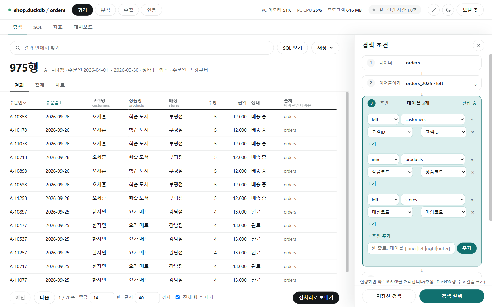
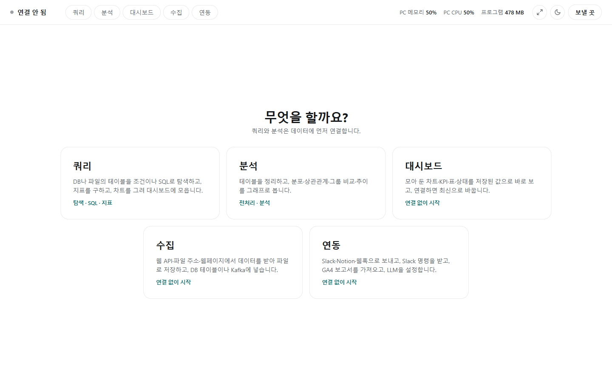

# ibis_search

DB·DW나 내 데이터 파일(DuckDB, Parquet, CSV, JSON, Excel)에 연결해 조건이나 SQL로 검색하고, 표·집계·차트로 보는 Windows 프로그램입니다. DB의 데이터는 읽기만 하고 바꾸지 않습니다.



화면에 보이는 데이터는 설명을 위해 지어낸 예시입니다.

| 화면 | 하는 일 | 자세히 |
|---|---|---|
| 쿼리 | 조건을 골라 탐색, SQL 직접 쓰기·질문으로 SQL 만들기, 지표, 차트. 실행 전에 처리 용량 안내 | [docs/query.md](docs/query.md) |
| 분석 | 컬럼마다 전처리해 새 파일·테이블로, 분포·상관관계·그룹 비교·추이 그래프 | [docs/analysis.md](docs/analysis.md) |
| 수집 | 웹 API·파일 주소·웹페이지에서 받아 저장, DB 테이블·Kafka에 적재, 업로드 기록, 예약 실행 | [docs/collect.md](docs/collect.md) |
| 연동 | Slack·Notion·웹훅으로 보내기, Slack `/ibis` 명령, GA4 가져오기, LLM 설정 | [docs/integrations.md](docs/integrations.md) |

대시보드 화면(저장된 값으로 보기, 기준일·기간·최신화·실시간)은 [docs/dashboard.md](docs/dashboard.md)(카드 종류는 [docs/dashboard_cards.md](docs/dashboard_cards.md))에 있습니다.

화면 설정, 진행 상황과 취소, 기억되는 것, DB별 드라이버는 [docs/settings.md](docs/settings.md)에 있습니다.

## 프로그램 받기

1. GitHub 저장소의 Actions 탭 → `build-exe` → `Run workflow`를 누릅니다.
2. 완료된 실행 화면 아래 Artifacts에서 `ibis_search-windows`(zip)를 내려받습니다.
3. 압축을 풀고 `ibis_search.exe`를 실행합니다. 폴더 안의 다른 파일은 지우지 않습니다.

서명되지 않은 프로그램이라 Windows SmartScreen 경고가 나오면 [추가 정보] → [실행]을 누릅니다.

프로그램은 자체 창으로만 열립니다. 브라우저로는 열 수 없습니다.

## 화면 고르기

실행하면 첫 화면에서 [쿼리] [분석] [대시보드] [수집] [연동] 중 하나를 고릅니다. 쿼리와 분석은 먼저 [데이터에 연결](docs/query.md#연결)하고, 수집과 연동은 연결 없이 들어갑니다.



- 들어간 뒤에는 위쪽 줄의 [쿼리] [분석] [대시보드] [수집] [연동]으로 오갑니다. 쿼리 화면 안에서는 [탐색] [SQL] [지표] 탭으로 오갑니다.
- 연결은 쿼리와 분석이 함께 씁니다. 수집이 도는 동안에도 쿼리·분석을 할 수 있습니다.
- 위쪽 줄에는 지금 연결, 메모리·CPU, 진행 중인 작업과 [취소], 크기 조절·화면 모드, [보낼 곳]이 있습니다.
- 화면을 오가면 넣어 둔 조건은 사라집니다. [검색 저장](docs/query.md#탐색-오른쪽-패널-18번)으로 남겨 두고, 결과를 분석으로 넘길 때는 [전처리로 보내기](docs/query.md#결과에서-할-수-있는-것)를 씁니다.

## 빠르게 써 보기

쿼리 화면의 탐색 탭에서, 오른쪽 "검색 조건" 패널을 위에서 아래로 진행합니다.

1. **데이터**: 폴더 경로를 넣고 [찾기] → 파일을 고르고 [연결] → 기준 테이블을 고릅니다.
2. **조건**: 5번 "조건"을 펼쳐 컬럼, 연산자, 값을 고르고 [추가]합니다.
3. **검색**: 패널 아래의 [검색 실행]을 누릅니다. 그 위에 실행하면 처리할 용량이 미리 나옵니다.

가운데에 행 수와 결과 표가 나옵니다. [집계] [차트] 탭에서 집계와 차트를 보고, [저장▾]으로 CSV·Excel·Parquet 파일로 받습니다. 이어붙이기·조인·기간·정렬·표시 컬럼은 필요할 때만 넣습니다.

## 안전하게 쓰기

- **데이터를 바꾸지 않습니다.** 검색·SQL은 읽기만 하는 SELECT 하나만 실행하고, 바꾸는 문장은 막습니다. DB에 쓰는 일은 전처리의 새 테이블 만들기와 수집의 적재뿐입니다.
- **비밀번호는 저장하지 않습니다.** DB·Kafka 비밀번호는 쓸 때마다 입력합니다. 토큰·키는 서비스마다 암호화 저장, 이번 실행 동안만, 환경변수 중에서 고릅니다.
- **바깥으로 보내는 것은 정한 것뿐입니다.** 보낼 곳·Slack 봇·GA4·LLM을 설정하고 쓸 때만 그 서비스와 통신합니다. LLM에는 데이터 값을 보내지 않고, LLM이 만든 SQL은 사람이 확인하고 실행합니다.
- **요금이 나오는 DB**는 [처리 용량](docs/query.md#탐색-오른쪽-패널-18번)과 [SQL 보기]로 미리 확인합니다. BigQuery의 처리 용량은 요금 없는 dry run으로 셉니다. [실행 계획]은 조회를 돌리지 않고(EXPLAIN) 인덱스를 타는지, 테이블 전체를 읽는지 보여 줍니다.
- 운영 DB에는 읽기 전용(적재는 적재 전용) 계정을 권합니다.

주제별 자세한 내용은 [안전하게 쓰기(자세히)](docs/settings.md#안전하게-쓰기-자세히)에 있습니다.

## 소스로 실행하기

exe를 만들지 않고 같은 프로그램 창을 띄울 수 있습니다.

```bash
pip install -r requirements.txt
```

```bash
python desktop.py
```

고친 뒤에는 검사를 돌립니다. 지어낸 데이터를 만들어 서버의 기능을 확인하며, 실제 설정 파일은 건드리지 않습니다. 저장소에 올리면 GitHub Actions에서도 같은 검사가 돕니다.

```bash
python tests.py
pip install -r requirements-dev.txt
python -m pytest tests_pytest -q
```

`tests_pytest`는 비밀번호·토큰이 저장되지 않는지, 사용 횟수 순서, 예전 설정 파일 읽기와 `.bak`, 시작할 때 무거운 라이브러리를 올리지 않는지, 테이블별 전처리 기억, 표본 방법의 차례, SQL 검사와 가상 테이블, 중첩 컬럼, 지표, NL2SQL과 LLM 어댑터, Slack·Notion·GA4 어댑터, 업로드 기록, 처리 용량을 확인합니다. 바깥 서비스(Slack, Notion, Google, LLM, Kafka)에는 보내지 않고 가짜로 바꿔 끼워 확인합니다.

DuckDB, Parquet, CSV 외의 DB에 접속하려면 해당 백엔드를 추가로 설치합니다. 설치되지 않은 DB에 접속하면 프로그램이 이 명령을 안내합니다.

```bash
pip install 'ibis-framework[mssql]'      # [] 안은 DB 이름: oracle, clickhouse, snowflake 등
```

## 라이선스

MIT 라이선스로 배포합니다. 전문은 [LICENSE](LICENSE)에 있습니다. 함께 들어 있는 Chart.js(`static/chart.umd.min.js`)도 MIT 라이선스입니다.
