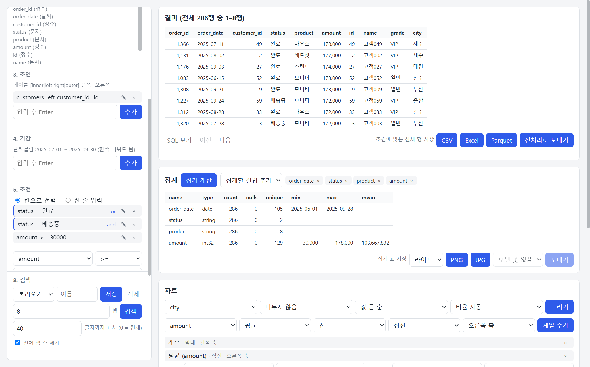
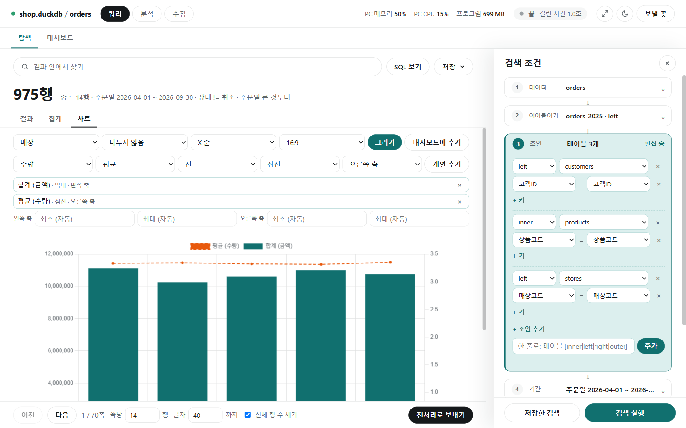
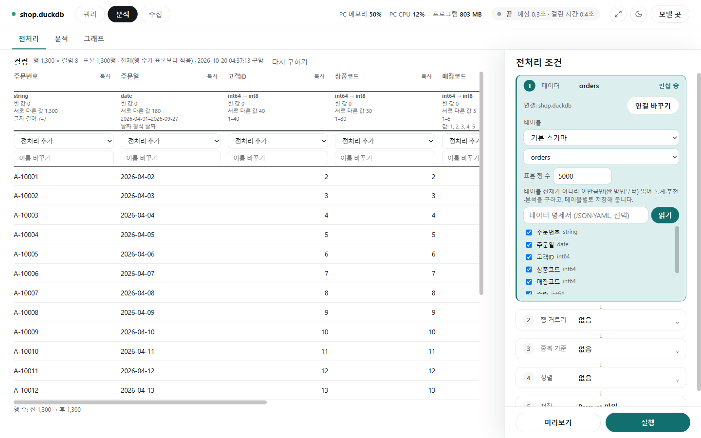

# ibis_search

DB·DW 또는 내 데이터 파일(DuckDB, Parquet, CSV, JSON, Excel)에 연결해, 테이블·조인·기간·조건을 골라 검색하는 Windows 프로그램입니다. 결과를 표와 집계, 차트로 보고 파일로 저장합니다. DB의 데이터는 읽기만 하고 바꾸지 않습니다.

전처리 화면도 함께 들어 있습니다. 테이블 하나를 골라 컬럼마다 정리 방법을 정하고, 결과를 새 파일이나 새 테이블로 만듭니다. 사용법은 [전처리](#전처리)에 있습니다.

수집 화면에서는 웹 API, 파일 주소, 웹페이지에서 데이터를 받아 Parquet·CSV로 저장하고, DB 테이블이나 Kafka 토픽에 적재합니다. 사용법은 [수집](#수집)에 있습니다.


화면에 보이는 데이터는 설명을 위해 지어낸 예시입니다. 아래의 다른 그림도 같습니다.

## 할 수 있는 일

| 하는 일 | 내용 |
|---|---|
| 연결 | DuckDB 파일, 여러 개의 Parquet·CSV·JSON·Excel 파일, 주소로 접속하는 DB 20여 종 |
| 검색 만들기 | 조인, 기간, 조건(and/or 묶음), 정렬, 표시 컬럼을 골라 넣고, 넣은 줄을 고치고, 이름을 붙여 저장 |
| 결과 보기 | 표(쪽 넘기기, 머리글 정렬), 컬럼별 집계, 여러 계열을 겹친 차트 |
| 대시보드 | 차트를 카드로 모아 보기, 여러 개를 골라 비율(1:1·4:3·16:9 등)을 정해 PNG·JPG로 각각 저장, 이름을 붙여 저장하고 다시 열기 |
| 내보내기 | 결과를 CSV·Excel·Parquet으로, 집계 표와 차트를 PNG·JPG로, 차트 값을 CSV로 |
| 돌리기 전에 확인 | DB에 보내질 SQL 보기, 예상 시간 |
| 도는 동안 | 걸린 시간과 메모리·CPU 표시, 취소 |
| 수집 | 웹 API(여러 쪽), 파일 주소, 웹페이지(클릭으로 지정)에서 받아 Parquet·CSV로, DB 테이블·Kafka에 적재. 사용 한도를 지키며 받고, 끊기면 이어 받기. 예약 실행 |

## 목차

- [프로그램 받기](#프로그램-받기)
- [화면 고르기](#화면-고르기)
- [빠르게 써 보기](#빠르게-써-보기)
- [연결](#연결)
- [검색 만들기](#검색-만들기)
- [조건](#조건)
- [검색하기](#검색하기)
- [결과](#결과)
- [차트](#차트)
- [대시보드](#대시보드)
- [전처리](#전처리)
- [수집](#수집)
- [다른 앱으로 보내기](#다른-앱으로-보내기)
- [진행 상황과 취소](#진행-상황과-취소)
- [화면 설정](#화면-설정)
- [안전하게 쓰기](#안전하게-쓰기)
- [기억되는 것](#기억되는-것)
- [소스로 실행하기](#소스로-실행하기)
- [DB별 드라이버](#db별-드라이버)
- [라이선스](#라이선스)

## 프로그램 받기

1. GitHub 저장소의 Actions 탭 → `build-exe` → `Run workflow`를 누릅니다.
2. 완료된 실행 화면 아래 Artifacts에서 `ibis_search-windows`(zip)를 내려받습니다.
3. 압축을 풀고 `ibis_search.exe`를 실행합니다. 폴더 안의 다른 파일은 지우지 않습니다.

서명되지 않은 프로그램이라 Windows SmartScreen 경고가 나오면 [추가 정보] → [실행]을 누릅니다.

프로그램은 자체 창으로만 열립니다. 브라우저로는 열 수 없습니다.

## 화면 고르기

실행하면 첫 화면에서 [쿼리](탐색·대시보드), [분석](전처리·분석·그래프), [수집] 중 하나를 고릅니다. 쿼리와 분석은 가운데 연결 카드에서 먼저 [연결](#연결)합니다.


- 들어간 뒤에는 위쪽 줄의 [쿼리] [분석] [수집]으로 오갑니다. 위쪽 줄에는 지금 연결과 테이블(`shop.duckdb / orders`), PC·프로그램의 메모리와 CPU, 진행 중인 작업(예상·걸린 시간·[취소]), 크기 조절·화면 모드 버튼, [보낼 곳]이 있습니다.
- 연결은 쿼리와 분석이 함께 씁니다. 한쪽에서 연결했으면 다른 쪽에서 다시 연결하지 않아도 됩니다.
- 수집은 연결을 쓰지 않습니다. 수집이 도는 동안에도 쿼리·분석을 할 수 있습니다.
- 화면을 오가면 넣어 둔 조건이나 전처리 선택은 사라집니다. 검색 쪽은 [검색 저장](#검색-저장과-불러오기)으로 남겨 둘 수 있습니다.
- 검색한 결과를 전처리로 넘기려면 결과 표 아래의 [전처리로 보내기](#전처리로-보내기)를 누릅니다.

## 빠르게 써 보기

아래는 검색 화면의 순서입니다. 전처리 화면은 [전처리](#전처리)에 있습니다.


오른쪽 "검색 조건" 패널의 단계를 위에서 아래로 진행합니다. 단계를 누르면 그 자리에서 펼쳐 고치고, 접힌 단계에는 요약이 보입니다.

1. **데이터**: 폴더 경로를 넣고 [찾기] → 파일을 고르고 [연결] → 기준 테이블을 고릅니다.
2. **조건**: 5번 "조건"을 펼쳐 컬럼, 연산자, 값을 고르고 [추가]. 필요한 만큼 반복합니다.
3. **검색**: 패널 아래쪽의 [검색 실행]을 누릅니다.

가운데에 큰 글씨로 행 수와 조건 요약, 결과 표가 나옵니다. 결과 위의 [집계], [차트] 탭에서 컬럼별 집계를 보고 차트를 그리며, [저장▾]으로 결과를 파일로 저장합니다.

이어붙이기, 조인, 기간, 정렬, 표시 컬럼은 필요할 때만 넣습니다. 시간이 걸리는 버튼은 진행되는 동안 잠기고, 위쪽 줄의 작업 표시에서 [취소]로 멈출 수 있습니다. 패널은 오른쪽 위 ×로 닫고 [검색 조건]으로 다시 엽니다.

## 연결

첫 화면에서 [쿼리]나 [분석]을 누르면 가운데에 "데이터 연결" 카드가 뜹니다. 연결하면 고른 화면으로 넘어갑니다. 이미 연결돼 있으면 카드 없이 바로 넘어갑니다.

- 쿼리·분석 화면에서 연결을 바꾸려면 위쪽 줄 왼쪽의 연결 이름을 누르거나, 쿼리 화면의 1번 "데이터"·분석 화면의 "1. 연결"에서 [연결 바꾸기]를 누릅니다.
- 연결 없이 쿼리·분석 화면을 열면 카드가 저절로 뜨고, 연결하기 전에는 닫을 수 없습니다.
- 마지막으로 연결한 폴더나 주소, 아이디는 다음 실행 때 칸에 채워져 있습니다.

맨 위의 [최근 연결]에는 연결에 성공했던 폴더와 주소가 많이 쓴 순서로 쓴 횟수와 함께 나옵니다(30개까지). 고르면 칸을 채우고, 비밀번호는 저장하지 않으므로 DB 주소면 비밀번호를 다시 넣고 [연결]을 누릅니다.

### 내 폴더 파일

폴더나 파일 경로를 넣고 [찾기](또는 Enter)를 누릅니다.

- **찾을 종류**: 경로 아래의 DuckDB, Parquet, CSV, JSON, Excel 중 체크한 종류만 찾습니다. 확장자는 `.duckdb`, `.parquet`, `.csv`, `.json`·`.jsonl`·`.ndjson`, `.xlsx`이고 대소문자는 가리지 않습니다.
- **하위 폴더까지 찾기**: 체크하면 하위 폴더도 찾습니다(기본). 이름이 `.`으로 시작하는 폴더는 찾지 않습니다.
- **파일 경로**: 경로가 파일이면 그 파일 하나만 봅니다. 테이블 파일이 하나뿐이면 바로 고른 상태가 되어 [연결]만 누르면 됩니다.

**DuckDB 파일**은 목록에서 하나를 고르고 [연결]을 누릅니다.

**Parquet·CSV·JSON·Excel 파일**은 여러 개를 골라 엽니다.

1. 목록에서 [테이블 파일 고르기]를 고릅니다. 찾은 파일이 체크 목록으로 나옵니다. 처음에는 아무것도 체크되어 있지 않습니다.
2. 쓸 파일만 체크합니다. [모두 선택]으로 한꺼번에 체크할 수 있고, 고른 개수가 옆에 표시됩니다.
3. [연결]을 누릅니다.

고른 파일마다 테이블이 하나씩 생깁니다. JSON은 줄마다 객체 하나인 형식과 객체 배열(`[{…}, …]`) 형식을 열고, Excel은 첫 시트를 엽니다. 파일 이름이 테이블 이름이 되고, 고른 파일 중 이름이 같은 것이 여럿이면 `폴더_이름_확장자`(예: `sub_orders_csv`)로 구분합니다.

**작업 메모리 상한**

DuckDB 파일을 조회할 때 쓰는 메모리의 최대치를 정합니다. 제한 없음(기본), 1GB, 2GB, 4GB, 8GB 중에서 고르거나, [직접 입력]을 골라 GB 단위로 넣습니다(0.256에서 1,000 사이, 소수 가능). 다음 [연결]부터 적용됩니다.

- 큰 테이블의 집계나 정렬은 메모리를 많이 씁니다. 2천만 행 테이블의 집계가 제한 없이는 2.8GB까지 썼고, 2GB로 두면 2.0GB, 1GB로 두면 1.2GB 안에서 끝났습니다. 대신 조금 느려집니다.
- 너무 낮으면 "메모리가 모자랍니다"로 실패할 수 있습니다. 그때는 상한을 올리거나 조건을 좁힙니다.
- 상한을 두면 넘치는 부분을 임시 폴더(`%TEMP%\ibis_search\` 아래)에 잠시 씁니다. 이 폴더는 연결을 끊거나 프로그램을 닫을 때 지워집니다.
- Parquet·CSV·JSON·Excel 파일 연결과 DB 주소 연결에는 적용되지 않습니다. DB 주소로 연결하면 계산은 DB 서버가 합니다.

**쿼리가 끝난 뒤의 메모리**

검색, 집계, 차트, 저장이 끝나면 결과만 남기고, 쿼리하며 올린 데이터는 메모리에서 비웁니다. 다음 쿼리는 필요한 만큼 다시 읽어 올립니다.

- 내 폴더의 DB 파일과 Parquet·CSV·JSON·Excel 파일 연결에 해당합니다. 쿼리하는 동안에는 메모리를 많이 쓸 수 있지만, 끝나면 연결 직후와 비슷한 수준으로 돌아갑니다.
- DB 주소로 연결한 DB·DW(Snowflake 등)는 서버가 계산하고 프로그램은 결과만 받으므로 비울 것이 없습니다. 비우려고 서버에 쿼리를 더 보내지도 않습니다.

### DB 주소

연결 주소(예: `duckdb://data.duckdb`, `mssql://host:1433/db`)와 아이디, 비밀번호를 넣고 [연결]을 누릅니다. 필요 없는 항목은 비웁니다. DB별 주소 형식은 [DB별 드라이버](#db별-드라이버)에 있습니다.

60초 안에 연결되지 않으면 기다리기를 멈추고 알려 줍니다. 주소가 틀렸거나 네트워크가 막혀 있을 때입니다.

### 연결을 바꾸거나 끊을 때

- **다시 연결**: 새로 연결하면 이전 연결은 닫히고, 이전에 고른 테이블과 조건은 비워집니다.
- **연결 실패**: 없는 파일이나 틀린 주소로 연결에 실패하면 이전 연결이 그대로 유지됩니다.
- **[모두 해제]**: 체크를 모두 풉니다. 이때 지금 연결이 무엇이냐에 따라 다르게 동작합니다.

| 지금 연결 | [모두 해제]를 누르면 |
|---|---|
| Parquet·CSV·JSON·Excel 파일 | 연결을 끊고 화면이 연결 전 상태로 돌아갑니다. 파일을 다시 고르고 [연결]을 누르면 새로 연결됩니다. |
| DuckDB 파일, DB 주소 | 연결은 그대로 두고, 고른 테이블과 조건, 결과 표·집계·차트만 비웁니다. 테이블을 다시 고르면 이어서 씁니다. |

## 검색 만들기

검색 조건 패널의 2번부터 7번까지가 검색의 내용입니다. 검색 전까지는 테이블 이름과 컬럼 정보만 읽고, [검색 실행]을 누를 때 연산합니다.

### 넣고, 고치고, 빼기

기간, 조건, 정렬, 표시 컬럼은 모두 같은 방식으로 다룹니다(이어붙이기와 조인은 칸으로 고릅니다).

| 하는 일 | 방법 |
|---|---|
| 넣기 | 한 줄을 입력하고 Enter나 [추가] |
| 고치기 | 목록의 `✎`를 누르면 그 줄이 입력 칸에 들어갑니다. 고쳐서 Enter를 누르면 같은 자리에서 바뀝니다 |
| 빼기 | 목록의 `×` |

형식이 맞지 않거나 없는 컬럼이면 넣는 자리에서 이유를 알려 주고, 비슷한 이름이 있으면 함께 알려 줍니다. 고치다가 틀리면 원래 줄이 그대로 남습니다.

### 테이블

스키마(DB에서만)와 기준 테이블을 고릅니다. 고르면 컬럼 이름과 타입이 아래에 표시됩니다.

### 이어붙이기

같은 모양의 테이블을 기준 테이블 아래로 잇습니다(행이 늘어납니다). 예를 들어 `orders`에 `orders_2025`를 이으면 두 해의 주문을 한 번에 검색합니다.

- 방식은 둘 중 하나입니다. **left**: 기준 테이블의 컬럼을 모두 남기고, 붙이는 테이블에 없는 컬럼은 빈 값(붙이는 테이블에만 있는 컬럼은 빠집니다). **inner**: 모든 테이블에 같이 있는 컬럼만 남깁니다.
- 어느 테이블의 행인지는 `출처` 컬럼에 나옵니다. 조건에도 쓸 수 있습니다(예: `출처 = orders_2025`).
- 타입은 기준 테이블을 따릅니다. 바꿀 수 없는 값이 있으면 그 연결의 오류를 알려 줍니다.
- 기준 테이블에 이미 `출처` 컬럼이 있으면 이어붙일 수 없습니다.

### 조인

조인 하나마다 종류(inner·left·right·outer)와 테이블을 고르고, 키를 `왼쪽 컬럼 = 오른쪽 컬럼`으로 고릅니다. [+ 키]로 키를 더하고, [+ 조인 추가]로 조인을 더합니다. 다 고른 조인만 검색에 들어가고, 맞지 않으면 이유를 알려 줍니다.

한 줄로 넣어도 됩니다.

```
customers left customer_id=id
```

형식: `테이블 [inner|left|right|outer] 왼쪽컬럼=오른쪽컬럼`

- 종류를 빼면 inner입니다.
- 컬럼 이름이 같으면 이름만 씁니다.
- 컬럼이 여러 개면 쉼표로 나눕니다.

### 기간

```
order_date 2025-07-01 ~ 2025-07-31
order_date 2025-07-01 ~
```

형식: `날짜컬럼 시작 ~ 끝`. 한쪽은 비워도 됩니다. 날짜시간 컬럼에 끝을 날짜로만 쓰면 그날 끝까지 포함합니다.

### 정렬

```
amount desc
status
```

형식: `컬럼 [asc|desc]`. 빼면 asc이고, 먼저 넣은 줄이 우선입니다. 결과 표의 머리글을 눌러서 정할 수도 있습니다.

### 표시 컬럼

```
status, amount
```

비우면 전체 컬럼을 보여 줍니다. 표시하지 않는 컬럼도 조건과 정렬에는 쓸 수 있습니다.

## 조건



위쪽 목록에 넣은 조건이 쌓이고, 그 아래에서 새 조건을 넣습니다.

### 넣는 방식

"5. 조건"에서 방식을 고릅니다. 두 방식으로 넣은 조건은 같은 목록에 쌓입니다.

**칸으로 선택**

1. 컬럼을 고릅니다.
2. 연산자를 고릅니다. 컬럼 타입에 맞는 연산자만 보입니다.
3. 값을 넣고 [추가]를 누릅니다.

값을 넣는 방법은 컬럼과 연산자에 따라 다릅니다.

| 경우 | 값 넣기 |
|---|---|
| 숫자, 날짜 컬럼 | 직접 입력 |
| 문자 컬럼 | 직접 입력하거나, [목록]을 눌러 그 컬럼에 있는 값을 불러와 고르기 |
| `between` | 값 칸 두 개 |
| `in`, `except` | 목록에서 고를 때마다 쉼표로 이어 붙음 |
| `is null`, `is not null` | 값 없음 |

[목록]은 누를 때만 DB를 조회하고, 최대 200개까지 보여 줍니다. 더 많으면 앞의 200개만 나오므로 나머지는 직접 입력합니다.

**한 줄 입력**

```
amount >= 1000
status = 완료
amount between 1000 5000
status in 완료, 취소
status except 완료, 취소
status like 완
status is not null
status = 완료 or amount >= 3000
```

넣은 조건을 `✎`로 고칠 때는 한 줄 입력으로 바뀝니다.

### 연산자

| 연산자 | 뜻 |
|---|---|
| `=`, `!=` | 같다, 다르다 |
| `>=`, `<=`, `>`, `<` | 크기 비교 (숫자, 날짜) |
| `between 값1 값2` | 값1 이상 값2 이하 (숫자, 날짜) |
| `in 값1, 값2` | 적은 값 중 하나 |
| `except 값1, 값2` | 적은 값을 제외 |
| `like 값` | 값이 포함된 것 (문자 컬럼, 대소문자 구분 없음) |
| `is null`, `is not null` | 값이 비어 있다, 비어 있지 않다 |

`!=`와 `except`는 값이 비어 있는 행도 함께 제외합니다.

### and와 or

목록의 각 조건 오른쪽에 있는 [and] / [or]를 누르면 다음 조건과의 연결이 바뀝니다. 새로 넣은 조건은 and로 이어집니다. 조건을 고쳐도 연결은 그대로 남습니다.

`or`로 이어진 조건끼리 먼저 묶이고, 묶음끼리는 `and`입니다. 묶인 조건은 왼쪽에 세로선으로 표시됩니다.

| 목록 | 뜻 |
|---|---|
| `A` [and] `B` [and] `C` | A이면서 B이면서 C |
| `A` [or] `B` [and] `C` | (A 또는 B)이면서 C |
| `A` [and] `B` [or] `C` | A이면서 (B 또는 C) |
| `A` [or] `B` [or] `C` | A 또는 B 또는 C |

SQL은 and를 먼저 묶지만 여기서는 or를 먼저 묶습니다. 화면의 세로선이 실제 묶음입니다. 실제로 어떻게 보내지는지는 결과 표 아래의 [SQL 보기]로 확인합니다.

한 줄 입력에서는 한 줄 안에 `조건 or 조건`으로 직접 쓸 수도 있습니다. 그 줄은 하나의 묶음입니다.

### 따옴표

값에 `or`나 쉼표가 들어 있으면 작은따옴표나 큰따옴표로 감쌉니다. 따옴표는 빼고 검색합니다.

```
title = 'black or white'
name in 'Kim, Lee', Park
```

칸으로 선택할 때는 이런 값을 프로그램이 알아서 감쌉니다.

따옴표가 실제로 들어 있는 값을 찾으려면 입력칸 아래의 체크 [따옴표로 값 감싸기 ('값')]를 끄고 추가합니다. 그 조건은 따옴표를 글자 그대로 찾고, 목록에 "따옴표 그대로"라고 표시됩니다. 체크는 추가할 때의 상태가 그 조건에만 적용됩니다.

## 검색하기

"8. 검색"은 패널을 어디로 스크롤해도 아래쪽에 보입니다.

### 검색

결과 아래 줄의 "쪽당 … 행"(1 이상 10,000 이하)을 정하고 패널 아래쪽의 [검색 실행]을 누릅니다. 더 많은 행은 위쪽의 [저장▾]으로 내려받습니다.

### 전체 행 수 세기

체크가 켜져 있으면 조건에 맞는 전체 행 수를 함께 셉니다. 끄면 이렇게 달라집니다.

- 검색할 때 DB에 보내는 조회가 두 번에서 한 번으로 줍니다.
- 예상 시간을 구하려고 테이블의 행 수를 세는 일도 하지 않습니다. 걸린 시간은 그대로 나옵니다.
- 결과 제목에 전체 행 수가 빠집니다.

읽은 양만큼 요금이 나오는 DB에서는 끄고 씁니다.

### 검색 저장과 불러오기

테이블과 조인, 기간, 조건, 정렬, 표시 컬럼, 행 수를 이름을 붙여 저장해 둡니다. 연결 정보는 담지 않으므로 연결을 바꿔도 남아 있습니다.

| 하는 일 | 방법 |
|---|---|
| 저장 | [이름] 칸에 이름을 쓰고 [저장]. 이름을 비우면 지금 고른 검색에 덮어씁니다 |
| 불러오기 | [불러오기] 칸에서 고릅니다. 불러오기만 하고 검색은 하지 않습니다. 목록은 많이 불러온 순서입니다 |
| 삭제 | 고른 뒤 [삭제] |

지금 연결에 없는 테이블이나 컬럼이 들어 있는 검색은 불러오지 않고 이유를 알려 줍니다. 100개까지 저장합니다.

## 결과

### 결과 표

| 하는 일 | 방법 |
|---|---|
| 몇 행인지 보기 | 표 위에 큰 글씨로 전체 행 수와 지금 보이는 범위, 조건 요약이 나오고(예: 286행 중 1–20행 · 상태 != 취소), 아래에 쪽(1 / 15쪽)이 나옵니다 |
| 지금 쪽에서 찾기 | 맨 위 "결과 안에서 찾기"에 글자를 넣으면 지금 보이는 쪽의 행 중 그 글자가 든 행만 남기고 강조합니다(서버에 다시 묻지 않음) |
| 원래 테이블 보기 | 조인으로 들어온 컬럼은 머리글 아래에 원래 테이블 이름이 작게 나옵니다 |
| 다음 행 보기 | [이전], [다음]. 정렬을 정해 두어야 넘길 때 순서가 흔들리지 않습니다 |
| 정렬 바꾸기 | 머리글을 누르면 그 컬럼의 오름차순으로 다시 검색하고, 한 번 더 누르면 내림차순입니다. 정렬 목록은 그 컬럼 하나로 바뀝니다 |
| 보낼 SQL 보기 | [SQL 보기]. 조회는 하지 않습니다. Parquet·CSV 연결은 SQL을 쓰지 않아 볼 수 없습니다 |
| 긴 값 보기 | 문자열은 아래 줄의 "글자 … 까지"에서 정한 글자 수까지만 보입니다(기본 40, 0이면 전체). 잘린 값은 마우스를 올리면 전체가 보입니다 |
| 한 쪽의 행 수 | 아래 줄의 "쪽당 … 행"(기본 20) |

### 결과 저장

위쪽의 [저장▾]에서 CSV, Excel, Parquet을 고르면 화면의 행 수와 상관없이 조건에 맞는 전체 행을 저장합니다.

- Excel은 1,048,575행까지 저장합니다. 더 많으면 CSV나 Parquet으로 저장합니다.
- CSV는 Excel에서 바로 열어도 한글이 깨지지 않습니다.
- CSV와 Excel에서는 `=`, `+`, `-`, `@`로 시작하는 문자 값 앞에 `'`를 붙입니다. 이유는 [안전하게 쓰기](#안전하게-쓰기)에 있습니다. Parquet은 값을 그대로 둡니다.

### 전처리로 보내기

결과 아래 줄의 [전처리로 보내기]를 누르면 다음 순서로 진행됩니다.

1. 저장할 위치와 이름을 묻습니다.
2. 조건에 맞는 전체 행을 그 위치에 Parquet 파일로 저장합니다. 값은 바꾸지 않고 그대로 씁니다.
3. 연결이 그 파일로 바뀌고, 전처리 화면이 그 테이블을 고른 상태로 열립니다.

연결이 저장한 파일로 바뀌므로, 원래 DB를 다시 보려면 다시 연결합니다. 지금 읽고 있는 파일과 같은 이름으로는 저장할 수 없습니다.

### 집계

[집계 계산]을 누르면 지금 조건으로 컬럼별 개수, 빈 값, 고유값, 최소, 최대, 평균을 계산합니다. 최소와 최대는 숫자와 날짜 컬럼에, 평균은 숫자 컬럼에만 나옵니다. 큰 테이블에서는 오래 걸릴 수 있어 검색과 따로 계산하고, 새로 검색하면 지워집니다.

**일부 컬럼만 집계하기**

제목 옆의 [집계할 컬럼 추가]에서 컬럼을 고릅니다. 고른 컬럼은 그 오른쪽에 하나씩 놓이고, `×`로 뺍니다. 한 줄에 다 들어가지 않으면 `… 외 N개`로 줄여 보이며, 누르면 모두 펼칩니다.

- 하나도 고르지 않으면 전체를 집계합니다(표시 컬럼을 정했으면 그 컬럼들).
- 고른 컬럼만 계산하므로 큰 테이블에서는 더 빨리 끝납니다.
- 표시 컬럼에 없는 컬럼도 고를 수 있습니다.

**그림으로 저장**

집계 표 아래의 [PNG], [JPG]를 누르면 표 전체를 그림 파일로 저장합니다. 화면에서 스크롤해야 보이는 행도 모두 들어갑니다. 그 왼쪽에서 그림의 모드([라이트]는 흰 배경, [다크]는 어두운 배경)를 고릅니다.

## 차트

차트 카드에는 설정 줄이 두 개 있습니다. 윗줄은 차트 전체에, 아랫줄은 계열(막대나 선 하나하나)에 적용됩니다.



**윗줄: 차트 전체**

| 고르는 것 | 내용 |
|---|---|
| X 컬럼 | 가로축에 놓을 컬럼 |
| 나누기 | 고른 컬럼의 값마다 계열을 따로 그립니다. [나누지 않음]이 기본입니다 |
| 순서 | [X 순] 또는 [값 큰 순]. 최대 50개 그룹까지 표시합니다 |
| 비율 | [비율 자동], [1:1], [16:9] |

**아랫줄: 계열**

| 고르는 것 | 내용 |
|---|---|
| Y와 집계 방식 | 개수는 [Y 없음]으로 두고, 합계와 평균은 숫자 컬럼을 Y로 고릅니다 |
| 종류 | 막대 또는 선 |
| 선 모양 | 실선 또는 점선 (선일 때만) |
| 축 | 왼쪽 축 또는 오른쪽 축 |

계열을 하나만 그릴 때는 아랫줄을 고르고 바로 [그리기]를 누릅니다. 차트의 컬럼은 표시 컬럼과 상관없이 전체 컬럼에서 고릅니다.

### 여러 계열 겹치기

1. 아랫줄에서 계열 하나를 고르고 [계열 추가]를 누릅니다. 아래 목록에 들어갑니다.
2. 겹칠 계열만큼 반복합니다. 목록의 `×`로 뺍니다.
3. [그리기]를 누르면 목록의 계열이 한 차트에 겹쳐 그려집니다.

예를 들면 이렇게 씁니다.

- 선 세 개: 평균, 합계, 개수를 각각 선으로 추가합니다. 그중 하나를 점선으로 바꿀 수 있습니다.
- 막대와 선: 개수는 막대로, 평균은 선으로 추가합니다.
- 크기가 많이 다른 값: 개수(수십)와 합계(수백만)처럼 차이가 크면 한쪽을 오른쪽 축으로 둡니다.

계열의 색은 넣은 순서대로 자동으로 정해지고, 계열이 둘 이상이면 범례가 나옵니다. [값 큰 순]은 첫 번째 계열의 값을 기준으로 합니다.

### 값별로 나누기

[나누기]에서 컬럼을 고르면 그 컬럼의 값마다 계열이 생깁니다. 예를 들어 X를 날짜, 나누기를 상태로 두면 상태별로 선이 하나씩 그려집니다. 값이 많으면 행이 많은 순으로 8개까지만 그립니다. 여러 계열과 함께 쓰면 계열마다 값별로 나뉩니다.

### 세로축 범위

계열 목록 아래에 [왼쪽 축]과 [오른쪽 축]의 최소, 최대 칸이 있습니다. 여기에 값을 넣으면 세로축이 그 범위로 고정됩니다. 비워 둔 칸은 자동으로 정해지고, 한쪽만 넣어도 됩니다. 넣는 즉시 차트에 반영되며, 저장하는 그림에도 같은 범위가 쓰입니다. 범위 밖의 값은 잘려서 보이지 않습니다.

### 비율

[비율 자동]이면 그룹이 5개 이하일 때 정방형(1:1)이고, 그룹이 늘수록 넓어져 25개 이상이면 16:9가 됩니다.

### 차트의 값을 표로 보기

차트 아래의 [표로 보기]를 누르면 차트에 그린 값을 표로 봅니다. 첫 컬럼이 X이고 계열마다 한 컬럼입니다. [CSV]로 그 표를 저장합니다. 도시별 건수와 평균 금액처럼 그룹별 값을 표로 받을 때 씁니다. 차트와 같이 50개 그룹까지입니다.

### 그림으로 저장

차트 아래의 [PNG], [JPG]를 누르면 화면에 보이는 비율 그대로 그림 파일로 저장합니다. 그 왼쪽에서 그림의 모드([라이트]는 흰 배경, [다크]는 어두운 배경)를 고릅니다. 화면 모드와 따로 정하고, 집계 표 저장과 같은 설정을 함께 씁니다.

차트는 프로그램에 들어 있는 Chart.js 4.5.1을 사용해 인터넷 없이 그립니다.

## 대시보드

쿼리 화면 위쪽의 [탐색] [대시보드] 탭에서 [대시보드]를 누르면 모아 둔 차트를 카드로 봅니다. 탭 옆의 숫자는 넣은 그래프 수입니다.

### 차트 넣기

탐색의 [차트] 탭에서 차트를 그린 뒤 [대시보드에 추가]를 누릅니다. 그때의 테이블·조건·X·계열·세로축 범위·비율이 카드 하나가 됩니다. 24개까지 넣을 수 있습니다.

- 카드 위의 이름 칸을 눌러 이름을 바꿉니다. 그림 파일 이름이 됩니다.
- 카드의 ×로 그 그래프를 뺍니다.
- 지금 대시보드는 프로그램을 닫기 전까지 남아 있어, 탐색·분석·수집 화면을 오가도 그대로입니다.

### 고르고 다운로드

카드를 누르면 고르고, 다시 누르면 풉니다. 여러 개를 고를 수 있고 [모두 선택], [선택 해제]도 있습니다. 고른 카드는 강조색 테두리와 왼쪽 막대, 체크로 보입니다.

[다운로드]를 누르면 고른 그래프를 하나씩 그림 파일로 저장합니다. 저장할 폴더를 한 번 묻고, 그래프 이름으로 저장합니다. 같은 이름의 파일이 있으면 덮어쓰지 않고 `이름 (2).png`처럼 번호를 붙입니다. 그림 위쪽에는 그래프 이름이 들어갑니다.

| 고르는 것 | 내용 |
|---|---|
| 비율 | 화면대로(카드에 보이는 모양), 1:1(900×900), 4:3(1200×900), 16:9(1600×900) |
| 모드 | 라이트(흰 배경), 다크(어두운 배경). 차트·집계 표 저장과 같은 설정을 씁니다 |
| 형식 | PNG, JPG |

### 저장과 열기

[저장한 대시보드▾]에서 이름을 넣고 [저장]을 누릅니다. 같은 이름은 덮어씁니다. 목록에서 고르고 [열기]를 누르면 지금 대시보드를 그것으로 바꾸고, 지금 연결에서 그래프마다 값을 다시 구해 그립니다. [삭제]로 지웁니다.

- 연결 정보와 차트의 값은 저장하지 않습니다. 테이블 이름과 조건, X, 계열만 저장합니다.
- 그 테이블이나 컬럼이 없는 연결에서 열면 그 카드에 그리지 못한 이유가 나옵니다.
- [다시 구하기]는 모든 그래프를 지금 연결에서 다시 구합니다. 데이터가 바뀌었을 때 씁니다.

## 전처리

전처리 화면은 테이블 하나를 정리해 새 파일이나 새 테이블로 만듭니다. 원본 테이블은 바꾸지 않습니다. 연결, 화면 모드, 크기 조절, 위쪽의 사용량·시간·[취소]는 검색 화면과 같습니다.



### 쓰는 순서

1. **연결**하고 **테이블**을 고릅니다. 오른쪽에 컬럼이 가로로 한 줄씩 나오고, 컬럼마다 타입과 통계(빈 값 수, 서로 다른 값 수, 최소–최대 또는 글자 길이)가 보입니다.
2. 컬럼 아래의 [전처리 추가]에서 할 일을 고릅니다. 고른 것만 적용되고, 저절로 적용되는 것은 없습니다.
3. 필요하면 왼쪽에서 행 거르기, 중복 기준, 정렬을 넣습니다.
4. [미리보기]로 앞 20행과 전후의 행 수를 확인합니다.
5. 저장할 곳을 고르고 [실행]을 누릅니다.

설정을 바꾸면 표 아래에 미리보기를 다시 누르라는 안내가 나옵니다.

### 통계가 나오는 순서

테이블을 고르면 세 단계로 채워집니다. 큰 테이블에서는 뒤의 단계에 시간이 걸립니다.

1. 컬럼 이름과 타입, 행 수가 먼저 나옵니다. 이때부터 전처리를 고르고 미리보기와 실행을 쓸 수 있습니다.
2. 통계와 추천이 채워집니다. 테이블 전체가 아니라 표본만 읽습니다(아래 "표본으로 구하는 통계").
3. 글자 컬럼의 타입 추천(날짜로, 숫자로)이 채워집니다.

- 계산하는 동안 [취소]를 누르면 남은 단계를 그만둡니다. 통계 칸의 [다시]로 다시 구합니다.
- **표본 행 수**(테이블 카드, 기본 5,000): 통계와 추천을 이만큼의 표본으로 구합니다. 1,000에서 1,000,000 사이로 바꿀 수 있습니다.

### 표본으로 구하는 통계

DW처럼 읽은 만큼 요금이 나오는 곳에서도 비용을 줄이도록, 통계는 표본으로만 구합니다. 표본은 싼 방법부터 차례로 해 보고, 안 되면 다음 방법으로 넘어갑니다.

| 차례 | 방법 | 쓰는 때 |
|---|---|---|
| 1 | 무과금 미리보기 | BigQuery(쿼리 없이 저장소에서 바로 읽어 요금이 없음) |
| 2 | 전체 | 행 수가 표본 행 수보다 적은 테이블 |
| 3 | 블록 샘플링 | 저장 블록 일부만 읽음. 너무 적게 오면 다음으로 |
| 4 | 최신 파티션 | 데이터 명세서에 파티션이 있는 테이블 |
| 5 | 앞 행 | 위가 모두 안 될 때 |

- 컬럼 카드 위에 `표본 5,000행 · 블록 샘플링 · 구한 때`가 나옵니다. 넘어간 방법과 이유는 마우스를 올리면 보입니다.
- 컬럼마다 표본 통계에 더해 값이 하나뿐인지, 날짜 형식, 값이 되풀이되는 컬럼의 값 목록(20개 이하)이 나옵니다.
- Parquet 파일은 파일 정보로 전체 기준의 빈 값 수와 범위도 함께 보입니다(데이터는 읽지 않음).
- 구한 통계는 테이블별로 저장해 두고, 같은 테이블을 다시 열면 그것을 씁니다. 새로 구하려면 [다시 구하기]를 누릅니다(200개 테이블까지).
- 표본이라 표본에 없는 값은 모릅니다. 예를 들어 숫자로 바꾸기 추천이 나와도 표본 밖에 글자가 있으면 그 값은 빈 값이 되므로, [미리보기]의 행 수와 빈 값을 확인하세요.

### 데이터 명세서

테이블 카드의 [데이터 명세서]에 JSON이나 YAML 파일 경로를 넣고 [읽기]를 누르면, 테이블·컬럼 설명을 통계 칸에 보이고 파티션 키로 최신 파티션만 표본으로 읽습니다. 비우고 [읽기]를 누르면 쓰지 않습니다.

```yaml
tables:
  sales.orders:            # 스키마.테이블 또는 테이블
    description: 주문 내역
    partition:
      column: order_date
      recent_days: 3         # 또는 latest: "2026-10-18"
    columns:
      status:
        description: 주문 상태(Y/N)
```

### 추천

통계를 보고 컬럼마다 할 만한 전처리를 근거와 함께 보여 줍니다. 누르면 그 컬럼의 선택에 들어가고, [추천 모두 적용]으로 한꺼번에 넣을 수 있습니다. 들어간 뒤에도 고치거나 뺄 수 있습니다.

| 보이는 상태 | 추천 |
|---|---|
| 앞뒤에 공백이 있는 값이 있음 | 앞뒤 공백 지우기 |
| `-`, `N/A`, 빈 문자열처럼 빈 값을 뜻하는 글자가 있음 | 그 글자를 빈 값으로 |
| 모든 값이 숫자 모양, 또는 쉼표·단위를 떼면 숫자 | 숫자로 바꾸기 |
| 모든 값이 `20250131`, `2025-01-31`, `2025-01-31 09:30:00` 모양 | 날짜로 바꾸기 |
| 대소문자만 다른 값이 있음 | 소문자로 통일 |
| 빈 값이 있음 | 적으면 그 행 빼기, 많으면 중앙값(수)이나 최빈값으로 채우기 |
| 값이 한 가지뿐이거나 전부 빈 값 | 컬럼 빼기 |

### 컬럼마다 고르는 전처리

한 컬럼에 여러 개를 고르면 아래 표의 위에서 아래 순서로 적용됩니다.

| 묶음 | 전처리 | 내용 |
|---|---|---|
| 글자 | 앞뒤 공백 지우기 | |
| 글자 | 연속 공백을 하나로 | |
| 글자 | 이 값들을 빈 값으로 | 쉼표로 구분해 적습니다. 예: `-, N/A` |
| 글자 | 글자 찾아 지우기 | 적은 글자를 그대로 찾아 지웁니다 |
| 글자 | 대문자·소문자로 | |
| 글자 | 값 바꿔 쓰기 | 값 전체가 같을 때만 바꿉니다 |
| 글자 | 패턴으로 바꾸기 | 정규식. 문법은 연결한 DB의 것을 따릅니다 |
| 타입 | 타입 바꾸기 | 정수, 실수, 글자, 날짜. 바꿀 수 없는 값은 빈 값이 됩니다. 글자는 숫자 모양일 때만 숫자로 바뀝니다: 정수는 `12`, `-7`, `+3`(`1.5`나 `1e3`은 아님), 실수는 `1.5`, `.5`, `1e3`(`inf`, `nan`은 아님) |
| 새 컬럼 | 빈 값이었는지 표시 | `컬럼_isnull` 컬럼이 생깁니다. 빈 값을 채우기 전의 상태입니다 |
| 빈 값 | 빈 값 처리 | 그 행 빼기, 또는 정한 값·평균·중앙값·최빈값·앞의 값·뒤의 값으로 채우기 |
| 숫자 | 범위 밖 값 처리 | 그 행을 빼거나 범위로 잘라 냅니다. 범위는 직접 넣거나 사분위수(IQR), 표준편차로 정합니다 |
| 숫자 | 값 맞추기 | 표준화, 0–1로, 로그 `ln(1+x)` |
| 숫자 | 반올림 | 소수 자릿수 |
| 숫자 | 구간 나누기 | 경계값을 쉼표로 적습니다. `0, 10, 100` → `0–10`, `10–100` |
| 범주 | 드문 값 묶기 | 정한 횟수보다 적게 나온 값을 `기타`로 |
| 새 컬럼 | 날짜에서 뽑기 | 연, 월, 일, 요일, 시, 월 단위 → `컬럼_year` 등 |
| 새 컬럼 | 값을 번호로 | 라벨 인코딩 → `컬럼_label`. 값이 1,000가지를 넘으면 만들지 않습니다 |
| 새 컬럼 | 값마다 컬럼으로 | 원-핫 인코딩 → `컬럼_값` 여러 개. 값이 50가지를 넘으면 만들지 않습니다 |
| 새 컬럼 | 패턴에 맞는 부분 뽑기 | 정규식에 처음 맞은 부분 → `컬럼_match`. 묶음 번호를 주면 그 묶음만. 맞는 곳이 없으면 빈 값 |
| 새 컬럼 | 들어 있는지 표시 | 찾을 글자를 쉼표로 여러 개 → 글자마다 `컬럼_has_글자`(있으면 1, 없으면 0). 정규식으로 볼 수도 있습니다 |
| 새 컬럼 | 단어별 개수 세기 | 값을 구분자(비우면 공백)로 나눠 단어별 개수를 `{"서울": 2, "배송": 1}` 모양의 글자로 → `컬럼_counts` |

**날짜 형식**

글자를 날짜로 바꿀 때 형식을 적습니다. 비우면 `%Y-%m-%d`로 봅니다.

- 쓸 수 있는 것: `%Y %y %m %d %H %M %S %I %p %b %B`
- 예: `%Y%m%d`, `%Y-%m-%d %H:%M:%S`, `%d %b %Y`
- 시각(`%H %M %S %I %p`)이 들어 있으면 결과가 날짜시간이 됩니다.
- 형식과 모양이 다른 값은 빈 값이 됩니다. `2025-02-30`처럼 모양은 맞지만 없는 날짜가 있으면 오류가 납니다.

**이름 바꾸기와 복사**

- 컬럼 아래의 [이름 바꾸기] 칸에 새 이름을 적습니다.
- 컬럼 이름 옆의 [복사]를 누르면 같은 값의 컬럼이 하나 더 생깁니다. 원래 값과 바꾼 값을 함께 남길 때 씁니다.

**단어별 개수 세기**

- 결과는 JSON 글자입니다. 파이썬에서는 `json.loads(값)`으로 dict가 됩니다. 키는 단어의 정렬 순서입니다.
- 빈 값이거나 단어가 하나도 없는 행은 빈 값이 됩니다.
- Parquet·CSV 파일 연결에서는 행 순서가 달라질 수 있고, 문장이 거의 다 다른 큰 테이블에서는 오래 걸립니다. 순서가 필요하면 정렬을 넣습니다.
- SQLite에서는 쓸 수 없습니다.

### 컬럼 빼기와 새로 생긴 컬럼

왼쪽 컬럼 목록의 체크를 끄면 그 컬럼은 결과에서 빠집니다. 이름을 누르면 오른쪽 표가 그 컬럼으로 넘어갑니다.

전처리로 새로 생긴 컬럼은 미리보기를 누른 뒤에 원래 컬럼 아래에 들여 쓴 모양으로 나타나고, 같은 방법으로 뺄 수 있습니다. 원-핫 인코딩을 넣으면 원래 컬럼은 체크가 꺼지며, 남기려면 다시 켭니다.

### 행 거르기

조건에 맞는 행만 남깁니다. 문법은 검색 화면의 [한 줄 입력](#넣는-방식)과 같고, 여러 줄을 넣으면 모두 맞는 행만 남습니다. 전처리보다 먼저, 원래 값을 기준으로 적용됩니다.

### 중복 기준

고른 컬럼의 값이 하나도 빠짐없이 같은 행들을 중복으로 보고 하나만 남깁니다.

- 컬럼을 고르지 않으면 중복 제거를 하지 않습니다.
- [전체 컬럼]을 누르면 통째로 같은 행만 지웁니다.
- 일부 컬럼만 고르면, 고르지 않은 컬럼은 어느 행의 값이 남을지 정해지지 않습니다. 일련번호처럼 행마다 다른 컬럼을 비교에서 뺄 때 씁니다.
- 비교는 전처리한 뒤의 값으로 합니다. 공백을 지우고 대소문자를 맞춘 뒤 비교하게 됩니다.
- [중복 세기]는 중복 묶음 수와 빠질 행 수를 보여 줍니다.

### 저장

| 저장할 곳 | 내용 |
|---|---|
| 파일 | Parquet 또는 CSV. 검색 화면에서 그 폴더를 연결하면 바로 볼 수 있습니다 |
| 같은 DB의 새 테이블 | 이름을 적고 [실행]을 두 번 누릅니다. 같은 이름의 테이블이 있으면 만들지 않습니다 |

- CSV에는 수식 막기(`'` 붙이기)를 하지 않습니다. 다시 데이터로 읽을 파일이라 값을 그대로 둡니다.
- Parquet·CSV 파일에 연결했을 때는 파일로만 저장합니다.
- DuckDB 파일에 새 테이블을 만들 때는 다른 프로그램이 그 파일을 열고 있으면 안 됩니다. 그 프로그램을 닫은 뒤 실행합니다.
- DB 주소로 연결했다면 접속 계정에 테이블을 만들 권한이 있어야 합니다.

**수 컬럼을 가장 작은 타입으로 (downcast)**

켜 두면(기본) 결과의 수 컬럼을 값이 들어가는 가장 작은 타입으로 줄입니다(예: int64 → int16). 값이 달라지는 경우에는 줄이지 않습니다.

### 구성 저장과 불러오기

고른 전처리를 이름을 붙여 저장해 두고, 나중에 같은 내용으로 다시 씁니다. [미리보기] 위의 줄에서 합니다.

- 저장: [이름] 칸에 이름을 쓰고 [저장]을 누릅니다. 이름을 비우면 지금 고른 구성에 덮어씁니다.
- 불러오기: 목록에서 고르면 그 테이블을 열고 선택을 채웁니다. 실행은 하지 않습니다.
- 삭제: 고른 뒤 [삭제]를 누릅니다.

저장되는 것은 테이블, 컬럼별 전처리와 입력한 값, 이름 바꾸기, 컬럼 복사, 뺀 컬럼, 행 거르기, 중복 기준, 정렬, downcast, 저장할 곳입니다. 연결 정보는 담지 않으며, 100개까지 저장합니다.

- 지금 연결에 그 테이블이 없거나 구성에 든 컬럼이 없으면 불러오지 않고 무엇이 없는지 알려 줍니다.
- 전처리로 새로 생기는 컬럼(`컬럼_값` 등)을 정렬이나 중복 기준에 넣어 두었다면, 불러온 뒤 미리보기를 누르고 다시 넣어야 합니다.

### 테이블별로 기억하는 전처리

[미리보기]나 [실행]을 하면 그때 고른 전처리를 그 테이블의 것으로 기억합니다. 같은 연결의 같은 테이블(스키마 포함)을 다시 열면 기억한 전처리가 채워지고 "지난번에 이 테이블에 쓴 전처리를 채웠습니다"가 나옵니다. 데이터를 읽는 [미리보기]와 [실행]은 누를 때만 합니다.

- 목록에서 이름 붙인 구성을 고르면 그 구성이 먼저입니다.
- 테이블의 컬럼이 바뀌어 기억한 전처리의 컬럼이 없으면 채우지 않고 알려 줍니다.
- 테이블 200개까지 기억하고, 넘으면 오래전에 쓴 것부터 지웁니다.

### 알아 둘 점

- 평균·중앙값으로 채우기, 표준화, 드문 값 묶기처럼 테이블 전체의 값이 필요한 전처리는 미리보기와 실행 때 그 값을 구하는 조회를 먼저 보냅니다. 읽은 양만큼 요금이 나오는 DB에서는 비용이 듭니다.
- 앞·뒤 값으로 채우기는 Parquet·CSV 파일 연결에서는 쓸 수 없습니다.
- 정수 컬럼을 평균이나 중앙값으로 채우면 실수 타입이 됩니다.

## 수집

웹 API, 파일 주소, 웹페이지에서 데이터를 받아 Parquet·CSV 파일로 저장합니다. 받은 파일은 바로 검색·전처리로 열 수 있습니다.

| 받는 방식 | 내용 |
|---|---|
| API | JSON을 돌려주는 주소에 요청을 보내고, 응답 안의 기록 목록을 표로 만듭니다. 여러 쪽을 차례로 받을 수 있습니다 |
| 파일 주소 | CSV·Parquet·JSON 파일 하나를 받습니다. 서버가 나눠 받기를 지원하면 여러 조각으로 나눠 동시에 받습니다 |
| 웹페이지 | 수집용 창에 페이지를 띄우고, 받을 값을 눌러 지정합니다. 반복되는 항목 하나가 한 행이 됩니다 |

### 요청 넣기

API 문서에 있는 요청 예시를 [요청 예시 붙여 넣기]에 그대로 붙여 넣고 [읽기]를 누르면 방식, 주소, 쿼리, 헤더, 본문 칸이 채워집니다. 칸에서 직접 고쳐도 됩니다.

| 붙여 넣을 수 있는 모양 | 예 |
|---|---|
| curl 명령 | `curl 'https://api.example.com/v1/items?page=1' -H 'Accept: application/json'` (줄 끝의 `\`, `^`, `` ` `` 이음도 읽습니다) |
| HTTP 요청 | 첫 줄 `GET /v1/items?page=1 HTTP/1.1`, 다음 줄부터 `Host:` 등 헤더, 빈 줄 뒤에 본문 |
| JSON | `{"method": "GET", "url": "https://…", "headers": {…}, "query": {…}, "body": …}` |

- 읽지 못한 옵션은 [읽기] 아래에 따로 보여 줍니다. 파일을 첨부하는 옵션(`-d @파일`)은 읽지 않습니다.
- 붙여 넣은 글은 저장하지 않습니다.

### 비밀 값과 env 파일

API 키나 토큰은 구성에 그대로 저장하지 않고, env 파일에 넣어 이름으로 씁니다.

1. env 파일(`API_KEY=값` 모양의 줄)을 만들고, [env 파일]에 그 경로를 넣어 [읽기]를 누릅니다. 이름만 보이고 값은 보이지 않습니다.
2. [읽기]가 비밀처럼 보이는 값(Authorization·Cookie 헤더, 이름에 key·token·secret·password 등이 든 헤더·쿼리·본문 값, 주소 안의 비밀번호)을 찾아 보여 줍니다.
3. 줄마다 env 이름을 고르고 [env 이름으로 바꾸기]를 누르면 값 자리에 `{env:API_KEY}`가 들어갑니다. `Bearer 값` 모양이면 `Bearer {env:API_KEY}`가 됩니다.
4. 비밀이 아닌 값이면 ×로 뺍니다. 뺀 이름은 구성에 함께 저장됩니다. Authorization·Cookie 헤더와 주소 안의 비밀번호는 뺄 수 없습니다.

비밀처럼 보이는 값이 그대로 남아 있으면 구성 저장, 시험 보내기, 시작을 하지 않습니다. env 파일은 보낼 때마다 다시 읽고, 값은 저장하지 않으며 화면과 오류 문구에서는 `●●●`로 가립니다.

### 자리 표시

주소, 쿼리, 헤더, 본문 어디에나 아래 자리를 넣을 수 있고, 보낼 때 값으로 바뀝니다. 자리에 맞게 인코딩해 넣습니다(쿼리는 URL 인코딩, JSON 본문은 JSON 글자 안).

| 자리 | 값 |
|---|---|
| `{env:이름}` | env 파일의 그 이름의 값 |
| `{page}` `{offset}` `{cursor}` | 쪽 넘기기에서 정해지는 값 |
| `{today:%Y%m%d}` `{now:%Y-%m-%dT%H:%M:%S}` | 보내는 날짜·시각. 형식을 빼면 `2026-01-31`, `2026-01-31 09:00:00` 모양 |

### 응답 지정

[시험 보내기]를 누르면 첫 쪽을 한 번 보내고, 실제로 보낸 요청(비밀 값은 가림)과 응답을 보여 줍니다. 응답 예시를 직접 붙여 넣어도 됩니다. JSON 응답은 트리로 보이며, 값을 눌러 쓰임을 정합니다.

| 누른 값 | 고를 수 있는 것 |
|---|---|
| 목록 | [기록 위치로]: 이 목록의 항목 하나가 결과의 한 행이 됩니다 |
| 기록 안의 값 | [컬럼으로 넣기] / [컬럼에서 빼기]. 컬럼 이름은 바꿀 수 있습니다 |
| 아무 값 | [다음 커서 위치], [다음 주소 위치], [전체 수 위치] |

- 컬럼을 하나도 고르지 않으면 기록의 모든 값을 컬럼으로 만듭니다. 안에 묶인 값은 `price.won`처럼 풀고, 목록은 JSON 글자로 둡니다.
- 지정할 때마다 앞 20행 미리보기와 기록 수가 나옵니다.
- 타입은 다 받은 뒤 전체를 보고 정합니다. 정수와 실수가 섞이면 실수, 그 밖에 섞이면 글자입니다.

### 쪽 넘기기

| 종류 | 요청에 넣을 자리 | 다음 쪽 |
|---|---|---|
| 없음 | | 한 번만 받습니다 |
| 쪽 번호 | `{page}` | 첫 쪽 번호부터 1씩 늘립니다 |
| offset | `{offset}` | 첫 값부터 정한 값씩 늘립니다 |
| 커서 | `{cursor}` | 응답의 [다음 커서 위치] 값을 넣습니다. 첫 요청에서는 빈 글자입니다 |
| 다음 주소 | | 응답의 [다음 주소 위치] 값(비우면 `Link` 헤더의 `rel=next`)으로 보냅니다 |

빈 쪽이 오거나, 같은 커서·주소가 다시 오거나, [전체 수 위치]의 수만큼 받았거나, 최대 쪽 수에 닿으면 멈춥니다. 쪽 번호·offset 방식만 여러 쪽을 동시에 받습니다.

### 받는 속도

| 칸 | 뜻 |
|---|---|
| 동시 수 | 한꺼번에 보내는 요청 수(기본 2) |
| 간격(초) | 요청 사이의 최소 간격(기본 1초) |
| 다시 시도 횟수 | 요청 하나를 다시 보내는 최대 횟수(기본 5) |
| 시간 초과(초) | 응답을 기다리는 시간(기본 30초) |

- 다시 보내는 것은 429, 5xx, 시간 초과, 연결 오류일 때뿐입니다. 간격을 점점 늘려 보냅니다.
- 429가 오면 동시 수를 반으로, 간격을 두 배로 줄여 받고, `Retry-After`만큼 쉽니다. 15분이 넘게 쉬라고 하면 멈춥니다.
- 401·403이면 바로 멈추고 인증을 확인하라고 알립니다. 그 밖의 4xx도 다시 보내지 않고 멈춥니다.
- 실패가 20번을 넘으면 멈춥니다.

### 사용 한도

API가 정한 사용 한도를 묶음으로 저장해 두고 구성에서 고릅니다. 같은 키를 쓰는 구성들이 같은 묶음을 고르면 사용량을 함께 셉니다.

| 칸 | 뜻 |
|---|---|
| 초당, 분당, 시간당, 하루 | 그 동안 보낼 수 있는 요청 수. 비우면 제한 없음. 모두 함께 지킵니다 |
| 동시 수, 최소 간격 | 이 묶음을 쓰는 동안의 상한. 받는 속도 칸과 둘 중 엄한 쪽을 따릅니다 |
| 하루 초기화 시각, 시간대 | 하루 횟수가 0으로 돌아가는 시각(기본 한국 시간 00:00) |
| 여유분(%) | 한도에서 그만큼 덜 씁니다 |

- 초·분·시간은 보내는 순간부터 거꾸로 1초·1분·1시간 안에 보낸 수를 셉니다. 다시 보낸 요청과 실패한 요청도 셉니다. [시험 보내기]도 셉니다.
- 사용량은 파일에 남아 프로그램을 껐다 켜도 이어집니다. 그 파일을 읽을 수 없으면 한도를 다 쓴 것으로 보고 시작하지 않습니다. 그때는 [사용량 초기화]를 누릅니다.
- 응답에 남은 횟수 헤더(`X-RateLimit-Remaining`, `RateLimit-Remaining`)가 오고 그 값이 0이면 다시 채워질 때까지 쉽니다.
- 하루 한도에 닿으면 받은 데까지 남기고 멈춥니다. 초기화 시각이 지난 뒤 다시 시작하면 이어서 받습니다.

### 파일 주소

- 먼저 앞부분 1바이트를 요청해 나눠 받기를 지원하는지 봅니다. 지원하면 조각 수(1~16, 기본 4)만큼 나눠 동시에 받고, 아니면 한 줄기로 받습니다.
- 인코딩이 자동이면 UTF-8로 읽히지 않을 때 CP949로 보고 UTF-8로 바꿉니다.
- 다 받으면 크기를 맞춰 보고, 실제로 표로 열리는지 확인한 뒤 끝냅니다. 저장 형식이 받은 파일과 다르면 바꿔 저장합니다.

### 웹페이지

1. [2. 받는 방식]에서 [웹페이지]를 고르고 주소를 넣은 뒤 [브라우저 열기]를 누릅니다. 수집용 창이 따로 뜹니다.
2. 로그인이 필요한 사이트면 수집용 창에서 직접 로그인합니다. 프로그램은 비밀번호를 다루지 않습니다.
3. [값 고르기]를 누르고 수집용 창에서 첫 항목의 값(예: 상품 이름)을 누릅니다. 같은 모양으로 반복되는 항목을 찾아 옅게 표시하고, 항목 수와 컬럼 하나가 생깁니다.
4. 같은 항목 안의 다른 값(가격 등)을 누를 때마다 컬럼이 하나씩 늘어납니다. 컬럼마다 받을 것(글자, 링크 주소 같은 속성)을 고르고 이름을 바꿉니다.
5. 여러 쪽이면 [다음 버튼 고르기]를 누르고 수집용 창의 [다음] 버튼을 누릅니다.
6. [고르기 끄기]를 누르고 [미리보기]로 지금 페이지에서 읽히는 앞 20행을 확인합니다.

고르는 동안에는 수집용 창의 링크나 버튼을 눌러도 이동하지 않습니다. 항목·컬럼·다음 버튼의 선택자는 칸에서 직접 고칠 수 있습니다.

| 쪽 넘기기 | 방식 |
|---|---|
| 없음 | 지금 주소의 한 쪽만 받습니다 |
| 다음 버튼 | 지정한 버튼을 눌러 넘깁니다. 버튼이 없거나 꺼져 있으면 끝입니다 |
| 주소의 `{page}` | 주소의 `{page}`를 첫 쪽 번호부터 1씩 늘려 엽니다 |
| 스크롤 | 끝까지 내려 항목을 더 불러옵니다. 새 항목이 생기지 않으면 끝입니다 |

- 쪽마다 항목이 나타나고 개수가 더 늘지 않을 때까지 기다립니다(최대 [기다리기]초). JS로 늦게 그리는 목록도 받습니다.
- 0건이거나 바로 전 쪽과 같은 항목이 오거나 최대 쪽 수에 닿으면 멈춥니다. 첫 쪽부터 0건이면 페이지 구조가 바뀌었거나 로그인이 필요할 수 있다고 알리고, 빈 결과는 저장하지 않습니다.
- 받는 도중 처음 연 사이트와 다른 주소로 넘어가면 로그인이 풀린 것으로 보고 멈춥니다.
- [robots.txt 지키기]가 켜져 있으면(기본) 사이트의 robots.txt가 막는 주소는 열지 않습니다. robots.txt를 받지 못했으면(서버 오류, 연결 실패) 막힌 것으로 봅니다. 끄면 사이트 이용 약관과 robots.txt를 직접 확인하세요.
- 쪽 하나를 여는 것(이동, 다음 버튼 누르기, 스크롤 한 번)을 사용 한도의 1번으로 셉니다. 페이지가 따로 불러오는 그림이나 스크립트는 세지 않습니다. 쪽 사이 간격은 [5. 받는 속도]의 간격입니다.
- [실행 중 수집용 창 보이기]를 끄면 창을 숨긴 채 받습니다.
- 이어 받기: 주소의 `{page}` 방식은 받은 쪽을 건너뜁니다. 다음 버튼·스크롤 방식은 처음 쪽부터 다시 넘기며, 이미 받은 쪽은 다시 저장하지 않습니다(다시 넘기는 쪽도 사용 한도에 셉니다).
- 수집용 창에서는 새 창·팝업이 같은 창에서 열리고, 파일 내려받기와 http·https가 아닌 주소로의 이동은 막힙니다. 그래서 팝업 창으로 로그인하는 사이트는 로그인이 안 될 수 있습니다.
- 그림자 DOM이나 iframe 안의 값은 고르거나 읽지 못합니다.

**로그인 정보**

수집용 창의 쿠키는 `%APPDATA%\ibis_search\browser\`에만 남고, 프로그램 창과는 따로입니다. [로그인 정보 지우기]는 수집용 창을 닫은 뒤에 그 폴더만 지웁니다.

### 저장과 실행

1. [저장 위치 고르기]로 결과 파일을 정합니다(Parquet 또는 CSV). 중복 기준 컬럼을 넣으면 그 컬럼 값이 모두 같은 행은 처음 받은 하나만 남깁니다.
2. [예상 확인]을 누르면 예상 요청 수와 오늘 남은 횟수가 나옵니다. 모자라면 오늘 받을 수 있는 쪽 수를 알려 줍니다.
3. [시작]을 누르면 단계, 받은 쪽·행·바이트, 실패 수, 쉬는 이유, 사용량이 1초마다 바뀝니다. [멈추기]로 멈춥니다.
4. 끝나면 [검색으로 열기]나 [전처리로 열기]로 그 파일을 엽니다. 연결이 그 파일로 바뀌므로 한 번 더 눌러야 엽니다.

- 받는 동안에는 결과 파일 옆에 `이름.part`(폴더 또는 파일)와 `이름.part.json`을 두고, 다 끝나면 지우고 결과 파일로 바꿉니다.
- 멈추거나, 실패하거나, 창을 닫으면 이 파일들이 남습니다. 같은 구성으로 다시 시작하면 받은 쪽(파일은 받은 범위)은 건너뛰고 이어 받습니다. 구성을 바꿨거나 서버의 파일이 바뀌었으면 처음부터 받습니다.
- 수집이 도는 동안 창을 닫으면 닫을지 묻습니다.
- 수집은 한 번에 하나만 돌립니다.

### 적재 (DB 테이블, Kafka 토픽)

[적재] 카드에서 받은 결과를 어디에 넣을지 고릅니다. 결과 파일([7. 저장])은 늘 만들고, 적재는 그 파일을 조금씩 읽어 넣습니다. 그래서 행이 많아도 메모리에 다 올리지 않고, 끊겨도 이어 넣을 수 있습니다.

| 적재할 곳 | 내용 |
|---|---|
| 파일만 | 결과 파일만 만듭니다(기본) |
| DB 테이블 | 내 폴더의 DB 파일이나 DB 주소(DW 포함)의 테이블에 넣습니다 |
| Kafka 토픽 | 한 행을 JSON 메시지 하나로 보냅니다 |

**비밀번호는 저장하지 않습니다.** DB 계정과 Kafka의 비밀번호는 적재할 때마다 입력합니다. 구성, 등록, 기록 파일 어디에도 남기지 않고, 시작한 뒤에는 칸을 비웁니다.

**DB 테이블**

| 넣는 방식 | 동작 |
|---|---|
| 새 테이블 | 이미 있는 이름이면 넣지 않습니다 |
| 덧붙이기 | 컬럼 이름과 타입이 결과 파일과 같을 때만 넣습니다. 다르면 다른 점을 알려 줍니다 |
| 바꾸기 | 이 프로그램이 만든 테이블만 바꿉니다. 새 내용을 다른 이름에 다 넣은 뒤 이름을 바꿔치기하고, 중간에 실패하면 원래 테이블을 되돌립니다 |

- [확인]을 누르면 넣기 전에 테이블이 있는지와 컬럼이 맞는지 보여 줍니다.
- 검색·전처리에서 같은 DB 파일을 열어 두었으면 적재하지 않습니다. 그 연결을 끊고 적재하세요.
- 덧붙이기에서 키 컬럼을 넣으면, 테이블에 이미 있는 키의 행은 건너뜁니다. 이 확인을 위해 묶음마다 DB에 조회가 나가므로, DW에서는 요금이 생길 수 있습니다.
- 다른 테이블과 데이터는 지우거나 고치지 않습니다.

**Kafka 토픽**

- 적재할 곳을 등록해 두고 고릅니다. 서버 주소, 토픽, 보안 방식(없음, SSL, SASL), SASL 방식과 아이디, CA 인증서 경로를 넣습니다. 비밀번호는 등록하지 않습니다.
- [접속 확인]으로 접속과 토픽이 있는지만 확인합니다(메시지는 보내지 않습니다).
- 메시지 키로 쓸 컬럼을 고를 수 있습니다. 날짜·시간은 글자(ISO 모양)로, 빈 값은 null로 넣습니다.
- 브로커의 메시지 크기 한도를 넘는 행은 실패로 세고 다음 행을 보냅니다.

**넣는 단위와 속도**

| 칸 | 뜻 |
|---|---|
| 넣는 단위 | 묶음(기본): 정한 행 수씩 넣고 묶음마다 확정합니다. 한 건씩: 행마다 넣습니다. 원격 DB에서는 느리므로 [예상 확인]에 예상 시간이 나옵니다 |
| 묶음 행 수 | 100~1,000,000 (기본 10,000) |
| 간격(초) | 묶음(또는 한 건) 사이에 쉬는 시간 |
| 다시 시도 | 실패한 묶음만 간격을 늘려 가며 다시 넣는 횟수 |

- 진행은 [실행] 카드에 "적재: 어디로 · 행 · 묶음 · 건너뜀 · 실패"로 나옵니다.
- 적재가 실패해도 결과 파일은 남습니다. [적재만 다시]를 누르면 다시 받지 않고, 넣은 묶음 다음부터 이어 넣습니다(비밀번호가 필요한 곳이면 다시 입력합니다).
- 확정 직후 연결이 끊기면 그 묶음이 들어갔는지 알 수 없어, 다시 넣을 때 중복될 수 있습니다. 키 건너뛰기를 쓰면 막을 수 있습니다.

### 예약 실행

저장한 수집 구성을 정한 때에 저절로 돌립니다. [예약] 카드에서 구성을 고르고 주기와 실행 방식을 정해 [예약 저장]을 누릅니다.

| 주기 | 예 |
|---|---|
| 매일 | 매일 09:00 |
| 매주 | 월·수·금 09:00 |
| N분마다 | 60분마다 (5~1,440분) |

| 실행 방식 | 동작 |
|---|---|
| 프로그램이 켜져 있는 동안 실행 | 프로그램이 켜져 있을 때만 돕니다. 다른 수집이 돌고 있으면 그번은 건너뜁니다 |
| Windows 예약 작업으로 등록 | 프로그램을 꺼 두어도 Windows가 정한 때에 창 없이 실행합니다(`ibis_search.exe --run "구성 이름"`) |

- 예약은 저장한 구성으로 돕니다. 구성을 고쳤으면 다시 저장하세요.
- **비밀번호가 필요한 적재(DB 주소의 계정, Kafka SASL)는 예약할 수 없습니다.** 비밀번호를 저장하지 않기 때문입니다. API 키는 env 파일에서 읽습니다. 웹페이지는 수집용 창에 남은 로그인 상태를 쓰고, 로그인이 풀려 있으면 실패로 기록합니다.
- [지금 실행]은 예약처럼 한 번 돌리고 기록합니다.
- 같은 구성은 동시에 두 번 돌지 않습니다. 프로그램 안 예약과 Windows 작업이 겹치면 나중 것이 건너뛰고 기록합니다.

**Windows 예약 작업**

- 작업 스케줄러의 `\ibis_search\` 폴더에만 만들고, 그 폴더의 것만 보고 지웁니다. 등록과 삭제는 한 번 더 눌러 확인한 뒤에 합니다.
- 관리자 권한 없이, 사용자가 로그온해 있을 때만 돕니다.
- 정한 때에 PC가 꺼져 있었으면 켜진 뒤 한 번 돕니다. 지난 실행이 아직 돌고 있으면 새 실행은 하지 않습니다. 한 번에 12시간을 넘기면 멈춥니다.
- exe를 다른 폴더로 옮기면 등록된 경로와 달라 경고가 나옵니다. [다시 등록]을 누르면 지금 경로로 고칩니다.
- [예약 지우기]는 예약과 Windows 작업을 함께 지웁니다. 빈 `\ibis_search\` 폴더는 작업 스케줄러에 남을 수 있습니다.

**실행 기록과 알림**

- [실행 기록]에 구성, 어떻게 돌았는지(프로그램 안·Windows·지금), 시작·끝, 결과(끝·실패·건너뜀), 행 수, 문구가 최근 200개까지 남습니다.
- 창 없이 돈 실행이 실패했으면, 다음에 수집 화면을 열 때 "확인하지 않은 실패 N건"이 나옵니다.
- 예약마다 [보낼 곳](#다른-앱으로-보내기)을 고르면 실패(와 건너뜀) 때, 또는 늘 알림을 보냅니다.

### 수집 구성 저장과 불러오기

[1. 구성]에 이름을 넣고 [저장]하면 지금 칸들을 저장합니다. env 파일은 경로만 저장하고, 붙여 넣은 예시와 응답, 적재할 곳의 비밀번호는 저장하지 않습니다.

## 다른 앱으로 보내기

오래 걸린 작업이 끝났다는 알림이나 집계 표, 차트를 Slack 같은 다른 앱으로 보냅니다. 보낼 곳을 먼저 등록해 두고 씁니다. 등록하지 않으면 프로그램은 바깥으로 아무것도 보내지 않습니다.

### 보낼 곳 등록

왼쪽 패널 위의 [보낼 곳]을 누르면 패널이 열립니다. 이름을 붙이고 종류를 고른 뒤 그 종류의 칸을 채우고 [저장]합니다. [시험 보내기]로 실제로 도착하는지 확인합니다.

| 종류 | 채울 것 | 보낼 수 있는 것 |
|---|---|---|
| Slack | 봇 토큰, 채널 ID | 글, 그림 |
| 웹훅(주소로 보내기) | 주소, 본문 종류, 본문 틀 | 글과 표. 그림은 본문 틀의 `{그림}` 자리에 글자(base64)로 |

- 토큰과 주소는 Windows가 지금 로그인한 계정으로만 풀 수 있게 암호화해 저장합니다. 화면에 다시 보여 주지 않으며, 바꾸려면 새로 입력합니다.
- 설정 파일을 다른 PC나 다른 계정으로 옮기면 토큰과 주소는 다시 입력해야 합니다.
- 30개까지 등록합니다.

**Slack 준비**

1. Slack에서 앱을 만들고 Bot Token Scopes에 `chat:write`와 `files:write`를 넣은 뒤 워크스페이스에 설치합니다.
2. 보낼 채널에 그 앱(봇)을 초대합니다.
3. `xoxb-`로 시작하는 봇 토큰과 채널 ID(`C`로 시작. 채널 정보 맨 아래에 있습니다)를 넣습니다.

**웹훅의 본문**

주소는 `https://`로 시작해야 합니다. 본문 종류(JSON, 글자, 폼)를 고르고 본문 틀을 직접 씁니다. 틀에는 아래 자리를 넣을 수 있고, 보낼 때 값으로 바뀝니다.

| 자리 | 들어가는 값 |
|---|---|
| `{제목}` | 무엇을 보내는지 (예: 집계, 검색이 끝났습니다) |
| `{내용}` | 테이블 이름 등 |
| `{행수}` | 행 수 |
| `{걸린시간}` | 걸린 시간 (예: 1분 23초) |
| `{표}` | 표를 글자로 바꾼 것. 50행까지 |
| `{그림}` | 그림(PNG)을 base64 글자로 바꾼 것. 없으면 빈 글자 |

- [기본 틀]에서 일반 JSON, Teams, Discord, 글자용 틀을 골라 시작할 수 있습니다. 받는 쪽이 요구하는 모양에 맞게 고쳐 씁니다.
- 값 안의 따옴표나 줄바꿈은 본문 종류에 맞게 처리해 넣습니다. JSON은 값을 채운 결과가 JSON으로 읽히지 않으면 보내지 않습니다.
- 틀은 보낼 곳과 함께 저장됩니다.

### 끝나면 알림

보낼 곳의 [오래 걸린 작업이 끝나면 여기로 알림]을 켜 두면, 정한 시간(기본 30초, 5초에서 3,600초 사이) 이상 걸린 작업이 끝났을 때 알립니다. 보내는 것은 작업 종류, 테이블 이름, 행 수, 걸린 시간이고 데이터의 값은 보내지 않습니다. 취소했거나 오류로 끝난 작업은 알리지 않습니다.

### 집계와 차트 보내기

검색 화면의 집계 카드와 차트 카드에서 보낼 곳을 고르고 [보내기]를 누릅니다. 버튼에 보낼 곳과 보낼 것이 표시되고, 한 번 더 눌러야 보냅니다.

- 집계: 집계 표를 글자와 그림으로 보냅니다.
- 차트: 차트의 값(표)과 차트 그림을 보냅니다.

## 진행 상황과 취소

패널 맨 위에 세 줄이 표시됩니다.

| 줄 | 내용 |
|---|---|
| `메모리  전체 62% \| 프로그램 6% (919MB)` | PC 전체의 메모리 점유율과, 그중 이 프로그램(화면 포함)이 쓰는 몫 |
| `CPU  전체 35% \| 프로그램 12%` | PC 전체의 CPU 사용률과, 그중 이 프로그램이 쓰는 몫. 전체 코어를 100%로 본 값입니다 |
| `전체  예상 3.4초 \| 실제 3.5초` | 검색한 뒤로 돌린 작업에 걸린 시간의 합계. 실행하는 동안에는 `실제` 자리에 `경과`가 흐릅니다 |

메모리와 CPU는 2초마다 바뀝니다. DB 주소로 연결하면 연산은 DB 서버가 하므로 거의 움직이지 않습니다. GPU는 쓰지 않습니다.

### 취소

작업이 도는 동안에는 시간 줄 옆에 [취소]가 나옵니다. 누르면 하던 검색, 집계, 차트, 저장을 멈춥니다.

- DuckDB처럼 중단을 지원하는 DB는 조회 자체가 멈춥니다.
- Parquet·CSV처럼 중단할 수 없는 연결은 기다리기만 멈춥니다. 하던 계산은 뒤에서 끝난 뒤 버려집니다.
- 30분이 넘는 작업은 저절로 멈춥니다.

### 걸린 시간

위쪽 줄의 작업 표시(걸린 시간)는 [검색 실행]을 누르면 0에서 다시 시작하고, 그 결과로 돌린 집계, 차트, 저장의 시간을 계속 더합니다. 예를 들어 검색 1.0초, 집계 2.4초, 차트 0.1초면 3.5초입니다.

### 예상 시간

예상 시간도 작업마다의 예상을 더한 값입니다. 작업 하나의 예상은 테이블의 행 수에 직전 실행의 행당 시간을 곱한 어림값입니다.

- 행당 시간은 작업 종류(검색, 집계, 차트, 저장)와 테이블 크기의 구간마다 따로 기억합니다. 구간은 1천 행 미만, 1천 행대, 1만 행대처럼 10배 단위입니다.
- 지금 테이블과 같은 구간의 값만 씁니다. 그 구간에서 그 작업을 한 번도 하지 않았으면 예상에 더해지지 않고, 더한 것이 하나도 없으면 `—`로 나옵니다.
- 조건이나 조인에 따라 빗나갈 수 있고, 연결한 직후의 첫 실행은 예상보다 느릴 수 있습니다.
- 기억한 값은 프로그램을 껐다 켜도 남습니다.

테이블의 행 수는 테이블마다 처음 한 번만 세는데, 원격 DB의 큰 테이블에서는 이때 시간이 걸릴 수 있습니다. [전체 행 수 세기](#전체-행-수-세기)를 끄면 세지 않습니다.

## 화면 설정

### 화면 모드

패널 오른쪽 위의 [다크 모드] / [라이트 모드]를 누르면 바뀝니다. 처음에는 Windows 설정을 따릅니다. 라이트 모드는 맨 위의 그림이고, 다크 모드는 아래와 같습니다.


### 크기 조절

1. 패널 오른쪽 위의 [크기 조절]을 누릅니다. 조절할 수 있는 경계가 옅게 표시됩니다.
2. 경계를 끌어서 크기를 바꿉니다. 더블클릭하면 기본 크기로 돌아갑니다.
3. 다 바꿨으면 [크기 조절 끝]을 누릅니다.

| 경계 | 바뀌는 것 |
|---|---|
| 왼쪽 패널과 결과 영역 사이 | 패널 너비 |
| 결과 카드 아래쪽 가장자리 | 결과 표 높이 |
| 집계 카드 아래쪽 가장자리 | 집계 표 높이 |
| 차트 카드 아래쪽 가장자리 | 차트 높이. 너비는 고른 비율에 맞춰 함께 바뀝니다 |

[크기 조절]이 꺼져 있는 동안에는 경계가 보이지 않고 끌리지도 않습니다. 아래는 [크기 조절]을 켠 화면입니다.


### 고르는 칸

고르는 칸을 누르면 목록이 펼쳐집니다. 항목이 8개보다 많으면 목록 맨 위에 [찾기] 칸이 나오고, 글자를 치면 그 글자가 들어 있는 항목만 남습니다. 컬럼이나 값이 많을 때 씁니다. ↑↓로 옮기고 Enter로 고르며 Esc로 닫습니다.

### 스크롤바

얇고 반투명하며 화살표가 없습니다. 패널, 표, 창 어디서나 같은 모양입니다.

## 안전하게 쓰기

| 주제 | 내용 |
|---|---|
| 데이터를 바꾸지 않음 | 검색은 조회만 하고, 넣거나 고치거나 지우는 기능이 없습니다. 전처리도 원본 테이블은 바꾸지 않으며, DB에 쓰는 일은 새 테이블 만들기 하나뿐입니다. 조건 칸에 넣은 글자는 SQL로 이어 붙이지 않고 컬럼·연산자·값으로 해석합니다. DuckDB 파일은 읽기 전용으로 엽니다 |
| 읽기 전용 계정 | 프로그램이 쓰지 않을 뿐, 접속 계정의 권한은 그대로입니다. 운영 DB에는 읽기 전용 계정으로 접속하는 것을 권합니다 |
| 비밀번호 | 프로그램이 켜져 있는 동안 메모리에만 두고 파일에 저장하지 않습니다. 오류 문구에서는 가리며, 주소 안에 직접 쓴 비밀번호도 가립니다 |
| 요금이 나오는 DB | 검색, 집계, 차트, 저장은 모두 DB에 조회를 보냅니다. [SQL 보기]로 미리 확인하고, [전체 행 수 세기]를 끄면 조회 수가 줍니다. 집계는 고른 컬럼 전체를 읽습니다 |
| 내보낸 파일의 수식 | 스프레드시트는 `=`, `+`, `-`, `@`로 시작하는 칸을 수식으로 실행할 수 있습니다. DB에 누가 그런 값을 넣어 두었을 수 있으므로, CSV와 Excel로 저장할 때 그런 문자 값 앞에 `'`를 붙입니다. 원래 값이 필요하면 Parquet으로 저장합니다 |
| 바깥으로 보내는 것 | [보낼 곳](#다른-앱으로-보내기)을 등록하고 보내기를 누르거나 알림을 켰을 때만, 그 보낼 곳으로 보냅니다. [수집](#수집)에서는 넣은 주소로만 요청을 보냅니다. 그 밖에는 인터넷으로 아무것도 보내지 않습니다. 토큰과 주소는 암호화해 저장하고 오류 문구에서 가립니다 |
| 수집 | 웹페이지는 따로 띄운 수집용 창에서 읽기만 하며, 그 창의 사이트는 프로그램 기능을 부를 수 없습니다. API 키 같은 비밀 값은 env 파일에만 두고 구성에는 이름만 저장합니다. 다른 호스트로 넘겨지면 인증 헤더를 빼고 보내며, https에서 http로 넘겨지는 것은 따르지 않습니다. 받는 곳의 이용 약관과 사용 한도를 지켜 쓰세요 |
| 예약 실행 | Windows 예약 작업은 작업 스케줄러의 `\ibis_search\` 폴더에만, 관리자 권한 없이 로그온해 있을 때만 돌게 등록합니다. 다른 예약 작업은 보거나 고치지 않습니다 |
| 적재 | DB 계정·Kafka 비밀번호는 저장하지 않고 적재할 때마다 입력합니다. 적재는 새 테이블 만들기, 덧붙이기, 이 프로그램이 만든 테이블 바꾸기만 하며 다른 데이터는 지우거나 고치지 않습니다. 운영 DB에는 적재 전용 계정을 쓰는 것을 권합니다 |
| 임시 파일 | 결과를 저장할 때와 작업 메모리 상한을 걸었을 때 `%TEMP%\ibis_search\` 아래에 임시 폴더를 만들고, 다 쓰면 지웁니다. 프로그램이 강제로 종료돼 남은 것은 다음에 실행할 때 지웁니다. 이때 지우는 것은 그 폴더 바로 아래에 있고, 이 프로그램이 넣은 표식이 있으며, 만든 프로그램이 이미 끝난 폴더뿐입니다. 그 밖의 파일과 폴더는 건드리지 않습니다 |
| 창 밖에서의 접근 | 실행할 때마다 새 열쇠를 만들어 프로그램 창의 요청만 받습니다. 같은 PC의 브라우저로 주소를 열어도 거부됩니다 |

## 기억되는 것

아래 파일은 `%APPDATA%\ibis_search\` 폴더에 있습니다. 지우면 그 내용만 처음 상태로 돌아갑니다.

| 파일 | 들어 있는 것 |
|---|---|
| `settings.json` | 화면 모드, 조건을 넣는 방식, 따옴표 체크, 전체 행 수 세기 체크, 차트 비율, 그림(차트·집계 표·대시보드)의 모드, 대시보드 그림의 비율·형식, 끌어서 조절한 크기, 전처리의 표본 행 수, 작업 메모리 상한, 알림 기준 시간, 예상 시간에 쓰는 행당 시간 |
| `searches.json` | 이름을 붙여 저장한 검색 |
| `recipes.json` | 이름을 붙여 저장한 전처리 구성 |
| `dashboards.json` | 이름을 붙여 저장한 대시보드(그래프마다 테이블·조건·X·계열만. 연결 정보와 값은 없음) |
| `destinations.json` | 등록한 보낼 곳. 토큰과 주소는 암호화되어 있습니다 |
| `collections.json` | 이름을 붙여 저장한 수집 구성. env 파일은 경로만 |
| `limits.json`, `limits_usage.json` | 사용 한도 묶음과, 묶음마다 보낸 요청의 기록 |
| `browser\` | 수집용 창의 쿠키 등(로그인 상태). [로그인 정보 지우기]로 지웁니다 |
| `kafka.json` | 등록한 Kafka 적재할 곳(비밀번호 없음) |
| `schedules.json`, `runs.json`, `locks\` | 예약, 실행 기록, 같은 구성이 동시에 돌지 않게 하는 잠금 |
| `load_tables.json` | 이 프로그램이 적재로 만든 테이블 목록(바꾸기를 허락하는 기준) |
| `usage.json` | 연결에 성공한 폴더·주소와 아이디, 저장한 검색을 쓴 횟수와 마지막에 쓴 때(목록을 많이 쓴 순서로 보이는 데 씀) |
| `table_preps.json` | 테이블별로 마지막에 쓴 전처리 |
| `profile_cache.json`, `data_spec.json` | 테이블별로 구해 둔 표본 통계(값 목록 포함), 고른 데이터 명세서의 경로 |
| `recent.json` | 예전 버전이 남긴 마지막 연결. 처음 실행할 때 `usage.json`으로 옮겨 담고, 파일은 지우지 않습니다 |

비밀번호와, 저장하지 않은 조건은 기억하지 않습니다. 주소 안에 비밀번호를 썼다면 그 부분은 빼고 기억합니다.

이 폴더의 파일을 덮어쓰기 전에는 원래 파일을 `이름.bak`으로 하나 남깁니다. 파일이 깨져 읽을 수 없으면 `.bak`을 읽습니다(사용 한도 기록은 깨지면 한도를 다 쓴 것으로 보고 [사용량 초기화] 전까지 시작하지 않습니다).

## 소스로 실행하기

exe를 만들지 않고 같은 프로그램 창을 띄울 수 있습니다.

```bash
pip install -r requirements.txt
```

```bash
python desktop.py
```

고친 뒤에는 검사를 돌립니다. 지어낸 데이터를 만들어 서버의 기능을 확인하며, 실제 설정 파일은 건드리지 않습니다. 저장소에 올리면 GitHub Actions에서도 같은 검사가 돕니다.

```bash
python tests.py
pip install -r requirements-dev.txt
python -m pytest tests_pytest -q
```

`tests_pytest`는 비밀번호가 저장되지 않는지, 사용 횟수 순서, 예전 설정 파일 읽기와 `.bak`, 시작할 때 무거운 라이브러리를 올리지 않는지, 테이블별 전처리 기억, 표본 방법의 차례를 확인합니다.

DuckDB, Parquet, CSV 외의 DB에 접속하려면 해당 백엔드를 추가로 설치합니다. 설치되지 않은 DB에 접속하면 프로그램이 이 명령을 안내합니다.

```bash
pip install 'ibis-framework[mssql]'      # [] 안은 DB 이름: oracle, clickhouse, snowflake 등
```

## DB별 드라이버

접속하기 전에 그 DB에 필요한 드라이버가 있는지 확인하고, 없으면 설치 방법이나 다운로드 주소를 알려 줍니다. 주소 뒤에 `?키=값&키=값`을 붙이면 그 DB의 추가 접속 설정으로 넘어갑니다.

| DB | 주소 예 | 따로 설치할 것 |
|---|---|---|
| DuckDB | `duckdb://data.duckdb` | 없음 |
| SQLite | `sqlite://data.db` | 없음 |
| MSSQL | `mssql://host:1433/db` | [ODBC Driver 17/18 for SQL Server](https://learn.microsoft.com/sql/connect/odbc/download-odbc-driver-for-sql-server) |
| PostgreSQL | `postgres://host:5432/db` | 없음 |
| MySQL | `mysql://host:3306/db` | 없음 |
| Oracle | `oracle://host:1521/db` | 없음 |
| ClickHouse | `clickhouse://host:8123/db` | 없음 |
| Trino | `trino://host:8080/catalog/schema` | 없음 |
| Snowflake | `snowflake://계정/데이터베이스/스키마?warehouse=WH` | 없음 |
| BigQuery | `bigquery://프로젝트/데이터셋` | 없음 (처음 접속 시 Google 로그인) |
| Databricks | `databricks://?server_hostname=호스트&http_path=경로&access_token=토큰` | 없음 |
| Athena | `athena://?s3_staging_dir=s3://버킷/경로&region_name=ap-northeast-2` | 없음 (AWS 자격 증명) |
| Druid, Exasol, Impala, Materialize, RisingWave, SingleStore | `druid://host:8082/druid/v2/sql` 등 | 없음 |
| Spark, Flink | `pyspark://`, `flink://` | [Java](https://adoptium.net/). exe에는 포함되지 않아 소스로 실행할 때만 사용합니다 (`pip install 'ibis-framework[pyspark]'`) |

MSSQL은 설치된 ODBC 드라이버 중 최신 버전을 자동으로 고릅니다. 다른 드라이버를 쓰려면 주소 끝에 `?driver=드라이버이름`을 붙입니다. 아이디·비밀번호를 모두 비우면 Windows 인증으로 접속합니다.

## 라이선스

MIT 라이선스로 배포합니다. 전문은 [LICENSE](LICENSE)에 있습니다. 함께 들어 있는 Chart.js(`static/chart.umd.min.js`)도 MIT 라이선스입니다.
