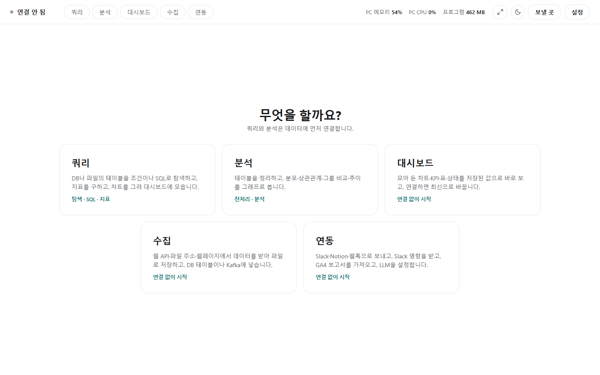

# Data Loupe (Ibis-search)

DB·DW나 내 데이터 파일(DuckDB, Parquet, CSV, JSON, Excel, GeoJSON)에 연결해 조건이나 SQL로 찾아보고, 표·집계·차트·대시보드로 보는 Windows 프로그램입니다. DB의 데이터는 읽기만 하고 바꾸지 않습니다.



첫 화면에서 쓸 기능을 고릅니다. 쿼리와 분석은 먼저 데이터에 연결하고, 대시보드·수집·연동은 연결 없이 들어갑니다. 들어간 뒤에는 위쪽 줄의 [쿼리] [분석] [대시보드] [수집] [연동]으로 오갑니다. 위쪽 줄에는 지금 연결, PC 메모리·CPU, 진행 중인 작업, 화면 크기 조절·어두운 화면, [보낼 곳], [설정]도 있습니다.

사진 속 데이터는 설명을 위해 지어낸 예시입니다.

## 다섯 기능

| 기능 | 하는 일 | 설명 |
|---|---|---|
| 쿼리 | 테이블을 조건으로 찾아보기(단계 카드·흐름 그림·문장 빈칸 채우기), SQL 직접 쓰기·질문으로 SQL 만들기, 집계·피벗·차트, 지표 | [docs/query.md](docs/query.md) |
| 분석 | 컬럼마다 전처리해 새 파일·테이블로, 분포·상관관계·그룹 비교·추이 그래프, 흐름(퍼널) | [docs/analysis.md](docs/analysis.md) |
| 수집 | 웹 API·파일 주소·웹페이지에서 받아 저장, DB 테이블·Kafka에 적재, 업로드 기록, 예약 실행 | [docs/collect.md](docs/collect.md) |
| 연동 | Slack·Notion·웹훅으로 보내기, Slack 명령 받기, GA4 가져오기, LLM 설정 | [docs/integrations.md](docs/integrations.md) |
| 대시보드 | 모아 둔 차트·KPI·표·상태를 저장된 값으로 보기, 기준일·기간·최신화·실시간, 목표와 비교 | [docs/dashboard.md](docs/dashboard.md) |

모든 기능에 걸친 설명은 따로 있습니다.

| 공통 | 내용 |
|---|---|
| [화면 설정과 안전](docs/functions/settings.md) | 화면 크기 조절·어두운 화면, 진행 상황과 취소, 안전하게 쓰기(자세히), 기억되는 것, DB별 드라이버(Supabase 포함) |
| [임시 저장](docs/functions/drafts.md) | 앱이 갑자기 꺼져도 만들던 화면을 이어서 하기, 되돌리기 |

버전마다 추가·개선·삭제된 것은 [CHANGELOG.md](CHANGELOG.md)에 있습니다.

## 설치

1. 저장소의 **Releases**에서 최신 `DataLoupe-setup.exe`를 받아 실행합니다.
   받은 파일이 릴리스에 올린 그 파일인지 보려면 같은 릴리스의 `DataLoupe-setup.exe.sha256`도 같은 폴더에 받고, 그 폴더의 PowerShell에서 아래를 실행합니다. `True`면 같은 파일이고 `False`면 실행하지 말고 다시 받습니다.
   ```powershell
   (Get-FileHash .\DataLoupe-setup.exe).Hash -eq (Get-Content .\DataLoupe-setup.exe.sha256).Split(" ")[0]
   ```
2. 설치 방식(현재 사용자용은 관리자 권한이 필요 없음)과 설치 위치, 바탕 화면 바로 가기를 고릅니다. 시작 메뉴에는 `Data Loupe`가 생깁니다.
3. **쓸 기능**을 고릅니다: 쿼리·분석·대시보드·수집·연동(기본은 전부, "사용자 지정"으로 일부만). 고르지 않은 기능은 메뉴와 첫 화면에서 숨습니다. 나중에 위쪽 **[설정]**에서 더하거나 뺄 수 있습니다. [설정]에서 [적용]하면 Releases에서 같은 버전의 설치 프로그램을 받아 지문(`.sha256`)이 맞을 때만 실행합니다(인터넷 필요, 설정·대시보드는 그대로).
4. 바로 가기나 시작 메뉴로 실행합니다. 이미 실행 중이면 먼저 연 창이 그대로 남습니다.

서명되지 않은 프로그램이라 Windows SmartScreen 경고가 나오면 [추가 정보] → [실행]을 누릅니다. 프로그램은 자체 창으로만 열리고, 브라우저로는 열 수 없습니다.

**업데이트**: 새 버전이 나오면 앱을 열 때 위쪽 줄에 '새 버전이 있어요 [업데이트]'가 뜹니다. 누르면 그 버전에서 바뀐 것(추가·개선·삭제)을 보여 주고, **[지금 업데이트]**로 지금 고른 기능 그대로 새 버전을 설치합니다(지문 확인 같음). 설치가 파일을 바꾸기 직전에 앱이 닫혔다가 끝나면 다시 열립니다. 새 버전 확인은 [설정]에서 끌 수 있습니다.

**예전 이름(ibis_search)에서 넘어올 때**: 설정과 대시보드는 `%APPDATA%\DataLoupe`에 있습니다. 예전 이름의 설정 폴더(`%APPDATA%\ibis_search`)는 새 버전을 처음 열 때 새 폴더로 자동으로 옮겨집니다. 옮기지 못하면 창으로 알리고 이유를 새 폴더의 `옮기기_실패.txt`에 남기며, 새 폴더에 설정 파일이 아직 없으면 다음 시작 때 다시 옮깁니다. 예전 이름으로 등록한 Windows 예약 작업은 설치할 때 설치 프로그램이 새 이름으로 옮깁니다(못 옮기면 앱을 열 때 다시 옮깁니다).

**지우기**: Windows 설정 → 앱에서 `Data Loupe`를 제거합니다. 앱이 등록한 Windows 예약 작업(`\DataLoupe\` 폴더)도 함께 지워집니다. 설정·대시보드(`%APPDATA%\DataLoupe`)는 남아 다시 설치하면 이어 씁니다.

## 안전하게 쓰기

- **데이터를 바꾸지 않습니다.** 검색·SQL은 읽기만 하는 SELECT 하나만 실행하고, 바꾸는 문장(DROP·DELETE·INSERT 등)과 파일·환경 값을 읽는 함수는 막습니다. DB에 쓰는 일은 분석의 새 테이블 만들기와 수집의 적재뿐입니다. 운영 DB에는 읽기 전용 계정을 권합니다.
- **비밀번호는 저장하지 않습니다.** DB·Kafka 비밀번호는 쓸 때마다 입력합니다. 다른 서비스의 토큰·주소는 서비스마다 "이 PC·이 계정만 풀 수 있게 암호화 저장", "이번 실행 동안만", "환경변수에서 읽기" 중에서 고릅니다.
- **데이터 값은 밖으로 보내지 않습니다.** 질문으로 SQL 만들기는 LLM에 테이블·컬럼 이름과 타입, 설명, 지표 정의만 보내고 데이터 값은 넣지 않습니다([프롬프트 보기]로 확인). 만든 SQL은 사람이 보고 실행합니다. 문장 보기도 서버의 규칙만으로 요청을 만들고 밖으로 보내지 않습니다. 바깥 서비스(보낼 곳·Slack 봇·GA4·LLM)와는 설정하고 쓸 때만 통신합니다.
- **요금이 나오는 DB**는 실행 전 처리 용량과 [SQL 보기]·[실행 계획]으로 미리 봅니다. 처리하거나 받을 양이 작업 메모리 상한을 넘으면 실행 전에 묻습니다.

자세한 내용은 [화면 설정과 안전](docs/functions/settings.md)에 있습니다.

## 소스로 실행하기

exe 없이 같은 프로그램 창을 띄울 수 있습니다. exe와 같은 Python 3.14를 쓰고, 버전 고정 목록 `constraints.txt`를 함께 줍니다.

```bash
pip install -c constraints.txt -r requirements.txt
python desktop.py
```

고친 뒤에는 검사를 돌립니다. 지어낸 데이터로 확인하고 실제 설정 파일은 건드리지 않으며, 바깥 서비스(Slack·Notion·Google·LLM·Kafka)에는 보내지 않고 가짜로 바꿔 끼워 확인합니다. 저장소에 올리면 GitHub Actions(`.github/workflows/test.yml`, `windows-2025`·Python 3.14)에서 같은 검사가 돌고, exe는 `build-exe.yml`이 같은 러너에서 만듭니다.

```bash
python tests.py
pip install -c constraints.txt -r requirements-dev.txt
python -m pytest tests_pytest -q
```

DuckDB·Parquet·CSV 밖의 DB에 접속하려면 그 DB의 드라이버를 더 설치합니다. 연결 창의 [드라이버 확인]이 설치 명령을 보여 줍니다.

## 라이선스

Apache License 2.0으로 배포합니다. 전문은 [LICENSE](LICENSE), 저작권 표시는 [NOTICE](NOTICE)에 있습니다. 함께 들어 있는 Chart.js(`static/core/chart.umd.min.js`)는 MIT 라이선스이고 그 저작권 표시는 파일 머리에 그대로 둡니다.
