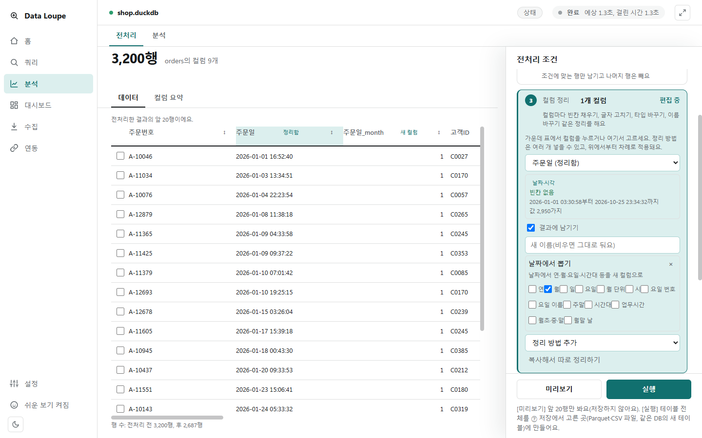

# 분석

[← README](../README.md) · [쿼리](query.md) · [분석](analysis.md) · [수집](collect.md) · [연동](integrations.md) · [대시보드](dashboard.md)

지저분한 데이터를 다듬고(전처리), 다듬은 데이터가 어떻게 생겼는지 그래프로 살펴보는(분석) 화면입니다. 원본 테이블은 바꾸지 않고, 정리한 결과는 새 파일이나 같은 DB의 새 테이블로 따로 저장합니다. 위쪽 **[전처리]**·**[분석]** 탭으로 오갑니다.

처음 쓸 때는 이 차례면 됩니다.

1. 첫 화면에서 데이터를 연결하고 왼쪽 메뉴 **[분석]**을 누릅니다. **[전처리]** 탭이 먼저 열립니다.
2. 오른쪽 **전처리 조건**의 ① 데이터에서 테이블을 고르면 가운데 **[데이터]** 탭에 앞 20행이, **[컬럼 요약]** 탭에 컬럼마다의 요약과 추천이 나옵니다.
3. 다듬을 것이 있으면 ②~⑥을 채우고 **[미리보기]**로 확인한 뒤 **[실행]**으로 저장합니다. 다듬지 않고 바로 분석해도 됩니다.
4. 위쪽 **[분석]** 탭으로 가서 오른쪽에서 분석 종류 카드를 고르고 칸을 채워 **[구하기]**를 누릅니다.

쉬운 보기가 켜져 있으면(처음 상태) 덜 쓰는 칸은 **[더 많은 설정 ▾]** 뒤에 접혀 있고, 단계 머리와 분석 종류 아래에 설명이 한 줄씩 붙습니다([설정](functions/settings.md#화면-설정)).

## 기능 설명

| 기능 | 한 줄 설명 | 자세히 |
|---|---|---|
| 전처리 | 행 거르기·컬럼 정리(목록을 행으로 펼치기 포함)·새 컬럼(계산 컬럼, PCA·K-Means·좌표)·중복 제거·정렬을 고르고, 컬럼 요약에서 품질 진단도 보고, 미리 본 뒤 파일이나 새 테이블로 저장 | [functions/prep.md](functions/prep.md) |
| 분석 탭 | 분석 종류 카드 13개(분포·상관관계·그룹 비교·기간별 추이·퍼널·리텐션·RFM·파레토·관계 검정·A/B 검정·연관 항목·변화 요인·시계열 분해)를 그래프와 표로 보고 대시보드에 넣기 | [functions/analysis_tab.md](functions/analysis_tab.md) |
| 퍼널 | 정해 둔 단계를 순서대로 거쳐 간 사람 수와 빠진 곳을 생키 그림과 표로 | [functions/funnel.md](functions/funnel.md) |
| 기억되는 것·안전 | 미리 읽을 행 수, 지난번 전처리, 저장한 설정이 어디에 남는지 | [functions/settings.md](functions/settings.md) |

## 컬럼 요약의 품질 진단

전처리 **컬럼 요약** 탭은 통계를 구한 뒤 같은 표본으로 품질 진단도 자동으로 합니다(DB에는 다시 묻지 않습니다). 모든 숫자는 표본 기준이고, 층화 표본은 가중치로 센 개수 앞에 "약 "이 붙습니다.

- **자동 진단 항목**: 날짜 형식 섞임, 이진·순서형·ID/해시 값, JSON 글자, 공백·탭·줄바꿈만 있는 값, 더한 빈 값 표시, 대소문자만 다른 값, 길이·바이트, 깨진 글자·제어 문자, 0·음수·양수·NaN·무한대 비율, 더미 숫자, 기본값 날짜(1970-01-01 등), 미래 날짜, 시작·끝 시간 역전, 백분위수, IQR·Z-Score·MAD 밖 값, 왜도·첨도(로그 변환 제안), 봉우리 여럿, 벤포드 이탈, 숫자 쏠림, 엔트로피·지니, 완전 중복 행. 접어 둔 **점검 메모 N개**(눌러서 폄)와 컬럼 표의 표본 요약([자세히] 안)·컬럼 이름 옆 태그로 보이고, 고칠 방법은 추천으로 나옵니다.
- **[진단 기준]**: 이상치 배수, 더미 숫자, 기본값 날짜, 빈 값 표시, 순서 척도 등을 바꿉니다. 저장하면 같은 표본으로 통계와 진단을 다시 구하고, **[기본값으로]**는 처음 값으로 되돌립니다.
- **진단 도구**(접이식 **백분위수**·**조합 키**·**키 중복**·**빈 시간 구간**·**참조 무결성**을 눌러 펴면 나옵니다. 조합 키 찾기 밖의 도구는 테이블 전체를 읽으며, 결과 아래에 "테이블을 N번 읽었어요"가 보입니다. BigQuery처럼 읽는 양을 미리 셀 수 있는 연결은 단계별 읽는 양과 합계를 확인 창으로 보여 줍니다):
  - **백분위수**: 숫자 컬럼의 값이 어디에 몰려 있는지 표로 봅니다.
  - **[조합 키 찾기]**: 표본에서 2~3개를 묶으면 겹치지 않는 컬럼 조합을 찾습니다(DB에 묻지 않음). 후보마다 **[전체로 확인]**.
  - **[키 중복 보기]·[전체 중복 행 세기]**: 고른 컬럼(또는 모든 컬럼) 기준 중복 묶음과 횟수 분포, 많이 겹친 키.
  - **[빈 구간 찾기]**: 날짜 컬럼에서 값이 하나도 없는 날·시간 구간.
  - **[참조 무결성 확인]**: 키가 고른 차원 테이블에 없는 행·키의 비율.
- 탭의 자리와 접이식은 [전처리](functions/prep.md#컬럼-요약)에 표로 정리해 두었습니다.
- **ID·해시 컬럼 빼기**: ID·해시·UUID로 보이는 글자 컬럼은 쿼리·분석·대시보드의 그룹·집계 컬럼 목록에서 빠지고, 목록 아래 안내의 **[다시 넣기]**로 되살립니다. 끄려면 왼쪽 메뉴 [설정] 창 [계산] 분류의 "ID·해시 컬럼을 묶기·집계 목록에서 빼기"를 해제합니다.

## 분석 차트의 자동 규칙과 모든 데이터

분석 탭 그래프 위 도구 줄에서 히스토그램·산점도를 어떻게 그릴지 정합니다.

- **[자동 규칙]**: 구간 수(FD·Sturges로 자동), 꼬리 자르기(양끝 백분위 밖은 "미만·초과 N건" 칸으로 따로 보임), 산점도 점 밀도(점이 많으면 옅고 작게, 아주 많으면 육각 칸의 개수), 숫자 줄이기를 규칙마다 끕니다. 끈 것은 기억해 [쿼리 화면](query.md#차트-정렬자동-규칙모든-데이터)과 같은 기본값이 됩니다. 바꾸면 같은 분석을 다시 구합니다.
- **[모든 데이터]**(기본 끔, 기억하지 않음): 꼬리를 자르지 않고 전체 범위로, 산점도는 육각 칸 대신 받은 점 전부로 그립니다. 점은 서버 안전 상한(5,000개 표본)까지이고 걸리면 안내가 나옵니다.
- **PNG·JPG 저장**은 밝게/어둡게를 고르고, **[모든 데이터 포함]**(기본 끔)을 켜면 모든 데이터로 다시 그려 저장합니다. 분석 결과 표는 그대로 있습니다.
- **[대시보드에 추가]**는 자동 규칙과 모든 데이터를 카드에 함께 담습니다.

## 분석 탭의 새 분석 8가지

분석 종류 카드 13개 가운데 뒤쪽 8개(리텐션(다시 나타남)·RFM(최근·빈도·크기 등급)·파레토(ABC 등급)·관계 검정(카이제곱)·A/B 검정(그룹 차이)·연관 항목(장바구니)·변화 요인·시계열 분해)입니다. 카드 13개의 이름과 한 줄 설명은 [분석 탭](functions/analysis_tab.md#분석-종류-카드-13개)에 있습니다. 결과는 그래프와 표로 나오고, 빈 값 때문에 뺀 행 수와 주의할 점(배정 비율이 1:1로 보기 어려울 때, 값이 1개뿐인 그룹을 뺐을 때, RFM 점수를 5단계로 나눌 수 없을 때 등)은 결과 위 안내에 보입니다. 이 8가지는 아직 **[대시보드에 추가]**를 쓸 수 없습니다(단추가 꺼짐). 표에 "(선택)"으로 적은 칸은 쉬운 보기에서 **[더 많은 설정 ▾]** 안에 있고, 비우면 기본값을 씁니다.

| 분석 | 넣는 것 | 결과 | 한계 |
|---|---|---|---|
| 리텐션 | 사용자, 날짜 컬럼, 단위(일·주·월), 경과 칸 수(선택) | 코호트별 유지율 칸 그림과 평균 유지율 선 | 코호트가 상한을 넘으면 단위를 키우거나 조건으로 좁히라고 안내합니다. 관찰할 수 없는 칸·진행 중 칸은 빈 칸입니다. |
| RFM | 사용자, 날짜, 금액, 기준일(선택), 거래 키(선택) | 5단계 점수로 나눈 8개 세그먼트의 사람 수·평균 R/F/M·매출 비중, 분위 경계 | 기준일을 비우면 자료의 마지막 날입니다. 거래 키를 고르면 빈도는 고유 거래 수, 안 고르면 행 수입니다.  같은 값이 몰려 5단계로 나눌 수 없는 축(예: 대부분 한 번만 산 빈도)은 있는 값만큼만 나누고 결과 위에 알립니다. |
| 파레토·ABC | 항목, 값(합계·행 수), A·B 경계(%) | 값이 큰 순서의 누적 비중과 A·B·C 등급 | 0 이하 값은 빼고 항목 수 상한이 있습니다. 경계를 넘는 항목은 앞 등급입니다. |
| 관계 검정 | 행·열 컬럼(범주 둘) | 교차표(관측·기대), 카이제곱·p값·Cramér's V, 표준화 잔차 | 값 종류가 많은 컬럼은 거절합니다. 기대 빈도 5 미만 칸이 많으면 믿기 어렵다고 알립니다. |
| A/B 검정 | 그룹 컬럼, 지표(비율·평균), 값 컬럼, 대조군(꼭 고름), 사용자 컬럼(한 사람이 여러 행이면 꼭 고름), 신뢰 수준(%, 선택. 비우면 설정의 신뢰수준) | 대조군 대비 차이·신뢰구간·Lift·p값 | 비율 값은 0·1이어야 합니다. 세 그룹 이상이면 평균은 ANOVA, 비율은 카이제곱 동질성이고 쌍 p값은 Bonferroni 보정입니다. 표본이 적으면 근사 검정이라고 알립니다.  사용자를 고르면 사람마다 먼저 모아(비율은 한 번이라도 1이면 1, 평균은 합계) 검정합니다. 고르지 않으면 한 행을 한 사람으로 보아 한 사람이 여러 행인 자료에서는 p값이 실제보다 작게 나옵니다. 두 그룹의 크기가 1:1로 보기 어려우면 결과 위에 알립니다. |
| 연관 항목(장바구니) | 거래 키, 항목, 최소 지지도(%, 선택), 상위 쌍 수(선택) | 함께 산 쌍의 지지도·신뢰도·향상도 | 항목·쌍 수와 쌍 행 수에 상한이 있어 넘으면 많이 산 쪽만 보거나 좁히라고 안내합니다. |
| 변화 요인 | 날짜, 기준·비교 기간, 그룹, 값(0·1이면 비율) | 평균 변화를 구성 변화·그룹 안 변화·상호작용으로 나눈 폭포 그림과 그룹별 표 | 두 기간은 겹치면 안 됩니다. 그룹이 많으면 상위 30개 밖은 "기타"로 묶고, 한 기간에만 있는 그룹의 효과는 구성 변화입니다. |
| 시계열 분해 | 날짜, 단위, 값·집계, 이동평균 창(선택), 이상 판정 배수(선택), 흩어짐 기준 분위(선택) | 추세·계절·나머지와 이상 시점 표시 | 계절은 일 = 요일, 월 = 월이고 주는 없습니다. 평균 같은 집계는 빈 기간을 건너뛰어 이어 붙이므로 기간 간격이 고르지 않을 수 있습니다. 나머지가 거의 같으면 이상 시점을 판정하지 않습니다.  추세와 계절은 튄 값에 끌려가지 않게 중앙값으로 구합니다. 이상 시점은 나머지가 "배수 × 흩어짐"보다 멀 때이고, 흩어짐은 나머지 크기의 기준 분위(기본 0.9)로 잽니다. 분위를 0.5로 적으면 MAD 기준이라 기준선이 낮아져 표시가 늘어납니다. |

- **전체로 구하기**: 리텐션·RFM·파레토·장바구니·변화 요인·시계열 분해는 건수·합계가 깎이지 않도록 늘 테이블 전체로 구합니다. 관계 검정·A/B 검정은 다른 분석처럼 표본으로 구하고 **[표본 말고 전체 데이터로 다시 구하기]**로 다시 구합니다.
- **읽는 양**: 원격 DB가 직접 계산하면 이 테이블을 여러 번 읽으므로, 처리 용량 확인 창에 "표를 N번 읽어요"가 함께 보입니다.

## 표 머리글을 눌러 정렬하기

표 머리글을 누를 때마다 오름(↑) → 내림(↓) → 원래 순서로 바뀝니다(한 컬럼 기준). 빈 값은 방향과 상관없이 맨 뒤입니다.

- **데이터 탭**: 정렬은 머리글의 **↕ 단추**로 합니다(컬럼 이름을 누르면 지금처럼 ③ 컬럼 정리가 열립니다). 테이블 전체(전처리 단계가 있으면 적용한 뒤)를 그 컬럼으로 다시 조회해 앞 20행을 보여 주고, BigQuery처럼 읽는 양을 셀 수 있는 연결은 처리 용량 확인 창이 뜹니다. [미리보기]를 누르면 정렬이 풀립니다. 분석 탭 맨 위 데이터 표는 단추 없이 이 정렬을 따릅니다.
- **컬럼 요약·분석 표·퍼널 표**: 이미 받은 결과만 화면에서 정렬하므로 다시 조회하지 않습니다. 컬럼 요약에는 **빈 값 비율**·**고유값 수** 칸이 따로 있어 숫자로 정렬합니다(표본 기준). 상한 때문에 잘린 표(그룹 비교·시계열·값 빈도)는 받은 행만 정렬하고 표 아래에 안내가 나옵니다. 값 빈도의 "(빈 값)"·"그 밖의 값" 줄은 맨 끝에 고정입니다. '보일 행 수'·범위 슬라이더는 결과 전체를 정렬한 뒤 자릅니다.

## 전처리에 태그 붙이기

쿼리 화면에서 [태그]를 켜 둔 테이블이면, 전처리 ① 단계(기준 표) 아래의 **[태그 붙이기]**를 체크해 행에 단 태그를 `태그` 컬럼으로 가져옵니다. 거르기는 모든 행 / 태그 없는 행 / 고른 태그(하나라도·모두) 중에서 고릅니다. 태그를 켠 적 없는 테이블은 체크가 잠기고 "쿼리 화면 결과 표의 [태그]에서 먼저 켜세요"라고 알립니다. `태그`는 글자 컬럼이라 다른 컬럼처럼 정리·정렬·보일 컬럼에 쓸 수 있고, 구성을 저장하면 이 칸도 함께 저장됩니다. 원격 DB는 이 PC로 받은 작업 사본에 붙입니다.
