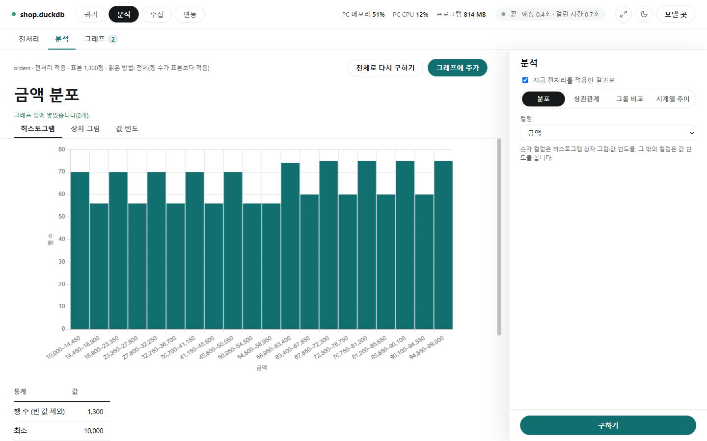

# 분석 화면

[← README](../README.md) · [쿼리 화면](query.md) · [분석 화면](analysis.md) · [수집 화면](collect.md) · [연동](integrations.md) · [설정과 참고](settings.md)

**한 줄 요약**: 지저분한 데이터를 깨끗하게 정리하고(전처리), 그 데이터가 어떻게 생겼는지 그래프로 살펴보는(분석) 화면입니다.

분석 화면 위쪽에는 탭이 셋 있습니다.

| 탭 | 언제 쓰나 |
|---|---|
| 전처리 | 공백·오타·빈칸·중복을 정리하고 새 파일로 저장할 때 |
| 분석 | 값이 어떻게 퍼져 있는지, 무엇과 무엇이 같이 움직이는지, 그룹·기간별로 어떤지 볼 때 |
| 그래프 | 분석에서 만든 그래프를 모아 그림으로 저장할 때 |

**원본 데이터는 절대 바꾸지 않습니다.** 정리한 결과는 늘 새 파일이나 새 테이블로 따로 저장합니다.

## 먼저 알아 둘 말

| 말 | 뜻 |
|---|---|
| 전처리 | 분석하기 전에 데이터를 깨끗하게 다듬는 일. 예: " 서울 " → "서울", "N/A" → 빈칸 |
| 빈 값(null) | 아무것도 들어 있지 않은 칸 |
| 타입 | 칸에 든 값의 종류: 정수, 실수(소수), 글자, 날짜 |
| 표본 | 큰 데이터 전체 대신 일부(기본 5,000행)만 뽑아 빠르게 살펴보는 것 |
| 중복 | 같은 내용이 두 번 이상 들어 있는 행 |
| 분포 | 값이 어디에 많고 어디에 적은지 |
| 상관관계 | 한 값이 커질 때 다른 값도 같이 커지는지(또는 작아지는지) |

## 따라 해 보기

### 예시 1. 지저분한 고객 명단 정리하기

`customers.csv`에 이런 문제가 있다고 합시다: 이름 앞뒤에 공백이 있고, 전화번호 칸에 `-`나 `N/A`가 섞여 있고, 가입일이 `20250131` 같은 글자이고, 같은 고객이 두 번 들어 있습니다.

1. 첫 화면에서 **[분석]** → 그 파일이 있는 폴더를 연결합니다([연결 방법](query.md#연결)).
2. ① 데이터에서 테이블 `customers`를 고릅니다. 가운데에 컬럼마다 통계(빈 값 몇 개, 서로 다른 값 몇 개 등)와 **추천**이 나옵니다.
3. 추천이 맞아 보이면 **[추천 모두 적용]** 을 누릅니다. 예를 들어 이런 것들이 들어갑니다.
   - 이름: 앞뒤 공백 지우기
   - 전화번호: `-, N/A`를 빈 값으로
   - 가입일: 날짜로 바꾸기(`%Y%m%d`)
4. 오른쪽 ③ **중복 기준** 에서 `고객ID`를 고릅니다. → 같은 고객ID는 하나만 남습니다.
5. 패널 아래 **[미리보기]** 를 누릅니다. 앞 20행과 "행 수: 전 1,300 → 후 1,280"처럼 몇 행이 줄었는지 확인합니다.
6. ⑤ **저장** 에서 파일(Parquet 또는 CSV)과 위치를 고르고 **[실행]** 을 누릅니다.

### 예시 2. 주문 금액이 어떻게 분포하는지 보기

1. 전처리 탭에서 `orders`를 고른 상태로 위쪽 **[분석]** 탭을 누릅니다.
2. 오른쪽에서 **분포**, 컬럼 `금액`을 고르고 **[구하기]** 를 누릅니다.
3. 히스토그램(금액대별 주문 수 막대)과 최소·평균·최대가 나옵니다. **[상자 그림]** 을 누르면 튀는 값(이상치)이 점으로 보입니다.

### 예시 3. 매장별 평균 금액 비교, 월별 매출 추이

- **그룹 비교**: 그룹 `매장코드`, 집계 `평균`, 값 `금액` → [구하기]. 매장별 평균 금액이 큰 순 막대로 나옵니다.
- **시계열 추이**: 날짜 `주문일`, 단위 `월`, 집계 `합계`, 값 `금액` → [구하기]. 월별 매출이 선 그래프로 나옵니다.

마음에 드는 그래프는 **[그래프에 추가]** 를 누르고, [그래프] 탭에서 모아 그림으로 저장합니다.

---

아래부터는 기능별 자세한 설명입니다.

## 전처리

[전처리] 탭은 테이블 하나를 정리해 새 파일이나 새 테이블로 만듭니다. 가운데에는 컬럼이 가로로 나란히 있고, 오른쪽에는 "전처리 조건" 단계(① 데이터 → ② 행 거르기 → ③ 중복 기준 → ④ 정렬 → ⑤ 저장)가 있습니다.


### 쓰는 순서

1. ① 데이터에서 테이블을 고릅니다. 컬럼마다 타입과 통계(빈 값 수, 서로 다른 값 수, 최소–최대 또는 글자 길이)가 보입니다.
2. 컬럼 아래 [전처리 추가]에서 할 일을 고릅니다. **고른 것만 적용**되고 저절로 바뀌는 것은 없습니다.
3. 필요하면 오른쪽에서 행 거르기·중복 기준·정렬을 넣습니다.
4. [미리보기]로 앞 20행과 행 수 변화를 확인합니다. 설정을 바꾸면 다시 누르라는 안내가 나옵니다.
5. ⑤ 저장에서 저장할 곳을 고르고 [실행]을 누릅니다.

### 통계가 나오는 순서

테이블을 고르면 세 번에 걸쳐 채워집니다(큰 테이블은 뒤쪽이 오래 걸림).

1. 컬럼 이름·타입·행 수. 이때부터 전처리를 고르고 미리보기·실행을 쓸 수 있습니다.
2. 통계와 추천(표본으로 구함).
3. 글자 컬럼의 "날짜로/숫자로 바꾸기" 추천.

- 도중에 [취소]를 누르면 남은 단계를 그만둡니다. 통계 칸의 [다시]로 다시 구합니다.
- **표본 행 수**(기본 5,000, 1,000~1,000,000): 통계와 추천을 이만큼만 읽어 구합니다.

### 표본으로 구하는 통계

큰 데이터를 다 읽으면 느리고, 회사 DW(데이터 창고)에서는 읽은 만큼 요금이 나옵니다. 그래서 통계는 일부(표본)만 읽어 구합니다. 싼 방법부터 차례로 해 보고 안 되면 다음으로 넘어갑니다.

| 차례 | 방법 | 쓰는 때 |
|---|---|---|
| 1 | 무과금 미리보기 | BigQuery(요금 없이 바로 읽음) |
| 2 | 전체 | 표본보다 작은 테이블 |
| 3 | 블록 샘플링 | 저장된 덩어리 몇 개만 읽음 |
| 4 | 최신 파티션 | 데이터 명세서에 날짜별 나눔(파티션)이 적힌 테이블 |
| 5 | 앞 행 | 위가 모두 안 될 때 |

- 컬럼 카드 위에 `표본 5,000행 · 블록 샘플링 · 구한 때`처럼 나옵니다.
- 컬럼마다 값이 하나뿐인지, 날짜 형식, 자주 나오는 값 목록(20개 이하)도 나옵니다.
- Parquet 파일은 파일 안 정보로 전체 기준 빈 값 수와 범위도 보여 줍니다(데이터는 읽지 않음).
- 구한 통계는 테이블별로 저장해 두고 다시 열면 그대로 씁니다. 새로 구하려면 [다시 구하기](200개 테이블까지).
- **주의**: 표본에 없는 값은 모릅니다. "숫자로 바꾸기" 추천이 나와도 표본 밖에 글자가 섞여 있으면 그 칸은 빈 값이 되니, [미리보기]의 빈 값 수를 꼭 확인하세요.

### 데이터 명세서

데이터 명세서는 "이 테이블은 무엇이고, 이 컬럼은 무슨 뜻인지" 적어 둔 설명서 파일입니다. 테이블 카드의 [데이터 명세서]에 파일 경로를 넣고 [읽기]를 누르면, 설명이 통계 칸에 보이고 파티션(날짜별 나눔)이 있으면 최신 것만 표본으로 읽습니다. [질문으로 SQL 만들기](query.md#질문으로-sql-만들기)도 이 설명을 AI에게 알려 줘서 더 정확해집니다. 비우고 [읽기]를 누르면 쓰지 않습니다.

```yaml
tables:
  sales.orders:            # 스키마.테이블 또는 테이블 이름
    description: 주문 내역
    partition:
      column: order_date   # 날짜별로 나뉜 컬럼
      recent_days: 3       # 최근 3일만 표본으로(또는 latest: "2026-10-18")
    columns:
      status:
        description: 주문 상태(Y=완료, N=취소)
```

### 추천

통계를 보고 컬럼마다 할 만한 전처리를 이유와 함께 보여 줍니다. 누르면 그 컬럼에 들어가고, [추천 모두 적용]으로 한꺼번에 넣습니다. 넣은 뒤에도 고치거나 뺄 수 있습니다.

| 이런 게 보이면 | 추천 |
|---|---|
| 값 앞뒤에 공백 | 앞뒤 공백 지우기 |
| `-`, `N/A`, 빈 글자처럼 "없음"을 뜻하는 글자 | 빈 값으로 |
| 모두 숫자 모양(쉼표·단위를 떼면 숫자 포함) | 숫자로 바꾸기 |
| `20250131`, `2025-01-31`, `2025-01-31 09:30:00` 모양 | 날짜로 바꾸기 |
| `Seoul`과 `seoul`처럼 대소문자만 다른 값 | 소문자로 통일 |
| 빈 값이 있음 | 적으면 그 행 빼기, 많으면 가운데 값(중앙값)이나 가장 흔한 값(최빈값)으로 채우기 |
| 값이 한 가지뿐이거나 전부 비어 있음 | 컬럼 빼기(쓸모없는 컬럼) |

### 컬럼마다 고르는 전처리

한 컬럼에 여러 개를 고르면 아래 표의 위에서 아래 순서로 적용됩니다.

| 묶음 | 전처리 | 예 / 설명 |
|---|---|---|
| 글자 | 앞뒤 공백 지우기 | `" 서울 "` → `"서울"` |
| 글자 | 연속 공백을 하나로 | `"서울   강남"` → `"서울 강남"` |
| 글자 | 이 값들을 빈 값으로 | `-, N/A`라고 적으면 그 값들이 빈칸이 됨 |
| 글자 | 글자 찾아 지우기 | `원`을 적으면 `"1,000원"` → `"1,000"` |
| 글자 | 대문자·소문자로 | `Seoul` → `seoul` |
| 글자 | 값 바꿔 쓰기 | 값 전체가 같을 때만. `Y` → `완료` |
| 글자 | 패턴으로 바꾸기 | 정규식(글자 규칙). 예: 숫자만 남기기 |
| 타입 | 타입 바꾸기 | 정수·실수·글자·날짜로. 바꿀 수 없는 값은 빈 값. 정수는 `12`, `-7`, `+3`만, 실수는 `1.5`, `.5`, `1e3`도 |
| 새 컬럼 | 빈 값이었는지 표시 | `컬럼_isnull` 컬럼을 만들어 채우기 전에 비어 있었는지 남김 |
| 빈 값 | 빈 값 처리 | 그 행 빼기, 또는 정한 값·평균·중앙값·최빈값·앞 행 값·뒤 행 값으로 채우기 |
| 숫자 | 범위 밖 값 처리 | 너무 크거나 작은 값을 빼거나 범위로 자름. 범위는 직접, 사분위수(IQR), 표준편차로 |
| 숫자 | 값 맞추기 | 표준화, 0~1로, 로그 |
| 숫자 | 반올림 | 소수 몇 자리까지 |
| 숫자 | 구간 나누기 | `0, 10, 100` → `0–10`, `10–100` 같은 구간 이름으로 |
| 범주 | 드문 값 묶기 | 몇 번 안 나온 값을 `기타`로 |
| 새 컬럼 | 날짜에서 뽑기 | 연·월·일·요일·시·월 단위 → `주문일_year` 등 |
| 새 컬럼 | 값을 번호로 | `서울=0, 부산=1…`(값 1,000가지까지) |
| 새 컬럼 | 값마다 컬럼으로 | `지역_서울`, `지역_부산`처럼 0/1 컬럼 여러 개(값 50가지까지) |
| 새 컬럼 | 패턴에 맞는 부분 뽑기 | 예: 주소에서 우편번호만 → `컬럼_match` |
| 새 컬럼 | 들어 있는지 표시 | 찾을 글자마다 `컬럼_has_글자`(있으면 1, 없으면 0) |
| 새 컬럼 | 단어별 개수 세기 | `"서울 배송 서울"` → `{"서울": 2, "배송": 1}`(SQLite에서는 안 됨) |

**날짜 형식**: 글자를 날짜로 바꿀 때 모양을 적습니다. 비우면 `%Y-%m-%d`(2025-01-31)입니다.

| 데이터 모양 | 적을 형식 |
|---|---|
| `20250131` | `%Y%m%d` |
| `2025-01-31 09:30:00` | `%Y-%m-%d %H:%M:%S` |
| `31 Jan 2025` | `%d %b %Y` |

쓸 수 있는 것: `%Y`(연 4자리) `%y`(연 2자리) `%m`(월) `%d`(일) `%H`(시) `%M`(분) `%S`(초) `%I %p`(12시간제) `%b %B`(영어 달 이름). 모양이 다른 값은 빈 값이 되고, `2025-02-30`처럼 없는 날짜는 오류가 납니다.

**이름 바꾸기와 복사**: 컬럼 아래 [이름 바꾸기] 칸에 새 이름을 적습니다. 이름 옆 [복사]를 누르면 같은 컬럼이 하나 더 생겨, 원래 값과 바꾼 값을 함께 남길 수 있습니다.

### 컬럼 빼기와 새로 생긴 컬럼

① 데이터의 컬럼 목록에서 체크를 끄면 그 컬럼은 결과에서 빠집니다. 이름을 누르면 가운데 표가 그 컬럼으로 넘어갑니다. 전처리로 새로 생긴 컬럼은 [미리보기] 뒤에 원래 컬럼 아래에 들여 쓴 모양으로 나타나고, 같은 방법으로 뺄 수 있습니다.

### 행 거르기

조건에 맞는 행만 남깁니다. 쓰는 법은 쿼리 화면의 [한 줄 입력](query.md#넣는-방식)과 같습니다(예: `금액 >= 0`, `상태 != 취소`). 여러 줄이면 모두 맞는 행만 남고, 전처리 전의 원래 값으로 거릅니다.

### 중복 기준

고른 컬럼의 값이 모두 같은 행을 중복으로 보고 하나만 남깁니다.

- 예: `고객ID`만 고르면 같은 고객ID는 하나만 남습니다.
- [전체 컬럼]을 누르면 모든 칸이 똑같은 행만 지웁니다.
- 아무것도 고르지 않으면 중복을 지우지 않습니다.
- 비교는 전처리한 뒤의 값으로 합니다(공백을 지우고 대소문자를 맞춘 뒤 비교).
- [중복 세기]로 몇 행이 빠질지 미리 봅니다.

### 저장

| 저장할 곳 | 내용 |
|---|---|
| 파일 | Parquet 또는 CSV. 쿼리 화면에서 그 폴더를 연결하면 바로 볼 수 있습니다 |
| 같은 DB의 새 테이블 | 이름을 적고 [실행]을 두 번 누릅니다(실수 방지). 같은 이름이 있으면 만들지 않습니다 |

- 파일(Parquet·CSV)에 연결했을 때는 파일로만 저장합니다.
- DuckDB 파일에 새 테이블을 만들 때는 다른 프로그램이 그 파일을 열고 있으면 안 됩니다.
- DB에 만들려면 접속 계정에 테이블을 만들 권한이 있어야 합니다.
- **수 컬럼을 가장 작은 타입으로**(기본 켜짐): 값이 바뀌지 않는 범위에서 파일 크기를 줄입니다.

### 구성 저장과 불러오기

고른 전처리 전체를 이름을 붙여 저장해 두고 다음에도 똑같이 씁니다(매달 같은 정리를 할 때 편함). [미리보기] 위의 줄에서 합니다.

- 저장: 이름을 쓰고 [저장](비우면 지금 구성에 덮어씀)
- 불러오기: 목록에서 고르면 그 테이블을 열고 선택을 채웁니다(실행은 하지 않음)
- 삭제: 고르고 [삭제]

테이블, 컬럼별 전처리, 이름 바꾸기, 복사, 뺀 컬럼, 행 거르기, 중복 기준, 정렬, 저장할 곳을 저장합니다(연결 정보 제외, 100개까지). 지금 연결에 그 테이블이나 컬럼이 없으면 불러오지 않고 알려 줍니다.

### 테이블별로 기억하는 전처리

[미리보기]나 [실행]을 하면 그 테이블에 쓴 전처리를 기억해, 다음에 같은 테이블을 열면 "지난번에 이 테이블에 쓴 전처리를 채웠습니다"와 함께 채워 줍니다(200개 테이블까지). 이름 붙인 구성을 고르면 그것이 먼저입니다.

### 알아 둘 점

- 평균·중앙값으로 채우기, 표준화, 드문 값 묶기처럼 전체 값이 필요한 전처리는 그 값을 먼저 계산합니다. 요금이 나오는 DB에서는 비용이 듭니다.
- 앞·뒤 행 값으로 채우기는 파일(Parquet·CSV) 연결에서는 쓸 수 없습니다.
- 정수 컬럼을 평균·중앙값으로 채우면 실수(소수) 컬럼이 됩니다.

## 분석

[분석] 탭에서는 전처리 탭에서 고른 테이블을 그래프와 표로 살펴봅니다. 오른쪽에서 분석 종류를 고르고 [구하기]를 누릅니다.



| 분석 | 이런 질문에 | 고르는 것 | 보이는 것 |
|---|---|---|---|
| 분포 | "금액은 주로 얼마쯤인가? 튀는 값은?" | 컬럼 하나 | 숫자: 히스토그램(20구간), 상자 그림, 값 빈도, 요약 통계. 글자: 많이 나온 20개 값 |
| 상관관계 | "수량이 많으면 금액도 큰가?" | 숫자 컬럼 2~12개(히트맵) 또는 X·Y 두 개(산점도) | 상관계수 표(-1~1, 1에 가까울수록 같이 커짐), 점 그래프 |
| 그룹 비교 | "매장마다 평균 금액은?" | 그룹 컬럼, 집계(평균·합계·개수), 값 컬럼 | 큰 순 막대와 표(30개 그룹까지) |
| 시계열 추이 | "월별 매출이 늘고 있나?" | 날짜 컬럼, 단위(일·주·월), 집계, 값 컬럼 | 선 그래프(400개 기간까지, 주는 월요일부터) |

- **지금 전처리를 적용한 결과로**(기본 켜짐): 전처리 탭에서 고른 정리를 적용한 데이터로 분석합니다. 끄면 원래 데이터로 합니다.
- **표본**: 기본은 표본(기본 5,000행)으로 빠르게 구합니다. 결과 위에 어떤 데이터로 구했는지 나옵니다.
- **[전체로 다시 구하기]**: 테이블 전체로 다시 구합니다. 큰 테이블은 오래 걸리고, 요금이 나오는 DB에서는 비용이 듭니다.
- 시계열의 날짜 컬럼은 날짜 타입이어야 합니다. 글자로 된 날짜는 전처리 탭에서 "날짜로 바꾸기"를 먼저 하세요.
- [그래프에 추가]를 누르면 지금 그래프가 [그래프] 탭에 들어갑니다.

### 그래프

[그래프] 탭에서는 분석에서 넣은 그래프를 카드로 모아 봅니다. 쓰는 법은 [대시보드](query.md#대시보드)와 같습니다. 카드를 눌러 여러 개 고르고, 비율·배경·형식을 정해 [다운로드]하면 각각 그림 파일로 저장됩니다. 카드의 이름 칸에서 이름을 바꾸고 ×로 뺍니다.

그래프에는 그때 구한 값이 그대로 들어 있습니다. 프로그램을 닫기 전까지 남아 있고, 이름을 붙여 저장하지는 않습니다.
