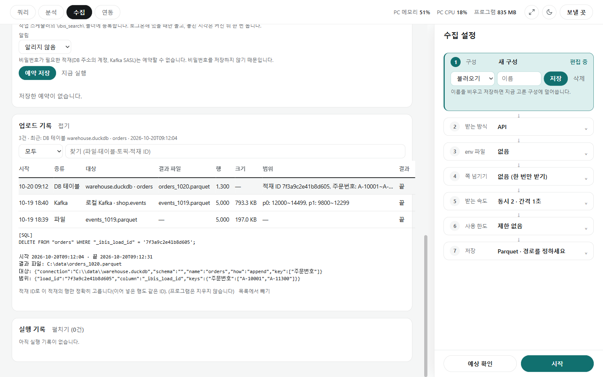

# 수집 화면

[← README](../README.md) · [쿼리](query.md) · [분석](analysis.md) · [수집](collect.md) · [연동](integrations.md) · [설정과 참고](settings.md)

**한 줄 요약**: 인터넷의 데이터(웹 API, 파일, 웹페이지)를 받아 내 PC에 표 파일로 저장하고, 필요하면 회사 DB나 Kafka에 넣어 주는 화면입니다. 정한 시간에 저절로 돌릴 수도 있습니다.

| 말 | 뜻 |
|---|---|
| API | 프로그램끼리 데이터를 주고받는 창구. 주소로 요청하면 데이터(대개 JSON 글자)를 돌려줌 |
| API 키 | API를 쓸 수 있는 출입증. 비밀번호처럼 다루며, `이름=값`을 적은 메모장(env 파일)에 둠 |
| 적재 | 받은 데이터를 DB 테이블이나 Kafka(회사 데이터 전송 시스템)에 넣는 것 |

| 받는 방식 | 이럴 때 |
|---|---|
| API | 서비스가 데이터 주소를 제공할 때. 1쪽, 2쪽…을 차례로 받음 |
| 파일 주소 | 인터넷에 CSV·Parquet·JSON 파일이 올라와 있을 때 |
| 웹페이지 | 웹 화면에만 보일 때. 값을 눌러 지정 |

## 따라 해 보기

**1. API에서 상품 목록 받기**

API 문서에 `curl 'https://api.example.com/v1/items?page=1' -H 'Authorization: Bearer abc123'` 같은 예시가 있다고 합시다.

1. 메모장으로 `C:\keys\shop.env`를 만들고 `SHOP_KEY=abc123` 한 줄을 저장합니다.
2. **[요청 예시 붙여 넣기]** 에 위 예시를 붙여 넣고 **[읽기]** → 주소·헤더 칸이 채워집니다.
3. 비밀 값이 보인다는 안내가 나옵니다. **env 파일** 에 `C:\keys\shop.env`를 읽고, `SHOP_KEY`를 골라 **[env 이름으로 바꾸기]** → 키 대신 `{env:SHOP_KEY}`가 들어가 저장되지 않습니다.
4. 주소의 `page=1`을 `page={page}`로 고치고 **쪽 넘기기** 를 "쪽 번호"로 합니다.
5. **[시험 보내기]** → 응답에서 상품 목록을 눌러 **[기록 위치로]** → 앞 20행 미리보기.
6. **저장** 에서 `C:\data\items.parquet`을 고르고 **[예상 확인]** → **[시작]** → 끝나면 **[쿼리로 열기]**.

**2. 매일 아침 9시에 저절로 받기**

[구성]에 `상품 목록`이라는 이름으로 [저장] → **[예약]** 카드에서 그 구성, `매일`, `09:00`, [Windows 예약 작업으로 등록](프로그램을 꺼도 돎) → **[예약 저장]**. 실패하면 Slack 등으로 알림을 받도록 [알림]을 고를 수 있습니다.

**3. 웹페이지에서 상품 이름·가격 받기**

[웹페이지]를 고르고 주소 → **[브라우저 열기]**(필요하면 직접 로그인) → **[값 고르기]** 를 누르고 첫 상품 이름을 누름(같은 모양 상품들이 표시됨) → 가격도 누름 → 여러 쪽이면 [다음 버튼 고르기] → [미리보기] → [시작].

**4. DB에 넣고, 잘못 넣은 것만 지우기**

**[적재]** 에서 [DB 테이블], 테이블 `items`, 덧붙이기, **[적재 ID 컬럼 넣기]** 를 켜고 [시작]. 나중에 **[업로드 기록]** 에서 그 줄을 누르면 `DELETE FROM "items" WHERE "_ibis_load_id" = '…'` 같은 지우기 명령이 나옵니다. 확인하고 실행하면 그 적재분만 지워집니다.

## 수집

**알아서 해 주는 것**

- **비밀 값 지키기**: 붙여 넣은 예시에서 키·토큰처럼 보이는 값을 찾아 env 이름으로 바꾸게 합니다. 남아 있으면 저장·시작하지 않고, 화면·오류에서는 `●●●`로 가립니다. 다른 서버로 넘겨질 때 키를 보내지 않는 규칙은 [안전하게 쓰기](settings.md#안전하게-쓰기-자세히)에 있습니다.
- **결과 CSV의 수식 막기**: CSV로 저장하면 `=`·`+`·`-`·`@`로 시작하는 글자 값과 컬럼 이름 앞에 `'`를 붙입니다(쿼리의 저장과 같고, `-1500`처럼 숫자로 읽히는 값은 그대로). 값의 모양(`007`, `1.10`)은 그대로 둡니다.
- **쪽 넘기기**: 쪽 번호(`{page}`), 건너뛸 수(`{offset}`), 다음 쪽 표시(`{cursor}`), 다음 주소 중에서 API 문서에 맞는 것을 고릅니다. 빈 쪽이 오거나 끝까지 받으면 멈춥니다. 최대 쪽 수(기본 100)에 닿아 멈추면 "더 있을 수 있음"이라고 알리고, 예약 실행은 실패로 알립니다. 쪽 번호·건너뛸 수에서 둘째 쪽부터 404(없음)가 오면 빈 쪽처럼 끝으로 봅니다.
- **천천히, 실패하면 다시**: 기본은 동시 2개, 1초 간격, 5번까지 다시 시도. 서버가 "너무 많다"(429)고 하면 저절로 속도를 줄이고(간격은 처음의 8배까지, 잇따라 잘 받으면 처음대로), 다시 시도해서 받은 요청은 실패로 세지 않습니다. 인증 오류면 바로 멈춥니다.
- **사용 한도**: "분당 60번, 하루 1만 번" 같은 API 한도를 묶음으로 저장해 두면 넘지 않게 받습니다. 하루 한도에 닿으면 멈추고, 다음 날 다시 시작하면 이어 받습니다.
- **끊겨도 이어 받기**: 같은 구성으로 다시 [시작]하면 받은 쪽은 건너뜁니다. 시작한 지 하루가 넘었으면 처음부터 받습니다(`{today}`가 오늘 날짜가 되게). 하루 한도로 멈춘 것은 다음 날에도 이어 받고, 마지막으로 받은 지 하루가 넘게 내버려 두었으면 처음부터 받습니다. 파일 주소는 받아 둔 파일 크기가 맞을 때만 이어 받습니다.
- **날짜 넣기**: 주소에 `{today:%Y%m%d}`를 쓰면 보낼 때 오늘 날짜(`20261020`)로 바뀝니다.
- **파일 주소**: 나눠 받기를 지원하면 여러 조각으로 동시에 받고, 한글이 깨지는 옛 CSV(CP949)도 알아서 바꿉니다.
- **웹페이지**: 늦게 나타나는 목록도 기다렸다가 받습니다. 사이트가 robots.txt로 막아 둔 주소는 열지 않습니다(기본). 이용 약관을 지켜 쓰세요.

## 적재와 업로드 기록

| 적재할 곳 | 넣는 방식 |
|---|---|
| 파일만(기본) | 결과 파일만 만듦 |
| DB 테이블 | 새 테이블, 덧붙이기(키가 같은 행은 건너뛸 수 있음. 테이블에 이미 있는 키도, 넣는 데이터 안에서 겹친 키도 첫 행만 넣음), 바꾸기(이 프로그램이 만든 테이블만, 실패하면 되돌림. 이름을 바꾸지 못하면(인덱스·뷰가 걸린 DuckDB 테이블 등) 원래 테이블은 그대로 두고 새 내용은 `이름_ibis_load`에 남김. 새 테이블로 바뀌므로 권한·인덱스·뷰는 다시 걸어야 함) |
| Kafka 토픽 | 한 행을 메시지 하나로. 보낼 곳(서버·토픽)을 등록해 두고 고름. 너무 큰 행은 실패로 세고 계속, 일시 오류는 다시 보냄 |

- **비밀번호는 저장하지 않습니다.** DB·Kafka 비밀번호는 적재할 때마다 입력합니다. 그래서 비밀번호가 필요한 적재는 예약할 수 없습니다(API 키는 env 파일이라 예약 가능).
- CSV 결과 파일은 파일 전체를 보고 컬럼 타입과 구분자(`,`·`;` 등)를 정합니다. 그래서 `00001` 같은 값은 글자로 남고, 앞부분이 비어 있는 컬럼도 타입을 잃지 않습니다. 수식 막기로 `'`가 붙은 값은 붙은 채로 들어갑니다([안전하게 쓰기](settings.md#안전하게-쓰기-자세히)).
- 덧붙이기는 이번 수집에서 값이 하나도 없던 컬럼(글자로 저장됨)은 테이블의 타입으로 넣고, 테이블에만 있는 컬럼은 빈 값으로 둡니다. 새 컬럼이나 타입이 다른 컬럼은 넣지 않습니다.
- 키로 거르면 묶음마다 테이블에서 키를 찾아보므로 키 컬럼에 인덱스가 있어야 빠릅니다. 원격 DB에 한 건씩 넣으면 한 건마다 문장이 여러 개 오가 DB에 부담이 크니 묶음으로 넣으세요.
- [확인]으로 넣기 전에 테이블과 컬럼이 맞는지 봅니다. 실패해도 결과 파일은 남고, [적재만 다시]로 이어 넣습니다(키 없으면 행이 겹칠 수 있음). 묶음 크기만 바꿔 다시 해도 이어 넣고, 적재할 테이블·방식 같은 대상을 바꾸면 처음부터 넣습니다. 다 넣기 전에는(접속 실패·컬럼 차이로 넣기 전에 멈춘 때 포함) 같은 결과 파일로 다시 수집(예약 포함)하지 않고 먼저 [적재만 다시]로 마저 넣으라고 알립니다.

### 업로드 기록

저장한 파일과 DB·Kafka에 넣은 것이 한 번마다 장부처럼 남습니다(2,000건까지). **나중에 "그때 넣은 것만 지워야 할 때" 바로 찾기 위한 것**입니다.

| 남는 것 | 예 |
|---|---|
| 언제·어디에·어떤 파일에서 | 10-20 09:12, `warehouse.duckdb · orders`, `orders_1020.parquet` |
| 얼마나 | 1,300행, 793 KB |
| 범위 | 적재 ID, 키의 처음~끝 값, Kafka는 파티션별 메시지 번호(offset) 처음~끝 |

줄을 누르면 지울 때 쓸 명령(DB는 적재한 DB의 문법에 맞춘 `DELETE`/`DROP`, Kafka는 지우기 도구용 내용)과 주의할 점을 보여 줍니다. DB 종류를 모르는데 값에 `\`가 있으면 안전한 명령을 만들 수 없어 직접 지우라고 알립니다. **프로그램은 직접 지우지 않습니다.** 적재 ID가 있으면 그 적재분만 정확히 고르고, 없으면 범위로 고르므로 다른 행도 지워질 수 있다고 알려 줍니다. Kafka는 중간만 골라 지울 수 없어 그 앞 메시지까지 지워진다고 알려 줍니다.

## 예약 실행

| 주기 | 실행 방식 |
|---|---|
| 매일, 매주(요일), N분마다(5~1,440분) | 프로그램이 켜져 있는 동안만, 또는 Windows 예약 작업(꺼져 있어도 창 없이) |

- 예약은 **저장한** 구성으로 돕니다. 구성을 고쳤으면 다시 저장하세요.
- 두 방식을 함께 고를 수 없습니다. [Windows 예약 작업으로 등록]을 켜면 [프로그램이 켜져 있는 동안 실행]이 꺼집니다(두 번 돌지 않게).
- 같은 결과 파일에는 한 번에 한 곳만 수집합니다(형식만 다른 구성도). 다른 창이나 예약 작업이 이미 받고 있으면 시작하지 못하고(예약은 건너뛰고) 알려 줍니다. 간격 예약이 건너뛴 것은 알릴 때를 "늘"로 했을 때만 보냅니다(간격이 실행보다 짧으면 매번 건너뛰므로).
- [실행 기록]에 결과가 남고, 창 없이 돈 실행이 실패하면 다음에 수집 화면을 열 때 알려 줍니다.
- Windows 예약 작업은 작업 스케줄러의 `\DataLoupe\` 폴더에 관리자 권한 없이 만듭니다.
