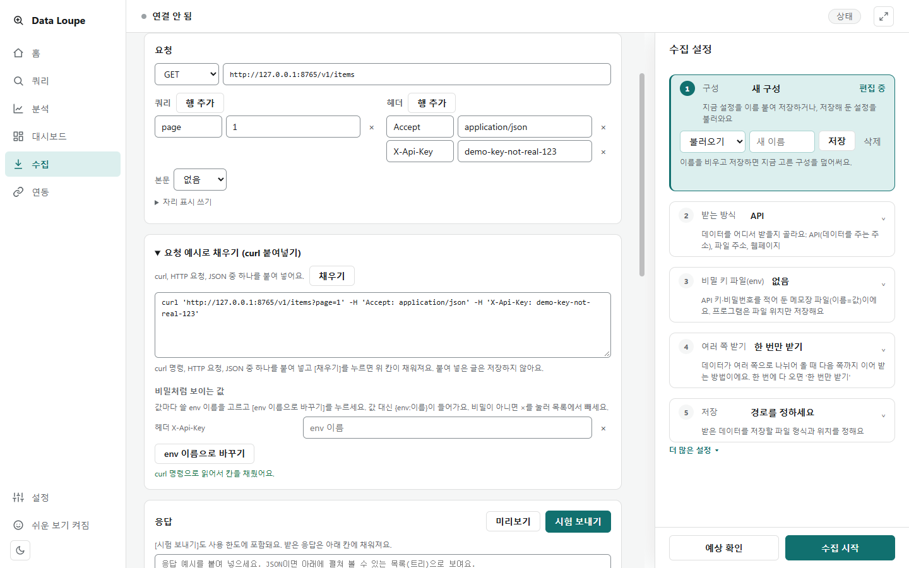

# 수집

[← README](../README.md) · [쿼리](query.md) · [분석](analysis.md) · [수집](collect.md) · [연동](integrations.md) · [대시보드](dashboard.md)

인터넷의 데이터(웹 API, 파일 주소, 웹페이지)를 받아 내 PC에 파일(Parquet·CSV·Excel·DuckDB 파일·SQLite 파일)로 저장하는 화면입니다. 받은 결과는 쿼리·분석 화면에서 바로 열 수 있고, DB 테이블이나 Kafka 토픽에 넣을(적재) 수 있으며, 정한 시각에 저절로 돌게 예약할 수 있습니다.

처음이면 화면 맨 위 **처음이면 이 순서로 해요** 안내대로 합니다: 오른쪽 **수집 설정**의 **받는 방식**을 고르고 → 가운데 카드에 주소를 넣어 시험해 보고 → 오른쪽 **저장**에서 파일 위치를 정한 뒤 **[수집 시작]**을 누릅니다.

- 가운데에는 위에서부터 요청(또는 파일 주소·웹페이지) · 요청 예시로 채우기 · 응답 · 적재 · 실행 · 예약 · 업로드 기록 · 실행 기록 카드가 있습니다.
- 오른쪽 **수집 설정**에는 번호가 붙은 단계(구성 · 받는 방식 · 비밀 키 파일(env) · 여러 쪽 받기 · 저장)가 있고, 맨 아래에 **[예상 확인]**·**[수집 시작]**이 있습니다. 단계 이름을 누르면 펼쳐집니다.
- 왼쪽 메뉴의 **쉬운 보기**가 켜져 있으면(기본) **받는 속도**·**사용 한도** 단계는 저장 단계 아래 **[더 많은 설정 ▾]** 뒤에 접혀 있습니다. 번호는 보이는 단계에만 차례로 붙습니다.

## 기능 설명

| 기능 | 한 줄 설명 | 자세히 |
|---|---|---|
| API 수집 | curl 예시를 붙여 넣어 요청을 만들고, 시험 보내기로 표의 줄이 될 목록을 골라 쪽마다 받기. 저장 형식 다섯 가지, 파일 주소로 받기도 여기에 | [functions/collect_api.md](functions/collect_api.md) |
| 웹페이지 수집 | 수집용 창에서 받을 값을 눌러 컬럼을 만들고 여러 쪽을 받기 | [functions/collect_web.md](functions/collect_web.md) |
| 적재·업로드 기록 | 결과를 DB 테이블(없는 DuckDB 파일은 새로 만듦)·Kafka 토픽에 넣고, 넣은 것을 장부로 남겨 그 적재분만 지울 명령 보기 | [functions/load.md](functions/load.md) |
| 예약 | 저장한 구성을 매일·매주·N분마다 프로그램 안에서나 Windows 예약 작업으로 돌리고, 결과를 알림으로 받기 | [functions/schedule.md](functions/schedule.md) |
| 보낼 곳(알림) | 예약 결과를 받을 Slack·Notion·웹훅 등록 | [functions/integrations_send.md](functions/integrations_send.md) |
