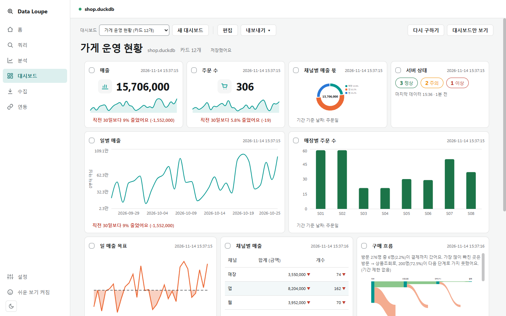

# 대시보드

[← README](../README.md) · [쿼리](query.md) · [분석](analysis.md) · [수집](collect.md) · [연동](integrations.md) · [대시보드](dashboard.md)

차트·KPI·표·상태 같은 카드를 한 화면에 모아 두는 곳입니다. 카드에는 구한 값이 함께 저장되어, 데이터에 연결하지 않아도 열면 바로 보입니다. 연결하면 정해 둔 주기가 지난 카드만 다시 구해 최신으로 바꿉니다.

위쪽 도구 줄은 왼쪽부터 **[대시보드 ▾]**(저장한 대시보드 고르기)·**[새 대시보드]** | **[편집]**·**[+ 카드 ▾]**·**[내보내기 ▾]** | 연결 이름·**[다시 구하기]**·**[설정]**·**[대시보드만 보기]**입니다.

대시보드 화면은 `web/`의 Next.js 화면을 빌드한 결과(`web/out`)입니다. 설치 파일(exe)에는 들어 있고, 소스에서 실행할 때는 Node.js로 한 번 빌드해야 합니다(README의 빌드 절). 빌드하지 않으면 `/dashboard`는 "대시보드 화면이 빌드되지 않았어요" 안내만 보입니다. 설치할 때 대시보드 기능을 빼면 이 화면 파일도 설치하지 않습니다.

## 기능 설명

| 기능 | 한 줄 설명 | 링크 |
|---|---|---|
| 기본 쓰기 | 대시보드 만들기·저장, 기준일·기간·비교 기준, 최신화와 실시간, 대시보드만 보기 | [dashboard_basics.md](functions/dashboard_basics.md) |
| 카드 종류 | KPI·도넛 KPI·게이지·요약 문장·표·문장·상태·경고·배치도·편차 표·지도 등 카드와 목표 파일·색 규칙 | [dashboard_cards.md](functions/dashboard_cards.md) |
| 편집 | [편집]으로 카드 끌어 옮기기·크기 바꾸기·설정 패널, 템플릿, 그림·보고서 저장, 카드 색 | [dashboard_edit.md](functions/dashboard_edit.md) |
| 지표 | [+ 카드 ▾] → [지표]로 여는 내 지표·지표 사전 목록(계산·고치기는 쿼리 화면) | [metrics.md](functions/metrics.md) |
