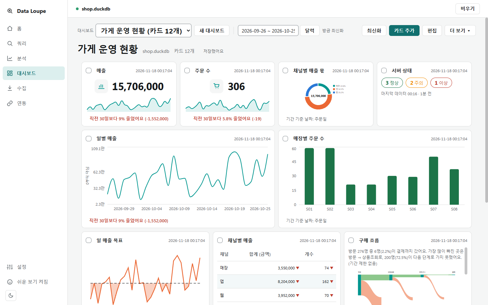

# 대시보드

[← README](../README.md) · [쿼리](query.md) · [분석](analysis.md) · [수집](collect.md) · [연동](integrations.md) · [대시보드](dashboard.md)

차트·KPI·표·상태 같은 카드를 한 화면에 모아 두는 곳입니다. 카드에는 구한 값이 함께 저장되어, 데이터에 연결하지 않아도 열면 바로 보입니다. 연결하면 정해 둔 주기가 지난 카드만 다시 구해 최신으로 바꿉니다.

왼쪽 메뉴에 두 곳이 있습니다. **[대시보드]**는 보는 곳이고, **[대시보드 만들기]**는 카드를 넣고 옮기고 고치는 곳입니다. 두 곳은 같은 대시보드를 엽니다.

보는 곳의 도구 줄: **대시보드** 고르는 칸 | **기간** 칸·**[달력]**·마지막으로 구한 때 | **[최신화]**·**[대시보드만 보기]**·**[만들기]**(지금 대시보드를 만드는 곳에서 엽니다)·**[예시 데이터로 확인하기]**·**[내보내기]**. 카드를 옮기거나 고치는 단추는 없습니다.

만드는 곳의 도구 줄은 왼쪽부터 **대시보드** 고르는 칸(저장한 대시보드 고르기)·**[새 대시보드]** | **기간** 칸·**[달력]**·마지막으로 구한 때("방금 최신화"·"5분 전 최신화"처럼) | **[최신화]**·**[카드 추가]**(강조 단추. 카드 추가 서랍을 엽니다)·**[+ 카드 ▾]**·**[보러 가기]**(저장하고 보는 곳에서 엽니다)·**[예시 데이터로 확인하기]**·**[더 보기 ▾]**(내보내기 · 대시보드 설정)입니다. 도구 줄 아래 제목 줄에는 대시보드 이름, 지금 연결 이름(없으면 "연결 안 됨"), 카드 수, 저장 상태("저장 중…"·"저장했어요")가 보입니다.

카드가 하나도 없으면 가운데에 시작 안내와 **[카드 추가]**·**[쿼리에서 가져오기]** 단추가 나옵니다.

대시보드 화면은 `web/`의 Next.js 화면을 빌드한 결과(`web/out`)입니다. 설치 파일(exe)에는 들어 있고, 소스에서 실행할 때는 Node.js로 한 번 빌드해야 합니다(README의 빌드 절). 빌드하지 않으면 `/dashboard`는 "대시보드 화면이 빌드되지 않았어요" 안내만 보입니다. 설치할 때 대시보드 기능을 빼면 이 화면 파일도 설치하지 않습니다.

## 대시보드 바로가기

대시보드 하나를 따로 창으로 바로 여는 Windows 바로가기(.lnk)를 만듭니다.

- **만들기**: 보는 곳의 도구 줄에서 **[대시보드만 보기]** 옆 **[바로가기 만들기]**를 누릅니다. 아이콘을 바꾸려면 .ico 파일을 고르고(안 고르면 앱 아이콘), 저장할 곳을 고르면 끝납니다.
- **연결**: 바로가기는 만들 때의 연결을 기억합니다(비밀번호는 기억하지 않습니다). 연결 없이 만들 수도 있습니다.
- **열기**: 바로가기를 실행하면 본체와 따로 창이 열리고, 받아 둔 값으로 먼저 보입니다. 본체나 다른 바로가기와 같이 열 수 있습니다.
- **창에서 되는 것**: 기간·필터·쪽 바꾸기, **[최신화]**, 화면 모드, 내보내기, CSV 저장. 카드를 고치거나 설정을 바꾸는 것, 줄 표시를 바꾸는 것은 안 됩니다. 화면 모드는 그 창에서만 바뀝니다.
- **비밀번호**: 데이터베이스 연결이면 **[최신화]**를 누를 때나 첫 자동 갱신 때 비밀번호를 묻습니다. 저장하지 않습니다. 기억한 연결을 못 찾으면 주소·아이디·비밀번호를 묻고, 그 연결을 바로가기가 기억합니다.
- **같이 열 때**: 본체와 바로가기 창이 같은 데이터를 동시에 받으면 늦은 쪽은 받지 않고 알려 줍니다. 같은 대시보드를 두 창에서 고치면 한쪽이 다른 쪽을 덮을 수 있습니다.
- **대시보드를 지웠으면**: 바로가기를 실행해도 창은 열리지 않고 알림 창만 뜹니다.

## 기능 설명

| 기능 | 한 줄 설명 | 링크 |
|---|---|---|
| 기본 쓰기 | 대시보드 만들기·저장, 기준일·기간·비교 기준, 최신화·갱신 주기·데이터 받기, 통화 기호, 필터 칸, 자세히 보기(값·크게 보기·줄 상세), 대시보드만 보기 | [dashboard_basics.md](functions/dashboard_basics.md) |
| 카드 종류 | 차트·KPI·도넛 KPI·게이지·요약 문장·표·목록·문장·상태·경고·배치도·편차 표·히스토그램·히트맵·생키·코호트·지도 등 카드 31가지와 목표 파일·색 규칙 | [dashboard_cards.md](functions/dashboard_cards.md) |
| 편집 | [대시보드 만들기]에서 카드 끌어 옮기기·크기 바꾸기·설정 패널, 템플릿, 그림·보고서 저장, 카드 색 | [dashboard_edit.md](functions/dashboard_edit.md) |
| 지표 | [+ 카드 ▾] → [지표]로 여는 내 지표·지표 사전 목록(계산·고치기는 쿼리 화면) | [metrics.md](functions/metrics.md) |
