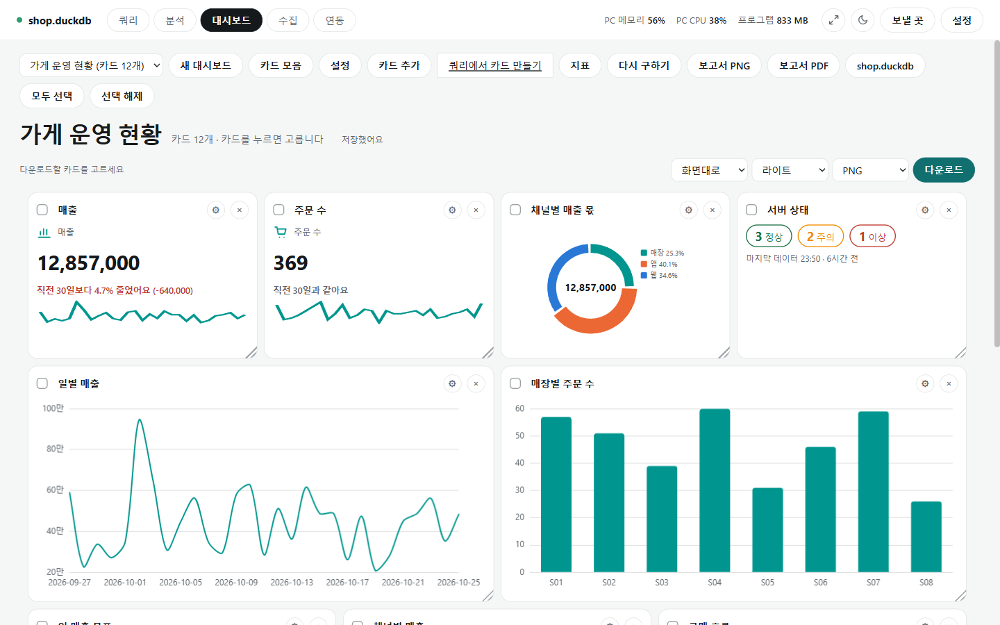

# 대시보드

[← README](../README.md) · [쿼리](query.md) · [분석](analysis.md) · [수집](collect.md) · [연동](integrations.md) · [대시보드](dashboard.md)

차트·KPI·표·상태 같은 카드를 한 화면에 모아 두는 곳입니다. 카드에는 구한 값이 함께 저장되어, 데이터에 연결하지 않아도 열면 바로 보입니다. 연결하면 정해 둔 주기가 지난 카드만 다시 구해 최신으로 바꿉니다.

## 기능 설명

| 기능 | 한 줄 설명 | 링크 |
|---|---|---|
| 기본 쓰기 | 대시보드 만들기·저장, 기준일과 기간, 최신화와 실시간, 첫 화면에서 열기 | [dashboard_basics.md](functions/dashboard_basics.md) |
| 카드 종류 | KPI·도넛 KPI·게이지·요약 문장·표·문장·상태·경고·배치도·편차 표·지도 등 카드와 목표 파일·색 규칙 | [dashboard_cards.md](functions/dashboard_cards.md) |
| 편집 | 카드 끌어 옮기기, 크기 바꾸기, 설정 패널, 템플릿, 그림·보고서 저장, 색과 팔레트 | [dashboard_edit.md](functions/dashboard_edit.md) |
| 지표 | 대시보드 위쪽 [지표] 단추로 여는, 쿼리 화면과 같은 지표 화면 | [metrics.md](functions/metrics.md) |
