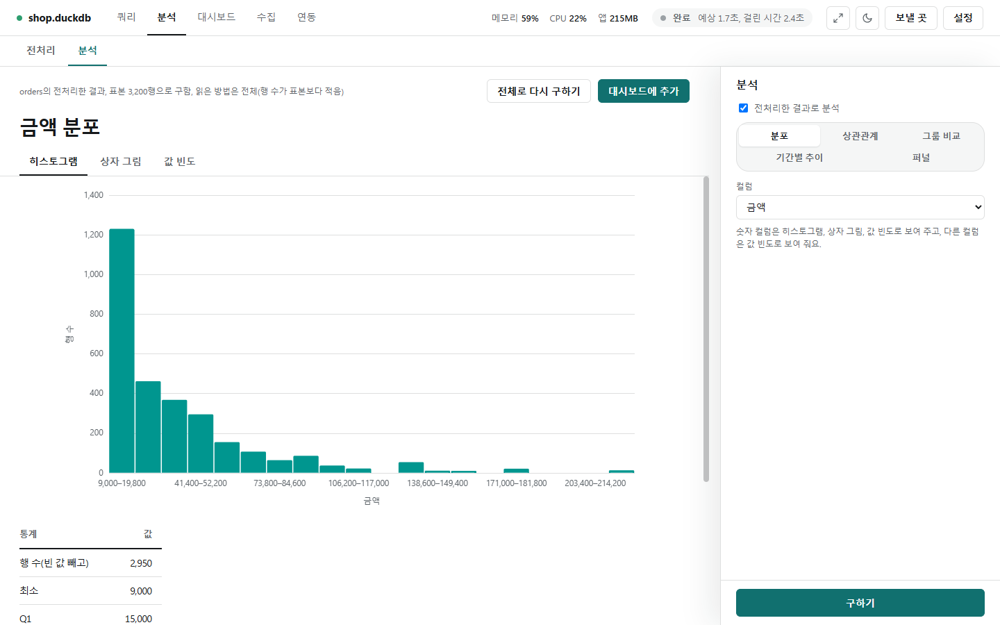
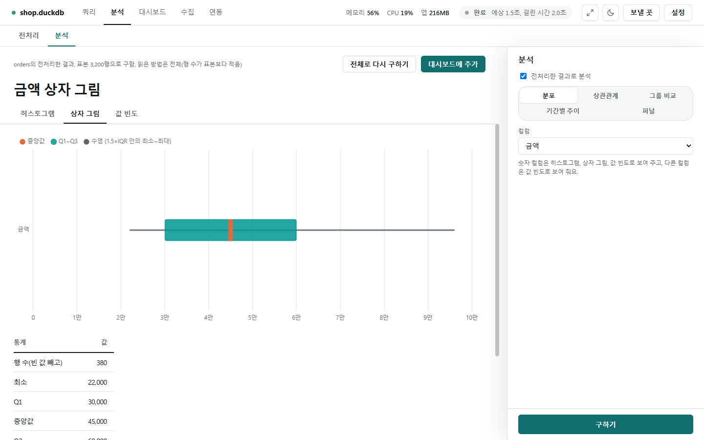
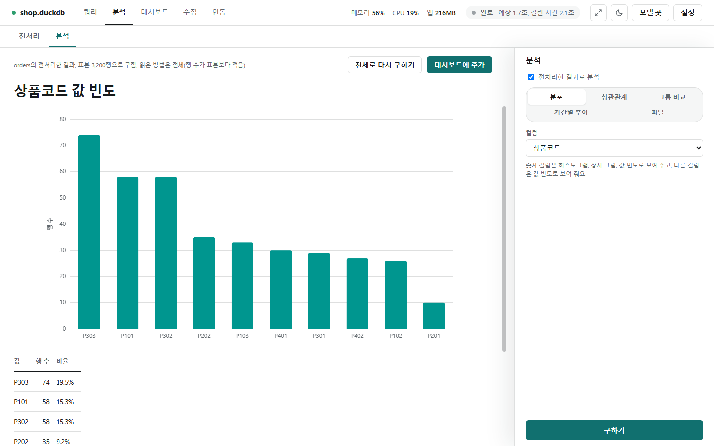
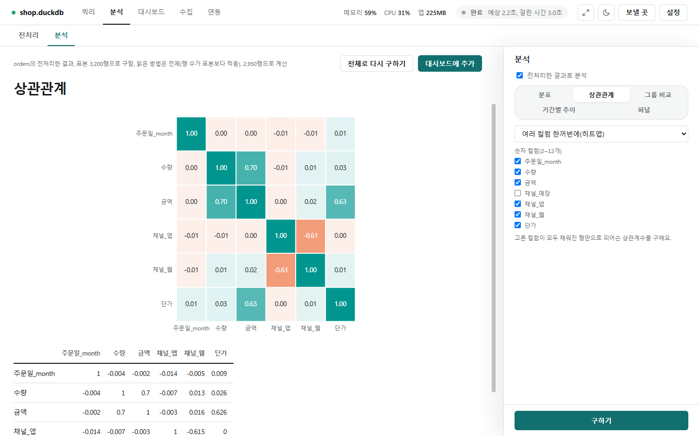
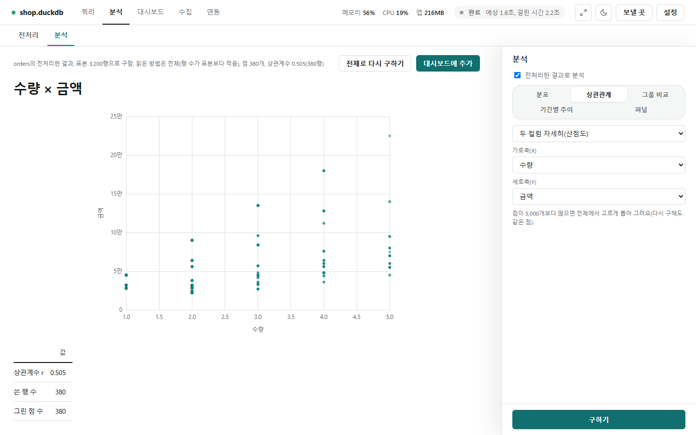
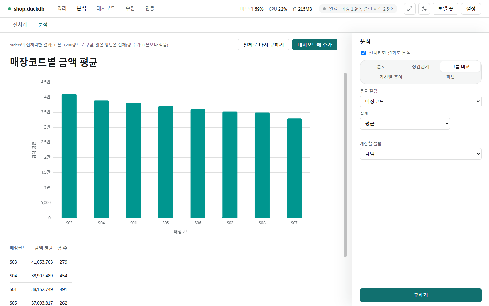
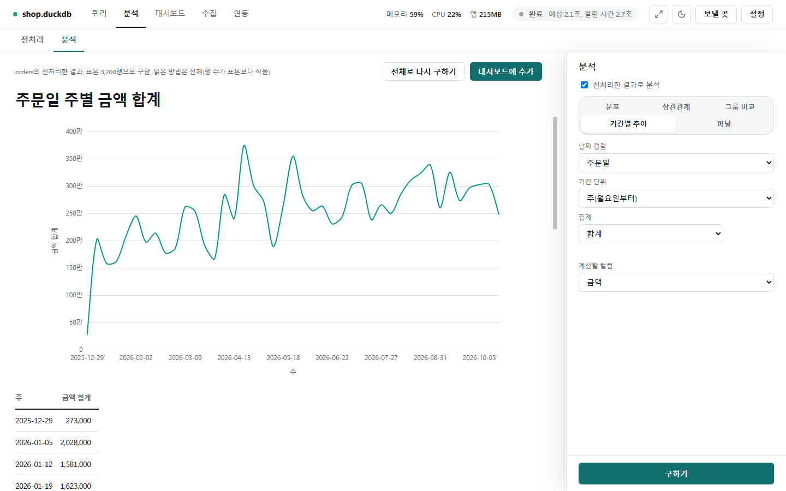

# 분석 탭

[← 분석](../analysis.md)

전처리 탭에서 고른 테이블이 어떻게 생겼는지 그래프와 표로 봅니다. 오른쪽에서 분석 종류를 고르고 칸을 채운 뒤 **[구하기]**를 누릅니다.

- **전처리한 결과로 분석**이 켜져 있으면 전처리 탭에서 고른 정리를 적용한 데이터로 구합니다. 끄면 원래 테이블로 구합니다.
- 기본은 표본(전처리 탭의 표본 행 수)으로 구합니다. 위쪽 회색 줄에 테이블, 전처리 적용 여부, 표본 행 수와 읽은 방법이 적힙니다.
- **[전체로 다시 구하기]**는 테이블 전체로 다시 구합니다(퍼널은 늘 전체로 구해 이 단추가 없습니다). 큰 테이블은 오래 걸리고, 요금이 나오는 DB는 비용이 듭니다.
- 실수 컬럼의 무한대 값과 NaN은 빈 값으로 보고 합계·평균 같은 계산에서 뺍니다(한 칸 때문에 결과 전체가 비지 않게).

## 분포

- **분포**를 고르고 컬럼 하나(예: `금액`)를 골라 [구하기]를 누릅니다. 값이 주로 어디에 몰려 있는지 봅니다.
- 숫자 컬럼은 **[히스토그램]**(20구간 막대)·**[상자 그림]**(사분위수와 튀는 값)·**[값 빈도]** 탭으로, 그 밖의 컬럼은 값 빈도로 봅니다.

- 아래 통계 표에 빈 값을 뺀 행 수, 최소, 사분위수(Q1·중앙값·Q3), 평균, 최대 등이 나옵니다.

- 값 빈도는 많이 나온 20개 값을 보이고, 나머지는 "그 밖의 값 N종류"로 묶습니다. 사진처럼 글자 컬럼(`상품코드`)은 탭 없이 값 빈도만 나옵니다.

## 상관관계

- 한 값이 커질 때 다른 값도 커지는지 봅니다. 1에 가까우면 같이 커지고, -1에 가까우면 반대로 움직입니다.
- **여러 컬럼 한꺼번에(히트맵)**: 숫자 컬럼을 2~12개 체크합니다. 고른 컬럼이 모두 채워진 행만으로 피어슨 상관계수를 구하고, 아래 표에도 같은 값이 나옵니다.

- **두 컬럼 자세히(산점도)**: **가로축(X)**·**세로축(Y)** 컬럼을 고르면 점을 그립니다. 점이 5,000개를 넘으면 전체에서 고르게 뽑습니다(다시 구해도 같은 점). 고르게 뽑지 못하는 연결에서는 앞에서부터 5,000개를 씁니다.

## 그룹 비교

- **묶을 컬럼**(예: `매장코드`), **집계**(예: `평균`), **계산할 컬럼**(예: `금액`)을 고릅니다. 집계는 함수 사전의 집계를 모두 쓸 수 있습니다.
- 행이 많은 그룹 30개까지 보이고, 숫자 결과는 값이 큰 순으로 늘어놓습니다. 표에는 그룹마다 행 수도 나옵니다.

## 기간별 추이

- **날짜 컬럼**, **기간 단위**(일·주(월요일부터)·월), **집계**, **계산할 컬럼**을 고릅니다. 날짜 컬럼은 날짜 타입이어야 하니, 글자로 된 날짜는 전처리에서 먼저 바꿉니다.
- 기간이 400개를 넘으면 최근 400개를 보입니다.
- 개수·합계는 행이 없는 기간을 0으로 채웁니다. 평균 같은 집계는 빈 기간을 두지 않습니다.

## 퍼널

단계를 순서대로 거쳐 간 사람 수를 봅니다. [퍼널](funnel.md)에 따로 설명합니다.

## 대시보드에 추가

- 그래프 위 **[대시보드에 추가]**를 누르고, 넣을 대시보드를 고르거나 새 대시보드 이름을 쓴 뒤 **[추가]**를 누릅니다.
- 지금 보이는 그래프가 구한 값과 함께 카드로 들어갑니다. 구한 값이 카드에 들어 있으므로 이 PC·이 Windows 계정에서만 풀 수 있게 암호화해 저장합니다.
- 넣은 카드는 대시보드 화면에서 봅니다([대시보드](../dashboard.md)).
