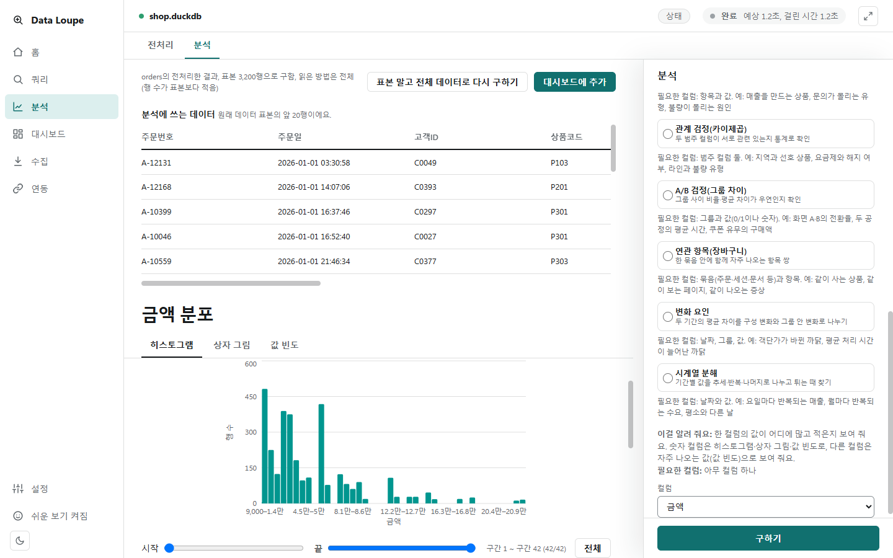
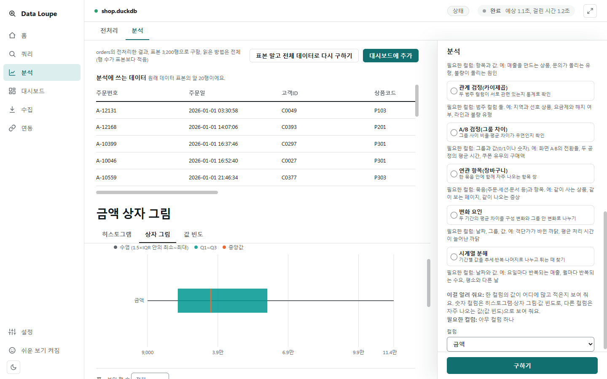
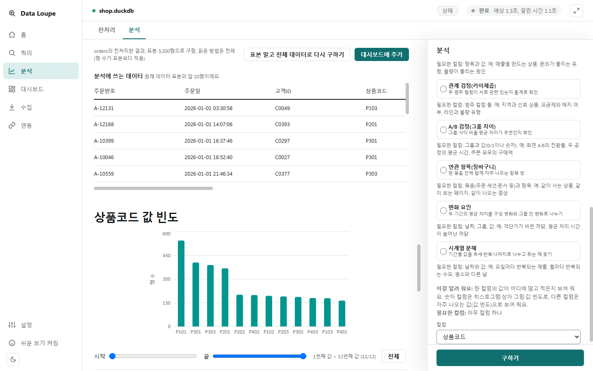
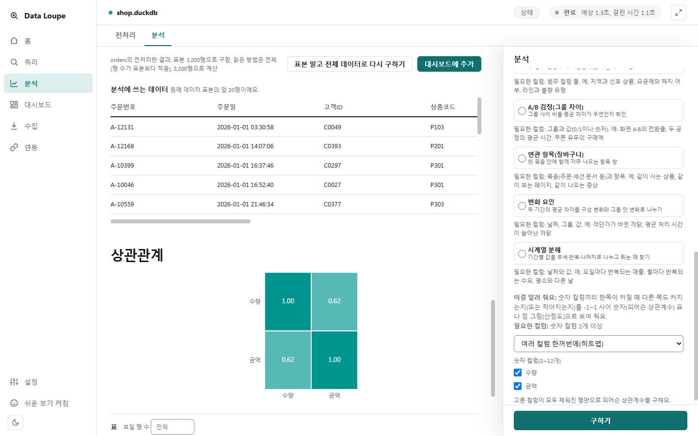
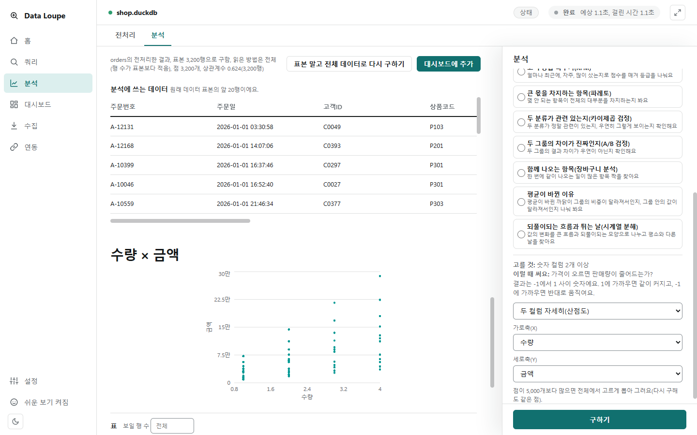
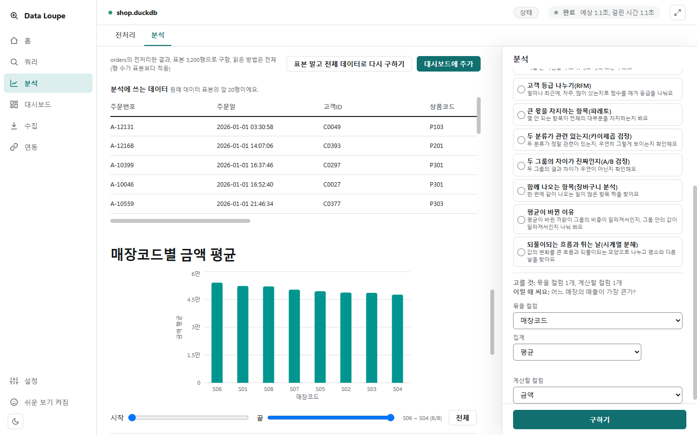
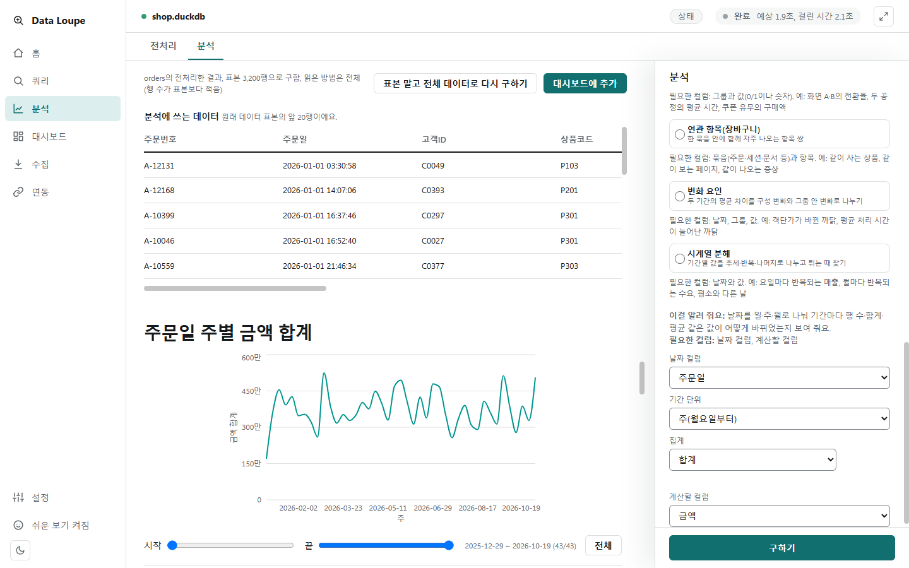
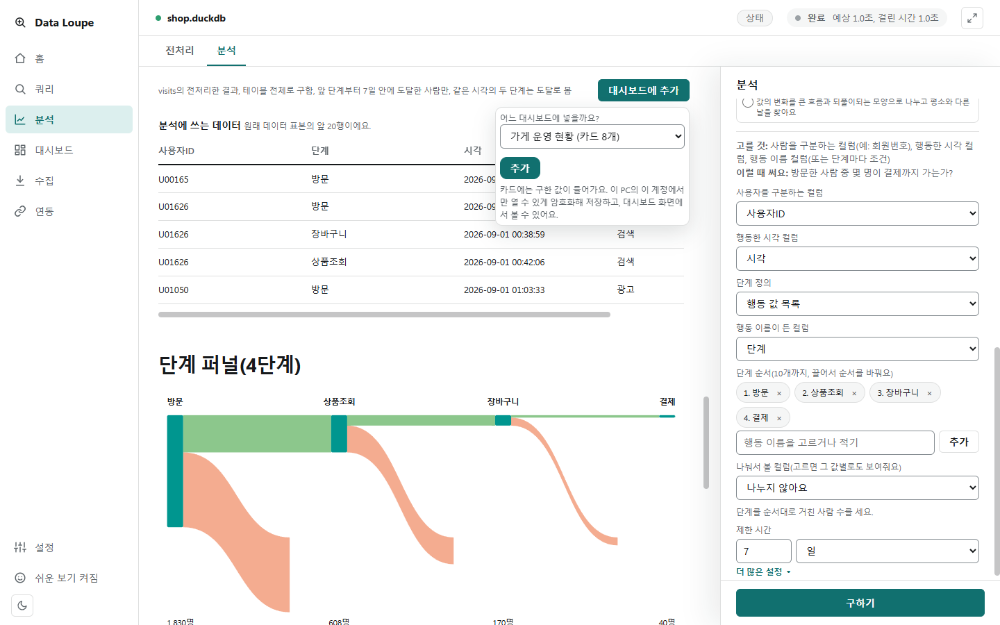

# 분석 탭

[← 분석](../analysis.md)

분석 화면 위쪽 **[분석]** 탭에서, 전처리 탭에서 고른 테이블이 어떻게 생겼는지 그래프와 표로 봅니다. 오른쪽에서 분석 종류 카드를 고르고 칸을 채운 뒤 아래 **[구하기]**(Ctrl+Enter)를 누릅니다.

- **전처리 탭에서 정리한 데이터로 분석**(처음에 켜짐)이 켜져 있으면 전처리 탭에서 고른 정리를 적용한 데이터로 구합니다. 끄면 원래 테이블로 구합니다.
- 가운데 맨 위 **분석에 쓰는 데이터** 표에 분석할 데이터의 앞 20행이 보입니다.
- 기본은 표본(전처리 탭의 **미리 읽을 행 수**)으로 구합니다. 위쪽 회색 줄에 테이블, 전처리 적용 여부, 표본 행 수와 읽은 방법이 적힙니다.
- 쿼리 화면에서 마지막에 고른 테이블을 기억해 두었다가, 이 화면을 열면 같은 연결에서 그 테이블을 이어서 엽니다.
- **[표본 말고 전체 데이터로 다시 구하기]**는 마지막 분석을 테이블 전체로 다시 구합니다. 큰 테이블은 오래 걸리고, 요금이 나오는 DB는 비용이 듭니다. 늘 테이블 전체로 구하는 분석(퍼널·리텐션·RFM·파레토·장바구니 분석·평균이 바뀐 이유·시계열 분해)에서는 이 단추가 보이지 않습니다.
- 결과는 **그래프**와 **표**로 나옵니다. 표의 **보일 행 수** 칸에 숫자를 넣으면 받은 결과를 화면에서 줄여 보고(다시 구하지 않음), 비우면 모두 봅니다. 결과가 두 줄 이상이면 그래프 아래 **시작**·**끝** 슬라이더로 보일 범위를 좁히고 **[전체]**로 되돌립니다. 최빈값·이어 붙이기처럼 글자가 나오는 집계는 그래프 없이 표로만 보입니다.
- 실수 컬럼의 무한대 값과 NaN은 빈 값으로 보고 합계·평균 같은 계산에서 뺍니다(한 칸 때문에 결과 전체가 비지 않게).
- ID·해시로 보이는 컬럼은 묶기·집계 목록에서 빠지고, 패널 위 안내의 **[다시 넣기]**로 되살립니다.

## 분석 종류 카드 13개

오른쪽 패널은 두 구역입니다. 위 **분석 종류** 구역에는 카드 13개가 한 줄에 하나씩 있고, 카드마다 **이름**과 **한 줄 설명**만 적혀 있습니다. 카드를 누르면 아래 구역에 그 분석의 **고를 것**, **이럴 때 써요**(예로 든 질문)와 채울 칸이 나옵니다.

| 카드 | 한 줄 설명 | 고를 것 | 이럴 때 써요 |
|---|---|---|---|
| 값이 퍼진 모양(분포) | 값이 주로 얼마쯤이고 얼마나 고르게 퍼져 있는지 봐요 | 컬럼 1개 | 주문 금액은 주로 얼마인가? |
| 같이 움직이는 숫자(상관관계) | 한 숫자가 커질 때 다른 숫자도 커지는지 봐요 | 숫자 컬럼 2개 이상 | 가격이 오르면 판매량이 줄어드는가? |
| 묶음끼리 비교 | 매장·팀 같은 묶음마다 합계나 평균을 구해 나란히 봐요 | 묶을 컬럼, 계산할 컬럼 | 어느 매장의 매출이 가장 큰가? |
| 날짜에 따른 변화 | 날·주·달이 지나면서 값이 늘었는지 줄었는지 봐요 | 날짜 컬럼, 계산할 컬럼 | 매출이 달마다 늘고 있는가? |
| 단계마다 남는 수(퍼널) | 여러 단계를 차례로 거칠 때 몇 명이 남고 어디서 많이 빠지는지 봐요 | 사람을 구분하는 컬럼, 시각 컬럼, 단계 | 방문한 사람 중 몇 명이 결제까지 가는가? |
| 다시 오는 비율(리텐션) | 처음 온 사람들이 그 뒤에도 계속 오는지 봐요 | 사람을 구분하는 컬럼, 날짜 컬럼 | 이번 달에 가입한 사람이 다음 달에도 오는가? |
| 고객 등급 나누기(RFM) | 얼마나 최근에, 자주, 많이 샀는지로 점수를 매겨 등급을 나눠요 | 고객을 구분하는 컬럼, 날짜 컬럼, 금액 컬럼 | 단골은 누구이고 떠나려는 고객은 누구인가? |
| 큰 몫을 차지하는 항목(파레토) | 몇 안 되는 항목이 전체의 대부분을 차지하는지 봐요 | 항목 컬럼, 값 컬럼 | 매출의 80%를 만드는 상품은 몇 개인가? |
| 두 분류가 관련 있는지(카이제곱 검정) | 두 분류가 정말 관련이 있는지, 우연히 그렇게 보이는지 확인해요 | 종류로 나뉘는 컬럼 2개 | 지역에 따라 잘 팔리는 상품이 다른가? |
| 두 그룹의 차이가 진짜인지(A/B 검정) | 두 그룹의 결과 차이가 우연이 아닌지 확인해요 | 그룹 컬럼, 값 컬럼(0·1이나 숫자) | 새 화면을 본 사람이 더 많이 샀는가? |
| 함께 나오는 항목(장바구니 분석) | 한 번에 같이 나오는 일이 많은 항목 짝을 찾아요 | 묶음을 구분하는 컬럼(주문번호 등), 항목 컬럼 | 빵을 산 사람은 우유도 같이 사는가? |
| 평균이 바뀐 이유 | 평균이 바뀐 까닭이 그룹의 비중이 달라져서인지, 그룹 안의 값이 달라져서인지 나눠 봐요 | 날짜 컬럼, 그룹 컬럼, 값 컬럼, 두 기간 | 객단가가 내린 것은 싼 상품이 많이 팔려서인가? |
| 되풀이되는 흐름과 튀는 날(시계열 분해) | 값의 변화를 큰 흐름과 되풀이되는 모양으로 나누고 평소와 다른 날을 찾아요 | 날짜 컬럼, 계산할 컬럼 | 주말마다 매출이 오르는가? |

- 앞의 넷(분포·상관관계·묶음끼리 비교·날짜에 따른 변화)은 이 문서 아래에, 퍼널은 [퍼널](funnel.md)에, 뒤의 여덟(리텐션~시계열 분해)은 넣는 칸·결과·한계를 [분석](../analysis.md#분석-탭의-새-분석-8가지)에 표로 설명합니다.
- 쉬운 보기가 켜져 있으면 덜 쓰는 칸(경과 칸 수, 기준일, A·B 경계, 신뢰 수준, 최소 지지도 등)은 **[더 많은 설정 ▾]** 안에 있습니다. 비우면 기본값을 씁니다.

### A/B 검정의 사용자 칸

A/B 검정은 **그룹 컬럼**, **지표**(비율·평균), **값 컬럼**, **대조군**(그룹 컬럼의 값 중에서 고름), **사용자 컬럼**을 채웁니다.

- 한 사람이 여러 행인 자료(예: 주문마다 한 행)는 **사용자 컬럼을 꼭 고릅니다**. 고르면 사람마다 먼저 모은 뒤(비율은 한 번이라도 1이면 1, 평균은 합계) 검정합니다.
- 고르지 않으면 한 행을 한 사람으로 보아 p값이 실제보다 작게 나올 수 있고, 결과 위에 그렇게 알립니다.
- 두 그룹의 크기가 1:1로 보기 어렵거나 값이 1개뿐인 그룹을 뺐으면 결과 위에 알립니다.
- **신뢰 수준(%)**은 비우면 [설정](settings.md#앱-설정)의 [표본] 분류 신뢰수준을 씁니다.

### RFM

**사용자를 구분하는 컬럼**, **시각 컬럼(날짜)**, **금액 컬럼**을 고르면 최근에(R)·자주(F)·많이(M) 한 정도를 5단계 점수로 나누고 세그먼트로 묶습니다. 테이블 전체로 구합니다.

- **기준일**을 비우면 자료의 마지막 날입니다. **거래 키**를 고르면 빈도를 고유 거래 수로, 안 고르면 행 수로 셉니다.
- 같은 값이 몰려 5단계로 나눌 수 없는 축(예: 대부분 한 번만 산 빈도)은 있는 값만큼만 나누고 결과 위에 알립니다.

## 분포

- **분포**를 고르고 컬럼 하나(예: `금액`)를 골라 [구하기]를 누릅니다. 값이 주로 어디에 몰려 있는지 봅니다.
- 숫자 컬럼은 **[히스토그램]**(20구간 막대)·**[상자 그림]**(사분위수와 튀는 값)·**[값 빈도]** 탭으로, 그 밖의 컬럼은 값 빈도로 봅니다.

- 아래 통계 표에 빈 값을 뺀 행 수, 최소, 사분위수(Q1·중앙값·Q3), 평균, 최대 등이 나옵니다.

- 값 빈도는 많이 나온 20개 값을 보이고, 나머지는 "그 밖의 값 N종류"로 묶습니다. 사진처럼 글자 컬럼(`상품코드`)은 탭 없이 값 빈도만 나옵니다.

## 상관관계

- 한 값이 커질 때 다른 값도 커지는지 봅니다. 1에 가까우면 같이 커지고, -1에 가까우면 반대로 움직입니다.
- **여러 컬럼 한꺼번에(히트맵)**: 숫자 컬럼을 2~12개 체크합니다. 고른 컬럼이 모두 채워진 행만으로 피어슨 상관계수를 구하고, 아래 표에도 같은 값이 나옵니다.

- **두 컬럼 자세히(산점도)**: **가로축(X)**·**세로축(Y)** 컬럼을 고르면 점을 그립니다. 점이 5,000개를 넘으면 전체에서 고르게 뽑습니다(다시 구해도 같은 점). 고르게 뽑지 못하는 연결에서는 앞에서부터 5,000개를 씁니다.

## 묶음끼리 비교

- **묶을 컬럼**(예: `매장코드`), **집계**(예: `평균`), **계산할 컬럼**(예: `금액`)을 고릅니다. 집계는 함수 사전의 집계를 모두 쓸 수 있습니다.
- 행이 많은 그룹 30개까지 보이고, 숫자 결과는 값이 큰 순으로 늘어놓습니다. 표에는 그룹마다 행 수도 나옵니다.

## 날짜에 따른 변화

- **날짜 컬럼**, **기간 단위**(일·주(월요일부터)·월), **집계**, **계산할 컬럼**을 고릅니다. 날짜 컬럼은 날짜 타입이어야 하니, 글자로 된 날짜는 전처리에서 먼저 바꿉니다.
- 기간이 400개를 넘으면 최근 400개를 보입니다.
- 개수·합계는 행이 없는 기간을 0으로 채웁니다. 평균 같은 집계는 빈 기간을 두지 않습니다.

## 퍼널

단계를 순서대로 거쳐 간 사람 수를 봅니다. [퍼널](funnel.md)에 따로 설명합니다.

## 그래프 도구와 그림 저장

그래프 위 도구 줄에서 **자동 규칙**(구간 수·꼬리 자르기·점 밀도·숫자 줄이기)과 **모든 데이터**를 정하고, 밝게·어둡게를 골라 **[PNG]**·**[JPG]**로 저장합니다(**모든 데이터 포함**을 켜면 덜어 낸 것까지 담음). 자세한 것은 [분석](../analysis.md#분석-차트의-자동-규칙과-모든-데이터)에 있습니다.

## 대시보드에 추가

- 위쪽 **[대시보드에 추가]**를 누르고, "어느 대시보드에 넣을까요?"에서 넣을 대시보드를 고르거나 **새 대시보드 이름**을 쓴 뒤 **[추가]**를 누릅니다.
- 지금 보이는 그래프가 구한 값과 함께 카드로 들어갑니다. 구한 값이 카드에 들어 있으므로 이 PC·이 Windows 계정에서만 풀 수 있게 암호화해 저장합니다.
- 리텐션부터 시계열 분해까지의 여덟 분석과, 그래프 없이 표로만 나오는 결과는 아직 카드로 담지 않아 단추가 꺼집니다.
- 넣은 카드는 대시보드 화면에서 봅니다([대시보드](../dashboard.md)).
