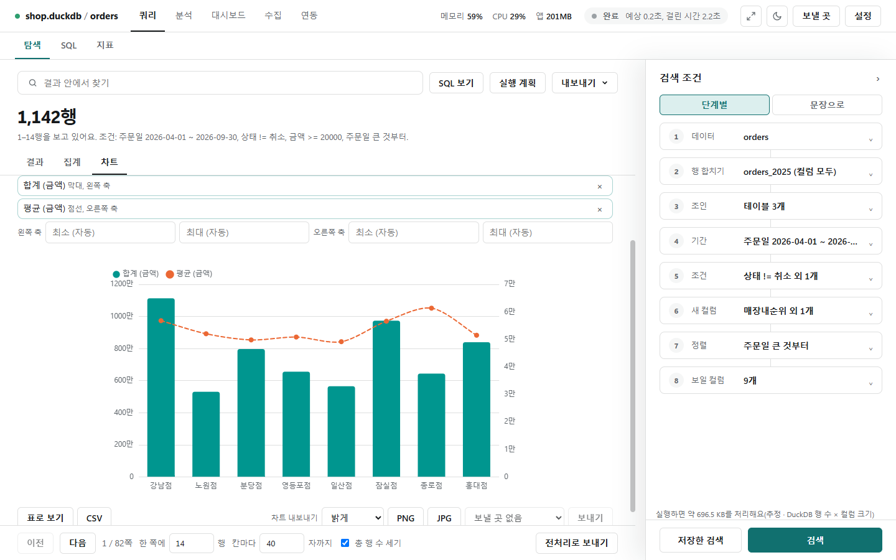
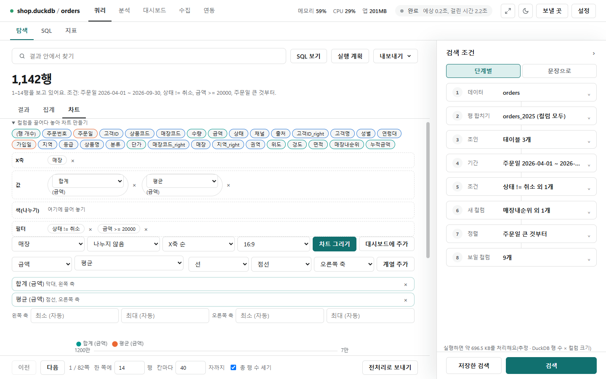
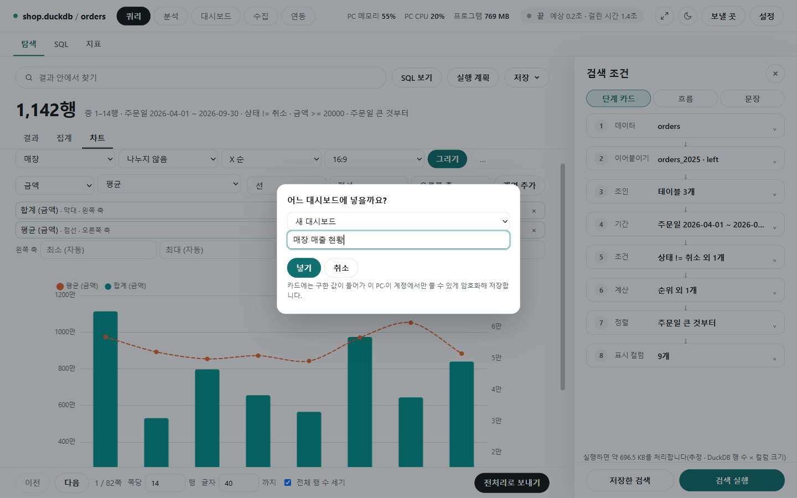
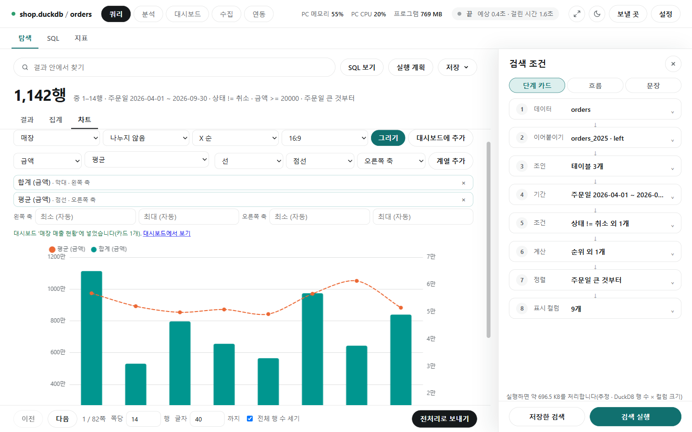

# 차트

[← 쿼리](../query.md)

결과 위 **[차트]** 탭에서 지금 조건의 결과를 그래프로 봅니다. 그린 차트는 값과 함께 대시보드에 넣을 수 있습니다.

## 막대와 선 겹치기

- 첫 줄: X축 컬럼(매장), 나눌 컬럼(값마다 막대나 선을 나눔, 최대 8개), 순서(**X축 순**·**값 큰 순**), 비율(자동·1:1·16:9), **[차트 그리기]**.
- 둘째 줄: Y 컬럼(금액), 집계(평균 — [함수 사전](sql_functions.md)의 집계 전부), 종류(막대·선), 선 모양(실선·점선), 축(왼쪽·오른쪽) → **[계열 추가]**.
- 넣은 계열이 목록(`합계 (금액) · 막대 · 왼쪽 축`, `평균 (금액) · 점선 · 오른쪽 축`)으로 쌓이고 한 차트에 겹쳐 그려집니다. ×로 뺍니다.
- 왼쪽·오른쪽 축의 최소·최대는 비우면 자동입니다.
- X 값은 50개까지 그립니다. X가 날짜면 최근 50개를 남깁니다.
- 아래에서 **[표로 보기]**, CSV, **차트 내보내기**(밝게·어둡게, PNG·JPG), 보낼 곳으로 **[보내기]**를 합니다.

## 컬럼을 끌어다 놓아 차트 만들기

- **컬럼을 끌어다 놓아 차트 만들기**를 펼치면 컬럼 칩이 나옵니다. 칩을 **X축**·**값**·**색(나누기)**·**필터** 칸에 끌어 놓으면 차트가 바로 바뀝니다(칩을 누르고 칸을 눌러도 됨).
- **(행 개수)** 칩은 행 수를 셉니다. 값 칸에서는 집계(합계·평균 …)를 고릅니다.
- 필터 칸에는 지금 걸린 조건(`상태 != 취소`, `금액 >= 20000`)이 보입니다.

## 대시보드에 추가

- **[대시보드에 추가]**를 누르면 "어느 대시보드에 넣을까요?"가 뜹니다. 있는 대시보드를 고르거나 **새 대시보드**를 고르고 이름(예: '매장 매출 현황')을 써서 **[넣기]**합니다.
- 카드에 담긴 값은 암호화해서 저장하고, 이 PC의 이 계정에서만 열 수 있습니다.

- 넣으면 차트 위에 "‘매장 매출 현황’ 대시보드에 넣었어요. 지금 카드는 1개예요."와 **대시보드에서 보기** 링크가 뜹니다. 대시보드에서는 저장된 값으로 보고 최신으로 바꿉니다([대시보드](../dashboard.md)).
