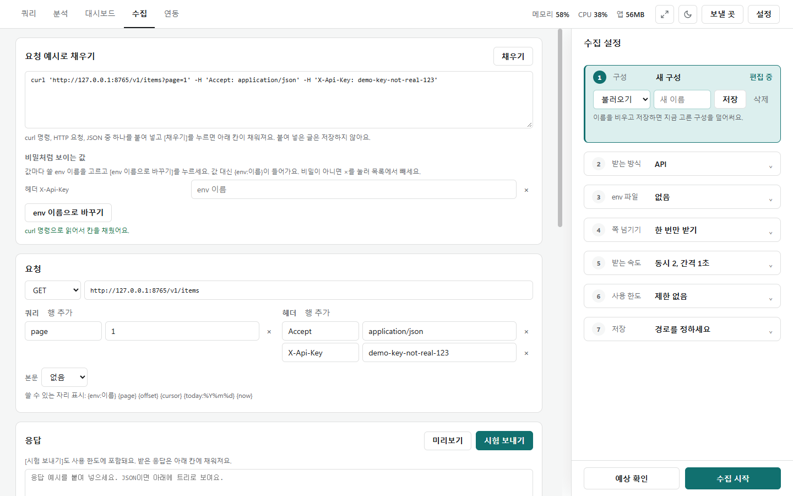
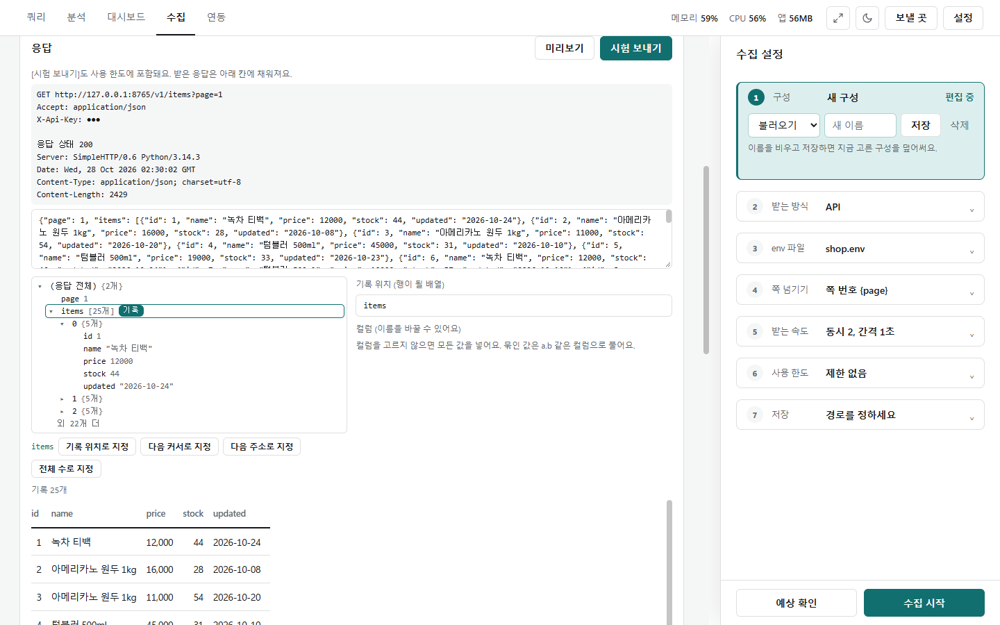
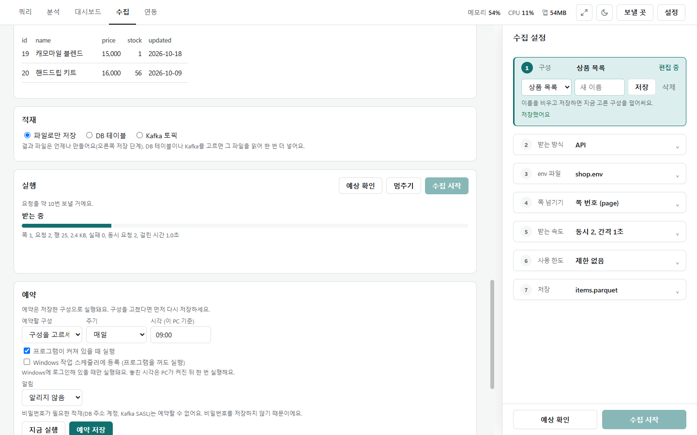
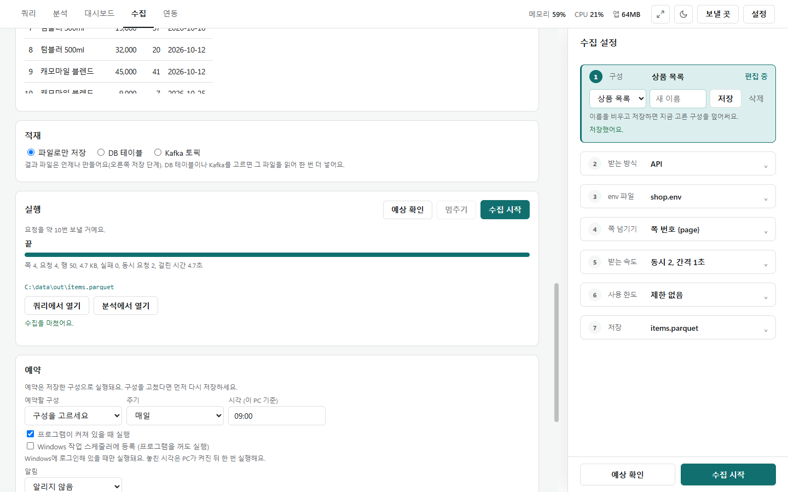
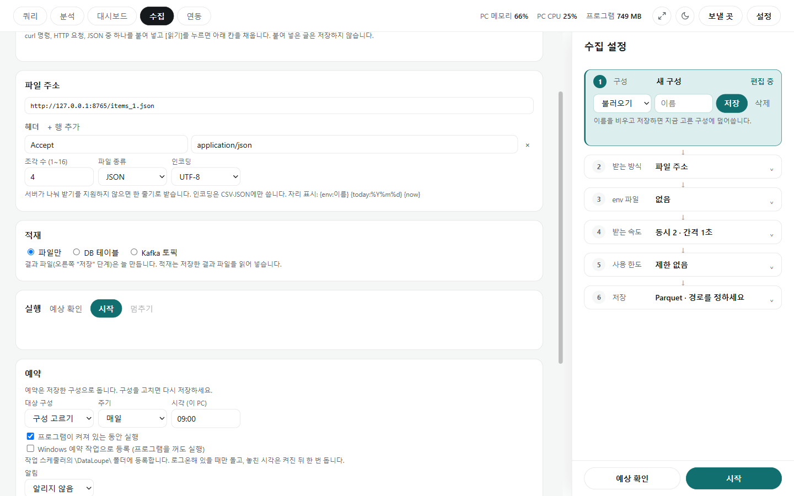

# API 수집

[← 수집](../collect.md)

API는 프로그램끼리 데이터를 주고받는 창구입니다. 주소로 요청하면 데이터(대개 JSON 글자)를 돌려줍니다. API 문서에 있는 요청 예시를 붙여 넣는 것부터 시작합니다.

## 요청 예시 붙여 넣기

- **요청 예시 붙여 넣기**에 curl 명령, HTTP 요청, JSON 중 하나를 붙여 넣고 **[읽기]**를 누르면 아래 **요청** 카드(방식·주소·쿼리·헤더·본문)가 채워집니다. 붙여 넣은 글은 저장하지 않습니다.
- 키·토큰처럼 보이는 값이 있으면 **비밀처럼 보이는 값**에 나옵니다(사진은 `X-Api-Key` 헤더). env 이름을 고르고 **[env 이름으로 바꾸기]**를 누르면 값 대신 `{env:이름}`이 들어가 키가 저장되지 않습니다. 비밀이 아니면 ×로 뺍니다(그 자리만 빠지고, 같은 이름이 다른 자리에 있으면 그것은 여전히 비밀로 봅니다).
- env 파일은 `이름=값`을 적은 메모장 파일입니다. 오른쪽 ③ **env 파일**에 경로를 넣고 [읽기]합니다. 값은 저장하지 않고 경로만 저장합니다.
- 주소·쿼리·헤더에 쓸 수 있는 자리 표시: `{env:이름}` `{page}` `{offset}` `{cursor}` `{today:%Y%m%d}`(보낼 때 오늘 날짜로) `{now}`.

## 시험 보내기와 기록 위치

- **응답** 카드의 **[시험 보내기]**는 첫 쪽을 한 번 보내 봅니다(사용 한도에도 셉니다). 보낸 요청의 키는 `●●●`로 가려 보입니다.
- 응답 트리에서 목록(사진은 `items`)을 누르고 **[기록 위치로]**를 누르면 그 배열의 항목 하나가 한 행이 됩니다. 아래에 앞 행 미리보기가 나옵니다.
- 같은 자리에서 **[다음 커서 위치]**·**[다음 주소 위치]**·**[전체 수 위치]**도 지정합니다(쪽 넘기기에 씀). 컬럼 이름은 바꿀 수 있고, 비우면 전부 넣습니다(묶인 값은 `a.b` 컬럼으로 풀림).

## 수집 설정 (오른쪽 ①~⑦)

| 단계 | 하는 일 |
|---|---|
| ① 구성 | 지금 설정을 이름 붙여 **[저장]**·불러오기·삭제. 이름을 비우고 저장하면 고른 구성에 덮어씀. 예약은 저장한 구성으로 돎 |
| ② 받는 방식 | API · 파일 주소 · 웹페이지([웹페이지 수집](collect_web.md)) |
| ③ env 파일 | 키를 적은 env 파일 경로 |
| ④ 쪽 넘기기 | 없음(한 번만) · 쪽 번호 `{page}` · offset `{offset}` · 커서 `{cursor}` · 다음 주소(비우면 Link 헤더의 rel=next). 첫 쪽 번호·늘릴 값·최대 쪽 수(기본 100) |
| ⑤ 받는 속도 | 동시 수(기본 2) · 간격(기본 1초) · 다시 시도 횟수(기본 5) · 시간 초과(기본 30초) |
| ⑥ 사용 한도 | "분당 60번, 하루 1만 번" 같은 API 한도 묶음(초당·분당·시간당·하루·동시 수·최소 간격·하루 초기화 시각·시간대·여유분). 같은 키를 쓰는 구성끼리 같은 묶음을 고르면 함께 셈 |
| ⑦ 저장 | Parquet·CSV, 저장할 파일 경로, 중복 기준 컬럼(선택) |

- 빈 쪽이 오거나 끝까지 받으면 멈춥니다. 최대 쪽 수에 닿아 멈추면 "더 있을 수 있음"이라고 알리고, 예약 실행은 실패로 알립니다.
- 서버가 "너무 많다"(429)고 하면 저절로 간격을 늘립니다(처음 간격의 8배까지). 인증 오류(401·403)면 바로 멈춥니다.
- 하루 한도에 닿으면 멈추고, 다음 날 다시 시작하면 이어 받습니다.
- CSV로 저장하면 `=`·`+`·`-`·`@`로 시작하는 글자 값과 컬럼 이름 앞에 `'`를 붙여 엑셀 수식으로 읽히지 않게 합니다(`-1500`처럼 숫자로 읽히는 값은 그대로).

## 실행

- **[예상 확인]**으로 보낼 요청 수를 먼저 봅니다. **[시작]**을 누르면 진행 막대와 쪽·요청·행·크기·실패·걸린 시간이 보이고, **[멈추기]**로 멈춥니다.
- 끊기거나 멈춘 뒤 같은 구성으로 다시 [시작]하면 받은 쪽은 건너뛰고 이어 받습니다. 마지막으로 받은 지 하루가 넘었으면 처음부터 받습니다.

- 끝나면 결과 파일 경로와 **[쿼리로 열기]**·**[분석으로 열기]**가 나옵니다. 누르면 그 파일을 [쿼리](../query.md)나 [분석](../analysis.md) 화면에서 엽니다.
- 받은 결과를 DB나 Kafka에 넣으려면 같은 화면의 **적재** 카드를 씁니다([적재](load.md)).

## 파일 주소로 받기

② 받는 방식에서 **파일 주소**를 고르면 인터넷에 올라와 있는 CSV·Parquet·JSON 파일을 받습니다.

- 주소·헤더, **조각 수**(기본 4), **파일 종류**(자동·CSV·Parquet·JSON), **인코딩**(자동·UTF-8·CP949)을 정합니다.
- 서버가 나눠 받기를 지원하면 여러 조각으로 동시에 받고, 아니면 한 줄기로 받습니다. 인코딩은 CSV·JSON에만 씁니다.
- 받아 둔 파일 크기가 맞을 때만 이어 받습니다.
