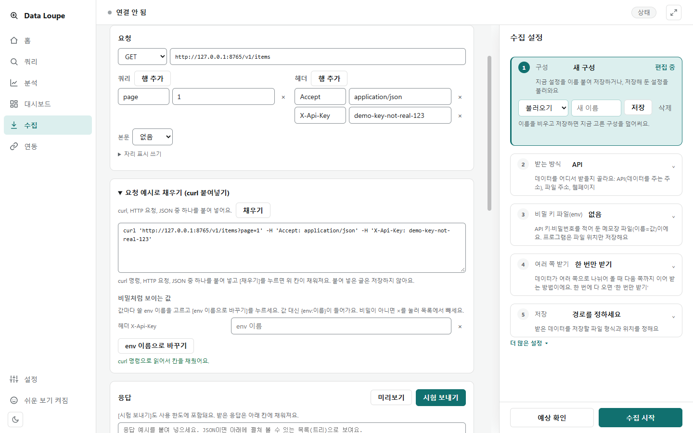
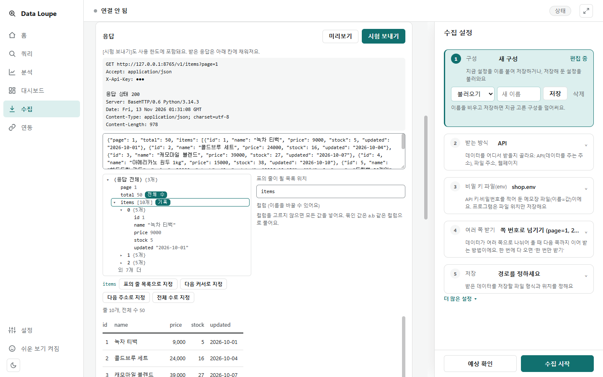
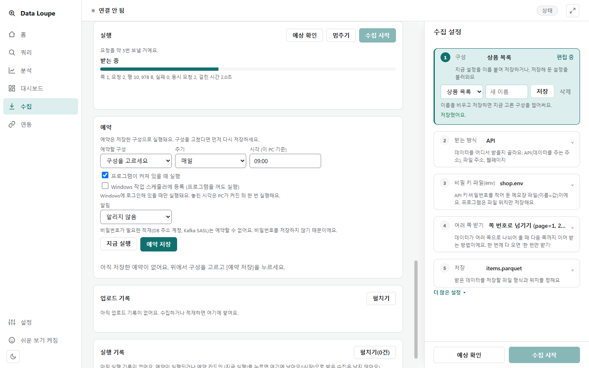
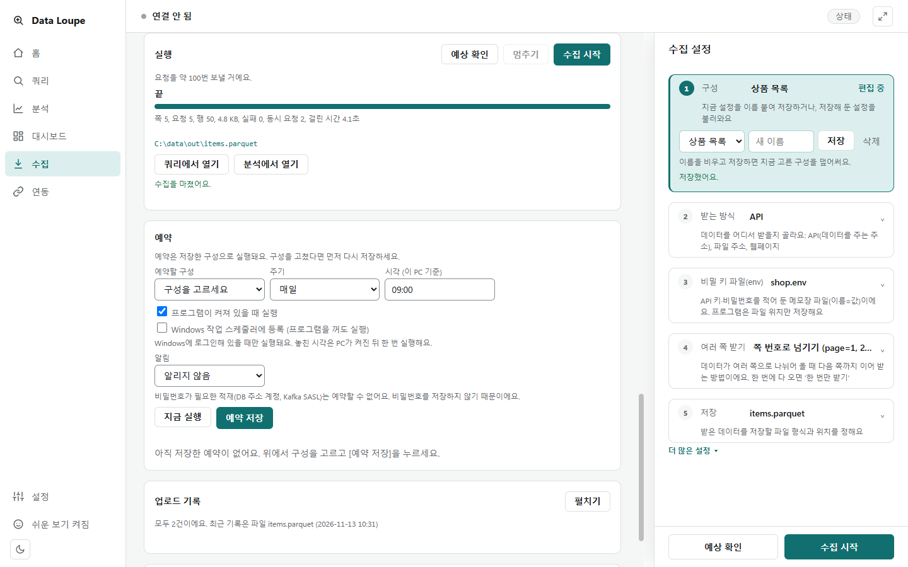
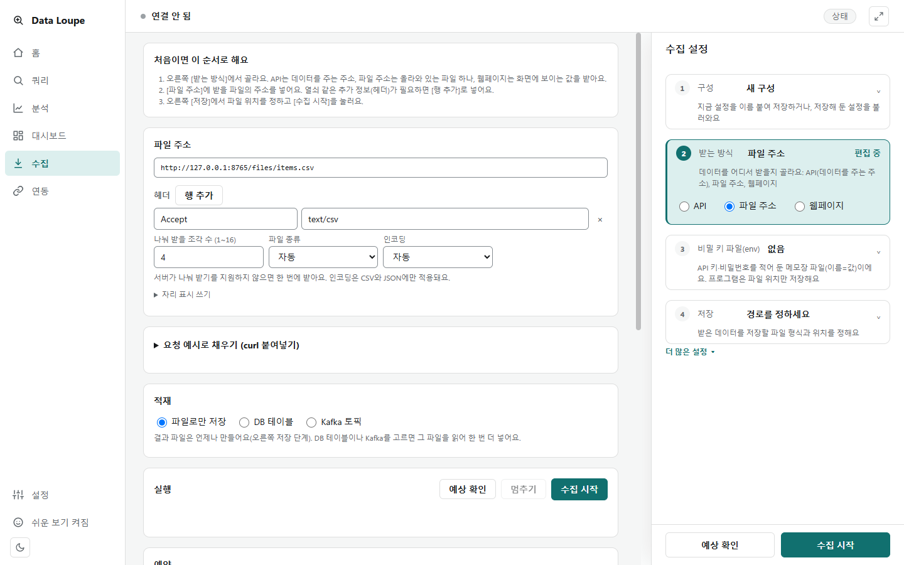

# API 수집

[← 수집](../collect.md)

API는 프로그램끼리 데이터를 주고받는 창구입니다. 주소로 요청하면 데이터(대개 JSON 글자)를 돌려줍니다. API 문서에 있는 요청 예시를 붙여 넣는 것부터 시작합니다.

## 요청 예시로 채우기

- **요청 예시로 채우기**에 curl 명령, HTTP 요청, JSON 중 하나를 붙여 넣고 **[채우기]**를 누르면 위 **요청** 카드(메서드·주소·쿼리·헤더·본문)가 채워집니다. **요청** 카드가 맨 위에 있고, 예시 붙여넣기 칸은 그 아래 접힌 곳에 있습니다. 붙여 넣은 글은 저장하지 않습니다.
- 키·토큰처럼 보이는 값이 있으면 **비밀처럼 보이는 값**에 나옵니다(사진은 `X-Api-Key` 헤더). env 이름을 고르고 **[env 이름으로 바꾸기]**를 누르면 값 대신 `{env:이름}`이 들어가 키가 저장되지 않습니다. 비밀이 아니면 ×로 뺍니다(그 자리만 빠지고, 같은 이름이 다른 자리에 있으면 그것은 여전히 비밀로 봅니다).
- env 파일은 `이름=값`을 적은 메모장 파일입니다. 오른쪽 ③ **비밀 키 파일(env)**에 경로를 넣고 [불러오기]를 누릅니다. 값은 저장하지 않고 경로만 저장합니다.
- 주소·쿼리·헤더에 쓸 수 있는 자리 표시(화면에서는 **자리 표시 쓰기**를 펼치면 보임): `{env:이름}` `{page}` `{offset}` `{cursor}` `{today:%Y%m%d}`(보낼 때 오늘 날짜로) `{now}`.

## 시험 보내기와 표의 줄이 될 목록 위치

- **응답** 카드의 **[시험 보내기]**는 첫 쪽을 한 번 보내 봅니다(사용 한도에도 포함됩니다). 보낸 요청의 키는 `●●●`로 가려 보이고, 받은 응답은 아래 칸에 채워집니다. 응답 예시를 그 칸에 직접 붙여 넣어도 됩니다.
- 응답이 JSON이면 펼쳐 볼 수 있는 목록(트리)으로 보입니다. 트리에서 목록(사진은 `items`)을 누르고 **[표의 줄 목록으로 지정]**을 누르면 **표의 줄이 될 목록 위치** 칸이 채워지고, 그 목록의 항목 하나가 한 행이 됩니다. 비워 두면 응답 전체를 그 목록으로 봅니다.
- 목록 안의 값을 누르면 **[컬럼에 넣기]**·**[컬럼에서 빼기]**로 받을 컬럼을 고릅니다. 컬럼 이름은 바꿀 수 있고, 하나도 고르지 않으면 전부 넣습니다(묶인 값은 `a.b` 컬럼으로 풀림).
- 같은 자리에서 **[다음 커서로 지정]**·**[다음 주소로 지정]**·**[전체 수로 지정]**으로 **여러 쪽 받기** 단계의 위치 칸도 채웁니다.
- **[미리보기]**는 요청을 보내지 않고, 칸에 있는 응답에서 지금 지정대로 값을 뽑아 앞 행을 표로 보여 줍니다.

## 수집 설정 (오른쪽 단계)

오른쪽 단계의 번호는 보이는 단계에만 차례로 붙습니다. 아래는 **쉬운 보기**가 켜진(기본) API 방식의 번호입니다. 받는 속도·사용 한도는 저장 단계 아래 **[더 많은 설정 ▾]**을 누르면 펼쳐지고, 펼치면 ⑤ 받는 속도 · ⑥ 사용 한도 · ⑦ 저장이 됩니다.

| 단계 | 하는 일 |
|---|---|
| ① 구성 | 지금 설정을 이름 붙여 **[저장]**·불러오기(목록에서 고름)·**[삭제]**. 이름을 비우고 저장하면 고른 구성을 덮어씀. 예약은 저장한 구성으로 실행됨 |
| ② 받는 방식 | API · 파일 주소 · 웹페이지([웹페이지 수집](collect_web.md)) |
| ③ 비밀 키 파일(env) | 키를 적은 env 파일 경로와 **[불러오기]** |
| ④ 여러 쪽 받기 | 데이터가 여러 쪽으로 나뉘어 올 때 다음 쪽까지 이어 받는 방법(아래 표) |
| ⑤ 저장 | 저장 형식(아래 절), 저장할 파일 경로(**[위치 고르기]**), 중복 기준 컬럼(선택) |
| 받는 속도 | 동시 요청 수(기본 2) · 요청 간격(기본 1초) · 다시 시도 횟수(기본 5) · 응답 제한 시간(기본 30초). 동시에 받기는 쪽 번호와 건너뛸 개수 방식에서만 됨 |
| 사용 한도 | "분당 60번, 하루 1만 번" 같은 API 한도(초당·분당·시간당·하루 요청, 동시 요청 수, 최소 간격, 하루 초기화 시각, 시간대, 여유분). 이름을 붙여 **[저장]**하고, 같은 키를 쓰는 구성끼리 같은 한도를 고르면 사용량을 함께 셈. 칸을 비우면 제한하지 않음. **[사용량 초기화]**는 고른 한도의 사용 기록을 지움(두 번 눌러야 함) |

### 여러 쪽 받기

**④ 여러 쪽 받기**의 목록에서 방식을 고르면 바로 아래에 그 방식의 설명이 한 줄 나옵니다. 어느 것인지 모르겠으면 API 설명서에 page·offset·cursor·next 중 어떤 말이 나오는지 봅니다.

| 선택지 | 언제 고르나 | 요청에 적을 것 |
|---|---|---|
| 한 번만 받기 | 데이터가 나뉘어 오지 않고 요청 한 번으로 끝날 때 | 없음 |
| 쪽 번호로 넘기기 (page=1, 2, 3…) | 쪽 번호를 1, 2, 3…으로 바꿔 가며 받을 때 | 쪽 번호 자리에 `{page}` (예: `?page={page}`) |
| 건너뛸 개수로 넘기기 (offset=0, 100…) | 앞에서 몇 개를 건너뛸지를 0, 100, 200…처럼 늘려 가며 받을 때 | 그 자리에 `{offset}` (예: `?offset={offset}&limit=100`) |
| 응답의 다음 표시로 넘기기 (cursor) | 응답이 알려 주는 '다음 표시' 값을 다음 요청에 넣어 이어 받을 때 | 그 자리에 `{cursor}` (예: `?cursor={cursor}`), **다음 커서 위치** 칸에 응답 안의 자리 |
| 응답의 다음 주소로 넘기기 | 응답이 다음 쪽의 주소를 통째로 알려 줄 때 | **다음 주소 위치** 칸에 응답 안의 자리(비우면 응답 Link 헤더의 rel=next 주소) |

- 방식에 따라 나오는 칸: **첫 쪽 번호**(건너뛸 개수 방식은 **처음 건너뛸 개수(offset)**), **한 번에 늘릴 값**(건너뛸 개수 방식, 기본 100), **최대 쪽 수**(기본 100), **전체 수 위치**(선택. 정해 두면 예상 요청 수를 계산하고 전체를 다 받으면 멈춤).
- 고른 방식의 자리 표시(`{page}` 등)가 요청 어디에도 없으면 칸 아래에 "요청에 {page}가 없어요…"라고 알려 줍니다.
- 빈 쪽이 오거나 끝까지 받으면 멈춥니다. 최대 쪽 수에 닿아 멈추면 "더 있을 수 있음"이라고 알리고, 예약 실행은 실패로 알립니다.
- 서버가 "너무 많다"(429)고 하면 저절로 간격을 늘립니다(처음 간격의 8배까지). 인증 오류(401·403)면 바로 멈춥니다.
- 하루 한도에 닿으면 멈추고, 다음 날 다시 시작하면 이어 받습니다.

### 저장 형식

**⑤ 저장**의 목록에서 형식을 고릅니다. 형식을 바꾸면 경로의 확장자도 같이 바뀝니다.

| 형식 | 결과 |
|---|---|
| Parquet (`.parquet`) | 표 파일 하나. 기본값 |
| CSV (`.csv`) | 표 파일 하나. Excel이 한글을 바로 읽도록 저장 |
| Excel (`.xlsx`) | 시트 하나. **1,048,575행까지** |
| DuckDB 파일 (`.duckdb`) | 파일 안의 **테이블 하나** |
| SQLite 파일 (`.db`) | 파일 안의 **테이블 하나** |

- **Excel**은 행이 1,048,575개를 넘으면 자르지 않고 오류로 알립니다. 받은 것은 남아 있으므로, 형식을 CSV나 Parquet으로 바꿔 다시 **[수집 시작]**을 누르면 다시 받지 않고 받아 둔 것을 그 형식으로 바꿉니다.
- **DuckDB·SQLite 파일**의 테이블 이름은 파일 이름에서 정합니다(영문·숫자·밑줄·한글만 남김. 예: `orders_2026.duckdb` → 테이블 `orders_2026`). 이미 있는 파일을 고르면 **같은 이름의 테이블만 새 내용으로 바뀌고 다른 테이블은 그대로** 남습니다.
- 다른 프로그램이 그 DB 파일을 쓰고 있으면(또는 제대로 닫히지 않았으면) 실패합니다. 그 프로그램에서 파일을 닫고 다시 시작하면 받아 둔 것으로 이어서 바꿉니다. 열려 있는 Excel·CSV 결과 파일도 닫아야 바꿀 수 있습니다.
- **CSV**로 저장할 때만 `=`·`+`·`-`·`@`로 시작하는 글자 값과 컬럼 이름 앞에 `'`를 붙여 엑셀 수식으로 읽히지 않게 합니다(`-1500`처럼 숫자로 읽히는 값은 그대로). Excel·Parquet·DuckDB·SQLite에는 붙이지 않습니다.
- **중복 기준 컬럼**: 고른 컬럼의 값이 모두 같은 행은 하나만 남깁니다. 쉼표로 적거나 아래 체크 목록에서 고릅니다.

## 실행

- **[예상 확인]**으로 보낼 요청 수와 오늘 남은 횟수를 먼저 봅니다(전체 수 위치를 정하지 않았으면 요청 수는 "아직 알 수 없어요"로 나옵니다). **[수집 시작]**을 누르면 진행 막대와 쪽·요청·행·크기·실패·동시 요청 수·걸린 시간이 보이고, **[멈추기]**로 멈춥니다. 두 단추는 가운데 **실행** 카드와 오른쪽 수집 설정 맨 아래에 똑같이 있습니다.
- 저장할 파일 경로를 정하지 않으면 시작하지 않고 "저장할 파일 경로를 정하세요"라고 알립니다.
- 끊기거나 멈춘 뒤 같은 구성으로 다시 [수집 시작]을 누르면 받은 쪽은 건너뛰고 이어 받습니다. 마지막으로 받은 지 하루가 넘었으면 처음부터 받습니다.

- 끝나면 결과 파일 경로와 **[쿼리에서 열기]**·**[분석에서 열기]**가 나옵니다. 누르면 "한 번 더 누르면 연결이 이 파일로 바뀌어요"로 바뀌고, 한 번 더 누르면 연결을 그 결과 파일로 바꿔 [쿼리](../query.md)나 [분석](../analysis.md) 화면에서 엽니다.
- 다섯 형식 모두 열 수 있습니다. Parquet·CSV·Excel은 파일이 곧 테이블이고, DuckDB·SQLite 파일은 그 안의 결과 테이블을 엽니다.
- 받은 결과를 DB나 Kafka에 넣으려면 같은 화면의 **적재** 카드를 씁니다([적재](load.md)).

## 파일 주소로 받기

② 받는 방식에서 **파일 주소**를 고르면 인터넷에 올라와 있는 CSV·Parquet·JSON 파일을 받습니다. 이때 오른쪽의 여러 쪽 받기 단계는 빠지고 뒤 단계 번호가 하나씩 당겨집니다(저장이 ④). 실행 중에는 쪽·행 대신 받은 크기(전체 크기를 알면 "받은 / 전체")가 보입니다.

- 주소·헤더, **나눠 받을 조각 수**(기본 4), **파일 종류**(자동·CSV·Parquet·JSON), **인코딩**(자동·UTF-8·CP949)을 정합니다.
- 서버가 나눠 받기를 지원하면 여러 조각으로 동시에 받고, 아니면 한 줄기로 받습니다. 인코딩은 CSV·JSON에만 씁니다.
- 받아 둔 파일 크기가 맞고, 서버가 파일의 ETag나 수정 시각을 알려 줄 때만 이어 받습니다(둘 다 없으면 처음부터 받습니다).
