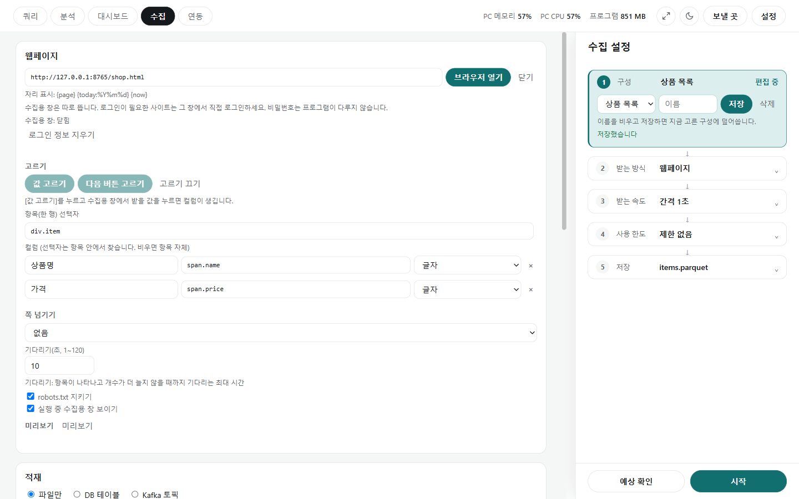

# 웹페이지 수집

[← 수집](../collect.md)

API가 없고 웹 화면에만 보이는 데이터를 받습니다. 오른쪽 ② **받는 방식**에서 **웹페이지**를 고릅니다.

## 페이지 열기

- 주소를 넣고 **[수집용 창 열기]**를 누르면 수집용 창이 따로 뜹니다. 주소에는 `{page}` `{today:%Y%m%d}` `{now}`를 쓸 수 있습니다.
- 로그인이 필요한 사이트는 그 창에서 직접 로그인합니다. 비밀번호는 프로그램이 다루지 않습니다.
- **[로그인 정보 지우기]**는 수집용 창에 남은 로그인 정보(쿠키 등)를 지웁니다(창을 닫은 뒤에만). **[창 닫기]**로 창을 닫습니다.

## 받을 값 고르기

- **[값 고르기]**를 누른 뒤 수집용 창에서 받을 값(예: 첫 상품 이름)을 클릭하면 컬럼이 추가됩니다. 같은 모양의 항목들이 함께 잡혀 **한 행이 되는 항목의 선택자**가 채워집니다(사진은 `div.item`).
- 가격처럼 다른 값도 눌러 컬럼을 더합니다. 컬럼마다 이름·선택자(항목 안에서 찾음, 비우면 항목 자체)·종류를 고칠 수 있고 ×로 뺍니다.
- 다 고르면 **[그만 고르기]**를 누릅니다.

## 쪽 넘기기와 옵션

- **쪽 넘기기**: 넘기지 않음 · 다음 버튼 누르기(**[다음 버튼 고르기]**로 지정) · 주소의 `{page}` 바꾸기 · 스크롤 내리기. 첫 쪽 번호와 최대 쪽 수(기본 100)를 정합니다.
- **최대 대기**(1~120초, 기본 10): 항목이 나타나고 개수가 더 늘지 않을 때까지 기다리는 최대 시간입니다. 늦게 나타나는 목록도 기다렸다가 받습니다.
- **robots.txt 규칙 따르기**(기본 켬): 사이트가 robots.txt로 막아 둔 주소는 열지 않습니다. 사이트 이용 약관도 지켜 쓰세요.
- **수집하는 동안 수집용 창 보이기**: 끄면 수집하는 동안 창을 숨깁니다.
- **미리보기**의 **[지금 페이지 읽기]**: 수집용 창의 지금 페이지에서 읽기만 해 봅니다(사용 한도에 세지 않음).

## 실행

- **[예상 확인]**·**[수집 시작]**은 [API 수집](collect_api.md#실행)과 같습니다. 최대 쪽 수에 닿아 멈추면 "더 있을 수 있음"이라고 알리고, 예약 실행은 실패로 알립니다.
- 끊긴 뒤 다시 시작하면 이어 받지만, 스크롤 방식은 첫 화면 항목 수가 달라질 수 있어 처음부터 받습니다.
- 결과는 아래 **적재** 카드로 DB·Kafka에 넣을 수 있습니다([적재](load.md)).
