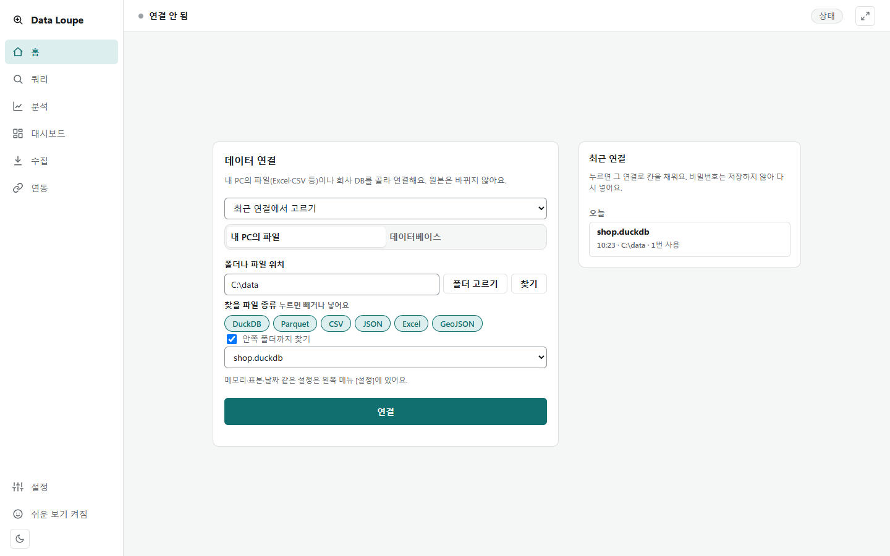
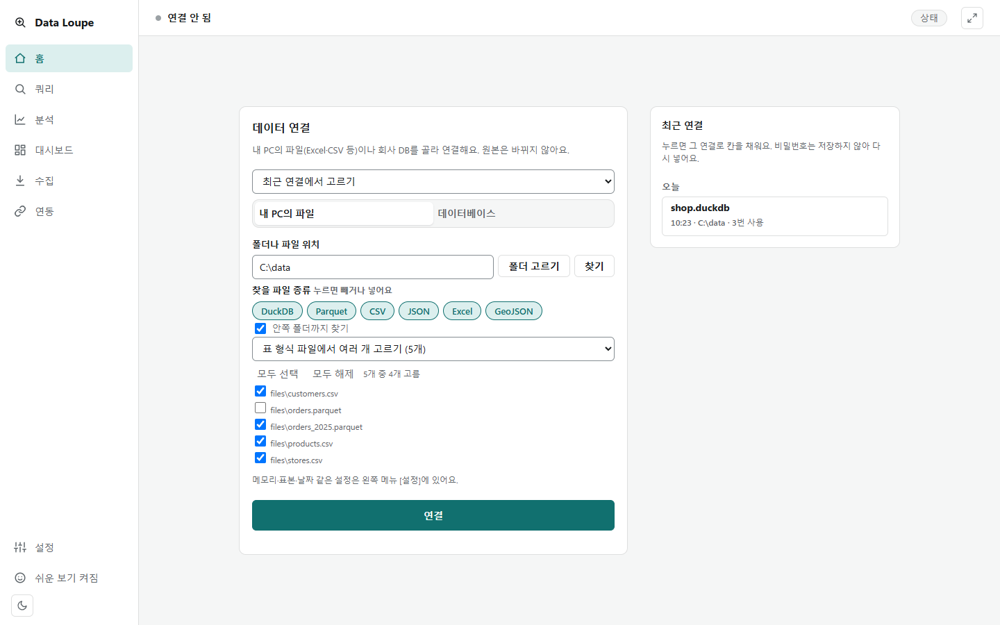
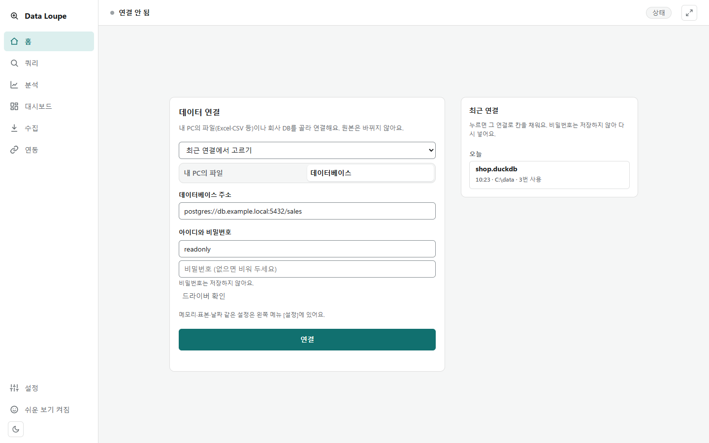
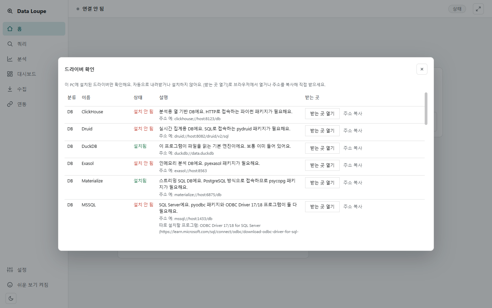

# 데이터 연결

[← 쿼리](../query.md)

쿼리와 분석은 먼저 데이터에 연결합니다. 연결은 한 번 하면 화면을 오가도 남아 있어 쿼리와 분석이 함께 씁니다.

- **첫 화면(홈)**: 아직 연결하지 않았으면 가운데에 **데이터 연결** 칸이 펼쳐져 있고, 오른쪽에 **최근 연결** 목록이 있습니다. 연결하면 가운데가 **지금 연결**(연결 이름)과 "무엇을 하고 싶어요?" 화면 바로가기([쿼리]·[분석]·[대시보드]·[수집]·[연동])로 바뀝니다.
- **쿼리·분석 화면**: 연결 없이 열면 "이 화면을 쓰려면 먼저 데이터를 연결하세요."와 함께 같은 연결 창이 뜹니다. 지난번 연결의 경로·주소·아이디는 칸에 미리 채워져 있습니다.
- **연결 바꾸기**: 위쪽 줄 왼쪽의 연결 이름(연결 전에는 "연결 안 됨")을 누르거나, 쿼리·분석의 ① 데이터 단계에서 **[연결 바꾸기]**를 누릅니다. 연결 창이 없는 화면(수집 등)에서는 연결 이름을 누르면 첫 화면으로 가서 바꿉니다.
- 원본 파일과 DB는 바뀌지 않습니다.

## 내 PC의 파일

1. **내 PC의 파일**을 고릅니다.
2. **폴더나 파일 위치** 칸에 경로를 적고 **[찾기]**(또는 Enter)를 누릅니다. 경로를 적기 어렵다면 **[폴더 고르기]**를 눌러 폴더 고르기 창에서 고릅니다. 고르면 칸이 채워지고 바로 찾습니다.
3. **찾을 파일 종류**의 칩(DuckDB·Parquet·CSV·JSON·Excel·GeoJSON)은 색이 칠해진 종류만 찾습니다. 누르면 빼거나 넣습니다. **안쪽 폴더까지 찾기**(처음에 켜짐)를 끄면 그 폴더 바로 아래만 봅니다.
4. 아래 목록에서 파일을 고르고 **[연결]**을 누릅니다.

- 파일 목록에는 **고른 폴더 아래의 이름만** 보입니다(안쪽 폴더의 파일은 `안쪽폴더\이름`). 전체 경로는 마우스를 올리면 나옵니다.
- DuckDB 파일은 하나를 골라 연결하고, 그 안의 테이블들이 보입니다.
- 한글 엑셀이 저장한 CSV(CP949)도 그대로 열립니다. CSV의 컬럼 타입은 앞 1만 행을 보고 정하고, ISO 날짜(2026-09-30 등)는 날짜 타입으로 읽습니다. 뒤쪽에 글자가 섞인 컬럼은 글자로 둡니다.
- 파일이 2,000개를 넘으면 앞의 2,000개만 보이고 "경로나 종류를 좁혀 주세요"라고 알립니다.

- Parquet·CSV·JSON·Excel·GeoJSON은 파일 하나가 테이블 하나입니다. 목록에서 **표 형식 파일에서 여러 개 고르기 (N개)**를 고르면 체크 목록이 나오고, 쓸 파일만 체크해 한 번에 엽니다. **[모두 선택]**·**[모두 해제]**가 있고 옆에 `12개 중 3개 고름`처럼 몇 개를 골랐는지 보입니다. 표 형식 파일이 하나뿐이면 그 파일이 미리 체크됩니다.
- 표 형식 파일로 연결한 뒤 **[모두 해제]**를 누르면 연결을 끊고 파일을 다시 고르게 합니다. DuckDB 파일·데이터베이스로 연결했을 때는 연결은 두고 화면에 올라온 것만 비웁니다.
- GeoJSON을 열면 도형마다 한 행인 표가 됩니다([좌표](geo.md)).

## 최근 연결

- 연결에 성공했던 폴더·주소는 기억해 둡니다. **비밀번호는 저장하지 않아** 다시 넣습니다.
- **첫 화면 오른쪽의 최근 연결**: 최근에 쓴 것부터 **날짜별(오늘·어제·그 밖은 날짜)**로 묶어 보입니다. 줄마다 연결 이름(파일 이름 또는 주소와 아이디)과 그 아래에 쓴 시각·폴더·`N번 사용`이 보입니다. 누르면 연결 칸이 그 연결로 채워지니 [찾기]나 비밀번호만 넣고 [연결]을 누릅니다. 목록이 길면 그 목록 안에서만 스크롤합니다. 연결한 적이 없으면 "아직 연결한 적이 없어요."가 보입니다.
- **연결 창 위의 [최근 연결에서 고르기]**: 같은 연결을 자주 쓴 것부터 `이름 (N번 사용)`으로 보여 주고, 고르면 칸을 채웁니다.

메모리·표본·날짜 같은 설정은 왼쪽 메뉴 [설정] 창에 있습니다([설정](settings.md#앱-설정)). 그중 연결과 가장 관련 깊은 칸은 [계산] 분류의 아래 칸들입니다.

| 칸 | 뜻 |
|---|---|
| 메모리 한도 | DuckDB가 쓰는 메모리의 최대치(받아 둔 결과를 계산할 때도 적용). 너무 낮으면 큰 집계가 느리거나 실패합니다. 다음 [연결]부터 적용 |
| 계산에 쓸 CPU 코어 | DuckDB 파일과 PC에 받아 둔 결과를 계산할 때 쓰는 CPU 코어 수. 줄이면 계산 중에도 PC가 덜 무겁습니다. 다음 [연결]부터 적용 |
| 읽을 양을 미리 모를 때 | 처리 용량을 미리 셀 수 없는 연결에서 그대로 실행할지, 실행하지 않을지 |
| 최소 표본 비율(%) | 컬럼 추론용 표본이 이만큼도 안 모이면 다른 방법으로 넘어갑니다(기본 20%) |

## 데이터베이스

- **데이터베이스**를 고르고 **데이터베이스 주소**(예: `postgres://host:5432/db`)와 **아이디와 비밀번호**(없으면 비워 둠)를 넣은 뒤 **[연결]**합니다.
- **비밀번호는 저장하지 않습니다.** 연결할 때마다 입력합니다.
- 운영 DB에는 읽기 전용 계정을 권합니다. 사진은 `readonly` 아이디로 접속하는 모습입니다.
- Supabase는 Session pooler 주소를 붙여 넣고 비밀번호는 아래 칸에 넣습니다. DB별 주소 모양은 [DB별 드라이버](settings.md#db별-드라이버)에 있습니다.
- 접속은 60초까지 기다립니다.

## 드라이버 확인

- 연결 창에서 **데이터베이스**를 고른 뒤 **[드라이버 확인]**을 누르면 표(분류·이름·상태·설명·받는 곳)가 뜹니다. DB마다 이 PC에 필요한 드라이버가 있는지(설치됨·설치 안 됨·프로그램 필요)와 설명, 주소 예를 보여 줍니다.
- 아무것도 자동으로 받거나 설치하지 않습니다. 줄마다 **[받는 곳 열기]**를 누르면 받는 곳이 기본 브라우저로 열리고, **[주소 복사]**로 주소를 복사합니다. 직접 설치한 뒤 프로그램을 다시 켭니다.
- 드라이버가 없어 연결이 실패하면 같은 안내가 연결 창 아래에 바로 나옵니다.
