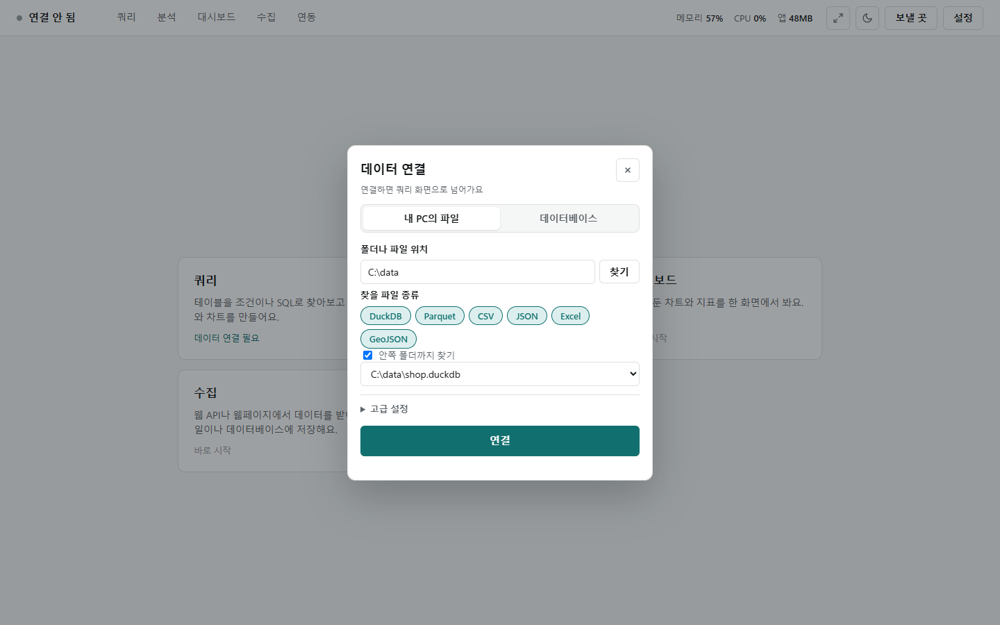
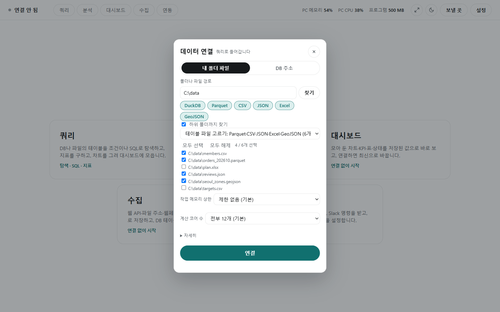
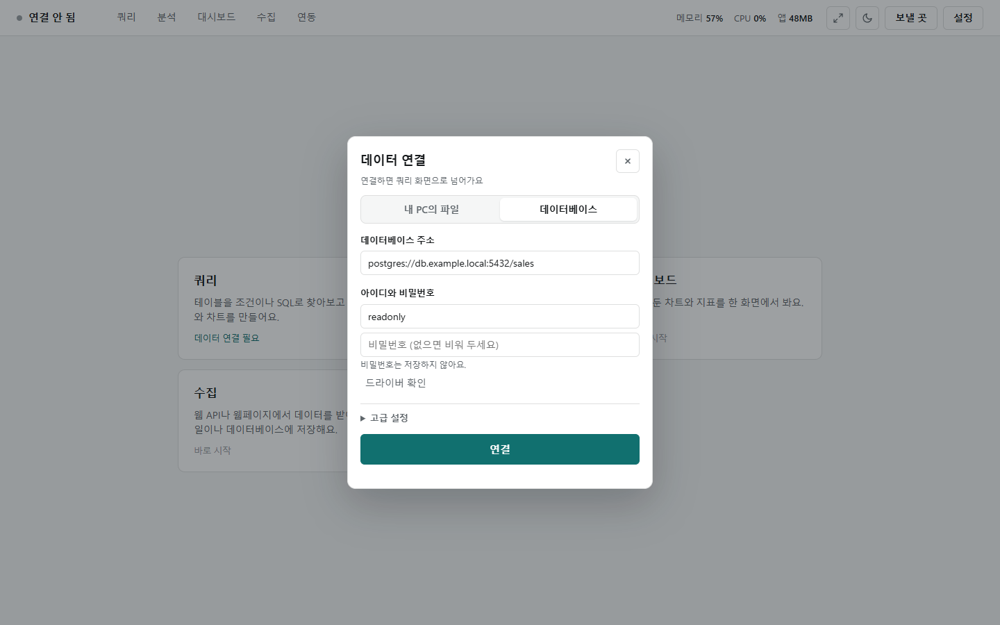
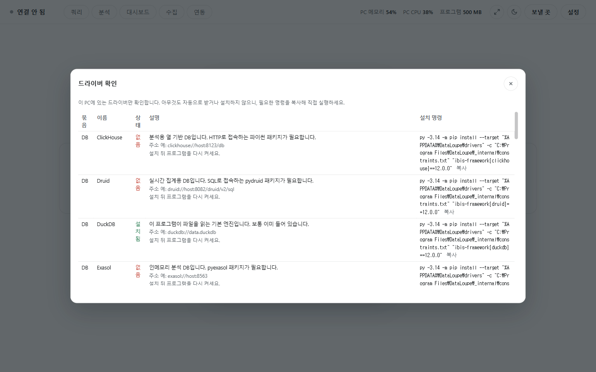

# 데이터 연결

[← 쿼리](../query.md)

쿼리와 분석은 먼저 데이터에 연결합니다. 첫 화면에서 [쿼리]나 [분석]을 누르면 **데이터 연결** 창이 뜹니다. 연결은 쿼리와 분석이 함께 씁니다.

## 내 PC의 파일

- **내 PC의 파일**을 고르고 **폴더나 파일 위치**에 경로를 넣은 뒤 **[찾기]**를 누릅니다.
- **찾을 파일 종류** 칩(DuckDB·Parquet·CSV·JSON·Excel·GeoJSON)을 눌러 종류를 고릅니다. **안쪽 폴더까지 찾기**를 켜면 안쪽 폴더도 봅니다.
- 목록에서 파일을 고르고 **[연결]**을 누릅니다. DuckDB 파일은 그 안의 테이블들이 보입니다.
- 한글 엑셀이 저장한 CSV(CP949)도 그대로 열립니다.

- Parquet·CSV·JSON·Excel·GeoJSON은 파일 하나가 테이블 하나입니다. 여러 개를 체크해 한 번에 엽니다(**모두 선택**·**모두 해제**, 몇 개를 골랐는지 표시).
- GeoJSON을 열면 도형마다 한 행인 표가 됩니다([좌표](geo.md)).

창 아래 **고급 설정**을 펼치면 아래 칸이 나옵니다.

| 칸 | 뜻 |
|---|---|
| 메모리 한도 | DuckDB가 쓰는 메모리의 최대치. 너무 낮으면 큰 집계가 느리거나 실패합니다. 다음 [연결]부터 적용 |
| 계산에 쓸 CPU 코어 | 계산에 쓰는 CPU 코어 수. 줄이면 계산 중에도 PC가 덜 무겁습니다 |
| 읽을 양을 미리 모를 때 | 처리 용량을 미리 셀 수 없는 연결에서 그대로 실행할지, 실행하지 않을지 |
| 최소 표본 비율(%) | 컬럼 추론용 표본이 이만큼도 안 모이면 다른 방법으로 넘어갑니다(기본 20%) |

연결에 성공했던 폴더·주소는 많이 쓴 순으로 **최근 연결에서 고르기** 목록에 남아, 고르면 칸을 채웁니다(비밀번호는 다시 입력).

## 데이터베이스

- **데이터베이스**를 고르고 **데이터베이스 주소**(예: `postgres://host:5432/db`)와 아이디·비밀번호를 넣은 뒤 **[연결]**합니다.
- **비밀번호는 저장하지 않습니다.** 연결할 때마다 입력합니다.
- 운영 DB에는 읽기 전용 계정을 권합니다. 사진은 `readonly` 아이디로 접속하는 모습입니다.
- Supabase는 Session pooler 주소를 붙여 넣고 비밀번호는 아래 칸에 넣습니다. DB별 주소 모양은 [DB별 드라이버](settings.md)에 있습니다.

## 드라이버 확인

- **[드라이버 확인]**을 누르면 DB마다 이 PC에 필요한 드라이버가 있는지(설치됨·설치 안 됨·프로그램 필요), 주소 예, 설치 명령을 보여 줍니다.
- 아무것도 자동으로 받거나 설치하지 않습니다. 필요한 명령을 **복사**해 직접 실행하고 프로그램을 다시 켭니다.
