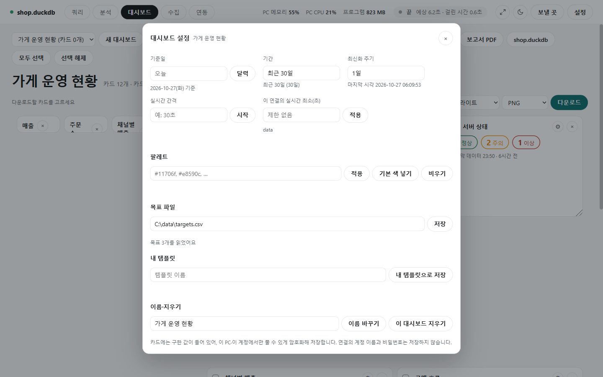

# 대시보드 기본 쓰기

[← 대시보드](../dashboard.md)

대시보드는 위쪽 줄의 **[대시보드]**를 눌러 여는 화면입니다. 카드를 모으고, 저장하고, 보는 기간을 정하고, 연결하면 최신으로 바꾸는 법을 설명합니다.

## 모으기

![[새 대시보드]: 이름 칸과 템플릿 고르기, [만들기]](../photo/dashboard-new-template.png)

- **[새 대시보드]**를 누르면 이름 칸과 템플릿 고르기가 나옵니다. 이름을 쓰고 템플릿(분석 개요형·목표 달성형·모니터링형·직접 구성·내 템플릿)을 고른 뒤 **[만들기]**를 누릅니다. 템플릿은 [편집](dashboard_edit.md#템플릿)에 있습니다.
- 맨 왼쪽 고르기 칸에서 저장해 둔 대시보드를 고릅니다. 마지막으로 연 대시보드를 기억합니다.
- 카드를 넣는 길은 셋입니다.
  - **[카드 추가]**: 테이블을 골라 KPI·표·상태 같은 카드를 바로 만듭니다([카드 종류](dashboard_cards.md)).
  - **[카드 모음]**: 빈 카드 틀을 끌어 놓고 나중에 데이터를 정합니다([편집](dashboard_edit.md)).
  - 쿼리 화면의 차트·지표, 분석 화면의 결과에서 **[대시보드에 추가]** → 넣을 대시보드를 고르면 "대시보드에서 보기" 링크가 뜹니다. **[쿼리에서 카드 만들기]**는 쿼리 화면으로 갑니다.
- 대시보드는 100개, 대시보드 하나의 카드는 48개까지입니다.

## 저장

- 카드·자리·카드 색을 고치면 0.7초 뒤 **저절로 저장**합니다. 저장 단추는 따로 없고, 제목 옆에 "저장했어요"가 뜹니다.
- 저장하지 못하면 다른 대시보드로 옮기지 않고 편집을 그대로 둡니다(임시 저장은 [drafts.md](drafts.md)).
- 카드에는 구한 값이 들어 있어 `%APPDATA%\DataLoupe\dashboards.dat`에 **이 PC·이 Windows 계정에서만 풀 수 있게 암호화**해 저장합니다. 다른 PC에서는 풀 수 없다고 알리고 파일은 건드리지 않습니다.
- 연결의 계정 이름과 비밀번호는 저장하지 않습니다.

## 기준일과 기간

**[설정]**을 누르면 **대시보드 설정** 창이 뜹니다. 위쪽 칸들이 "언제를 볼지"를 정합니다.

| 칸 | 쓰는 법 |
|---|---|
| 기준일 | 비우면 오늘. `2026-10-01`, `2026.10.01`, `20261001`, `어제`, `지난달 말`, 또는 **[달력]**. 오늘 뒤의 날은 "아직 오지 않은 날이에요"로 막습니다 |
| 기간 | `최근 30일`, `2026-10`, `2026-Q3`, `2026`, `지난달`, `이번 주`, `2026-01-01 ~ 2026-03-31`(한쪽을 비우면 열린 범위). 날짜 단위로만 쓰고 시각(`09:00`)은 받지 않습니다. 틀리면 이유를 보이고 이전 값을 둡니다 |

- `최근 N일`(주·달·년도)은 **기준일 전날(어제)까지**입니다. 오늘을 넣으려면 `오늘`·`이번 주`를 씁니다.
- 기간을 **비워 두면**(새 대시보드의 처음 상태) 대시보드 기간을 걸지 않고 카드마다 자기 조건대로 보입니다.
- 기준일이 오늘이 아니면 "지난 날짜 기준으로 보는 중"이 뜨고 실시간 갱신은 멈춥니다.
- 날짜가 X축인 카드는 저장된 일 값을 다시 묶어 주·월·연으로 바로 그립니다.
- 날짜가 X축이 아닌 카드(KPI·표·문장 등)는 카드의 **기간 기준 날짜 컬럼**에 기간을 걸어 다시 구합니다. 연결이 없으면 카드에 "연결하면 이 기간으로 다시 구해요"가 뜹니다.
- 비교 문장("직전 30일보다 4.7% 줄었어요")은 기본으로 바로 앞 같은 길이의 기간과 견줍니다. 달·분기·연으로 꼭 맞는 기간은 지난달·직전 분기·작년과 견줍니다.
- 읽어 온 범위 안에서 행이 없는 날은 개수·합계를 0으로 봅니다(평균·최소·최대는 빈 값).

## 최신화와 실시간

| 칸 | 뜻 |
|---|---|
| 최신화 주기 | 예: `1일`, `36시간`(1시간 이상). 연결에 성공하면 이 주기가 지난 카드만 다시 구해 저장합니다 |
| 실시간 간격 | 예: `30초`. 대시보드를 보는 동안 이 간격으로 카드를 다시 구합니다. **[시작]**으로 켭니다 |
| 실시간 최소 간격(초) | 이 연결에서 쓸 실시간 간격의 하한. 정하지 않으면 DB 서버 같은 원격 연결은 60초, 이 PC의 파일은 제한 없음. 0으로 저장하면 이 기본값으로 돌아갑니다 |

- 어느 화면에서 연결하든 "대시보드를 최신 값으로 바꾸고 있어요 (3/7)" 창이 뜨고 카드마다 완료·실패·건너뜀·대기를 보입니다. **[닫고 계속하기]**는 창만 닫고(위쪽 줄 알약을 누르면 다시 열림), **[멈추기]**는 남은 카드를 건너뜁니다.
- 실패한 카드는 이전 값을 그대로 둡니다. 다른 연결에서 구한 카드는 건너뛰고 카드에 "다른 연결에서 구한 이전 값이에요"가 보입니다.
- 최신화 중에 연결을 바꾸면 그 카드는 "연결이 바뀌어 건너뛰었어요", 남은 카드는 "멈췄어요"로 멈춥니다.
- 최신화는 카드가 쓰는 컬럼과 보는 기간의 행만 읽고, 같은 테이블·조건의 카드는 한 번에 읽습니다. 읽는 양이 설정한 기준을 넘는 카드는 그 카드만 건너뛰고 이유를 적습니다.
- 실시간은 앞 조회가 끝난 뒤 다음 조회를 합니다(겹치지 않음). 글자를 입력하는 중이면 그 회는 "입력 중이라 이번 갱신은 건너뛰었어요"로 건너뜁니다.
- 실시간 값과 기간을 걸어 둔 채 구한 값은 화면에만 보이고 저장하지 않습니다.
- **[다시 구하기]**: 모든 카드를 지금 연결에서 다시 구해 저장합니다. 기간을 걸어 둔 채 구한 값은 화면에만 두고, 실패한 카드는 이전 값을 둡니다.

## 첫 화면과 쿼리 화면

- 첫 화면의 **[대시보드]** 카드는 "바로 시작"으로, 연결하지 않고 이 화면을 엽니다. 저장된 값이 바로 보입니다.
- 예전에는 쿼리 화면 안에 대시보드가 있었습니다. 지금은 이 화면 하나뿐이고, 예전 주소(`/search#dashboard`)로 들어가도 이 화면으로 옵니다.
- 위쪽 **[지표]** 단추는 테이블을 고르게 한 뒤 쿼리 화면과 같은 지표 화면을 띄웁니다. 저장하는 곳이 같아 두 화면에 똑같이 보입니다([지표](metrics.md)).
