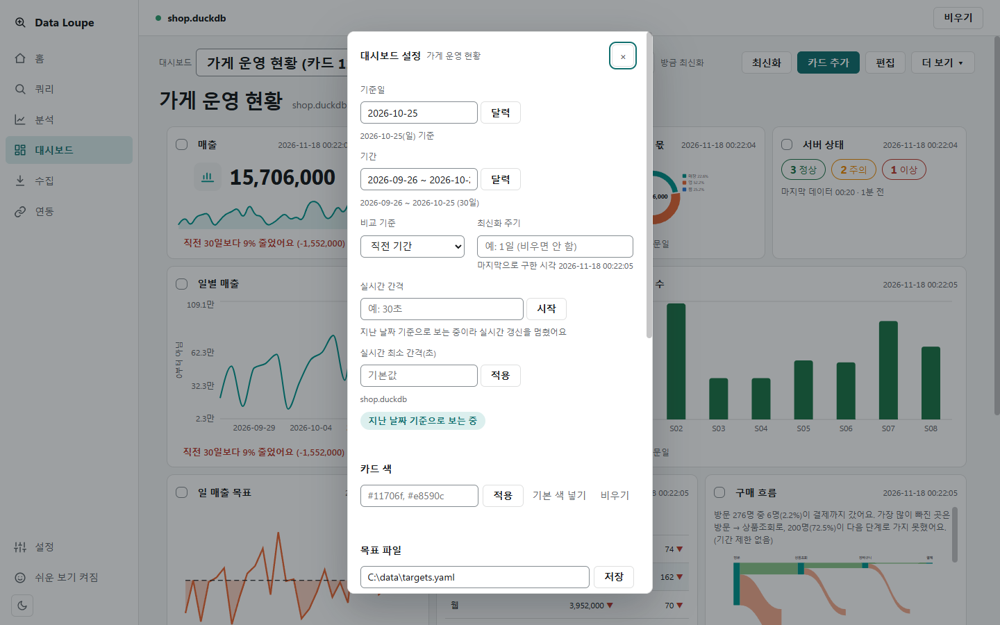

# 대시보드 기본 쓰기

[← 대시보드](../dashboard.md)

대시보드는 왼쪽 메뉴의 **[대시보드]**를 눌러 여는 화면입니다. 카드를 모으고, 저장하고, 보는 기간을 정하고, 연결하면 최신으로 바꾸는 법을 설명합니다.

왼쪽 메뉴에 두 곳이 있습니다. **[대시보드]**는 보는 곳이고, **[대시보드 만들기]**는 카드를 넣고 옮기고 고치는 곳입니다. 두 곳은 같은 대시보드를 엽니다.

보는 곳의 도구 줄: **대시보드** 고르는 칸 | **기간** 칸·**[달력]**·마지막으로 구한 때 | **[최신화]**·**[대시보드만 보기]**·**[만들기]**(지금 대시보드를 만드는 곳에서 엽니다)·**[예시 데이터로 확인하기]**·**[내보내기]**. 카드를 옮기거나 고치는 단추는 없습니다. 보는 곳에서 **기간**을 바꾸면 지금 화면에만 적용되고 저장되지 않습니다(다시 열면 만드는 곳에서 정한 기간으로 보입니다).

만드는 곳의 도구 줄: **대시보드** 고르는 칸·**[새 대시보드]** | **기간** 칸·**[달력]**·마지막으로 구한 때("방금 최신화"처럼) | **[최신화]**·**[카드 추가]**·**[+ 카드 ▾]**·**[보러 가기]**·**[예시 데이터로 확인하기]**·**[더 보기 ▾]**(내보내기 · 대시보드 설정). 그 아래 제목 줄에 대시보드 이름, 지금 연결 이름(없으면 "연결 안 됨"), 카드 수가 보입니다. 대시보드가 없을 때는 [카드 추가]를 누를 수 없으니 먼저 [새 대시보드]를 만듭니다. [새 대시보드]와 [더 보기 ▾]의 대시보드 설정은 만드는 곳에만 있습니다.

## 모으기

![[새 대시보드]: 이름 칸과 시작 모양(템플릿) 고르기, [만들기]](../photo/dashboard-new-template.png)

- 만드는 곳에서 **[새 대시보드]**를 누르면 이름 칸과 **시작 모양**(템플릿) 고르기가 나옵니다. 이름을 쓰고 시작 모양(분석 개요형·목표 달성형·모니터링형·직접 구성·내 템플릿)을 고른 뒤 **[만들기]**를 누릅니다. 템플릿은 [편집](dashboard_edit.md#템플릿)에 있습니다.
- 맨 왼쪽 **대시보드** 고르는 칸에서 저장해 둔 대시보드를 고릅니다(이름 옆에 `카드 5개`처럼 카드 수가 보임). 마지막으로 연 대시보드를 기억합니다.
- 카드가 하나도 없으면 가운데에 "이렇게 시작해요" 안내와 **[카드 추가]**·**[쿼리에서 가져오기]** 단추가 나옵니다. 여기서 [카드 추가]를 누르면 편집을 켜지 않아도 카드 추가 서랍이 열립니다.
- 카드를 넣는 길은 **[+ 카드 ▾]** 메뉴(편집 중에만 보임)에 모여 있습니다. 도구 줄의 **[카드 추가]**를 누르면 편집이 켜지면서 카드 추가 서랍이 바로 열립니다.
  - **카드 추가**: 오른쪽 서랍이 열리고, 테이블을 골라 KPI·표·상태 같은 카드를 바로 만듭니다([카드 종류](dashboard_cards.md)).
  - **카드 모음**: 빈 카드 틀을 끌어 놓고 나중에 데이터를 정합니다([편집](dashboard_edit.md)).
  - **지표**: 내 지표와 지표 사전 목록을 봅니다. 지표 파일의 지표는 [카드로 추가]로 KPI 카드를 만들고, 계산·빈칸 고치기는 쿼리 화면 [지표] 탭에서 합니다([지표](metrics.md)).
  - **쿼리에서 가져오기**: 쿼리 화면으로 갑니다. 쿼리 화면의 차트·지표, 분석 화면의 결과에서 **[대시보드에 추가]** → 넣을 대시보드를 고르면 "대시보드에서 보기" 링크가 뜹니다.
- 대시보드는 100개, 대시보드 하나의 카드는 48개까지입니다.

## 저장

- 카드·자리·카드 색을 고치면 0.7초 뒤 **저절로 저장**합니다. 저장 단추는 따로 없고, 제목 줄에 "저장 중…"에 이어 "저장했어요"가 뜹니다. **Ctrl+S**는 바로 저장하고, **Ctrl+Z**·**Ctrl+Y**로 편집을 되돌리거나 다시 합니다.
- 저장하지 못하면 다른 대시보드로 옮기지 않고 편집을 그대로 둡니다(임시 저장은 [drafts.md](drafts.md)).
- 카드에는 구한 값이 들어 있어 `%APPDATA%\DataLoupe\dashboards.dat`에 **이 PC·이 Windows 계정에서만 풀 수 있게 암호화**해 저장합니다. 다른 PC에서는 풀 수 없다고 알리고 파일은 건드리지 않습니다.
- 연결의 계정 이름과 비밀번호는 저장하지 않습니다.
- 계산 방식이 'DB는 거르기만, 계산은 이 PC에서'인 대시보드가 DB에서 받은 줄은 `%APPDATA%\DataLoupe\dash_data`에 Parquet로 남습니다(암호화는 대시보드 설정에서 고름, [최신화와 갱신 주기](#최신화와-갱신-주기)).
- 대시보드 이름 바꾸기와 지우기는 [대시보드 설정] 창 맨 아래에 있습니다. 지우기는 두 번 눌러야 지워집니다.

## 기준일·기간·비교 기준

**[더 보기 ▾]** → **대시보드 설정**을 누르면 **대시보드 설정** 창이 뜹니다(편집을 켜지 않아도 됩니다). [대시보드만 보기]의 **[대시보드 설정]**과 틀 요소 단추의 할 일 "대시보드 설정 창 열기"로도 열며, 보는 곳에서는 기간 칸(저장하지 않음)과 데이터 받기만 보입니다. 도구 줄의 **기간** 칸은 이 창의 기간 칸과 같은 것이어서 어느 쪽에서 바꿔도 됩니다. 위에서부터 기준일·기간·비교 기준, **데이터 받기**(계산 방식(만드는 곳에서만)·갱신 주기·받는 범위·[전체 갱신]·암호화·받은 데이터, [아래](#최신화와-갱신-주기)), **카드 색**, **목표 파일**, **통화 기호**, **차트 낱말**, **내 템플릿**, **이름 바꾸기와 지우기**가 있습니다. 위쪽 칸들이 "언제를 볼지"를 정합니다. 칸은 값을 쓰고 Enter를 치거나 다른 곳을 누르면 반영됩니다.

| 칸 | 쓰는 법 |
|---|---|
| 기준일 | 비우면 오늘. `2026-10-01`, `2026.10.01`, `20261001`, `어제`, `지난달 말`, 또는 **[달력]**. 오늘 뒤의 날은 "아직 오지 않은 날이에요"로 막습니다 |
| 기간 | `최근 30일`, `2026-10`, `2026-Q3`, `2026`, `지난달`, `이번 주`, `2026-01-01 ~ 2026-03-31`(한쪽을 비우면 열린 범위). 옆 **[달력]**에서 시작 날과 끝 날을 골라도 됩니다(기준일 뒤의 날은 고를 수 없음). 날짜 단위로만 쓰고 시각(`09:00`)은 받지 않습니다. 틀리면 이유를 보이고 이전 값을 둡니다 |
| 비교 기준 | 비교 문장이 지금 기간과 견줄 기간. **직전 기간**(기본)·**같은 요일 기간**(요일을 맞춰 몇 주 앞)·**작년 같은 기간** 중 고릅니다. 대시보드마다 저장합니다 |

- `최근 N일`(주·달·년도)은 **기준일 전날(어제)까지**입니다. 오늘을 넣으려면 `오늘`·`이번 주`를 씁니다.
- 기간을 **비워 두면**(새 대시보드의 처음 상태) 대시보드 기간을 걸지 않고 카드마다 자기 조건대로 보입니다. 이때 카드에 기간 줄이 있으면 그 기간을 비교 기준대로 견줍니다.
- 기준일이 오늘이 아니면 "지난 날짜 기준으로 보는 중"이 뜨고 주기 갱신은 멈춥니다.
- 날짜가 X축인 카드는 저장된 일 값을 다시 묶어 주·월·연으로 바로 그립니다.
- 날짜가 X축이 아닌 카드(KPI·표·문장 등)는 카드의 **기간 기준 날짜 컬럼**에 기간을 걸어 다시 구합니다. 연결이 없으면 카드에 "연결하면 이 기간으로 다시 구해요"가 뜹니다.
- 비교 문장("직전 30일보다 4.7% 줄었어요")은 **직전 기간**이면 바로 앞 같은 길이의 기간과 견줍니다. 달·분기·연으로 꼭 맞는 기간은 지난달·직전 분기·작년과 견줍니다.
- 읽어 온 범위 안에서 행이 없는 날은 개수·합계를 0으로 봅니다(평균·최소·최대는 빈 값).

## 최신화와 갱신 주기

대시보드 설정 창의 **데이터 받기** 묶음에서 정합니다. 바꾼 뒤 **[저장]**을 누릅니다.

| 칸 | 뜻 |
|---|---|
| 계산 방식 | **DB는 거르기만, 계산은 이 PC에서**(처음 값): DB에는 카드가 쓰는 컬럼·기간·값 조건으로 거른 줄만 요청해 이 PC에 받아 두고, 조인·집계·정렬은 이 PC가 합니다. **DB에서 계산**: 카드마다 DB가 계산합니다. 만드는 곳에서만 바꿉니다. 이 PC 파일 연결은 늘 이 PC에서 계산합니다 |
| 갱신 주기 | **단추를 누를 때만**(처음 값) 또는 **주기마다**(숫자 + 초·분·시, 10초~168시). 대시보드를 열어 둔 동안만 돌고, 앞 갱신이 끝난 뒤 다음 갱신을 합니다(겹치지 않음). DB에서 계산할 때 원격 연결은 1분 이상이어야 합니다 |
| 받는 범위 | **전부 다시 받기** 또는 **없는 것만 받기**. 없는 것만 받기는 테이블마다 **새 줄 컬럼**(정수·날짜·시각)을 골라, 새로 생긴 줄과 아직 받지 않은 기간만 받습니다 |
| [전체 갱신] | 이 대시보드가 쓰는 줄을 전부 다시 받습니다(연결했을 때만) |
| 암호화 | 받은 파일의 암호화: 없음·AES-128·AES-256·암호문. 열쇠와 암호문은 이 PC·이 계정만 풀 수 있게 보관합니다. 암호문은 다른 PC에서 같은 것을 다시 적으면 받은 데이터를 읽습니다 |
| 받은 데이터 | 받아 둔 크기. 파일은 `%APPDATA%\DataLoupe\dash_data`에 Parquet로 두고, 같은 연결·테이블·암호화면 대시보드끼리 같이 씁니다 |

- **없는 것만 받기의 한계**: DB에서 고쳐지거나 지워진 줄은 알지 못합니다. 그런 줄은 **[전체 갱신]**으로 받습니다. 마지막으로 받은 줄을 DB에서 찾지 못하면 알림(종)과 이 묶음에 "마지막으로 받은 줄을 찾지 못했어요"가 뜨고, 날짜 두 칸으로 기간을 정해 **[이 기간 다시 받기]**를 누릅니다(기간 컬럼이 하나가 아니면 [전체 갱신]만 됩니다).
- 연결 없이 열면 받아 둔 데이터로 계산합니다. 받아 둔 기간 밖을 보면 카드에 "데이터가 없는 구간이 있어요."가 붙습니다.
- 기준일이 오늘이 아니면 주기 갱신은 멈춥니다.
- 읽는 양이 설정한 기준을 넘는 카드(DB에서 계산)는 그 카드만 건너뛰고 이유를 적습니다. 실패한 카드는 이전 값을 그대로 둡니다.
- 기간을 걸어 둔 채 구한 값은 화면에만 보이고 저장하지 않습니다.
- 이 PC 계산에 쓰는 메모리는 대시보드를 한동안(기본 10분, 왼쪽 메뉴 [설정] 창 [계산] 분류) 쓰지 않으면 놓고, 다시 보면 그때 다시 엽니다.
- **[최신화]**: 모든 카드를 지금 다시 구해 저장합니다. 단추 왼쪽에 마지막으로 구한 때가 "방금 최신화"·"N분 전 최신화"처럼 보입니다. 기간을 걸어 둔 채 구한 값은 화면에만 두고, 실패한 카드는 이전 값을 둡니다.
- **알림(종)**: 도구 줄의 종 단추에 안 읽은 알림 개수가 보입니다. 누르면 받기 오류·연결 안내, "마지막으로 받은 줄을 찾지 못했어요"(기간 다시 받기), "더는 사용하지 않는 파일입니다"와 지운 대시보드가 남긴 받은 데이터(**[지우기]**)가 나옵니다. 읽은 알림은 기억해 개수에서 뺍니다.
- 대시보드를 지우면 그 대시보드만 쓰던 받은 파일도 지웁니다. 못 지운 것과 더는 안 쓰는 파일은 물은 뒤 지웁니다.

## 통화 기호와 그 밖의 설정

대시보드 설정 창의 아래쪽 칸들입니다.

- **통화 기호**: 표시 형식이 **금액**인 값 앞에 붙는 기호입니다. 기본은 `₩`이고, `$`·`€`처럼 4자까지 적고 **[저장]**을 누릅니다. 숫자·부호(`+` `-`)·공백은 쓸 수 없고, 비우고 저장하면 기본 기호로 돌아갑니다. 대시보드 하나가 아니라 **모든 대시보드에 적용**됩니다. 카드의 금액은 다시 그릴 때, 비교 문장은 다시 구할 때 바뀝니다.
- **그림 색**: 대시보드 전체의 표시색·강조색입니다([편집](dashboard_edit.md#색)).
- **목표 파일**: 카드가 이름으로 목표를 찾을 파일의 경로를 넣고 **[저장]**합니다([카드 종류](dashboard_cards.md#목표와-목표-파일)).
- **차트 낱말**: 긍정·부정·기타·결측 낱말을 한 줄에 하나씩 적고 **[저장]**합니다. 긍정·부정은 이름에 그 낱말이 들어 있으면, 기타·결측은 이름 전체가 같으면 맞는 것으로 봅니다([차트 자동 규칙](dashboard_cards.md#차트-자동-규칙)의 의미 색·핀에 쓰임).
- **내 템플릿**: 지금 대시보드의 배치와 모양 설정을 템플릿으로 저장하거나 지우고, 파일로 주고받거나 [더 받기]로 받습니다([편집](dashboard_edit.md#템플릿)).
- **이름 바꾸기와 지우기**: 이름 칸을 고치고 **[이름 바꾸기]**, 또는 **[대시보드 지우기]**(누르면 "한 번 더 누르면 지워져요"로 바뀌고 한 번 더 눌러야 지워짐).

## 필터 칸

대시보드 위쪽에 값을 고르는 칸을 두고, 고른 값의 행만으로 모든 카드를 다시 볼 수 있습니다.

- **정하기(만드는 곳)**: 제목 줄 아래의 **필터로 쓸 컬럼 이름** 칸에 컬럼 이름을 넣고(카드가 쓰는 컬럼이 후보로 뜹니다) **[필터 추가]**를 누릅니다. 8개까지 넣을 수 있고, 칸 옆 **×**로 뺍니다. 대시보드와 함께 저장됩니다.
- **고르기(보는 곳·만드는 곳)**: 칸에서 값을 고르면 모든 카드가 그 값의 행만으로 다시 구해집니다. 칸이 여러 개면 모두 맞는 행만 남습니다. **전체**를 고르면 풀립니다.
- 거른 값은 화면에만 보입니다. 저장된 값은 거르지 않은 값 그대로이고, 다른 대시보드를 열면 고른 것이 풀립니다.
- 그 컬럼이 없는 테이블의 카드는 거르지 않고 그대로 두며, 카드 아래에 "필터(컬럼)는 이 카드의 테이블에 그 컬럼이 없어 걸리지 않았어요"라고 알려 줍니다.
- 데이터에 연결돼 있어야 합니다. 연결이 없으면 칸이 잠기고 "데이터에 연결하면 거를 수 있어요"가 보입니다.

## 카드를 눌러 거르기

차트의 막대·조각, 숫자 타일, 세그먼트·칩 줄 요소를 누르면 **링크한 카드**만 그 값으로 다시 구해집니다. 링크하지 않은 카드는 그대로입니다.

- **링크 정하기(만드는 곳)**: 보내는 카드·요소의 설정 패널 아래 **링크** 칸에서 따라올 카드를 고릅니다. 처음 놓을 때는 같은 쪽의 데이터 카드가 모두 골라져 있고(차트는 자기 자신도), 나중에 놓은 카드는 여기서 더해야 따라옵니다. 지워진 상대는 "상대가 없어요"와 **[빼기]**로 보입니다.
- **다른 테이블의 카드**: 상대 카드가 다른 테이블을 읽으면 링크 칸에 컬럼마다 맞출 상대 컬럼을 고르는 칸이 나옵니다. 고르지 않으면 같은 이름의 컬럼에 겁니다. 그 컬럼이 없는 카드는 걸리지 않고 카드 안내에 적힙니다.
- **차트**: 카드 설정(⚙)에서 **누르면 거르기**를 켭니다. 분석 그림과 산점도·버블에는 없습니다. 보는 곳에서 막대·선의 가로축 자리나 도넛·파이 조각을 누르면 그 카드의 가로축 컬럼이 그 값인 행만으로 링크한 카드가 다시 구해지고, 같은 값을 다시 누르면 풀립니다. 가로축이 날짜인 카드와 "그 밖"처럼 합쳐진 막대는 걸리지 않습니다.
- **숫자 타일**: 설정의 **누르면**을 "조건만 걸기"나 "기간 줄도 같이 걸기"로 두면, 타일을 눌렀을 때 그 타일의 조건(과 기간 줄)이 링크한 카드에 걸립니다. 다시 누르면 풀립니다.
- **세그먼트·칩 줄·걸린 필터 줄**: 요소 목록의 조작 묶음에 있습니다([편집](dashboard_edit.md#섹션과-조각)).
- **기간·기준일·기간 단위 요소**도 링크한 카드에만 적용됩니다. 한 카드에 여럿이 링크되면 마지막에 바꾼 요소를 따릅니다. 만드는 곳에서 바꾼 값은 그 요소에 저장되고, 보는 곳에서 바꾼 값은 저장하지 않습니다. 도구 줄의 기간 칸과 필터 칸은 전처럼 모든 카드에 걸립니다.
- **걸린 것 보기·풀기**: 차트·칩 줄·세그먼트로 건 값은 위쪽 필터 줄에 칩으로 보이고 칩의 **×**로 풉니다. 만드는 곳 필터 줄의 **누른 값을 여기에 칩으로 보이기**를 끄면 이 칩은 보이지 않습니다. 보는 곳에서 격자의 빈 곳을 누르면 누른 것이 모두 풀립니다.
- 한 카드·요소가 한 번에 거는 값은 하나입니다. 다른 값을 누르면 그 값으로 바뀝니다.
- 데이터에 연결돼 있어야 하고, 거른 값은 화면에만 보입니다(필터 칸과 같습니다).

## 쪽(탭)으로 나누기

카드가 많으면 대시보드 하나를 여러 쪽으로 나눌 수 있습니다.

- **쪽 만들기(만드는 곳)**: 제목 아래 줄의 "새 쪽 이름" 칸에 이름을 넣고 **[쪽 추가]**를 누릅니다. 8개까지 만들 수 있고, 쪽 이름 옆 **×**로 뺍니다.
- **카드의 쪽 정하기(만드는 곳)**: 카드 설정(⚙)의 **쪽** 칸에서 고릅니다. 쪽은 카드가 놓인 섹션에 정해지므로 같은 섹션의 조각은 함께 옮겨집니다([대시보드 편집](dashboard_edit.md#섹션과-조각)). 새 카드는 지금 보고 있는 쪽에 놓입니다.
- **보기**: 쪽 이름을 누르면 그 쪽의 카드만 보입니다. 처음 열면 첫 쪽이 보입니다.
- 쪽을 정하지 않은 카드와 뺀 쪽에 있던 카드는 첫 쪽에 보입니다. 쪽을 하나도 만들지 않으면 전처럼 모든 카드가 한 화면에 보입니다.
- 기간·필터·카드를 눌러 거르기는 모든 쪽에 같이 걸립니다. 쪽 이름은 바꿀 수 없습니다(빼고 다시 만듭니다).

## 값과 비율 바꿔 보기

차트 카드에 마우스를 올리면 제목 줄에 나오는 **%**를 누르면 값 대신 비율(%)로 보입니다. 다시 누르면 값으로 돌아옵니다.

- 계열이 하나면 전체 합 가운데 각 막대·점의 몫, 계열이 여럿이면 가로축 값마다 계열들 가운데의 몫입니다.
- 화면에서만 바뀌고 저장되지 않습니다. **표로 보기**를 켠 카드는 표도 비율로 바뀝니다.
- 음수 값이 있는 카드는 바꾸지 않고 카드 아래에 알려 줍니다. 분석 그림과 산점도·버블, KPI·표 카드에는 **%**가 없습니다.

## 자세히 보기

- **값 보기**: 차트의 점·막대·조각에 마우스를 올리면 값이 보입니다. KPI 카드의 추이선과 목표 추세 카드는 올린 자리의 날짜와 값이 잠시 뒤에 뜹니다.
- **크게 보기**: 카드에 마우스를 올리면 제목 줄에 나오는 **⤢**를 누르면 그 카드가 큰 창으로 뜹니다. 바깥을 누르거나 **Esc**, **[닫기]**로 닫습니다. 보는 곳과 만드는 곳 모두에서 됩니다.
- **줄 상세**: 표 카드에서 줄을 누르면 그 줄의 모든 컬럼 이름과 값이 세로로 정리된 창이 뜹니다. 좁은 카드에서 잘린 값도 다 보입니다.

## 대시보드만 보기

![대시보드만 보기: 메뉴·도구와 카드의 선택·설정 단추 없이 대시보드 이름과 카드, 오른쪽 위 [보기 끝내기]만](../photo/dashboard-only.png)

보는 곳 도구 줄의 **[대시보드만 보기]**를 누르면 왼쪽 메뉴, 패널, 카드의 체크·설정·닫기 단추와 크기 손잡이가 모두 사라지고 위쪽 줄 하나와 카드만 남습니다. 회의 화면에 띄워 두거나 모니터 한쪽에 켜 둘 때 씁니다.

- 위쪽 줄: 왼쪽에 대시보드 이름과 연결 이름, 오른쪽에 **기간** 칸·**[달력]**, 필터 칸, **[최신화]**, 화면 모드(밝게·어둡게) 단추, **[보기 끝내기]**. 스크롤해도 위에 붙어 있습니다.
- 이 화면은 강조색이 보라색이고, KPI 값은 왼쪽에 맞춰집니다. 원래 화면으로 돌아오면 색도 돌아옵니다.

- 보는 동안 카드를 눌러도 선택되지 않고, 카드를 옮기거나 이름을 고칠 수 없습니다. 차트에 마우스를 올리면 값이 보이는 것처럼 보는 기능은 그대로입니다.
- **Esc**를 누르거나 오른쪽 위 **[보기 끝내기]**를 누르면 원래 화면으로 돌아옵니다.

## 첫 화면과 쿼리 화면

- 첫 화면의 **[대시보드]** 카드는 "바로 시작"으로, 연결하지 않고 이 화면을 엽니다. 저장된 값이 바로 보입니다.
- 예전에는 쿼리 화면 안에 대시보드가 있었습니다. 지금은 이 화면 하나뿐이고, 예전 주소(`/search#dashboard`)로 들어가도 이 화면으로 옵니다.
- 쿼리·분석 화면의 "대시보드에서 보기" 링크(`/dashboard?open=…`)는 그 대시보드를 바로 엽니다.
