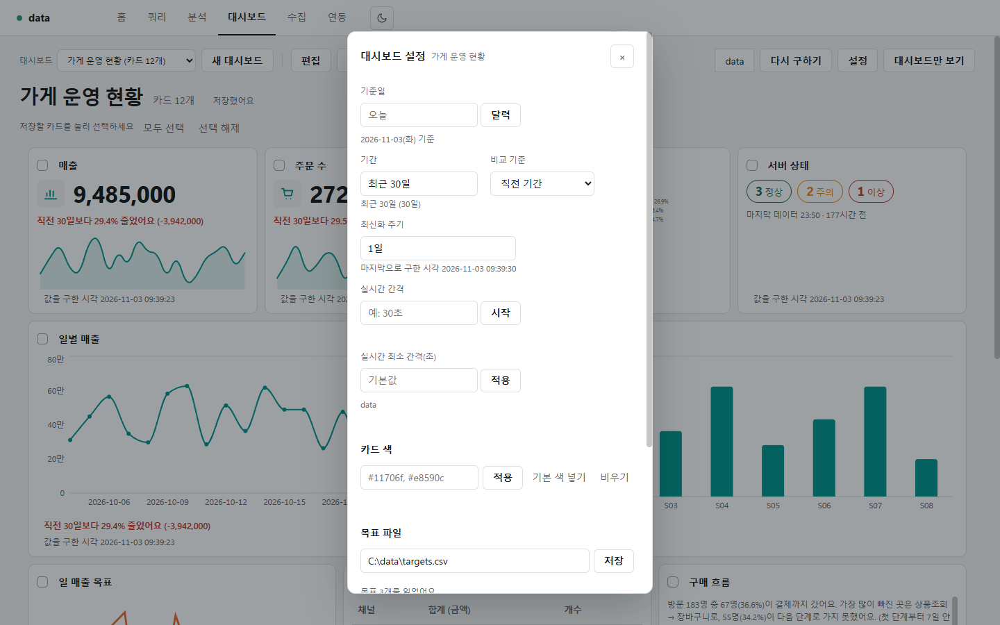

# 대시보드 기본 쓰기

[← 대시보드](../dashboard.md)

대시보드는 왼쪽 메뉴의 **[대시보드]**를 눌러 여는 화면입니다. 카드를 모으고, 저장하고, 보는 기간을 정하고, 연결하면 최신으로 바꾸는 법을 설명합니다.

화면 위쪽 도구 줄: **대시보드** 고르는 칸·**[새 대시보드]** | **[편집]**·**[+ 카드 ▾]**(편집 중에만)·**[내보내기 ▾]** | **[다시 구하기]**·**[대시보드 설정]**(편집 중에만)·**[대시보드만 보기]**. 그 아래 제목 줄에 대시보드 이름, 지금 연결 이름(없으면 "연결 안 됨"), 카드 수가 보입니다. 대시보드가 없을 때는 [편집]을 누를 수 없으니 먼저 [새 대시보드]를 만듭니다.

## 모으기

![[새 대시보드]: 이름 칸과 시작 모양(템플릿) 고르기, [만들기]](../photo/dashboard-new-template.png)

- **[새 대시보드]**를 누르면 이름 칸과 **시작 모양**(템플릿) 고르기가 나옵니다. 이름을 쓰고 시작 모양(분석 개요형·목표 달성형·모니터링형·직접 구성·내 템플릿)을 고른 뒤 **[만들기]**를 누릅니다. 템플릿은 [편집](dashboard_edit.md#템플릿)에 있습니다.
- 맨 왼쪽 **대시보드** 고르는 칸에서 저장해 둔 대시보드를 고릅니다(이름 옆에 `카드 5개`처럼 카드 수가 보임). 마지막으로 연 대시보드를 기억합니다.
- 카드가 하나도 없으면 가운데에 "이렇게 시작해요" 안내와 **[카드 추가]**·**[쿼리에서 가져오기]** 단추가 나옵니다. 여기서 [카드 추가]를 누르면 편집을 켜지 않아도 카드 추가 서랍이 열립니다.
- 카드를 넣는 길은 **[+ 카드 ▾]** 메뉴(편집 중에만 보임)에 모여 있습니다.
  - **카드 추가**: 오른쪽 서랍이 열리고, 테이블을 골라 KPI·표·상태 같은 카드를 바로 만듭니다([카드 종류](dashboard_cards.md)).
  - **카드 모음**: 빈 카드 틀을 끌어 놓고 나중에 데이터를 정합니다(편집이 켜집니다, [편집](dashboard_edit.md)).
  - **지표**: 내 지표와 지표 사전 목록을 봅니다. 지표 파일의 지표는 [카드로 추가]로 KPI 카드를 만들고, 계산·빈칸 고치기는 쿼리 화면 [지표] 탭에서 합니다([지표](metrics.md)).
  - **쿼리에서 가져오기**: 쿼리 화면으로 갑니다. 쿼리 화면의 차트·지표, 분석 화면의 결과에서 **[대시보드에 추가]** → 넣을 대시보드를 고르면 "대시보드에서 보기" 링크가 뜹니다.
- 대시보드는 100개, 대시보드 하나의 카드는 48개까지입니다.

## 저장

- 카드·자리·카드 색을 고치면 0.7초 뒤 **저절로 저장**합니다. 저장 단추는 따로 없고, 제목 줄에 "저장 중…"에 이어 "저장했어요"가 뜹니다. **Ctrl+S**는 바로 저장하고, **Ctrl+Z**·**Ctrl+Y**로 편집을 되돌리거나 다시 합니다.
- 저장하지 못하면 다른 대시보드로 옮기지 않고 편집을 그대로 둡니다(임시 저장은 [drafts.md](drafts.md)).
- 카드에는 구한 값이 들어 있어 `%APPDATA%\DataLoupe\dashboards.dat`에 **이 PC·이 Windows 계정에서만 풀 수 있게 암호화**해 저장합니다. 다른 PC에서는 풀 수 없다고 알리고 파일은 건드리지 않습니다.
- 연결의 계정 이름과 비밀번호는 저장하지 않습니다.
- 대시보드 이름 바꾸기와 지우기는 [대시보드 설정] 창 맨 아래에 있습니다. 지우기는 두 번 눌러야 지워집니다.

## 기준일·기간·비교 기준

편집 중에 **[대시보드 설정]**을 누르면 **대시보드 설정** 창이 뜹니다. 위에서부터 기준일·기간·비교 기준·최신화 주기·실시간 간격·실시간 최소 간격, **카드 색**, **목표 파일**, **통화 기호**, **차트 낱말**, **내 템플릿**, **이름 바꾸기와 지우기**가 있습니다. 위쪽 칸들이 "언제를 볼지"를 정합니다. 칸은 값을 쓰고 Enter를 치거나 다른 곳을 누르면 반영됩니다.

| 칸 | 쓰는 법 |
|---|---|
| 기준일 | 비우면 오늘. `2026-10-01`, `2026.10.01`, `20261001`, `어제`, `지난달 말`, 또는 **[달력]**. 오늘 뒤의 날은 "아직 오지 않은 날이에요"로 막습니다 |
| 기간 | `최근 30일`, `2026-10`, `2026-Q3`, `2026`, `지난달`, `이번 주`, `2026-01-01 ~ 2026-03-31`(한쪽을 비우면 열린 범위). 옆 **[달력]**에서 시작 날과 끝 날을 골라도 됩니다(기준일 뒤의 날은 고를 수 없음). 날짜 단위로만 쓰고 시각(`09:00`)은 받지 않습니다. 틀리면 이유를 보이고 이전 값을 둡니다 |
| 비교 기준 | 비교 문장이 지금 기간과 견줄 기간. **직전 기간**(기본)·**같은 요일 기간**(요일을 맞춰 몇 주 앞)·**작년 같은 기간** 중 고릅니다. 대시보드마다 저장합니다 |

- `최근 N일`(주·달·년도)은 **기준일 전날(어제)까지**입니다. 오늘을 넣으려면 `오늘`·`이번 주`를 씁니다.
- 기간을 **비워 두면**(새 대시보드의 처음 상태) 대시보드 기간을 걸지 않고 카드마다 자기 조건대로 보입니다. 이때 카드에 기간 줄이 있으면 그 기간을 비교 기준대로 견줍니다.
- 기준일이 오늘이 아니면 "지난 날짜 기준으로 보는 중"이 뜨고 실시간 갱신은 멈춥니다.
- 날짜가 X축인 카드는 저장된 일 값을 다시 묶어 주·월·연으로 바로 그립니다.
- 날짜가 X축이 아닌 카드(KPI·표·문장 등)는 카드의 **기간 기준 날짜 컬럼**에 기간을 걸어 다시 구합니다. 연결이 없으면 카드에 "연결하면 이 기간으로 다시 구해요"가 뜹니다.
- 비교 문장("직전 30일보다 4.7% 줄었어요")은 **직전 기간**이면 바로 앞 같은 길이의 기간과 견줍니다. 달·분기·연으로 꼭 맞는 기간은 지난달·직전 분기·작년과 견줍니다.
- 읽어 온 범위 안에서 행이 없는 날은 개수·합계를 0으로 봅니다(평균·최소·최대는 빈 값).

## 최신화와 실시간

| 칸 | 뜻 |
|---|---|
| 최신화 주기 | 예: `1일`, `36시간`(1시간 이상). 비우면 하지 않습니다. 연결에 성공하면 이 주기가 지난 카드만 다시 구해 저장합니다. 칸 아래에 "마지막으로 구한 시각"이 보입니다 |
| 실시간 간격 | 예: `30초`. 대시보드를 보는 동안 이 간격으로 카드를 다시 구합니다. **[시작]**으로 켜고 **[멈추기]**로 끕니다. 이 값은 저장하지 않습니다 |
| 실시간 최소 간격(초) | 이 연결에서 쓸 실시간 간격의 하한. 숫자를 넣고 **[적용]**을 누릅니다(연결했을 때만). 정하지 않으면 DB 서버 같은 원격 연결은 60초, 이 PC의 파일은 제한 없음. 0으로 저장하면 이 기본값으로 돌아갑니다 |

- 어느 화면에서 연결하든 "대시보드를 최신 값으로 바꾸고 있어요 (3/7)" 창이 뜨고 카드마다 완료·실패·건너뜀·대기를 보입니다. **[닫고 계속하기]**는 창만 닫고(위쪽 줄 알약을 누르면 다시 열림), **[멈추기]**는 남은 카드를 건너뜁니다.
- 실패한 카드는 이전 값을 그대로 둡니다. 다른 연결에서 구한 카드는 건너뛰고 카드에 "다른 연결에서 구한 이전 값이에요"가 보입니다.
- 최신화 중에 연결을 바꾸면 그 카드는 "연결이 바뀌어 건너뛰었어요", 남은 카드는 "멈췄어요"로 멈춥니다.
- 최신화는 카드가 쓰는 컬럼과 보는 기간의 행만 읽고, 같은 테이블·조건의 카드는 한 번에 읽습니다. 읽는 양이 설정한 기준을 넘는 카드는 그 카드만 건너뛰고 이유를 적습니다.
- 실시간은 앞 조회가 끝난 뒤 다음 조회를 합니다(겹치지 않음). 글자를 입력하는 중이면 그 회는 "입력 중이라 이번 갱신은 건너뛰었어요"로 건너뜁니다.
- 실시간 값과 기간을 걸어 둔 채 구한 값은 화면에만 보이고 저장하지 않습니다.
- **[다시 구하기]**: 모든 카드를 지금 연결에서 다시 구해 저장합니다. 기간을 걸어 둔 채 구한 값은 화면에만 두고, 실패한 카드는 이전 값을 둡니다.

## 통화 기호와 그 밖의 설정

대시보드 설정 창의 아래쪽 칸들입니다.

- **통화 기호**: 표시 형식이 **금액**인 값 앞에 붙는 기호입니다. 기본은 `₩`이고, `$`·`€`처럼 4자까지 적고 **[저장]**을 누릅니다. 숫자·부호(`+` `-`)·공백은 쓸 수 없고, 비우고 저장하면 기본 기호로 돌아갑니다. 대시보드 하나가 아니라 **모든 대시보드에 적용**됩니다. 카드의 금액은 다시 그릴 때, 비교 문장은 다시 구할 때 바뀝니다.
- **카드 색**: 대시보드 전체의 카드 색입니다([편집](dashboard_edit.md#색)).
- **목표 파일**: 카드가 이름으로 목표를 찾을 파일의 경로를 넣고 **[저장]**합니다([카드 종류](dashboard_cards.md#목표와-목표-파일)).
- **차트 낱말**: 긍정·부정·기타·결측 낱말을 한 줄에 하나씩 적고 **[저장]**합니다. 긍정·부정은 이름에 그 낱말이 들어 있으면, 기타·결측은 이름 전체가 같으면 맞는 것으로 봅니다([차트 자동 규칙](dashboard_cards.md#차트-자동-규칙)의 의미 색·핀에 쓰임).
- **내 템플릿**: 지금 카드 배치를 템플릿으로 저장하거나 지웁니다([편집](dashboard_edit.md#템플릿)).
- **이름 바꾸기와 지우기**: 이름 칸을 고치고 **[이름 바꾸기]**, 또는 **[대시보드 지우기]**(누르면 "한 번 더 누르면 지워져요"로 바뀌고 한 번 더 눌러야 지워짐).

## 대시보드만 보기

![대시보드만 보기: 메뉴·도구와 카드의 선택·설정 단추 없이 대시보드 이름과 카드, 오른쪽 위 [보기 끝내기]만](../photo/dashboard-only.png)

도구 줄 오른쪽의 **[대시보드만 보기]**를 누르면 왼쪽 메뉴, 도구 줄, 패널, 카드의 체크·설정·닫기 단추와 크기 손잡이가 모두 사라지고 대시보드 이름과 카드, 오른쪽 위 **[보기 끝내기]**만 남습니다. 회의 화면에 띄워 두거나 모니터 한쪽에 켜 둘 때 씁니다.

- 보는 동안 카드를 눌러도 선택되지 않고, 카드를 옮기거나 이름을 고칠 수 없습니다. 차트에 마우스를 올리면 값이 보이는 것처럼 보는 기능은 그대로입니다.
- **Esc**를 누르거나 오른쪽 위 **[보기 끝내기]**를 누르면 원래 화면으로 돌아옵니다.

## 첫 화면과 쿼리 화면

- 첫 화면의 **[대시보드]** 카드는 "바로 시작"으로, 연결하지 않고 이 화면을 엽니다. 저장된 값이 바로 보입니다.
- 예전에는 쿼리 화면 안에 대시보드가 있었습니다. 지금은 이 화면 하나뿐이고, 예전 주소(`/search#dashboard`)로 들어가도 이 화면으로 옵니다.
- 쿼리·분석 화면의 "대시보드에서 보기" 링크(`/dashboard?open=…`)는 그 대시보드를 바로 엽니다.
