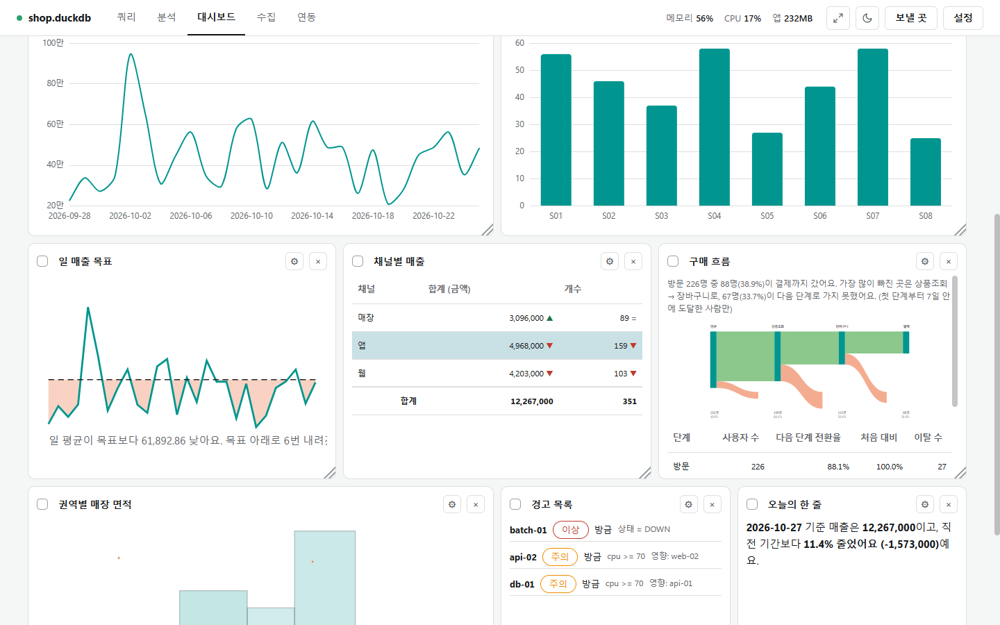
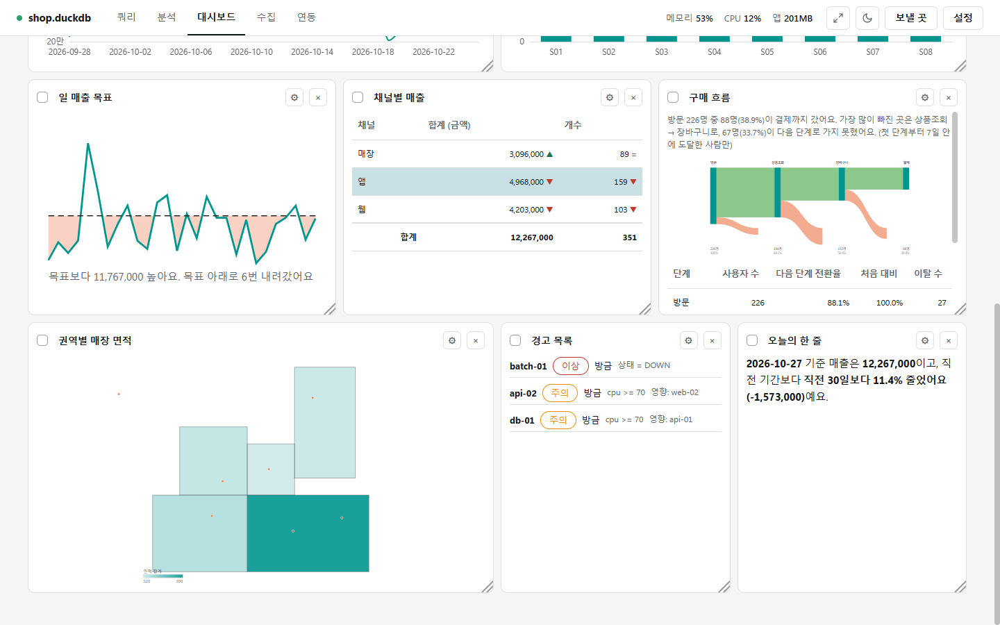

# 대시보드 카드 종류

[← 대시보드](../dashboard.md)

## 카드 추가

![[카드 추가] 메뉴: 테이블·카드 종류(KPI)·이름·값(금액 합계)·값 모양·지표·날짜 컬럼·목표](../photo/dashboard-add-menu.png)

- **[카드 추가]**를 누르면 메뉴가 열립니다. 위에서부터 **테이블**, **카드 종류**, 카드 이름, **값**(이름·컬럼·집계)을 고릅니다.
- **값 모양**(숫자·퍼센트·통화), **지표**(내 지표를 값으로 쓸 때), **날짜 컬럼**(기간을 걸 컬럼. 날짜 컬럼이 하나뿐이면 자동으로 고름), **목표**(숫자 또는 목표 파일의 이름)를 정하고 **[카드 추가]**를 누릅니다.
- 집계는 합계·평균·개수뿐 아니라 함수 사전의 집계(중앙값·P90·최빈값 …)를 모두 고를 수 있습니다.
- 메뉴에서 고를 수 있는 종류는 18가지입니다. 차트·지표·분석 카드는 쿼리·분석 화면의 **[대시보드에 추가]**로도 만듭니다.

## 차트·값 카드

| 종류 | 보이는 것 |
|---|---|
| 차트 | 막대·가로 막대·누적 막대·라인·꺾인 선·영역형 라인·도넛·파이·레이더·산점도·버블(11가지). 값은 5개까지 |
| KPI | 아이콘·큰 값·비교 문장·작은 선(스파크라인). 비율 지표는 분자·분모도 작게 |
| 도넛 KPI | 가운데 값과 네 꼭지점 값(칸 5개). 고리 방식 넷: 한 고리 누적, 겹친 두 고리, 반원 게이지, 고리+목표 눈금. 목표를 넘은 부분은 진한 색 |
| 게이지 | 항목(컬럼 값)별 몫으로 나눈 호, 가장 큰 항목은 굵게 |
| 요약 문장 | 변화, 가장 크게 기여한 항목의 몫, 목표 대비를 쓴 문장과 목표 대비 막대 |
| 두 계열 추이 | 두 값을 겹친 선. 마우스를 올리면 값 상자, 오늘 이후는 빗금, 아래 막대를 끌어 보는 범위 선택 |
| 칸 채우기 / 블록 | 목표까지 칸을 비율로 채움 / 값만큼 블록을 쌓음(실제·목표까지·넘은 칸) |
| 목표 추이 | 일 값 선, 목표 점선, 목표 아래 구간 채움, "목표보다 … · 기간 중 N번 내려감" |
| 최근 행 | 연결돼 있을 때만 앞 N행. 행 값은 저장하지 않음 |

- 날짜가 X축인 차트는 일·주·월·연으로 단위를 바꿔 봅니다. 고를 수 없는 차트 종류는 흐리게 보이고 누르면 이유가 나옵니다.
- **고유 개수**는 여러 날을 더할 수 없어, 기간을 바꾸면 연결해 그 기간으로 다시 구합니다(연결이 없으면 "—").

## 표·문장·흐름 카드

- **목표 추이**(왼쪽): 점선이 목표, 목표 아래로 내려간 구간을 칠하고 아래에 목표와의 차이와 내려간 횟수를 씁니다.
- **표**(가운데): 묶음 컬럼별 집계(최대 500행) 또는 원래 행(연결할 때만). 머리글을 눌러 정렬, 합계 줄, 직전 기간 대비 ▲▼. 색 규칙에 맞는 칸·줄을 칠합니다.
- **흐름(퍼널)**(오른쪽): 단계별 사용자 수를 생키 그림과 표로. 분석 화면의 [대시보드에 추가]나 [카드 추가] → 흐름(퍼널)으로 만듭니다([흐름](funnel.md)).
- **문장**: 직접 쓴 틀의 빈칸 `{이름}`에 값·직전 값·비교 문장·기준일을 넣습니다. 계산하지 못한 빈칸은 "—"(마우스를 올리면 이유).

### 색 규칙(표·문장)

한 줄에 `컬럼 | 식 | #색 | 화살표 | 칸·줄`로 씁니다. 맞는 칸만 칠하고, 여러 규칙이 맞으면 위의 규칙 하나만 씁니다.

| 식 | 뜻 |
|---|---|
| `= 0`, `> 100`, `>= 1,000`, `< -5%`, `10 ~ 20`, `1, 3, 7` | 숫자: 같다·크다·작다·사이·이 숫자들만 |
| `취소`, `취소, 환불`, `*지연*`, `ERR*`, `*실패` | 단어(대소문자 무시): 정확히·이 단어들만·포함·시작·끝 |

화살표는 없음, ▲·▼ 고정, 자동(직전 값보다 오르면 ▲, 내리면 ▼) 중 고릅니다. 읽을 수 없는 식·틀린 HEX는 그 줄 아래에 이유를 보이고 쓰지 않습니다.

## 상태·경고·배치도·편차 표·지도

서버·장비·매장 같은 **엔티티**별 최근 행을 **상태 규칙**(`cpu >= 90 이상`, `상태 = DOWN 주의`)과 **끊김 규칙**(마지막 시각이 N분 넘게 오래됨)으로 정상·주의·이상으로 나눕니다.

| 종류 | 보이는 것 |
|---|---|
| 상태 | 정상·주의·이상 배지와 수, "마지막 데이터 23:50 · 6시간 전" |
| 경고 목록 | 나쁜 엔티티를 "N분째"와 함께. **영향**은 연결선(`출발 -> 도착`)을 한 단계 따라간 대상 |
| 배치도 | 서버실 칸·네트워크·그림 파일 위의 상태 색 점. 점을 끌어 옮기면 자리를 저장. 그림은 png·jpg·svg 8MB까지, 카드를 저장한 뒤 보임 |
| 편차 표 | 엔티티 × 시간대(시·일·주·월) 값. 엔티티 50개·시간대 48개까지. 기준(비우면 엔티티 평균) 대비 허용 폭(비우면 기준의 20%)을 넘는 칸을 칠함 |
| 지도 | GeoJSON 영역 경계를 그리고 점을 찍어 영역별 값으로 칠함(확대·이동 없음). 배경 지도(OpenStreetMap)는 기본 꺼짐이고, 켜면 보는 범위의 지도 조각을 tile.openstreetmap.org에서 받습니다([좌표](geo.md)) |

- **문장**(오른쪽 아래): "2026-10-26 기준 매출은 12,857,000이고, 직전 기간보다 …"처럼 빈칸을 채운 글입니다.

## 목표와 목표 파일

- 목표는 카드에 숫자를 직접 쓰거나, **목표 파일**에서 이름으로 찾습니다. 목표 파일 경로는 [설정] 창이나 [카드 추가] 메뉴에서 저장합니다(경로만 저장, 파일이 바뀌면 다시 읽음).
- 형식: xlsx·xls·csv·yaml·json·md·txt, 5MB까지. 엑셀은 "목표" 시트(없으면 첫 시트)를 읽습니다.
- 머리글: 이름(`이름`·`지표`·`항목`), 값(`값`·`목표`·`target`), 기간(`기간`), 컬럼(`컬럼`), 대상(`대상`).
- 값은 `1억`·`3,000만`·`₩5,000,000`·`70%`처럼 써도 됩니다. 쉼표는 세 자리마다만 되고, `1.500.000`처럼 단위 없이 점이 이어진 숫자는 읽지 못합니다.
- **엑셀 달 칸**: 엑셀 칸에 `2026-10`을 치면 엑셀은 그 달 1일 날짜로 저장합니다. 프로그램은 이 칸을 `2026-10`으로 읽어 **달 목표로 맞춥니다**(1일이 아닌 날짜는 그 날짜 그대로).
- 대시보드 기간이 달·분기·연 하나면 그 기간(`2026-10`·`2026-Q4`·`2026`)의 목표를 씁니다. 그 달 줄이 없으면 그 달을 품는 분기·연의 목표를 씁니다. 다른 달·다른 해의 목표는 쓰지 않습니다.
- 같은 이름·기간·대상이 둘 이상이면 겹친 줄을 모두 빼고 이유를 알립니다. 읽지 못한 줄은 안내 옆 **[보기]**에서 줄 번호·이유를 100개씩 [이전]/[다음]으로 봅니다.

## 그림으로 저장

카드를 체크해 고른 뒤 **[다운로드]**를 누르면 고른 카드마다 그림 파일(PNG·JPG)로 저장합니다. 차트뿐 아니라 KPI·표·생키 같은 카드도 그림이 됩니다. 모든 카드를 한 장으로 모으는 보고서는 [편집](dashboard_edit.md#그림보고서-저장)에 있습니다.
