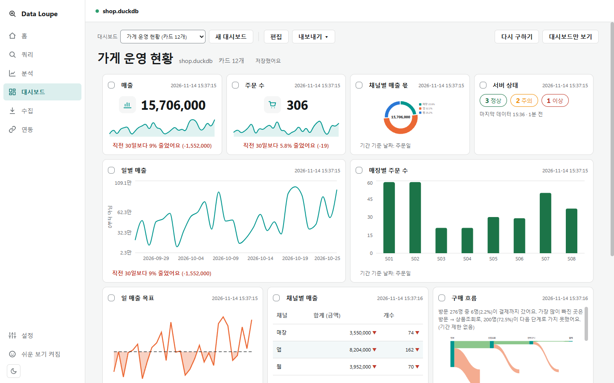
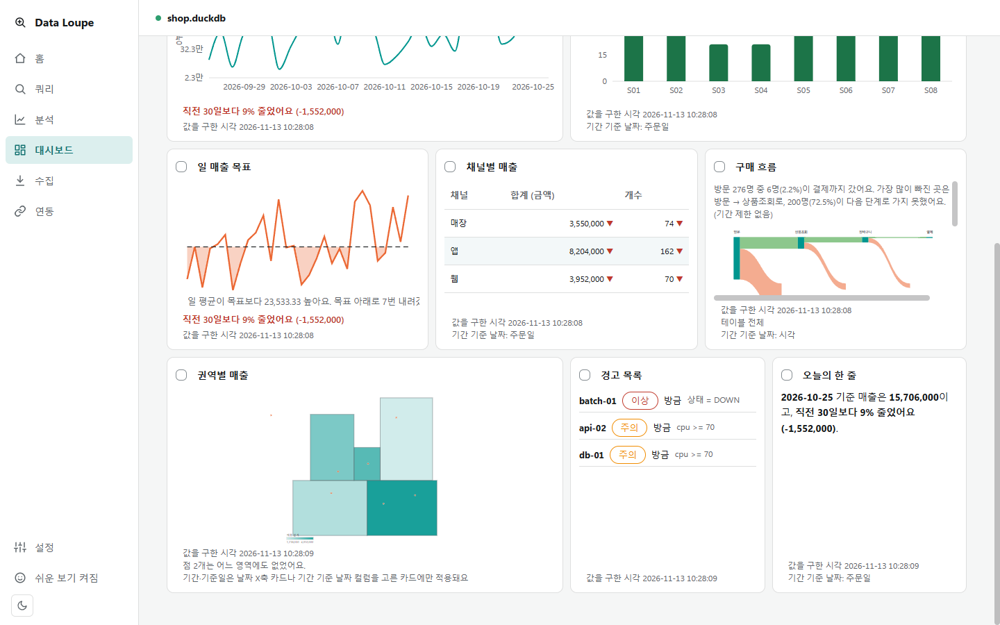
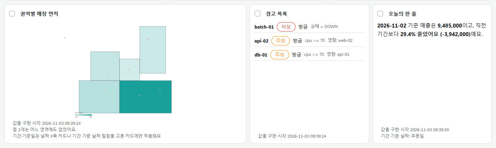
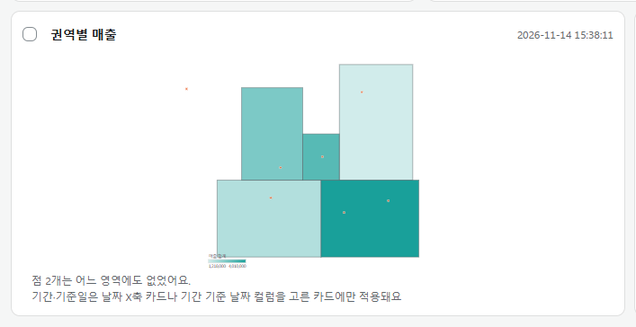

# 대시보드 카드 종류

[← 대시보드](../dashboard.md)

## 카드 추가

![[카드 추가] 메뉴: 테이블·카드 종류(KPI)·이름·값(금액 합계)·표시 형식·지표·날짜 컬럼·목표](../photo/dashboard-add-menu.png)

- **[+ 카드 ▾]** → **카드 추가**를 누르면 메뉴가 열립니다. 위에서부터 **테이블**, **카드 종류**, 카드 이름, **값**(이름·컬럼·집계)을 고릅니다.
- **표시 형식**(숫자·퍼센트·통화), **지표**(내 지표를 값으로 쓸 때), **날짜 컬럼**(기간을 걸 컬럼. 날짜 컬럼이 하나뿐이면 자동으로 고름), **목표**(숫자 또는 목표 파일의 이름)를 정하고 **[카드 추가]**를 누릅니다. KPI·도넛 KPI·칸 채우기 카드에는 **단위** 칸(예: 명, 회, 원)이 있어 값 뒤에 붙일 글자를 적습니다. 지표 파일의 지표를 값으로 쓰는 KPI는 표시 형식을 따로 고르지 않으면 지표 파일의 형식을 따릅니다.
- 집계는 합계·평균·개수뿐 아니라 함수 사전의 집계(중앙값·P90·최빈값 …)를 모두 고를 수 있습니다.
- ID·해시·UUID로 보이는 컬럼은 그룹·값 컬럼 목록에서 빠지고, 칸 아래 안내의 **[다시 넣기]**로 되살립니다(이미 카드가 쓰는 컬럼은 빼지 않습니다).
- 메뉴에서 고를 수 있는 종류는 18가지입니다. 차트·지표·분석 카드는 쿼리·분석 화면의 **[대시보드에 추가]**로도 만듭니다.

## 차트·값 카드

| 종류 | 보이는 것 |
|---|---|
| 차트 | 막대·가로 막대·누적 막대·라인·꺾인 선·영역형 라인·도넛·파이·레이더·산점도·버블(11가지). 값은 5개까지 |
| KPI | 아이콘·큰 값·비교 문장·작은 선(스파크라인). 비율 지표는 분자·분모도 작게 |
| 도넛 KPI | 가운데 값과 네 꼭지점 값(칸 5개). 고리 방식 넷: 한 고리 누적, 겹친 두 고리, 반원 게이지, 고리와 목표 눈금. 목표를 넘은 부분은 진한 색 |
| 게이지 | 항목(컬럼 값)별 몫으로 나눈 호, 가장 큰 항목은 굵게 |
| 요약 문장 | 변화, 가장 크게 기여한 항목의 몫, 목표 대비를 쓴 문장과 목표 대비 막대 |
| 두 계열 추이 | 두 값을 겹친 선. 마우스를 올리면 값 상자, 오늘 이후는 빗금, 아래 막대를 끌어 보는 범위 선택 |
| 칸 채우기 / 블록 | 목표까지 칸을 비율로 채움 / 값만큼 블록을 쌓음(실제·목표까지·넘은 칸) |
| 목표 추이 | 일 값 선, 목표 점선, 목표 아래 구간 채움, "목표보다 X 낮아요(높아요·같아요). 목표 아래로 N번 내려갔어요"(합계·개수는 일 값을 그리므로 "일 평균이 목표보다 …"로 견줍니다) |
| 최근 행 | 연결돼 있을 때만 앞 N행. 행 값은 저장하지 않음 |

- 날짜가 X축인 차트는 일·주·월·연으로 단위를 바꿔 봅니다. 차트 종류·시간 단위는 [편집] → 카드의 ⚙ → 설정 패널의 **모양**에서 바꿉니다. 고를 수 없는 차트 종류는 흐리게 보이고 누르면 이유가 나옵니다.
- **확대·이동**: 카드를 한 번 눌러 활성(얇은 테두리)으로 만들면 휠로 가로축만 확대·축소(마우스 자리 고정), 끌어서 이동, 더블클릭으로 전체 보기입니다. 바깥을 누르거나 Esc면 활성이 풀리고, 활성이 아닌 카드 위에서는 페이지가 스크롤됩니다. 막대·선·영역 같은 계열 차트, 산점도·버블, 캔들·순위·두 계열 추이·목표 추이가 대상이며(둥근 차트·레이더·가로 막대류·상자 그림·히트맵 등은 제외, 점이 5개 이하면 확대 안 함), 받아 둔 값을 자르기만 해 다시 조회하지 않고 저장하지도 않습니다. 데이터가 바뀌면 전체로 돌아갑니다.
- **고유 개수**는 여러 날을 더할 수 없어, 기간을 바꾸면 연결해 그 기간으로 다시 구합니다(연결이 없으면 "—").

## 표시할 그룹 고르기

차트·KPI가 아닌 값 카드(상자 그림·히트맵·트리맵·워드클라우드·퍼널·지도 등)와 차트는 [편집] → 카드의 ⚙ → 설정 패널의 **표시할 그룹**에서 보일 것을 고릅니다. KPI·게이지·표·상태 같은 카드는 대상이 아닙니다.

- **보일 그룹·계열**: 체크한 것만 보이고, 아무것도 체크하지 않으면 모두 보입니다. 목록이 길면 위에 찾기 칸이 나옵니다. 히트맵은 행·열, 순위 차트는 계열을 고릅니다.
- **끌어 고르기**: 목록에서 왼쪽 단추를 누른 채 끌면 지난 칸이 한꺼번에 골라집니다. 숫자·날짜 순서가 있는 값(숫자 가로축, 날짜 차트, 히스토그램, 달력 히트맵 등)은 끈 구간이 **범위**가 됩니다. 범위는 [범위 더하기]로 직접 쓸 수도 있고, 한쪽은 비울 수 있습니다.
- **범위를 한 그룹으로 묶기**: 숫자 가로축 차트에서 켭니다. 계열이 합계·개수면 화면이 더하고, **고유 개수**가 있으면 겹치는 값을 중복 없이 세려고 서버가 묶은 범위로 다시 구합니다(범위가 서로 겹치면 안 되고, 나누기와는 함께 쓸 수 없습니다). 평균·중앙값은 묶을 수 없습니다. 날짜 가로축·히스토그램은 묶기를 쓸 수 없습니다.
- **이름 바꾸기**: 그룹·계열 이름을 보이는 글자로 바꿉니다. 색은 원래 이름 기준 그대로 따라갑니다.
- **지도 영역 묶기**: 지도 카드는 보일 영역을 고르고, 영역을 골라 이름을 붙여 한 영역으로 묶습니다(영역 값이 합계·개수일 때만, 한 영역은 한 묶음에만).
- 고르기는 보기 설정이라 값을 다시 구하지 않습니다(고유 개수 범위 묶기만 예외). 서버 상한에 잘려 받지 못한 그룹은 카드의 조건 줄로 좁힙니다.

## 워드클라우드 세 방식

카드 추가 메뉴나 설정 패널에서 **방식**을 고릅니다.

| 방식 | 보이는 것 |
|---|---|
| 컬럼 값 | 컬럼의 값별 개수(기본) |
| 라벨 이름 | 쿼리 화면에서 단 태그 이름별 행 수. 보일 태그를 고를 수 있고, 태그를 켠 검색으로 담은 카드여야 합니다 |
| 글 속 단어 | 글 컬럼을 한국어 형태소로 나눠 센 단어 빈도(kiwipiepy) |

- **글 속 단어**는 **단어를 뽑을 행**(전체 행 / 고른 태그의 행)을 기본값 없이 직접 골라야 카드를 만들 수 있습니다. 고른 태그의 행이면 태그와 **하나라도 / 모두**도 고릅니다.
- 설정 패널에서 **품사**(명사·동사·형용사·외국어, 기본 명사), **불용어**(쓰고 Enter로 더하고 ×로 뺌, 카드에 저장), **최소 글자 수**(비우면 2)를 정합니다. 바꾸면 다시 구합니다.
- 받는 행 수에는 상한이 있습니다([고급 설정](settings.md#고급-설정)의 단어 분석 최대 행 수). 넘으면 기간·조건·태그를 좁히세요.

## 표·문장·퍼널 카드

- **목표 추이**(왼쪽): 점선이 목표, 목표 아래로 내려간 구간을 칠하고 아래에 목표와의 차이와 내려간 횟수를 씁니다.
- **표**(가운데): 묶음 컬럼별 집계(최대 500행) 또는 원래 행(연결할 때만). 머리글을 눌러 정렬, 합계 줄, 직전 기간 대비 ▲▼. 색 규칙에 맞는 칸·줄을 칠합니다.
- **퍼널**(오른쪽): 단계별 사용자 수를 생키 그림과 표로. 분석 화면의 [대시보드에 추가]나 [+ 카드 ▾] → 카드 추가 → 퍼널로 만듭니다([퍼널](funnel.md)).
- **퍼널 보기**: 카드의 ⚙ → 설정 패널에서 **그림 모양**을 흐름(생키와 표) 또는 사다리꼴로 바꿉니다. 사다리꼴은 기본으로 차례로 좁아지고, **인원 비례**를 켜면 폭이 단계의 사람 수에 비례합니다. **걸린 시간 표**(평균·중앙값·절사평균, 기본은 중앙값)는 "단계 → 단계"마다 걸린 시간을 보여 주며 다시 구하지 않고 바로 바뀝니다.
- **조건 단계 퍼널**: [+ 카드 ▾] → 카드 추가 → 퍼널에서 **단계 정의**를 "조건 줄"로 고르면 단계마다 이름과 조건 줄(줄끼리 and)을 적습니다. **틀**로 AARRR·RARRA 단계 이름을 채울 수 있고, 단계에 **재방문 N일**(1~365, 직접 입력 또는 1·3·7·14·30일)을 정하면 그 사람의 첫 활동 날짜보다 뒤이고 N일 안인 행만 그 단계로 봅니다(같은 날은 제외). **세기**는 "순서대로"(앞 단계를 거친 사람만) 또는 "단계마다 따로"(각 단계 조건을 만족한 사람, 이탈 수는 앞 단계는 만족했고 이 단계는 아닌 사람)입니다. 기간 제한은 두 세기 모두 쓰며, 따로 셀 때는 첫 단계를 처음 만족한 때부터 세고 첫 단계를 만족하지 않은 사람은 모든 단계에서 빠집니다. **절사평균 자르기 %**(비우면 10)는 [데이터 다시 정하기]에서 정합니다.
- **생키 자동 흐름**: 생키 카드의 **흐름 방식**을 "자동"으로 하면 단계를 적지 않고 이벤트 값의 경로를 알아서 이어 줍니다. [값 목록 불러오기]로 받은 값마다 시작·중간·끝을 고르고(고르지 않은 값은 건너뜀), **단계 깊이**(기본 6, 2~50, 클수록 느려질 수 있음)를 정합니다. 설정 패널의 **이탈 칸**은 고른 값 중 뒤에 더 없는 사람을 "이탈"로 모으고(끝 값을 골랐으면 기본 켬), **상한 없음**은 칸·띠 개수 제한을 풉니다. 두 설정은 값이 달라지므로 [다시 구하기]를 눌러야 합니다. 생키 카드(단계를 적는 방식도)에는 **조건 줄**을 더해 행을 걸러 낼 수 있습니다.
- **문장**: 직접 쓴 틀의 빈칸 `{이름}`에 값·직전 값·비교 문장·기준일을 넣습니다. 계산하지 못한 빈칸은 "—"(마우스를 올리면 이유).

### 색 규칙(표·문장)

카드 추가 메뉴나 설정 패널의 **색 규칙** 칸에 한 줄에 `컬럼 | 식 | #색 | 화살표 | 칸·줄`로 씁니다. 맞는 칸만 칠하고, 여러 규칙이 맞으면 위의 규칙 하나만 씁니다.

| 식 | 뜻 |
|---|---|
| `= 0`, `> 100`, `>= 1,000`, `< -5%`, `10 ~ 20`, `1, 3, 7` | 숫자: 같다·크다·작다·사이·이 숫자들만 |
| `취소`, `취소, 환불`, `*지연*`, `ERR*`, `*실패` | 단어(대소문자 무시): 정확히·이 단어들만·포함·시작·끝 |

화살표는 없음, ▲·▼ 고정, 자동(직전 값보다 오르면 ▲, 내리면 ▼, 화면에 같은 값으로 보이면 강조 없이 =) 중 고릅니다. 읽을 수 없는 식·틀린 HEX는 그 줄 아래에 이유를 보이고 쓰지 않습니다.

## 상태·경고·배치도·편차 표·지도

서버·장비·매장 같은 **대상**별 최근 행을 **상태 규칙**(`cpu >= 90 이상`, `상태 = DOWN 주의`)과 **끊김 규칙**(마지막 시각이 N분 넘게 오래됨)으로 정상·주의·이상으로 나눕니다.

| 종류 | 보이는 것 |
|---|---|
| 상태 | 정상·주의·이상 배지와 수, "마지막 데이터 23:50 · 6시간 전" |
| 경고 목록 | 나쁜 대상을 "N분째"와 함께. **영향**은 연결선(`출발 -> 도착`)을 한 단계 따라간 대상 |
| 배치도 | 서버실 칸·네트워크·그림 파일 위의 상태 색 점. 점을 끌어 옮기면 자리를 저장. 그림은 png·jpg·svg 8MB까지, 카드를 저장한 뒤 보임 |
| 편차 표 | 대상 × 시간대(시·일·주·월) 값. 대상 50개·시간대 48개까지. 기준 값(비우면 대상 평균) 대비 허용 폭(비우면 기준의 20%)을 넘는 칸을 칠함 |
| 지도 | GeoJSON 영역 경계를 그리고 점을 찍어 영역별 값으로 칠함(확대·이동 없음). 배경 지도(OpenStreetMap)는 기본 꺼짐이고, 켜면 보는 범위의 지도 조각을 tile.openstreetmap.org에서 받습니다([좌표](geo.md)) |

- **문장**(오른쪽 아래): "2026-10-27 기준 매출은 12,267,000이고, …"처럼 빈칸을 채운 글입니다.

## 목표와 목표 파일

- 목표는 카드에 숫자를 직접 쓰거나, **목표 파일**에서 이름으로 찾습니다. 목표 파일 경로는 [설정] 창이나 카드 추가 메뉴에서 저장합니다(경로만 저장, 파일이 바뀌면 다시 읽음).
- 형식: xlsx·xls·csv·yaml·json·md·txt, 5MB까지. 엑셀은 "목표" 시트(없으면 첫 시트)를 읽습니다.
- 머리글: 이름(`이름`·`지표`·`항목`), 값(`값`·`목표`·`target`), 기간(`기간`), 컬럼(`컬럼`), 대상(`대상`).
- 값은 `1억`·`3,000만`·`₩5,000,000`·`70%`처럼 써도 됩니다. 쉼표는 세 자리마다만 되고, `1.500.000`처럼 단위 없이 점이 이어진 숫자는 읽지 못합니다.
- **엑셀 달 칸**: 엑셀 칸에 `2026-10`을 치면 엑셀은 그 달 1일 날짜로 저장합니다. 프로그램은 이 칸을 `2026-10`으로 읽어 **달 목표로 맞춥니다**. 단 같은 열에 1일이 아닌 날짜가 하나라도 있으면 그 열은 날마다 적은 목표로 보고 모든 날짜를 그대로(`2026-10-01`) 읽습니다.
- 대시보드 기간이 달·분기·연 하나면 그 기간(`2026-10`·`2026-Q4`·`2026`)의 목표를 씁니다. 파일에 `2026-q4`·`2026.10`·`2026-1`로 써도 같은 기간으로 읽습니다(YAML에서는 `2026.10`이 숫자로 읽히니 따옴표로 감싸세요). 그 달 줄이 없으면 그 달을 품는 분기·연의 목표를 씁니다. 다른 달·다른 해의 목표는 쓰지 않습니다.
- 같은 이름·기간·대상이 둘 이상이면 겹친 줄을 모두 빼고 이유를 알립니다. 읽지 못한 줄은 안내 옆 **[보기]**에서 줄 번호·이유를 100개씩 [이전]/[다음]으로 봅니다.

## 차트 자동 규칙

차트를 그릴 때 보기 좋게 알아서 줄 세우고 덜어 내는 규칙들입니다. 모두 기본으로 켜져 있고, 카드의 ⚙ → 설정 패널의 **자동 규칙**에서 규칙마다 끄거나 수치를 바꿉니다. 기본값과 범위는 서버가 정해 화면에 내려 줍니다.

| 규칙 | 하는 일 |
|---|---|
| 정렬(`sort`) | 글자 가로축은 값 큰 순, 숫자·날짜는 가로축 순. 요일·월 이름은 달력 순서, 순서가 있는 값은 그 단계 순서 |
| 핀(`pin`) | '기타'와 빈 값은 맨 뒤. 기타·결측 낱말은 [차트 낱말](settings.md#차트-낱말과-자동-규칙-기본값)에서 고침 |
| Top-N(`topn`) | 그룹이 많으면 큰 것만 남기고 나머지는 '기타'로 합침 |
| 파이·도넛(`round`) | 조각이 6개를 넘으면 종류는 그대로 두고 상위 5개와 '기타'. 12시부터 시계 방향 |
| 가로 막대(`horizontal`) | 글자 가로축의 막대가 많거나 라벨이 칸보다 넓으면 가로 막대로 바꿔 그림 |
| 스파게티(`spaghetti`) | 선이 7개를 넘으면 큰 5개만 색을 주고 나머지는 회색 선(또는 계열마다 따로 그리기) |
| 0 기준선(`zero`) | 막대의 값 축은 0을 포함 |
| 선 확대(`yzoom`) | 선의 값 축은 최소~최대에 여백을 두고, 0이 아니면 "0 아님"을 표시 |
| 로그 제안(`log_hint`) | 값 차이가 매우 크면 안내만 보임(축은 바꾸지 않음) |
| 보조 축(`sync`) | 오른쪽 축 값이 모두 0~1이면 0~100%로 고정 |
| 리샘플링(`resample`) | 선은 그림 너비에 맞게 점을 솎고(LTTB), 막대는 일 → 주 → 월 → 연으로 묶음 |
| 점 밀도(`density`) | 산점도 점이 1,000개 이상이면 옅고 작게, 10,000개를 넘으면 육각 칸의 개수로 |
| 숫자 줄이기(`num`) | 눈금을 한국식(만·억·조) 또는 영어식(K·M·B)으로 줄임(툴팁은 전부) |
| 참조선(`refs`) | 파레토 80% 선(기본 켬), 평균·중앙값 선(기본 끔) |
| 의미 색(`semantic`) | 긍정·부정 낱말이 든 이름은 초록·빨강, 기타·결측은 회색 |
| 구간 수(`bins`) | 히스토그램 구간 수를 FD 또는 Sturges로 정함(서버) |
| 꼬리 자르기(`tail`) | 히스토그램·상자 그림은 양끝 백분위 밖을 따로 세어 보임(서버) |

- **'기타'**는 합계·개수·최소·최대일 때만 만듭니다. 평균·중앙값·고유 개수는 값을 지어내지 않고 큰 N개만 그린 뒤 안내합니다.
- **내가 고른 것이 먼저**입니다: [정렬]을 자동이 아닌 것으로 고르면 그 순서가 자동 정렬보다 먼저, 차트 종류를 고르면 가로 막대 전환 안 함, 값 축 범위(주·보조)나 [값 축]의 로그·SymLog를 고르면 0 기준선·선 확대 안 함, [표시할 그룹]을 고르면 Top-N·파이 상한 안 씀, 날짜 단위를 일이 아닌 것으로 고르면 자동 묶기 안 함.
- **정렬**: 설정 패널의 [정렬]에서 자동 / 원래 순서 / 값 큰 순 / 값 작은 순 / 이름 순 중에서 고릅니다. 이전에 만든 카드는 "원래 순서"가 골라져 지금 모양 그대로이고, 새 카드는 "자동"입니다.
- **값 축**: [값 축]에서 보통 / 로그 / SymLog를 고릅니다. 로그는 0 이하 값이 있으면 쓸 수 없고, SymLog는 음수·0도 그립니다. **값 축 범위**는 주 축·보조 축의 최소·최대를 직접 정합니다(보조 축 값이 비율이면 %로 읽어 51.2 → 51.2%).
- **모든 데이터**: 카드 설정의 체크를 켜면 Top-N·기타 합치기·파이 상위 5개·꼬리 자르기·점 솎기·육각 칸을 풀어 전부 그립니다. 정렬·가로 막대·색·축 규칙과 [표시할 그룹]은 그대로입니다. **표로 보기**를 켜면 차트 아래에 같은 값을 표로 보여 주고(높이 1/3, 넘치면 스크롤), 둘 다 카드에 저장됩니다. 히스토그램·산점도는 바꾸면 [다시 구하기]를 눌러야 합니다.
- **서버 안전 상한**은 모든 데이터를 켜도 풀리지 않습니다(차트 가로축 그룹 50개, 나눌 값 8개, 산점도 점 5,000개 표본, 상자 그림 그룹·이상치 점, 분석 그룹 비교 30개 등). 걸리면 카드에 안내 문장이 나옵니다.
- 상한에 걸려 받지 못한 그룹은 '기타' 값을 서버가 따로 구해 "기타(외 K개 이상)"로 보입니다.

## 그림으로 저장

카드를 눌러(체크) 고른 뒤 **[내보내기 ▾]** → **[그림으로 저장]**을 누르면 고른 카드마다 그림 파일(PNG·JPG)로 저장합니다. 차트뿐 아니라 KPI·표·생키 같은 카드도 그림이 됩니다. 확대한 카드는 보이는 범위 그대로 저장되고 활성 테두리는 찍히지 않습니다. 모든 카드를 한 장으로 모으는 보고서는 [편집](dashboard_edit.md#그림보고서-저장)에 있습니다.

- **[CSV로 저장]**: 고른 차트 카드의 값을 CSV(UTF-8 BOM, `\r\n`, `=`·`+`·`-`·`@`로 시작하는 글자 앞에 `'`)로 내려받습니다.
- **[모든 데이터 포함]**(기본 끔, 기억하지 않음): 끄면 화면에 보이는 그대로, 켜면 자동 규칙이 덜어 낸 것까지 담습니다(CSV는 자동 규칙 전의 값, 그림은 카드 크기 그대로 화면 밖에서 다시 그린 것이라 막대가 많으면 빽빽해집니다). [표시할 그룹]으로 고른 것은 그대로입니다. PNG·PDF 보고서는 이 선택과 상관없이 보이는 그대로입니다.
