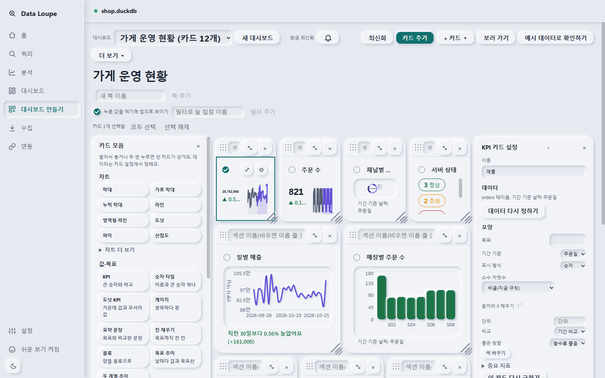
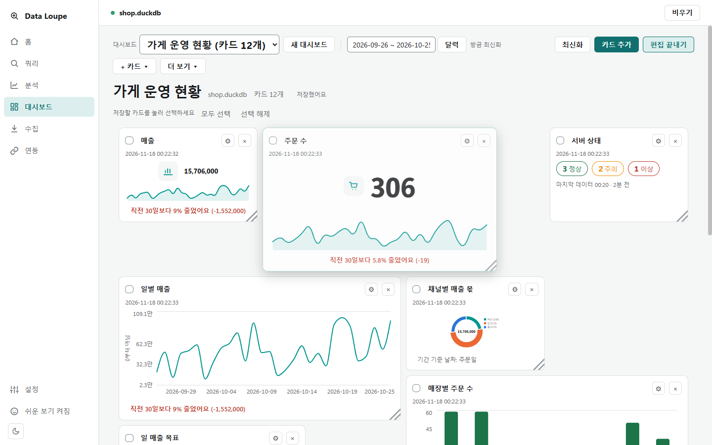
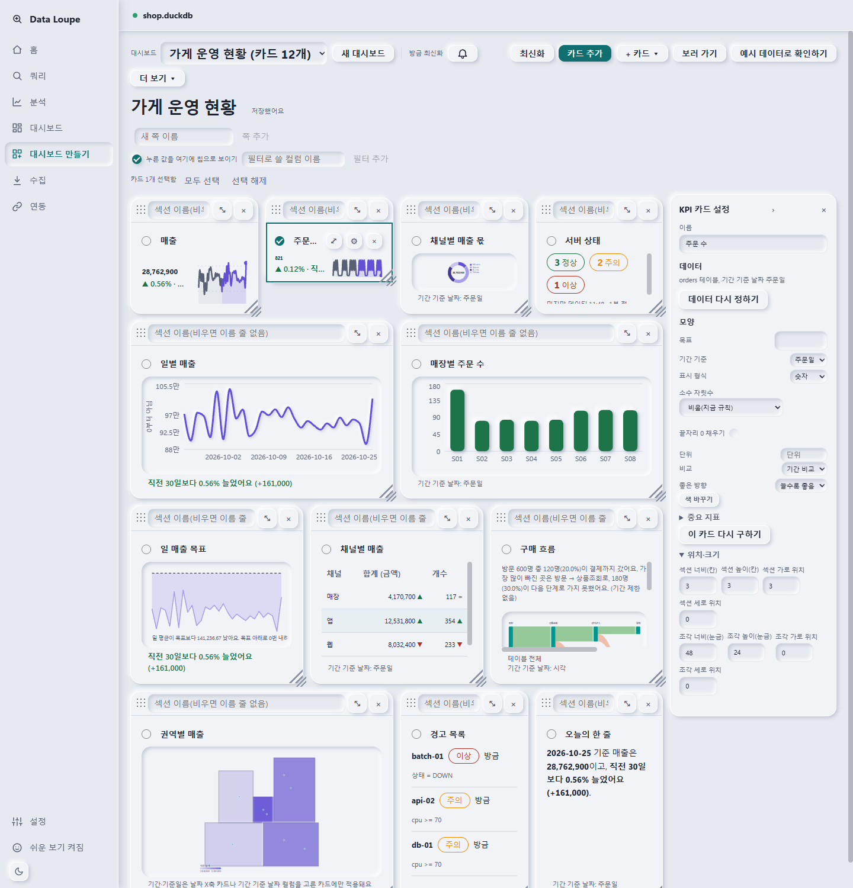
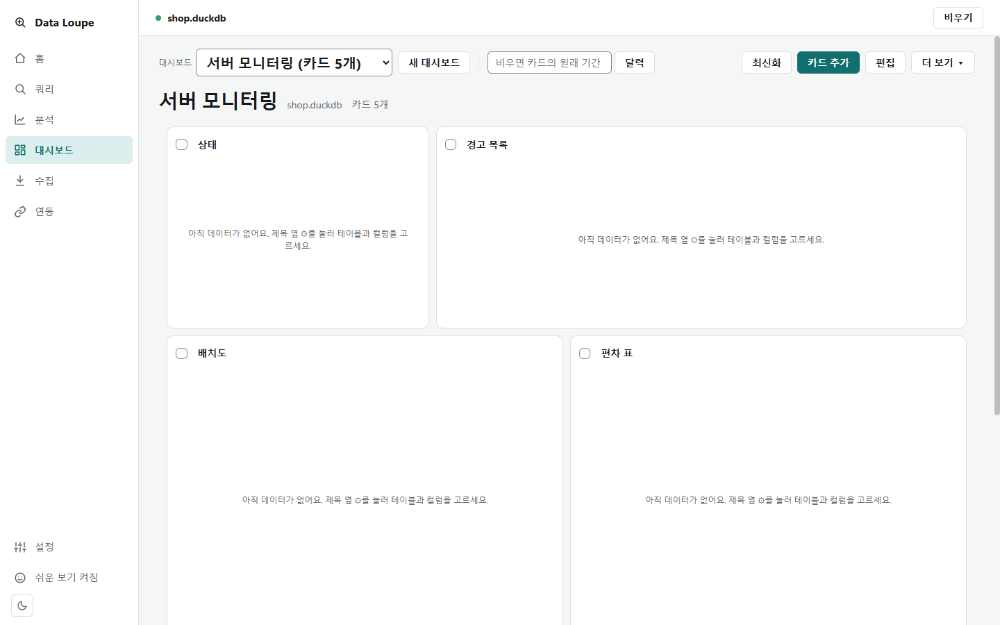

# 대시보드 편집

[← 대시보드](../dashboard.md)

## 편집하는 곳

- 왼쪽 메뉴의 **[대시보드 만들기]**(또는 보는 곳의 **[만들기]**)로 들어옵니다. 여기서는 늘 편집 상태라 카드 제목 줄 끌기, ⚙·×, 크기 손잡이가 있습니다. 다 고치면 **[보러 가기]**로 보는 곳에서 엽니다(저장은 저절로 됩니다). 보는 곳([대시보드])에는 이런 도구가 없습니다. 카드를 누르면 선택되고(여러 개 고를 수 있음), 고른 카드는 그림·CSV로 저장할 대상이 됩니다.
- **[+ 카드 ▾]** → **카드 모음**을 누르면 왼쪽에 카드 틀 목록이 열립니다. 묶음은 차트(종류마다 한 칸, 31종) · 값·목표 · 표·글 · 모니터링 · 분포·구성 · 변화·비교 · 흐름 · 지도입니다. 틀을 격자에 **끌어 놓거나 두 번 누르면** 빈 카드가 생기고 "아직 데이터가 없어요. 제목 옆 ⚙를 눌러 테이블과 컬럼을 고르세요."가 보입니다. 목록은 머리글의 ×로 닫습니다.
- **[+ 카드 ▾]** → **그림으로 고르기**를 누르면 종류마다 어떤 모양인지 보여 주는 예시 그림이 든 넓은 창이 열립니다(예시가 없는 몇 종류는 이름만). 그림을 **한 번 누르면** 그 종류의 빈 카드가 생기고 창이 닫힙니다. 그림은 예시이고 내 데이터로 그린 것이 아닙니다. Esc나 ×로 닫습니다.
- 카드 제목 줄의 **⚙**를 누르면 오른쪽에 **카드 설정 패널**이 열립니다. ×는 카드를 지웁니다(**Ctrl+Z**로 되돌림). 카드 제목은 편집 중에 제목 줄에서 바로 고칠 수도 있습니다.
- 패널 머리글 오른쪽 **›**를 누르면 패널이 접히고 **‹ 카드 설정** 띠만 남습니다. 띠를 누르면 다시 펼쳐집니다. 그 옆 **×**는 패널을 닫습니다.
- 카드는 **격자** 위에 놓입니다. 가로는 12칸, 세로는 한 칸 40px입니다.

## 끌어 옮기기

- 카드 **제목 줄을 끌면** 포인터가 가리키는 칸에 카드가 미리 보입니다. 놓으면 그 자리에 둡니다. 카드 이름 위를 잡고 끌어도 됩니다. 이름을 고치려면 끌지 말고 한 번 누릅니다(이름을 쓰는 중에는 끌어도 글자만 골라집니다).
- 놓은 자리에 다른 카드가 있으면 그 카드는 **아래로 밀립니다**. 카드가 빠져 생긴 **빈 곳은 위로 메워집니다**(아래 카드가 올라옴).
- 자리는 저절로 저장됩니다.

## 카드 크기

- 카드 **오른쪽 아래 모서리의 손잡이**를 끌면 크기가 바뀝니다. 끄는 동안 커질(작아질) 자리를 미리 보입니다.
- 크기는 칸 단위로 맞춰집니다. **가로 한 칸은 대시보드 너비의 1/12**, **세로 한 칸은 40px**입니다(칸 사이 간격 10px).
- 너비·높이 모두 **2~12칸**입니다. 오른쪽 끝을 넘으면 카드를 왼쪽으로 당겨 맞춥니다.
- 커진 카드와 겹치는 카드는 **아래로 밀리고**, 작아져 생긴 **빈 곳은 위로** 메워집니다.

- 숫자로 정할 수도 있습니다. 설정 패널 맨 아래 **위치·크기**(처음에는 접혀 있음)를 펼쳐 **너비(칸)**·**높이(칸)**(크기)와 **가로 위치**·**세로 위치**(자리, 왼쪽 위가 0)에 숫자를 넣습니다.
- 범위 밖 숫자(예: 너비 13칸)는 이유를 보이고 받지 않습니다. 겹침·빈 곳은 손잡이로 끌 때와 같은 규칙입니다.

## 섹션과 조각

카드는 **섹션**(격자 위의 상자) 안에 **조각**으로 놓입니다. 전에 만든 카드는 카드 하나가 섹션 하나를 꽉 채운 모양으로 그대로 보입니다. 위의 끌어 옮기기·카드 크기는 섹션에 그대로 적용됩니다.

- **섹션 도구 줄(만드는 곳)**: 섹션 위쪽 한 줄에 잡는 칸(끌어서 섹션 옮기기), 섹션 이름 칸, **⤡**(섹션 크기를 바꾸면 조각도 같이 바뀜, 처음에는 켜짐), 맞춤 단추, **×**(섹션 빼기)가 있습니다. 섹션 크기는 오른쪽 아래 손잡이로 바꿉니다.
- **조각 놓기**: 섹션 안은 더 잘게 나눈 눈금입니다(격자 한 칸 = 가로 16 × 세로 8눈금). 조각의 제목 줄을 끌어 옮기고, 오른쪽 아래 손잡이로 크기를 바꿉니다. 조각끼리는 **1눈금 이상** 떨어져야 하고, 겹치거나 붙는 자리에는 놓이지 않습니다(제자리로 돌아감).
- **안내선**: 옮기거나 크기를 바꿀 때 다른 조각의 가장자리·가운데와 맞으면 선이 보이고 그 자리에 붙습니다.
- **다른 섹션으로 옮기기**: 조각을 다른 섹션 위로 끌어 놓습니다. 놓을 자리가 없으면 원래 자리로 돌아갑니다.
- **새 카드 넣기**: 카드 종류를 섹션 위에 끌어 놓으면 그 섹션의 조각이 되고, 빈 격자에 놓으면 새 섹션이 생깁니다.
- **맞춤**: 같은 섹션의 조각을 둘 이상 고르면 도구 줄에 **왼쪽·가로 가운데·오른쪽·위·세로 가운데·아래 맞춤**, **가로·세로 같은 간격**(셋 이상), **같은 너비·같은 높이** 단추가 나옵니다. 맞춘 결과가 겹치거나 붙으면 이유를 보이고 바꾸지 않습니다.
- **⤡를 끄면** 섹션 크기만 바뀌고 조각은 그대로입니다. 이때 섹션은 조각이 들어가는 크기까지만 줄어듭니다.
- **섹션 빼기**: 조각이 둘 이상이면 ×를 한 번 더 눌러야 지워집니다(조각도 함께 지워짐). 마지막 조각을 빼도 빈 섹션은 남습니다.
- **글 요소**: 요소 목록의 **글**은 섹션 안에 글자를 놓습니다. 설정 패널에서 글(500자까지), 글자 크기(작게·보통·크게), 정렬(왼쪽·가운데·오른쪽)을 정합니다.
- **세그먼트 요소**: 칸을 나란히 놓은 단추 줄로, 늘 한 칸이 눌려 있습니다. 방식이 **보기 바꾸기**면 칸마다 상대 카드 하나의 계열(비우면 모든 계열)과 비율(%)로 보기를 정하고, **값으로 거르기**면 거를 컬럼과 칸마다 값(비우면 거르지 않음)을 정합니다. 칸은 8개까지입니다.
- **칩 줄 요소**: 고른 컬럼의 값을 칩으로 늘어놓고, 하나를 누르면 링크한 카드를 그 값으로 거릅니다(다시 누르면 풂). 칩 줄도 링크 상대가 될 수 있어, 다른 곳에서 건 필터에 맞는 값만 보입니다.
- **걸린 필터 줄 요소**: 지금 걸린 필터를 꼬리표로 보이고 **×**로 하나씩 풉니다. 설정에 **모두 풀기 단추 글자**를 적으면 줄 끝에 그 단추가 생깁니다.
- **링크**: 누르면 거르는 카드·요소와 기간·기준일·기간 단위 요소는 설정 패널의 **링크** 칸에서 고른 카드에만 적용됩니다([카드를 눌러 거르기](dashboard_basics.md#카드를-눌러-거르기)).

## 설정 패널

설정 패널(⚙)에서 카드 하나를 고칩니다. 위에서부터 아래 차례로 놓여 있습니다.

| 칸 | 하는 일 |
|---|---|
| 이름 | 카드 제목 |
| 데이터 | 지금 카드가 읽는 테이블(과 기간 기준 날짜)을 보여 줌. **[데이터 정하기]**(빈 카드) / **[데이터 다시 정하기]**를 누르면 카드 추가와 같은 칸이 열려 테이블·컬럼·집계를 고르고 **[이 카드에 채우기]**로 넣음. 자리·이름은 그대로 |
| 모양 | 그 카드의 줄: 기간 기준, 목표, 표시 형식·단위, **[색 바꾸기]**, 비교 방식(기간 비교/시점 비교), 좋은 방향(늘수록 좋음/줄수록 좋음), 차트 종류·시간 단위, 정렬·값 축, 자동 규칙 등. KPI는 아이콘·큰 값 크기(가운데/꽉 채우기)·추이선 자리(아래/오른쪽)도 고름 |
| 중요 지표 | **[북극성 지표로 정하기]**(가장 중요한 지표 하나, 제목 옆에 ★), **[카운터 지표로 정하기]**(북극성을 올리다 나빠지면 안 되는 지표, 제목 옆에 ⚑). 다시 누르면 해제 |
| 차트 구성 | 차트 카드만. 컬럼 칩을 칸에 놓아 차트를 바꿈(아래) |
| [이 카드 다시 구하기] | 이 카드만 지금 연결에서 다시 구함 |
| 위치·크기 | 접혀 있음. **섹션** 줄(격자 칸: 너비·높이·가로 위치·세로 위치)과 **조각** 줄(섹션 눈금) 두 줄. 조각이 겹치거나 1눈금보다 가까워지는 숫자는 받지 않음 |

- 카운터 지표에 **한계**(이 값 이상 유지/이하 유지와 한계 값)를 적고 **[한계 저장]**을 누르면, 값이 한계를 벗어날 때 대시보드 위쪽에 "카운터 지표가 한계를 벗어났어요" 경고가 뜹니다.
- 차트 카드는 **차트 구성**이 더 있습니다. 컬럼 칩을 **X축 · 값 · 색(나누기) · 필터** 칸에 끌어 놓으면 차트가 바로 바뀝니다(칩을 누르고 칸을 눌러도 됨). 안 되는 놓기(문자 컬럼을 값에, 날짜 컬럼을 색에 …)는 이유가 뜹니다. 쿼리 화면 차트 탭의 [컬럼을 끌어다 놓아 차트 만들기]와 같습니다([차트](chart.md)).

## 템플릿

- [새 대시보드]의 **시작 모양**에서 템플릿을 고르면 카드 틀만 놓입니다. 카드마다 ⚙ → [데이터 정하기]로 데이터를 채웁니다.

| 템플릿 | 놓이는 카드 |
|---|---|
| 분석 개요형 | 핵심 지표(KPI) 셋, 추이, 상세 표, 구성, 한 줄 요약 |
| 목표 달성형 | 달성률(도넛 KPI), 목표 추이, 진행(칸 채우기), 채운 양(블록), 한 줄 문장 |
| 모니터링형 | 상태, 경고 목록, 배치도, 편차 표 |
| 직접 구성 | 빈 격자 |

- **내 템플릿**: 대시보드 설정 창의 **내 템플릿**에서 템플릿 이름을 적고 **[내 템플릿으로 저장]**을 누르면 지금 카드의 종류·자리·색·이름만 저장합니다(값·연결·조회는 저장하지 않음. 카드가 하나 이상 있어야 함. 조각이 둘 이상인 섹션이 있으면 아직 저장할 수 없음). 새 대시보드를 만들 때 시작 모양 목록에 `이름 (내 템플릿)`으로 나옵니다. 저장한 템플릿은 그 아래 목록의 **[지우기]**로 지웁니다.

## 그림·보고서 저장

- 보는 곳의 **[내보내기]**(만드는 곳에서는 **[더 보기 ▾]** → **내보내기**)를 누르면 **그림·보고서** 창이 뜹니다. 비율(화면대로·1:1·4:3·16:9), 밝게/어둡게, PNG/JPG를 고릅니다(고른 값은 기억합니다).
- **[그림으로 저장]**: 고른 카드를 하나씩 그림 파일로 저장합니다(저장할 폴더를 한 번 묻습니다). 카드는 눌러서 고르고, 격자 위 줄의 **[모두 선택]**·**[선택 해제]**로 한꺼번에 고릅니다(이 줄은 만드는 곳이거나 고른 카드가 있을 때 보이며 "카드 2개 선택함"처럼 수를 알려 줍니다).
- **[CSV로 저장]**: 고른 차트 카드의 값을 CSV로 내려받습니다. **[모든 데이터 포함]**은 [카드 종류](dashboard_cards.md#그림으로-저장)에 있습니다.
- **[PNG 보고서]**·**[PDF 보고서]**: 모든 카드를 **격자 자리대로 한 장**에 모읍니다(위에 대시보드 이름과 날짜). 밝게/어둡게는 같은 창의 고르기를 따릅니다. PDF는 그 그림을 한 쪽에 넣은 파일이고, 저장할 곳을 묻습니다. 값이 없는 카드는 안내 글만 보입니다. 섹션은 상자와 이름까지 그리고, 글 요소는 글자로 들어갑니다(다른 요소의 자리는 비웁니다).

## 색

- **카드마다 색**: 설정 패널의 **[색 바꾸기]**에서 계열(도넛·파이는 조각)마다 HEX 색(`#11706f`)을 정합니다. 틀린 색은 이유를 보이고 받지 않습니다. **[지정 색 지우기]**는 이 카드에서 따로 정한 색을 지우고 대시보드 색으로 돌아갑니다.
- **그림 색**(대시보드 전체): 그림에 보이는 색은 배경색·표시색·강조색 셋입니다. 대시보드 설정 창의 **그림 색**에서 **표시색**과 **강조색** 두 개만 HEX로 적고 **[적용]**합니다. 표시색은 막대·선·조각의 색이고, 계열이나 조각이 여럿이면 표시색을 연하게·진하게 바꾼 여섯 단계로 나눠 칠합니다(여섯을 넘으면 되풀이). 강조색은 눈에 띄어야 하는 것(지도의 점, 분석 그림의 둘째 선)에 씁니다. **[기본 색으로]**는 고른 색을 지웁니다.
- 색을 고르는 차례: 카드에서 정한 색 → 대시보드 표시색의 단계 → 화면 모드(밝게·어둡게)의 기본 표시색 단계.
