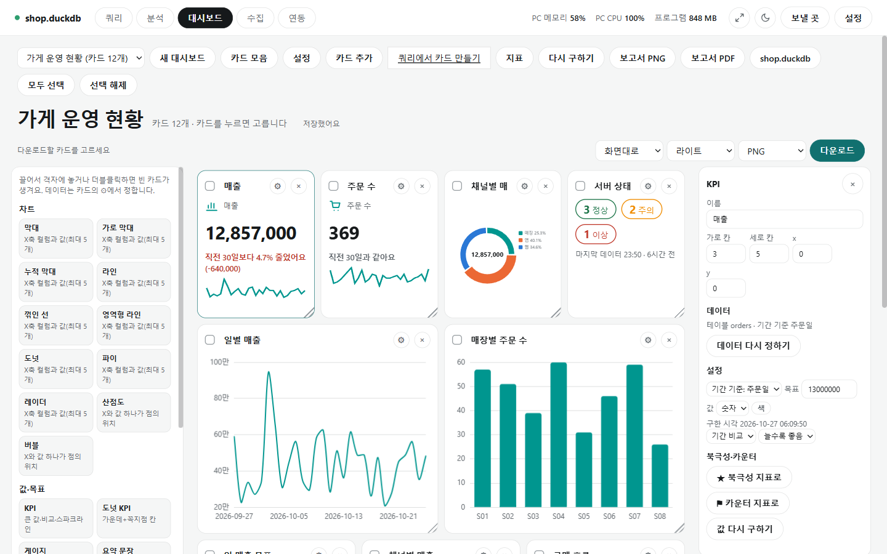
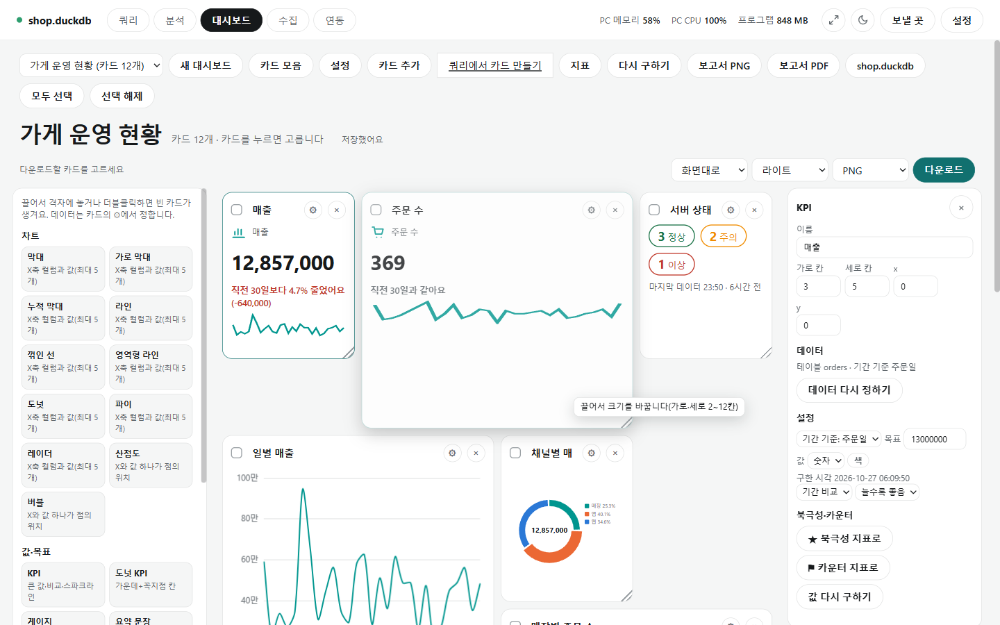
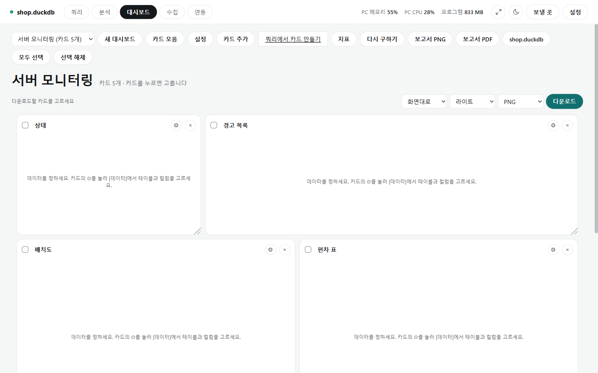

# 대시보드 편집

[← 대시보드](../dashboard.md)

## 편집하는 곳

- 따로 켜는 편집 모드는 없습니다. 대시보드를 열면 언제든 카드를 옮기고 크기를 바꿀 수 있습니다.
- **[카드 모음]**을 누르면 왼쪽에 카드 틀 목록(차트 11종, 값·목표, 표·글, 모니터링, 흐름, 지도)이 열립니다. 틀을 격자에 **끌어 놓거나 더블클릭**하면 빈 카드가 생깁니다.
- 카드 제목 줄의 **⚙**를 누르면 오른쪽에 **카드 설정 패널**이 열립니다. ×는 카드를 지웁니다.
- 카드는 **격자** 위에 놓입니다. 가로는 12칸, 세로는 한 칸 40px입니다.

## 끌어 옮기기

- 카드 **제목 줄을 끌면** 포인터가 가리키는 칸에 카드가 미리 보입니다. 놓으면 그 자리에 둡니다.
- 놓은 자리에 다른 카드가 있으면 그 카드는 **아래로 밀립니다**. 카드가 빠져 생긴 **빈 곳은 위로 메워집니다**(아래 카드가 올라옴).
- 자리는 저절로 저장됩니다.

## 카드 크기

- 카드 **오른쪽 아래 모서리의 손잡이**를 끌면 크기가 바뀝니다. 끄는 동안 커질(작아질) 자리를 미리 보입니다.
- 크기는 칸 단위로 맞춰집니다. **가로 한 칸은 대시보드 너비의 1/12**, **세로 한 칸은 40px**입니다(칸 사이 간격 10px).
- 가로·세로 모두 **2~12칸**입니다. 오른쪽 끝을 넘으면 카드를 왼쪽으로 당겨 맞춥니다.
- 커진 카드와 겹치는 카드는 **아래로 밀리고**, 작아져 생긴 **빈 곳은 위로** 메워집니다.

- 숫자로 정할 수도 있습니다. 설정 패널의 **가로 칸**·**세로 칸**(크기)과 **x**·**y**(자리, 왼쪽 위가 0)에 숫자를 넣습니다.
- 범위 밖 숫자(예: 가로 13칸)는 이유를 보이고 받지 않습니다. 겹침·빈 곳은 손잡이로 끌 때와 같은 규칙입니다.

## 설정 패널

설정 패널(⚙)에서 카드 하나를 고칩니다.

| 칸 | 하는 일 |
|---|---|
| 이름 | 카드 제목 |
| 가로 칸·세로 칸·x·y | 크기와 자리(위 절) |
| 데이터 | 테이블과 기간 기준 날짜 컬럼. **[데이터 정하기]**(빈 카드) / **[데이터 다시 정하기]**로 테이블·컬럼·집계를 고름. 자리는 그대로 |
| 설정 | 그 카드의 줄: 기간 기준, 목표, 값 모양, **[색]**, 기간 비교/시점 비교, 늘수록 좋음/줄수록 좋음, 차트 종류·시간 단위 |
| 북극성·카운터 | **[★ 북극성 지표로]**(가장 중요한 지표 하나), **[⚑ 카운터 지표로]**(북극성을 올리다 나빠지면 안 되는 지표) |
| [값 다시 구하기] | 이 카드만 지금 연결에서 다시 구함 |

- 카운터 지표에 **한계**(이 값 이상/이하여야 함)를 정하면, 값이 한계를 벗어날 때 대시보드 위쪽에 카운터 지표 경고가 뜹니다.
- 차트 카드는 **차트 칸**이 더 있습니다. 컬럼 칩을 **X축 · 값 · 색(나누기) · 필터** 칸에 끌어 놓으면 차트가 바로 바뀝니다(칩을 누르고 칸을 눌러도 됨). 안 되는 놓기(문자 컬럼을 값에, 날짜 컬럼을 색에 …)는 이유가 뜹니다. 쿼리 화면 차트 탭의 [끌어 놓기로 차트 만들기]와 같습니다([차트](chart.md)).

## 템플릿

- [새 대시보드]에서 템플릿을 고르면 카드 틀만 놓입니다. 카드마다 ⚙ → [데이터 정하기]로 데이터를 채웁니다.

| 템플릿 | 놓이는 카드 |
|---|---|
| 분석 개요형 | 핵심 지표(KPI) 셋, 추이, 상세 표, 구성, 한 줄 요약 |
| 목표 달성형 | 달성률(도넛 KPI), 목표 추이, 진행(칸 채우기), 채운 양(블록), 한 줄 문장 |
| 모니터링형 | 상태, 경고 목록, 배치도, 편차 표, 최근 행 |
| 직접 구성 | 빈 격자 |

- **내 템플릿**: [설정] 창의 **[내 템플릿으로 저장]**은 지금 카드의 종류·자리·색·이름만 저장합니다(값·연결·조회는 저장하지 않음). 새 대시보드를 만들 때 목록에 나옵니다.

## 그림·보고서 저장

- **[다운로드]**: 체크한 카드를 하나씩 그림 파일로 저장합니다. 옆 칸에서 비율(화면대로·1:1·4:3·16:9), 라이트/다크, PNG/JPG를 고릅니다. [모두 선택]·[선택 해제]로 한꺼번에 고릅니다.
- **[보고서 PNG]**·**[보고서 PDF]**: 모든 카드를 **격자 자리대로 한 장**에 모읍니다(위에 대시보드 이름과 날짜). 라이트/다크는 [다운로드] 옆 고르기를 따릅니다. PDF는 그 그림을 한 쪽에 넣은 파일이고, 저장할 곳을 묻습니다. 값이 없는 카드는 안내 글만 보입니다.

## 색과 팔레트

- **카드 색**: 설정 패널의 **[색]**에서 계열(도넛·파이는 조각)마다 HEX 색(`#11706f`)을 정합니다. 틀린 색은 이유를 보이고 받지 않습니다.
- **팔레트**: [설정] 창의 팔레트 칸에 HEX 색을 쉼표로 12개까지 적고 **[적용]**합니다. **[기본 색 넣기]**는 기본 색 묶음을 넣고, **[비우기]**는 지웁니다.
- 색을 고르는 차례: 카드에서 정한 색 → 팔레트의 순서대로 → 화면 모드(라이트·다크)의 기본 색.
