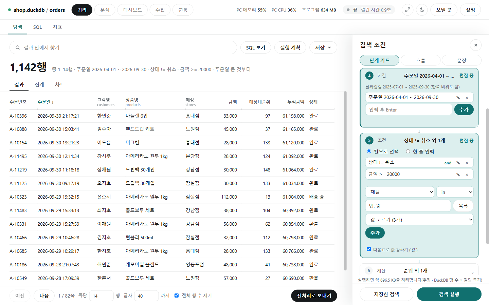
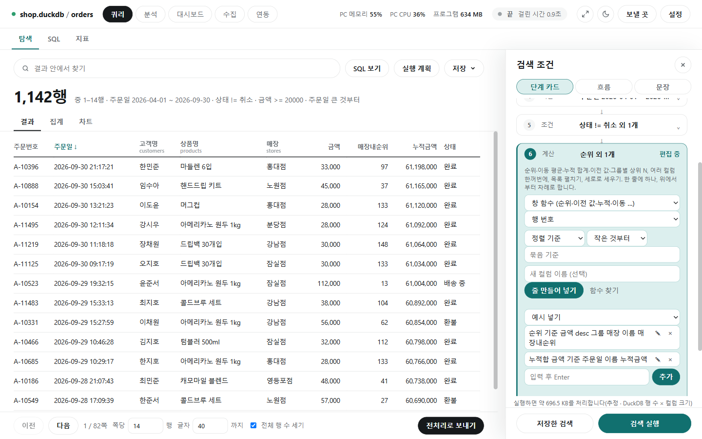
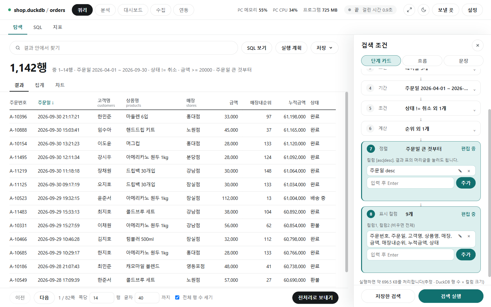

# 탐색(단계 카드)

[← 쿼리](../query.md)

[탐색] 탭 오른쪽 **검색 조건** 패널을 위에서 아래로 채우고 **[검색 실행]**을 누릅니다. 필요한 단계만 채우면 됩니다. 패널 위 **[단계 카드 | 흐름 | 문장]**은 같은 조건을 세 모양으로 보여 줍니다([흐름](flow.md), [문장](sentences.md)).

| 말 | 뜻(엑셀로 치면) |
|---|---|
| 테이블 / 컬럼 / 행 | 시트 / 열 / 행 |
| 조건 | 필터. 예: `상태 != 취소` |
| 조인 | 다른 테이블을 같은 값(고객ID 등)으로 옆에 붙이기. VLOOKUP과 비슷 |

## ① 데이터 · ② 이어붙이기 · ③ 조인

- **① 데이터**: 볼 기준 테이블(예: `orders`)을 고릅니다.
- **② 이어붙이기**: 같은 모양의 테이블(예: 작년 `orders_2025`)을 아래로 잇습니다. 어느 테이블의 행인지는 "출처" 컬럼에 나옵니다. `left`(기준 컬럼 모두)·`inner`(공통 컬럼만)·`intersect`(교집합)·`except`(차집합).
- **③ 조인**: 테이블과 방식(`left`·`inner`·`right`·`outer`·`semi`·`anti`·`asof`), 키(`고객ID = 고객ID`)를 고릅니다. 처음이면 `left`가 무난합니다. **[+ 조인 추가]**로 여러 개를 겁니다.
- 조인한 컬럼은 결과 표 머리글 아래에 어느 테이블에서 왔는지(customers·products·stores) 작게 보입니다.

## ④ 기간 · ⑤ 조건

- **④ 기간**: `주문일 2026-04-01 ~ 2026-09-30`처럼 쓰고 Enter. 한쪽은 비워도 됩니다. 위에 그 컬럼의 날짜 범위가 보입니다. 날짜시간 컬럼에 끝을 날짜만 쓰면 그날 끝까지 넣습니다.
- **⑤ 조건**: **칸으로 선택**(컬럼·연산자·값)하거나 **한 줄 입력**으로 씁니다. **[목록]**은 그 컬럼의 값을 불러와(최대 200개) 고르게 합니다.
- 조건 사이의 **and**를 누르면 **or**로 바뀝니다. 연필로 고치고 ×로 지웁니다.

| 쓸 수 있는 조건 | 예 |
|---|---|
| 비교 | `금액 >= 20000`, `상태 != 취소` |
| 범위·목록 | `금액 between 1 10`, `채널 in 앱, 웹`, `상태 except 취소, 환불` |
| 글자 | `like 김`(포함), `starts 김`(시작), `ends 점`(끝) |
| 빈 값 | `휴대폰 is null`, `휴대폰 is not null` |
| 좌표 | `near 위도 경도 37.5665 126.978 10`, `box …`([좌표](geo.md)) |

값에 쉼표나 `or`가 들어 있으면 `'값'`처럼 따옴표로 감쌉니다(**따옴표로 값 감싸기**).

## ⑥ 계산

- 위쪽 폼에서 종류(**창 함수**·**식**·**SQL식**·**창 결과로 거르기**)와 함수를 고르면 필요한 칸만 나타납니다. **[줄 만들어 넣기]**가 줄을 검사받아 목록에 넣습니다.
- 사진의 두 줄 `순위 기준 금액 desc 그룹 매장 이름 매장내순위`, `누적합 금액 기준 주문일 이름 누적금액`이 결과 표의 **매장내순위**·**누적금액** 컬럼이 되었습니다.
- **[예시 넣기]**로 예시 줄을 넣고 컬럼 이름만 바꿔 써도 됩니다. **[함수 찾기]**는 [함수 사전](sql_functions.md)을 엽니다.

| 줄 모양 | 예 |
|---|---|
| 창 함수 | `순위 기준 금액 desc 그룹 매장코드`, `이동평균 금액 3행 기준 주문일`, `lag 금액 1 기준 주문일` |
| 여러 컬럼 한꺼번에 | `반올림 0 숫자`, `곱하기 1.1 금액, 수량`, `빈값채우기 0 숫자`, `공백지우기 글자` |
| 펼치기·세로로 | `펼치기 태그`(목록을 행으로), `세로로 금액, 수량`(컬럼들을 행으로) |
| 식 | `식 금액 * 수량 이름 합계금액` |
| SQL식 | `SQL식 DATE_TRUNC('month', 주문일) 이름 월`(DB 고유 함수, 읽기만 하는 식) |
| 창 결과로 거르기 | `창거르기 rank <= 3 기준 금액 desc 그룹 매장` |

줄은 위에서부터 차례로 적용되고, 끝에 `이름 새이름`을 붙이면 새 컬럼 이름이 됩니다.

## ⑦ 정렬 · ⑧ 표시 컬럼

- **⑦ 정렬**: `주문일 desc`처럼 `컬럼 [asc|desc]`(desc는 큰 것부터). 결과 표 머리글을 눌러도 됩니다.
- **⑧ 표시 컬럼**: 보일 컬럼만 쉼표로 적습니다. 비우면 전체입니다.
- 패널 아래에 **실행하면 약 696.5 KB를 처리합니다**처럼 처리 용량이 미리 나옵니다(BigQuery는 요금 없는 dry run의 정확한 값, 그 밖에는 추정). 상한을 넘으면 실행 전에 묻습니다.
- 접힌 단계 카드에는 요약(`상태 != 취소 외 1개`, `9개`)이 보입니다.
