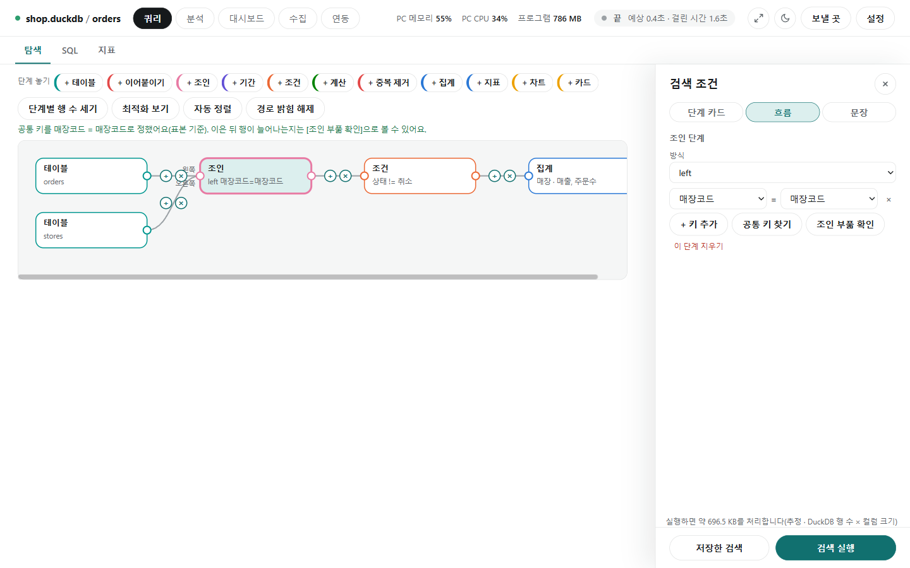
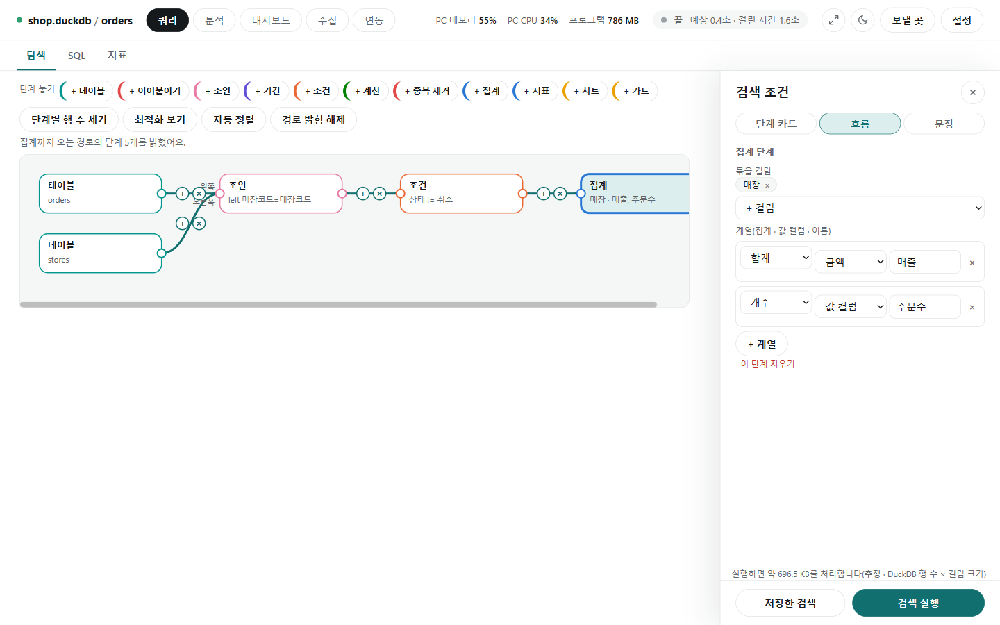
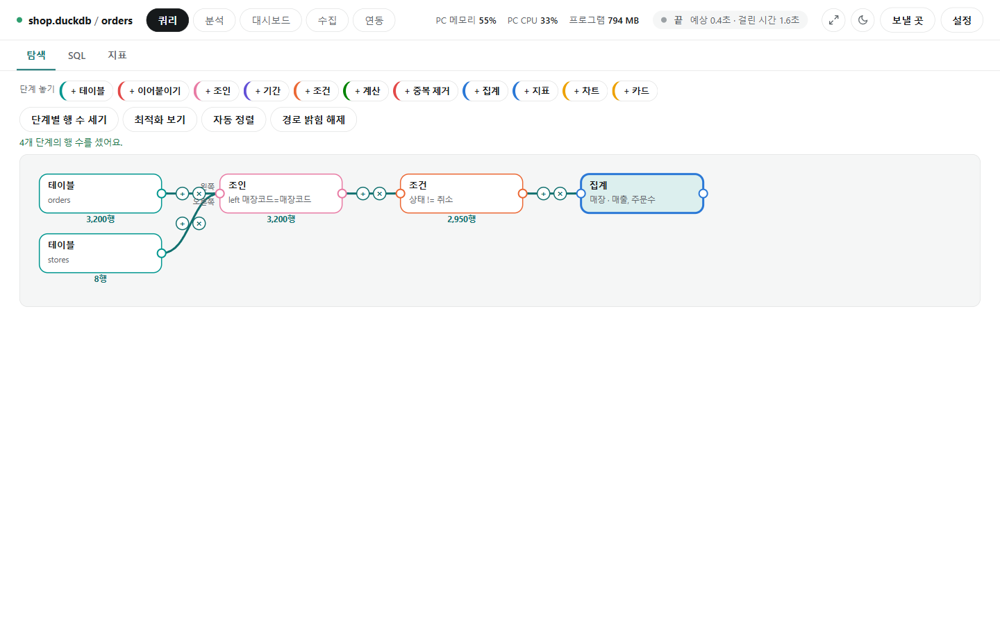
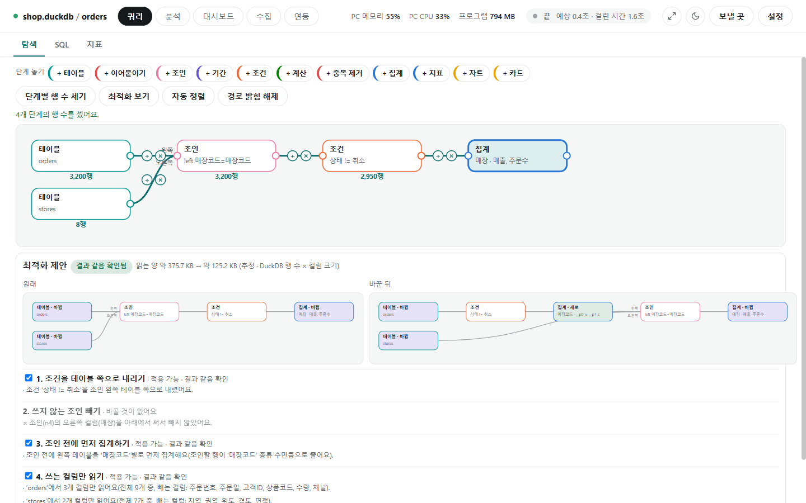

# 흐름 보기

[← 쿼리](../query.md)

검색 조건 패널 위 **[단계 카드 | 흐름 | 문장]**에서 **[흐름]**을 누르면, 같은 검색 조건을 단계 상자와 이음선으로 그린 그림이 됩니다. 한 보기에서 고친 것은 다른 보기에도 그대로 나옵니다. 흐름에서 **[검색 실행]**을 누르면 단계 카드로 돌아가 검색합니다.

## 상자 놓고 잇기 · 공통 키 찾기

- 위쪽 **단계 놓기**의 **[+ 테이블]** **[+ 이어붙이기]** **[+ 조인]** **[+ 기간]** **[+ 조건]** **[+ 계산]** **[+ 중복 제거]** **[+ 집계]** **[+ 지표]** **[+ 차트]** **[+ 카드]**로 상자를 놓습니다. 상자는 끌어서 옮기고, **[자동 정렬]**로 가지런히 놓습니다.
- 상자 오른쪽 점에서 다른 상자의 왼쪽 점으로 끌면 이어집니다. 선 위의 **+**는 그 사이에 단계를 끼우고, **×**는 이음을 끊습니다.
- 상자를 누르면 오른쪽에서 내용을 고칩니다(단계 카드와 같은 입력). **이 단계 지우기**로 지웁니다.
- 테이블 둘을 조인 상자에 이으면 **공통 키를 찾아** 줍니다. 사진은 "공통 키를 매장코드 = 매장코드로 정했어요(표본 기준)"입니다.
  - 점수 = 이름 35% + 값 겹침 45% + 타입 10% + 고유 여부 10%. 1등이 0.7 이상이고 2등과 0.15 넘게 차이 나면 자동으로 고르고, 아니면 상위 3개를 이유와 함께 보여 줘 **[이 키로]** 고르게 합니다.
  - 값 겹침은 표본(서로 다른 값 1,000개까지) 기준입니다. 원격 DB는 값을 새로 읽지 않고 이름·타입으로만 점수를 냅니다.
  - 고른 키는 같은 연결·테이블·컬럼 구성에서 기억합니다. 키 후보가 없으면 날짜 컬럼을 일·주·월로 맞춰 보라고 알려 줍니다.
- 조인 단계의 **[공통 키 찾기]**로 다시 찾고, **[조인 부풂 확인]**으로 이은 뒤 행이 늘어나는지(키가 겹쳐 행이 곱해지는지) 셉니다(전체를 읽음).

이을 수 없는 경우는 이유를 문장으로 알려 줍니다.

| 막히는 경우 | 예 |
|---|---|
| 순서가 어긋남 | 순서는 테이블 → 이어붙이기 → 조인 → 기간 → 조건 → 계산 → 중복 제거 → 집계·지표 → 차트·카드 |
| 순환이 생김 | 이으면 되돌아오는 길이 생길 때 |
| 조인 키의 종류가 다름 | 글자 키와 숫자 키 — 한쪽을 바꿔(cast) 이으라고 제안 |
| 다른 연결의 테이블 | 같은 연결의 테이블끼리만 |
| 집계 뒤에 없는 컬럼 | 집계하면 묶은 컬럼과 결과만 남음 |
| 숫자 아닌 컬럼의 합계 | 숫자로 바꾸거나 개수·고유 개수를 쓰라고 알림 |

## 경로 밝히기

- 집계·차트·카드 상자를 누르면 거기까지 오는 경로가 밝아집니다("집계까지 오는 경로의 단계 5개를 밝혔어요"). **[경로 밝힘 해제]**로 돌아옵니다.
- 집계 상자를 고르면 오른쪽에서 **묶을 컬럼**(매장)과 **계열**(집계·값 컬럼·이름, 예: 합계·금액·매출 / 개수·주문수)을 고칩니다. **[+ 계열]**로 더합니다.

## 단계별 행 수 세기

- **[단계별 행 수 세기]**를 누를 때만 셉니다. 상자 아래에 그 단계까지의 행 수(orders 3,200행 → 조건 뒤 2,950행)가 보입니다.
- 원격 DB는 요금이 들 수 있어 먼저 확인을 받습니다.

## 최적화 보기

**[최적화 보기]**는 결과가 집계(집계·지표 단계)인 흐름에서만, 같은 결과를 더 적게 읽는 흐름을 제안합니다. 제안만 하고, 체크한 규칙을 골라 **[이 흐름으로 바꾸기]**를 눌러야 바뀝니다.

| 규칙 | 하는 일 | 하지 않는 경우 |
|---|---|---|
| 1. 조건을 테이블 쪽으로 내리기 | 한 테이블 컬럼만 쓰는 조건·기간을 그 테이블 쪽으로 옮겨 조인 전에 거름 | inner는 양쪽, left는 왼쪽, right는 오른쪽, semi·anti는 왼쪽만. outer·asof는 내리지 않음 |
| 2. 쓰지 않는 조인 빼기 | left 조인의 오른쪽 컬럼을 아래에서 안 쓰고 오른쪽 키가 고유하면 조인을 뺌 | 오른쪽 컬럼을 쓰거나 키가 겹치면 그대로 |
| 3. 조인 전에 먼저 집계하기 | 차원 테이블 키가 고유하고 집계가 합계·개수·최소·최대·평균이면 사실 테이블을 키로 먼저 집계한 뒤 조인(평균은 합 ÷ 개수로) | 고유 개수·중앙값 같은 집계 |
| 4. 쓰는 컬럼만 읽기 | 테이블마다 아래에서 쓰는 컬럼만 읽음 | 이어붙이기가 있을 때, 겹친 이름이 `_테이블`로 바뀌는 조인, 타입·이름 패턴으로 컬럼을 고르는 계산, 지표 파일 이름만 쓴 지표 단계 |
| 부풂 경고 | 양쪽 키가 모두 고유하지 않으면 빨간 경고(합계가 부풀 수 있음), 오른쪽만 겹치면 노란 경고 | 흐름은 바꾸지 않음 |

- 원래 흐름과 바꾼 흐름을 나란히 보이고, 규칙마다 바뀐 곳과 이유, 읽는 양의 변화(약 375.7 KB → 약 125.2 KB)를 알려 줍니다.
- 규칙을 하나씩 적용할 때마다 두 흐름의 결과를 같은 연결에서 실제로 돌려 비교합니다. 같으면 **적용 가능 · 결과 같음 확인**, 다르면 그 규칙을 뺍니다(**뺌 · 결과가 달라요**). 모두 같으면 위에 **결과 같음 확인됨**이 붙습니다.
- 원격 DB는 비교가 전체를 읽는 조회라 바로 보내지 않습니다. 규칙 1·4만 **확인 안 됨**으로 제안하고, **[전체를 읽어 결과 확인]**을 눌러 확인하면 모두 검증해 제안합니다.

## 단계 카드로 돌아갈 때

- 흐름을 떠날 때 조건을 단계 카드로 모읍니다. 단계 카드로 나타낼 수 없는 모양이면 이유를 보이고 흐름에 머뭅니다.
- 집계·지표·차트·카드 상자는 단계 카드에 없어 흐름에만 남고, 단계 카드를 고치지 않고 돌아오면 그대로 되살아납니다.
- **최적화로 먼저 집계(규칙 3)하거나 조건을 내리거나(규칙 1) 쓰는 컬럼만 정하면(규칙 4), 그 흐름은 단계 카드로 바꿀 수 없습니다.** 조인 앞 가지에 조건·집계가 있거나 쓰는 컬럼만 정한 테이블은 단계 카드에 담을 칸이 없기 때문입니다. 바꾼 뒤 그 이유가 함께 나오니, 그 흐름은 흐름 보기에서 계속 쓰세요.
- 이 밖에 계산 뒤에 기간·조건이 오거나, 집계 뒤에 다른 단계가 이어지거나, 본 흐름에서 벗어난 가지가 있어도 단계 카드로 바꿀 수 없습니다.
