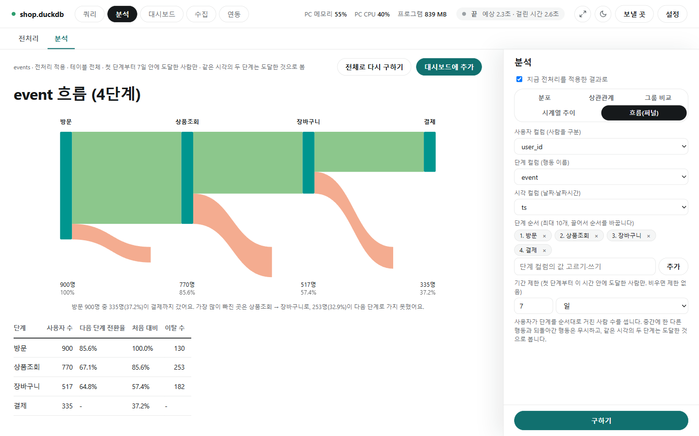
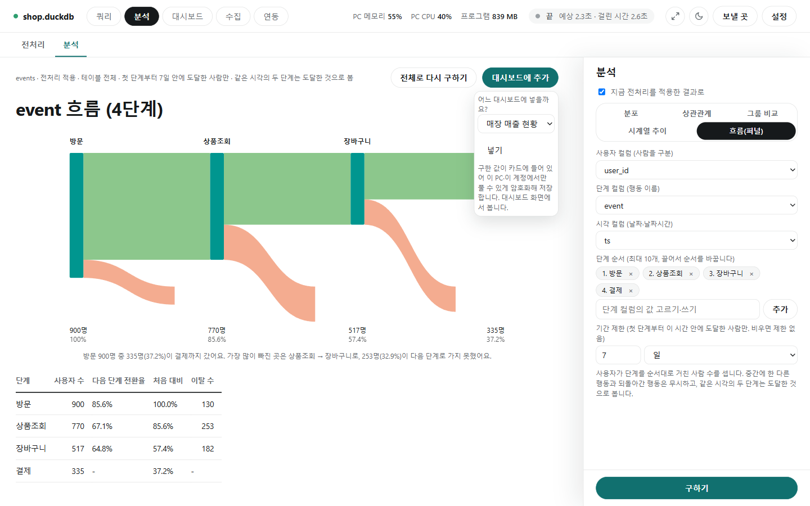

# 흐름(퍼널)

[← 분석](../analysis.md)

사용자가 정해 둔 단계(방문 → 상품조회 → 장바구니 → 결제 …)를 순서대로 거쳐 간 사람이 몇 명인지, 어디서 얼마나 빠졌는지 봅니다. 분석 탭에서 **흐름(퍼널)**을 고릅니다.

## 만들기

- **사용자 컬럼**(사람을 구분: 회원 번호, 기기 ID …), **단계 컬럼**(행동 이름), **시각 컬럼**(날짜나 날짜시간)을 고릅니다.
- **단계 순서**: 칸에 단계 컬럼의 값을 고르거나 써서 **[추가]**합니다. 1~10개, 칩을 끌어 순서를 바꾸고 ×로 뺍니다. 같은 단계를 두 번 넣을 수는 없습니다.
- **기간 제한**: 숫자와 단위(분·시간·일)를 쓰면 첫 단계부터 그 시간 안에 도달한 사람만 셉니다. 비우면 제한이 없습니다. 사진은 7일입니다.
- **[구하기]**를 누르면 가운데에 그림·한 줄 설명·표가 나옵니다.

## 그림과 표 읽기

- **그림(생키)**: 단계마다 세로 막대(높이는 사람 수에 비례), 다음 단계로 간 사람은 초록 띠, 빠진 사람은 주황 띠로 아래로 갈라져 내려갑니다. 막대·띠에 마우스를 올리면 사람 수가 보입니다. 막대 아래에 사람 수와 처음 대비 비율이 있습니다.
- **한 줄 설명**: 처음에서 끝까지 간 비율과 가장 많이 빠진 곳을 구한 숫자로만 적습니다. 예: "방문 900명 중 335명(37.2%)이 결제까지 갔어요."
- **표**: 단계 · 사용자 수 · 다음 단계 전환율 · 처음 대비 · 이탈 수(그 단계에서 다음 단계로 못 간 사람).

## 어떻게 세나요

- 첫 단계는 사용자마다 가장 이른 시각에서 시작하고, 다음 단계는 앞 단계 이후에 한 가장 이른 행동으로 이어 갑니다.
- 중간에 한 다른 행동과 되돌아간 행동은 무시합니다. 같은 시각의 두 단계는 도달한 것으로 봅니다.
- 기간 제한이 있으면 첫 단계를 한 시각마다 각각 한 번의 시도로 보고, 어느 한 시도에서라도 기간 안(끝 시각 포함)에 끝까지 가면 도달로 셉니다. 사람은 한 번만 셉니다.
- 다른 분석과 달리 **늘 테이블 전체**로 구합니다(표본은 한 사람의 단계를 일부만 담아 전환율을 낮게 만들기 때문). 읽는 컬럼은 사용자·단계·시각 셋뿐입니다.

## 대시보드에 넣기

- **[대시보드에 추가]** → 대시보드를 고르거나 새 이름을 쓰고 **[넣기]**. 지금 결과가 흐름(퍼널) 카드로 들어갑니다. 대시보드 화면의 [카드 추가]에서도 흐름(퍼널) 카드를 만들 수 있습니다([대시보드 카드](dashboard_cards.md)).
- 대시보드에 기간을 정하면 첫 단계를 그 기간 안에 한 사람만 세고, 뒤 단계는 기간 밖이어도 셉니다.
- 카드 색은 카드 색 설정의 `단계 막대`·`다음 단계`·`이탈`로 바꿉니다.
