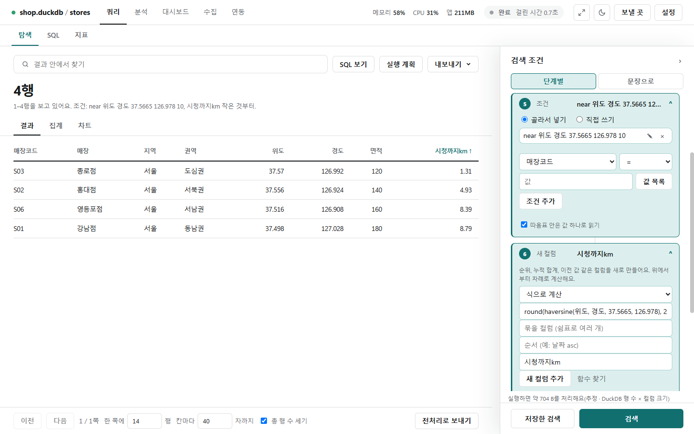
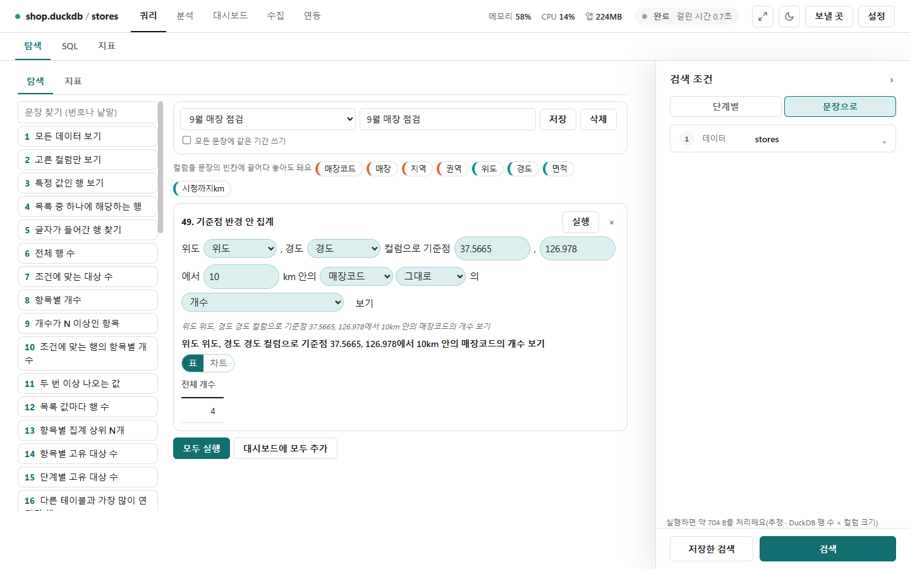
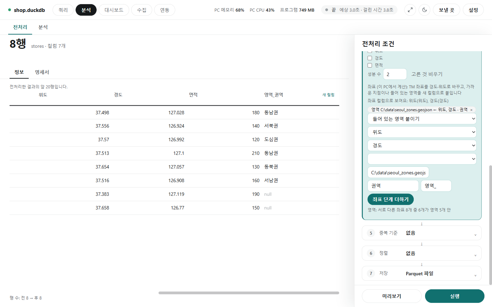
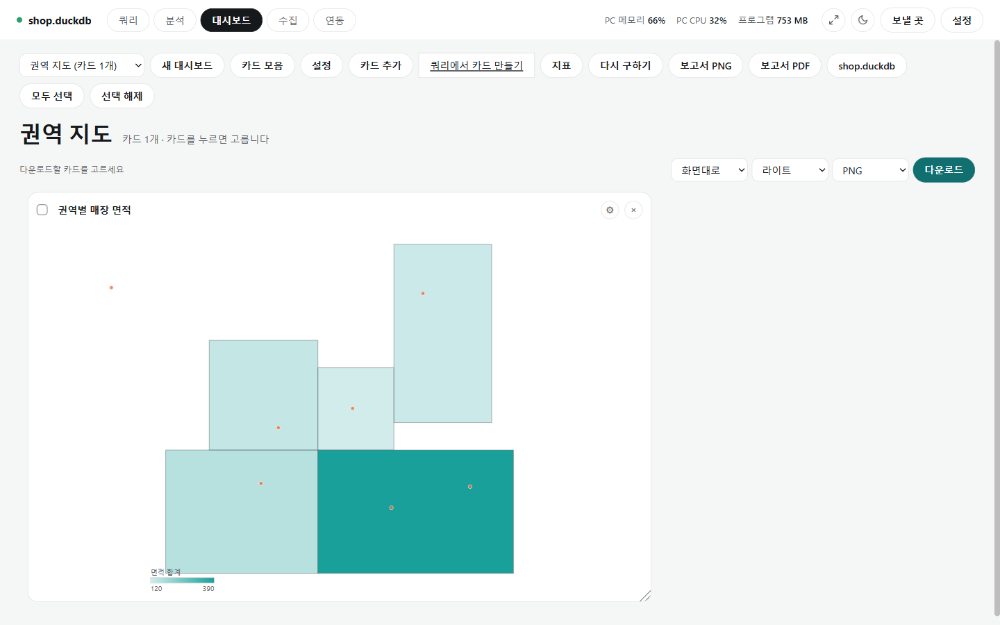

# 좌표

[← 쿼리](../query.md)

위도·경도가 든 자료를 거리·반경·격자로 보고, GeoJSON 영역과 이어 지도 카드로 그립니다. 좌표 계산은 데이터 값을 밖으로 보내지 않습니다(지도 카드의 배경 지도를 켠 때만 보는 범위가 지도 서버로 요청됩니다).

## 반경 조건과 거리 계산

- **⑤ 조건**에 `near 위도 경도 37.5665 126.978 10`을 넣으면 기준점(서울시청)에서 10km 안의 행만 남습니다(경계 포함).
- **⑥ 계산**에 식 `round(haversine(위도, 경도, 37.5665, 126.978), 2)`, 새 컬럼 이름 `시청까지km`를 넣으면 거리가 새 컬럼이 됩니다. 머리글을 눌러 가까운 순으로 봅니다.
- 범위 상자는 `box 위도 경도 최소위도 최소경도 최대위도 최대경도`입니다. 최소 경도가 최대 경도보다 크면 날짜 변경선을 가로지르는 상자로 봅니다.
- 식은 sin·cos 같은 기본 수식이라 원격 DB에서도 DB 안에서 계산합니다.

| 함수 | 하는 일 |
|---|---|
| `haversine(위도, 경도, 상대위도, 상대경도)` | 두 점의 거리(km). 상대 점은 숫자 또는 다른 컬럼 |
| `within_km(…, 반경)` · `in_box(…)` | 반경 안·상자 안이면 참(경계 포함) |
| `grid_id(위도, 경도, 칸크기)` | 격자 칸 id. 칸 크기는 도 단위(0.01 = 약 1.1km) |
| `grid_lat` · `grid_lon` | 격자 칸 중심 위도·경도 |

## 좌표 문장 틀

- [문장 보기](sentences.md)의 48~50번이 좌표 틀입니다: **영역별 값**, **기준점 반경 안**, **격자별 값**.
- 사진은 49번에 위도·경도 컬럼, 기준점 `37.5665, 126.978`, 반경 `10`, 매장코드의 개수를 넣어 **4**를 구한 모습입니다.
- 값 칸은 개수면 비워 둡니다. 48번의 영역 이름 컬럼은 전처리의 **들어 있는 영역**으로 만듭니다.

## GeoJSON 연결

폴더 연결에서 `.geojson` 파일(그리고 FeatureCollection인 `.json`)을 고르면 파일마다 표 하나가 되고, 도형(Feature) 하나가 한 행입니다.

| 컬럼 | 내용 |
|---|---|
| 속성 이름들 | GeoJSON의 properties가 그대로 컬럼. 같은 이름이 겹치면 `_속성`을 붙임 |
| `geom_type` | Point, LineString, Polygon, MultiPolygon … |
| `center_lon` `center_lat` | 중심(폴리곤은 구멍을 뺀 면적 무게중심, 점·선은 꼭짓점 평균) |
| `min_lon` `min_lat` `max_lon` `max_lat` | 범위 상자. 날짜 변경선을 넘는 도형은 `min_lon`이 `max_lon`보다 큼(예: 178·-179). 0~360으로 적힌 경도 파일은 그대로 둔다 |
| `geometry` | 도형 원본(JSON 글자) |

파일의 `crs`가 WGS84가 아니면(예: EPSG:5179) 경도·위도로 바꾼 값을 둡니다.

## 전처리의 좌표 단계

분석 화면 전처리의 새 컬럼에서 좌표 단계를 더합니다. 이 PC에서 서로 다른 좌표마다 한 번만 계산해 붙이므로 같은 좌표의 행은 같은 값이 붙습니다.

- **TM 좌표 → 경도·위도**: x·y 컬럼(미터)과 좌표계를 고릅니다.
- **가장 가까운 지점**: 지점 목록 테이블에서 가장 가까운 행의 이름과 거리(km). 지점이 많으면 격자로 후보를 줄입니다.
- **들어 있는 영역**: GeoJSON 영역 테이블(또는 파일 경로)의 어느 폴리곤에 드는지 찾아 영역 컬럼을 붙입니다. 구멍은 밖, 경계 위는 안입니다.
- 원격 DB는 처리 용량을 먼저 확인하고, 지점·영역 테이블은 쓸 컬럼만 받습니다.

| EPSG | 이름 | 주로 쓰이는 곳 |
|---|---|---|
| 5179 | UTM-K | 전국 한 장. 지도 서비스·최근 공공데이터(기본값) |
| 5186 | 중부원점 2010 | 서울·경기·충청·전라 최신 자료 |
| 5185 / 5187 / 5188 | 서부·동부·동해원점 2010 | 해당 지역 최신 자료 |
| 5174 | 중부원점(Bessel) | 옛 지적도·옛 공공데이터 |
| 5181 | 중부원점(KGD2002) | 옛 표준 자료 |

값이 1,000보다 큰 숫자면 TM 좌표로 보고, 결과가 한국 안에 떨어지는 좌표계를 추천합니다. 잘못 고르면 수 m~수십 km 어긋나니 미리보기의 경도·위도를 확인하세요. 전처리는 이름(lat·lng·lon·위도·경도·x·y)과 값 범위로 좌표 컬럼을 알아보고, 위도 ±90·경도 ±180을 벗어나면 경고합니다.

## 지도 카드

대시보드 카드 중 **지도**는 영역 경계를 그리고 점을 찍고 영역별 값으로 색칠합니다. 확대·이동 없이 데이터 범위에 맞춘 한 장입니다.

- 영역: GeoJSON 테이블이나 파일 경로, 이름 컬럼. 점: 위도·경도 컬럼. 영역별 값은 점의 개수나 값 컬럼의 합계·평균·최소·최대.
- 꼭짓점은 6,000개 안팎, 점은 2,000개까지만 그리고, 줄이면 카드 아래에 알립니다.
- **지도 배경(OpenStreetMap)**은 기본 꺼짐입니다. 켜면 보는 범위의 타일 그림(최대 16장)을 `tile.openstreetmap.org`에서 받아 깔고 "© OpenStreetMap contributors"를 적습니다. 이때 타일 번호(대략 어느 지역인지)와 이 PC의 IP가 지도 서버로 가고, 영역 이름·값·점 위치 같은 데이터 값은 보내지 않습니다.
