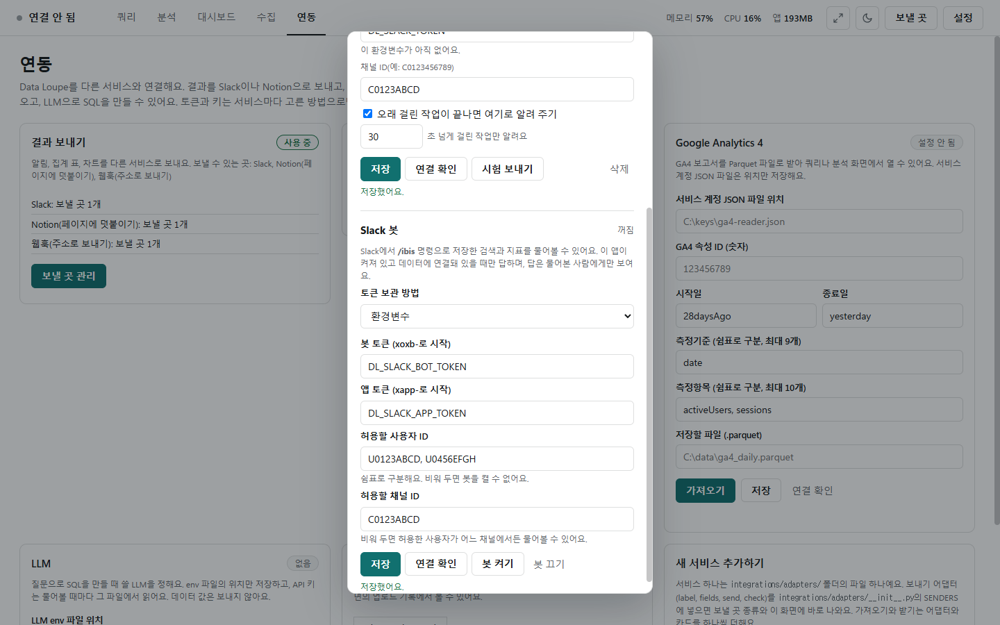

# Slack 봇

[← 연동](../integrations.md)

Slack에서 `/ibis` 명령으로 저장해 둔 검색·지표를 물으면 답합니다. 봇은 메신저 안에서 대신 답해 주는 계정입니다. **이 PC에서 프로그램이 켜져 있고 데이터에 연결돼 있을 때만** 답하고, 답은 물어본 사람에게만 보입니다.

## 설정

- 연동 화면 **Slack 봇** 카드의 **[봇 설정]**(또는 위쪽 **[보낼 곳]** 창 아래쪽)에서 엽니다.
- **토큰 보관 방법**: 암호화해 저장 · 이번 실행 동안만 · 환경변수([보내기](integrations_send.md)와 같음). 사진은 환경변수 이름으로 둔 모습입니다.
- **봇 토큰**(`xoxb-`로 시작)과 **앱 토큰**(`xapp-`로 시작, Socket Mode의 `connections:write`)을 넣습니다.
- **허용할 사용자 ID**(쉼표로 구분, 예: `U0123ABCD`): 비워 두면 봇을 켤 수 없습니다. **허용할 채널 ID**: 비우면 허용한 사용자라면 어느 채널에서든 받습니다.
- **[저장]** → **[연결 확인]**(봇을 켜지 않고 두 토큰 확인) → **[봇 켜기]**. 끌 때는 **[봇 끄기]**.
- 준비(Slack 관리자와 함께): Slack 앱에서 Socket Mode를 켜 앱 토큰을 받고, Slash Commands에 `/ibis`를 만든 뒤 설치해 봇 토큰을 받습니다. Socket Mode는 이 PC가 Slack으로 나가는 연결만 쓰므로 방화벽을 열 필요가 없습니다.

## 쓸 수 있는 명령

| Slack에 쓰는 것 | 답 |
|---|---|
| `/ibis 도움` | 쓸 수 있는 명령 |
| `/ibis 지표` · `/ibis 검색` | 지표 목록 · 저장한 검색 목록 |
| `/ibis 지표 취소율 검색="9월 정상 주문" 나누기=매장코드` | 그 저장한 검색 위에서 매장별 취소율 표 |
| `/ibis 검색 "9월 정상 주문" 행=10` | 행 수와 앞 10행(1~50행) |
| `/ibis 질문 지난달 매장별 매출` | LLM이 만든 SQL(실행하지 않음) |

- 허용하지 않은 사용자·채널에는 쓸 수 없다고만 답합니다.
- 데이터를 바꾸거나 SQL을 바로 실행하는 명령은 없습니다. 저장해 두지 않은 조회는 받지 않습니다.
- 처리할 데이터가 크거나 크기를 알 수 없는 검색·지표는 Slack에서 확인을 받을 수 없어 프로그램에서 실행하라고 답합니다.
- 데이터 값이 든 오류는 값을 빼고 정해진 문구로 알립니다. 지표·검색은 [지표](metrics.md)와 [결과](results.md)의 저장한 검색에서 만듭니다.
