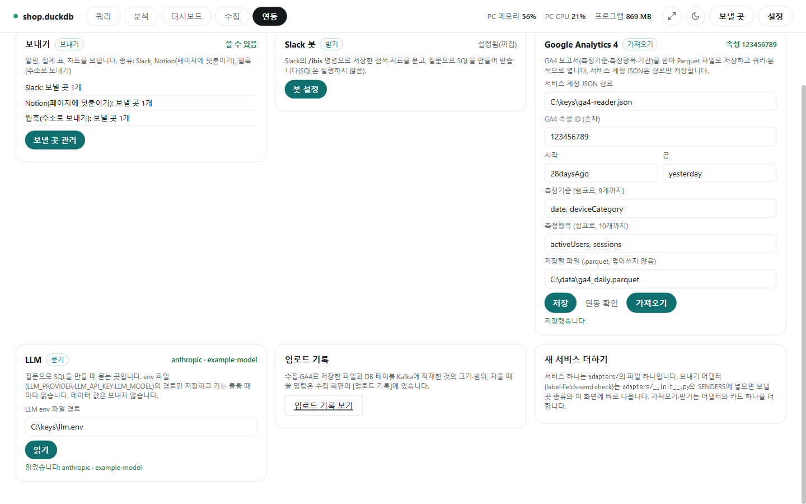

# Google Analytics 4 · LLM

[← 연동](../integrations.md)

연동 화면의 **Google Analytics 4**(가져오기), **LLM**(묻기), **업로드 기록**, **새 서비스 더하기** 카드를 설명합니다.



## Google Analytics 4 가져오기

GA4 보고서(무엇별로 · 무엇을 · 기간)를 받아 Parquet 파일로 저장하고 쿼리로 엽니다.

- **서비스 계정 JSON 경로**: 프로그램이 Google에 로그인할 때 쓰는 계정의 키 파일입니다. 경로만 저장하고, 키는 그 파일에만 있습니다.
- **GA4 속성 ID**(숫자), **시작**·**끝**(`2026-09-01`, `today`, `yesterday`, `28daysAgo` 같은 모양).
- **측정기준**(무엇별로, 쉼표로 9개까지, 예: `date, deviceCategory`), **측정항목**(무엇을 셀지, 10개까지, 예: `activeUsers, sessions`).
- **저장할 파일**(.parquet): 같은 이름의 파일이 있으면 덮어쓰지 않습니다.
- **[저장]** · **[연동 확인]**(보고서를 받지 않고 인증과 속성 접근만 확인) · **[가져오기]**. 가져오면 행 수와 컬럼이 나오고 **[쿼리로 열기]**가 생깁니다. 가져온 파일은 [업로드 기록](load.md#업로드-기록)에 남습니다.
- 준비(GA·Google Cloud 관리자에게 부탁해도 됨): 서비스 계정을 만들어 키(JSON)를 받고 Google Analytics Data API를 켠 뒤, GA4 속성의 액세스 관리에 그 계정 이메일을 **[뷰어]**로 추가합니다.

## LLM

[질문으로 SQL 만들기](sql.md)가 묻는 곳입니다. 카드 오른쪽 위에 지금 쓰는 회사·모델(예: `anthropic · example-model`)이 보입니다.

- **LLM env 파일 경로**를 넣고 **[읽기]**를 누릅니다. 경로만 저장하고, 키는 물을 때마다 파일에서 읽습니다.
- env 파일에는 다음을 적습니다.

```
LLM_PROVIDER=anthropic      # anthropic 또는 openai(OpenAI 호환: Azure·사내 게이트웨이·Ollama 등)
LLM_API_KEY=...             # 키가 없는 곳(Ollama 등)은 비워도 됨(openai만)
LLM_MODEL=...
LLM_BASE_URL=...            # 선택. https만(이 PC의 localhost·127.0.0.1은 http도)
LLM_MAX_TOKENS=1024         # 선택
```

- 데이터 값은 보내지 않습니다. 경로를 정하지 않으면 밖으로 아무것도 보내지 않습니다.

## 업로드 기록 · 새 서비스 더하기

- **업로드 기록** 카드의 **[업로드 기록 보기]**는 수집 화면의 업로드 기록으로 갑니다. 수집·GA4로 저장한 파일과 DB 테이블·Kafka에 적재한 것의 크기·범위, 지울 때 쓸 명령이 있습니다([적재](load.md)).
- **새 서비스 더하기** 카드는 개발자용 안내입니다. 서비스 하나는 `integrations/adapters/`의 파일 하나이고, 보내기 어댑터를 `adapters/__init__.py`의 `SENDERS`에 넣으면 보낼 곳 종류와 이 화면에 바로 나옵니다.
