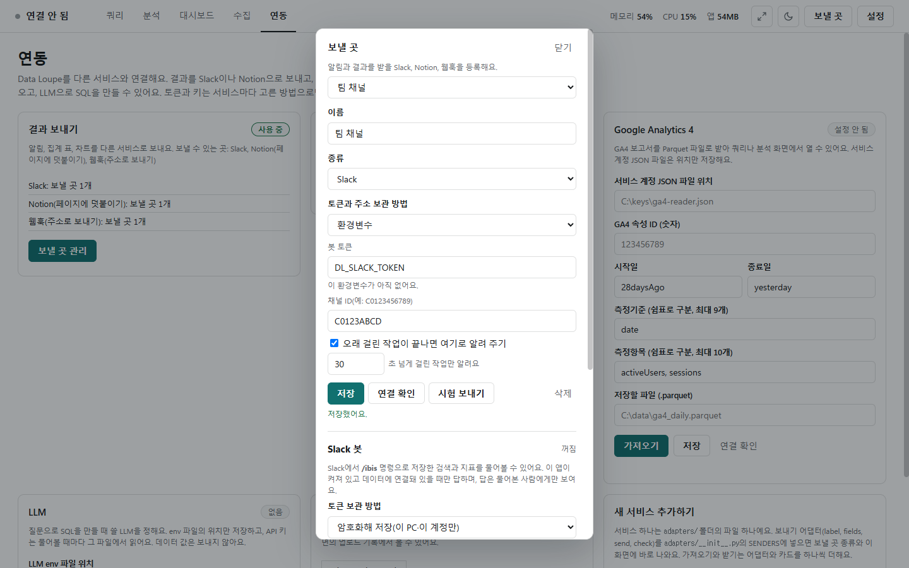
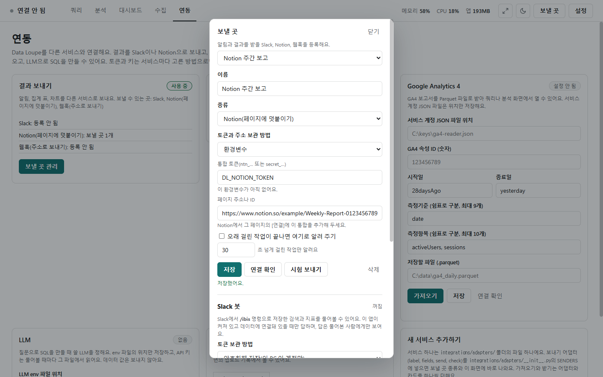
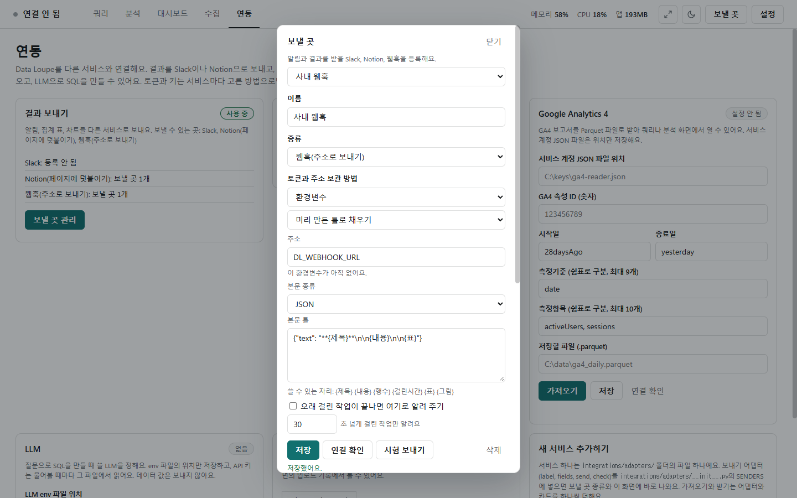

# 보내기 (Slack · Notion · 웹훅)

[← 연동](../integrations.md)

알림, 집계 표, 차트를 다른 앱으로 보냅니다. 보낼 곳은 위쪽 줄 오른쪽 **[보낼 곳]**이나 연동 화면 **결과 보내기** 카드의 **[보낼 곳 관리]**에서 등록합니다. 카드에는 종류마다 등록한 보낼 곳 수가 보입니다.

## 보낼 곳 창

창 위쪽에서 차례로 고릅니다: 등록한 보낼 곳 목록(새로 만들기) → 이름 → 종류 → **토큰과 주소 보관 방법** → 종류별 칸.

| 보관 방법 | 이럴 때 |
|---|---|
| 암호화해 저장(이 PC·이 계정만) | 보통은 이것. Windows가 암호화해 이 PC·이 Windows 계정에서만 풀림 |
| 이번 실행 동안만(메모리) | 공용 PC. 파일에 남지 않고 프로그램을 끄면 사라짐 |
| 환경변수 | 파일에 저장하면 안 될 때. 칸에 값 대신 환경변수 이름(예: `DL_SLACK_TOKEN`)을 씀. 없으면 "이 환경변수가 아직 없어요"라고 알림 |

- **오래 걸린 작업이 끝나면 여기로 알려 주기**를 켜면, 정한 초(기본 30초, 모든 보낼 곳에 같이 적용)를 넘게 걸린 작업이 끝날 때 알립니다. 알림에는 작업 이름·테이블 이름·행 수·걸린 시간만 담고 데이터 값은 보내지 않습니다.
- **[저장]** · **[삭제]** · **[연결 확인]**(메시지 없이 토큰·채널만 확인) · **[시험 보내기]**(시험 메시지를 실제로 보냄).
- 쿼리 화면의 집계·차트 아래 **[보내기]**로 표와 그림을 보냅니다. 한 번 더 눌러야 보냅니다([결과](results.md), [차트](chart.md)). 표는 50행까지 글자로 보냅니다.
- 예약 수집의 결과 알림도 여기 등록한 곳으로 갑니다([예약](schedule.md)).

## Slack

- **봇 토큰**(`xoxb-`)과 **채널 ID**(예: `C0123456789`)를 넣습니다. 사진은 토큰을 환경변수 이름 `DL_SLACK_TOKEN`으로 둔 모습입니다.
- 준비: Slack 앱을 만들고 권한 `chat:write`(그림도 보내려면 `files:write`)를 준 뒤 설치하고, 보낼 채널에 봇을 초대합니다.
- 글과 그림(차트)을 보낼 수 있습니다.

## Notion

- **통합 토큰**(`ntn_…` 또는 `secret_…`)과 **페이지 주소나 ID**를 넣습니다.
- Notion에서 그 페이지의 **[연결]**에 이 통합을 추가해 두어야 합니다.
- 글과 표를 페이지 끝에 덧붙입니다(그림은 보내지 않음).

## 웹훅

- 웹훅은 정해 둔 주소로 보내면 Teams·Discord 같은 서비스에 메시지가 뜨게 하는 방법입니다. 받는 서비스에서 받은 주소(`https://`로 시작)를 **주소**에 넣습니다.
- **미리 만든 틀로 채우기**에서 일반 JSON · Teams · Discord · 글자 중 하나를 고르면 **본문 종류**와 **본문 틀**이 채워집니다. 사진의 틀은 Teams 모양입니다.
- 본문 틀에 쓸 수 있는 자리: `{제목}` `{내용}` `{행수}` `{걸린시간}` `{표}` `{그림}`. 본문 종류는 JSON · 글자 · 폼(URL 인코딩).
