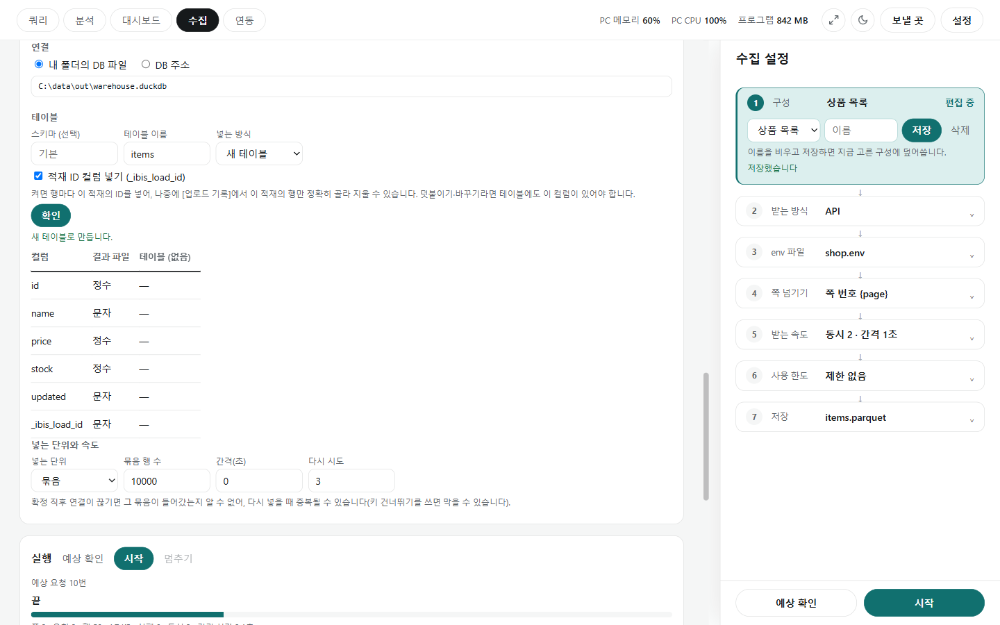
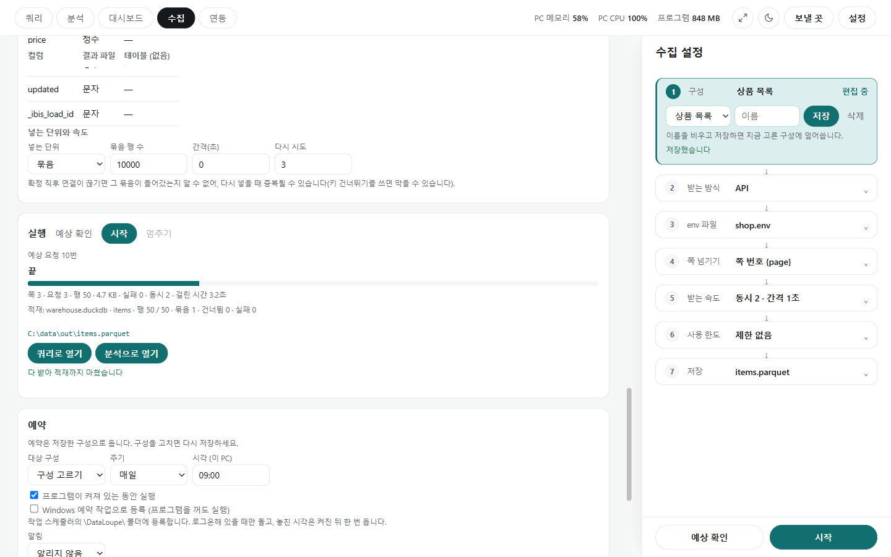
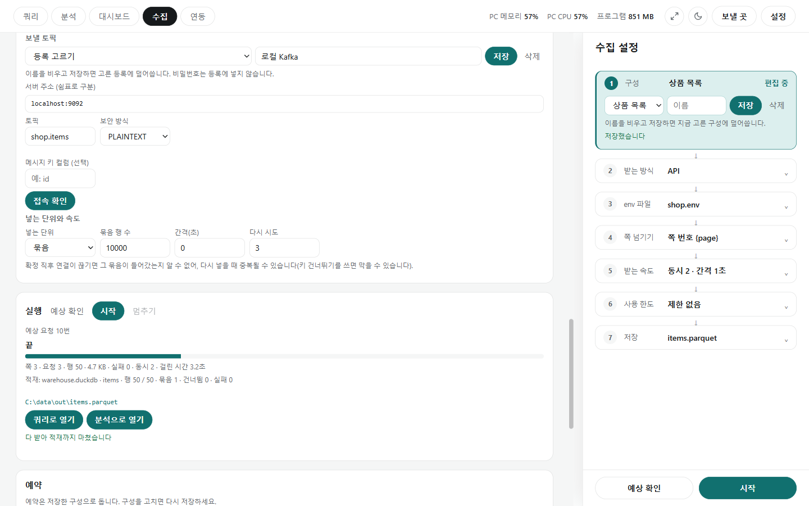
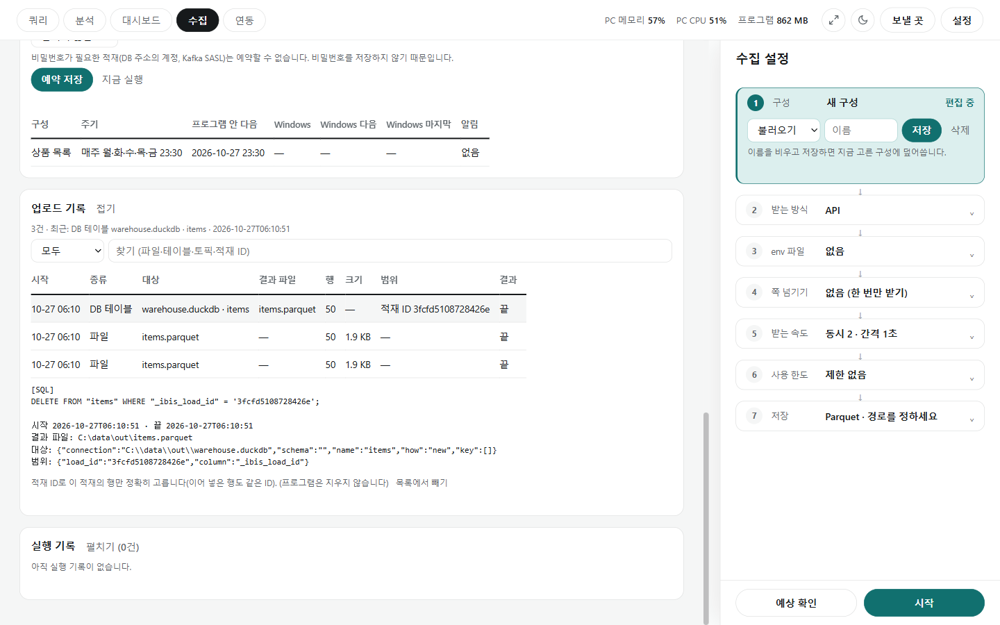

# 적재와 업로드 기록

[← 수집](../collect.md)

적재는 받은 데이터를 DB 테이블이나 Kafka(회사에서 데이터를 실어 나르는 시스템) 토픽에 넣는 것입니다. 수집 화면의 **적재** 카드에서 **파일만**(기본) · **DB 테이블** · **Kafka 토픽** 중 하나를 고릅니다. 결과 파일은 늘 만들고, 적재는 그 파일을 읽어 넣습니다.

## DB 테이블에 넣기

- **연결**: **내 폴더의 DB 파일**(경로) 또는 **DB 주소**(주소·아이디·비밀번호). 비밀번호는 저장하지 않아 적재할 때마다 입력합니다.
- **테이블**: 스키마(선택), 테이블 이름, **넣는 방식**을 고릅니다.

| 넣는 방식 | 하는 일 |
|---|---|
| 새 테이블 | 새로 만들어 넣음 |
| 덧붙이기 | 있는 테이블 끝에 더함. **이미 있는 키는 건너뛰기**에 키 컬럼을 쓰면 테이블에 있는 키와 겹치는 행은 넣지 않음 |
| 바꾸기 | 이 프로그램이 만든 테이블만 새 내용으로 바꿈. 새 내용을 옆 테이블에 다 넣은 뒤 바꿔치기함 |

- **적재 ID 컬럼 넣기(`_ibis_load_id`)**를 켜면 행마다 이번 적재의 ID를 넣어, 나중에 이번 적재분만 정확히 골라 지울 수 있습니다. 덧붙이기·바꾸기라면 테이블에도 이 컬럼이 있어야 합니다.
- **[확인]**: 데이터를 넣지 않고 테이블이 있는지, 결과 파일과 컬럼이 맞는지 표로 보여 줍니다.
- **넣는 단위와 속도**: 묶음(기본 10,000행) 또는 한 건씩, 간격(초), 다시 시도(기본 3). 원격 DB에 한 건씩 넣으면 DB에 부담이 크니 묶음을 씁니다.

- **[시작]**하면 받기가 끝난 뒤 적재합니다. 실행 카드에 `적재: warehouse.duckdb · items · 행 50 / 50 · 묶음 1 · 건너뜀 0 · 실패 0`처럼 나옵니다.
- 적재가 실패해도 결과 파일은 남습니다. **[적재만 다시]**를 누르면 다시 받지 않고 넣은 묶음 다음부터 이어 넣습니다(비밀번호가 필요하면 다시 입력).
- 확정 직후 연결이 끊기면 그 묶음이 들어갔는지 알 수 없어 다시 넣을 때 겹칠 수 있습니다. 키 건너뛰기를 쓰면 막을 수 있습니다.

## Kafka 토픽에 넣기

- **보낼 토픽**에 이름을 붙여 등록(**[저장]**)해 두고 고릅니다. 비밀번호는 등록에 넣지 않습니다.
- 서버 주소(쉼표로 여러 개), 토픽, 보안 방식(PLAINTEXT·SSL·SASL_PLAINTEXT·SASL_SSL), 메시지 키 컬럼(선택)을 정합니다. SASL이면 방식·아이디·비밀번호(저장 안 함), SSL이면 CA 인증서 경로(선택)도 씁니다.
- **[접속 확인]**은 메시지를 보내지 않고 접속만 해 봅니다.
- 한 행이 메시지 하나가 됩니다. 너무 큰 행은 실패로 세고 계속합니다.

## 업로드 기록

- 수집 화면 아래 **업로드 기록**에 저장한 파일과 DB·Kafka에 넣은 것이 한 번마다 한 줄로 남습니다(최근 2,000건). 종류(모두·파일·DB 테이블·Kafka)와 찾기 칸으로 거릅니다.
- 줄마다 시작 시각, 종류, 대상, 결과 파일, 행 수, 크기, 범위(적재 ID, 키의 처음~끝, Kafka는 파티션별 offset), 결과가 있습니다.
- 줄을 누르면 그 적재분만 지울 때 쓸 명령(DB는 `DELETE FROM "items" WHERE "_ibis_load_id" = '…';` 같은 SQL)과 주의할 점이 나옵니다. **프로그램은 직접 지우지 않습니다.** 명령을 확인하고 직접 실행하세요.
- 적재 ID가 없으면 키 범위로 고르므로 다른 행도 지워질 수 있다고 알려 줍니다. **[목록에서 빼기]**는 기록 줄만 뺍니다.
- 연동 화면의 **업로드 기록** 카드에서도 이곳으로 옵니다. GA4로 가져온 파일도 여기에 남습니다.
