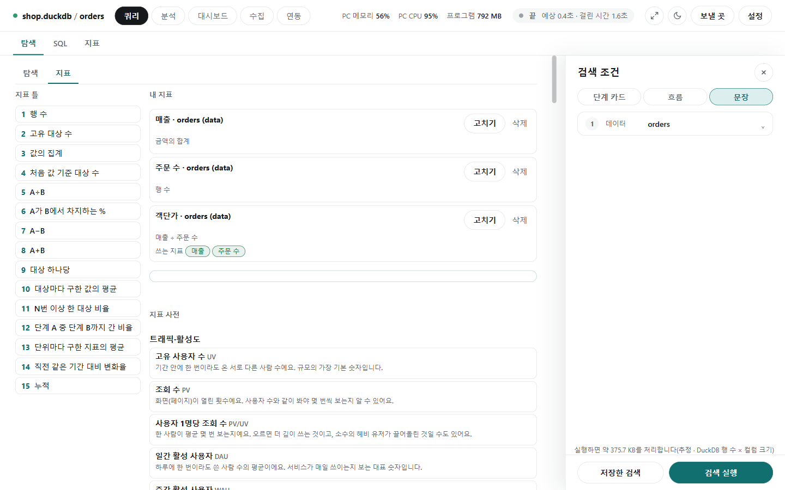

# 지표

[← 쿼리](../query.md)

"매출", "주문 수", "객단가"처럼 자주 보는 숫자를 한 번 정해 두고 다시 쓰는 곳입니다. 길은 둘입니다.

- **내 지표**: 쿼리 화면 [탐색] 탭에서 오른쪽 검색 조건을 **[문장]** 보기로 바꾸면 가운데 위에 [탐색]·**[지표]** 작은 탭이 생깁니다. 여기서 지표 틀의 빈칸을 채워 만듭니다. 대시보드 화면의 **[지표]** 단추도 같은 화면을 엽니다(저장하는 곳이 같음).
- **지표 파일**: 쿼리 화면 위쪽의 **[지표]** 탭. 파일에 적어 둔 지표를 누르면 바로 구합니다.

## 지표 틀 15개

![[지표] 탭: 왼쪽 지표 틀 15개, 가운데 '새 지표: 값의 집계' 폼으로 매출(금액 합계, 원, 클수록 좋음)을 만드는 모습](../photo/metrics-template.png)

왼쪽 **지표 틀**을 누르면 가운데에 새 지표 폼이 열립니다.

| 번호 | 지표 틀 | 번호 | 지표 틀 |
|---|---|---|---|
| 1 | 행 수 | 9 | 대상 하나당 |
| 2 | 고유 대상 수 | 10 | 대상마다 구한 값의 평균 |
| 3 | 값의 집계 | 11 | N번 이상 한 대상 비율 |
| 4 | 처음 값 기준 대상 수 | 12 | 단계 A 중 단계 B까지 간 비율 |
| 5 | A÷B | 13 | 단위마다 구한 지표의 평균 |
| 6 | A가 B에서 차지하는 % | 14 | 직전 같은 기간 대비 변화율 |
| 7 | A−B | 15 | 누적 |
| 8 | A+B | | |

- 폼 위 줄에 **지표 이름**, **단위**(예: 원, %), **좋은 방향**(클수록 좋음·작을수록 좋음·좋고 나쁨 없음)을 씁니다.
- 아래 문장의 빈칸(컬럼·가공·집계)을 고르면 바로 검사해 "문제 없어요." 또는 이유를 보입니다.
- 지표는 지금 테이블에 묶입니다("orders 테이블에 묶여요"). **[만들기]**로 저장합니다.
- A÷B·A−B 같은 틀은 빈칸에 다른 내 지표를 넣어 지표로 지표를 만듭니다.

## 내 지표



- 지금 테이블의 지표가 **[고치기]**·**[삭제]**와 함께 보입니다. 다른 지표를 쓰는 지표에는 **쓰는 지표** 칩이 붙습니다.
- 쓰는 지표가 지워졌으면 칩이 "없는 지표"로 바뀝니다. 테이블 구조가 바뀌어 컬럼이 없어졌으면 "쓸 수 없음"과 이유가 뜹니다.
- 정의를 고칠 때 그 지표를 쓰는 대시보드 카드·목표·다른 지표가 있으면 먼저 알려 주고, 고친 뒤 카드에는 "정의가 바뀌었어요"가 표시됩니다.
- 다른 지표가 쓰고 있는 지표는 지울 수 없습니다.
- 내 지표는 문장 틀의 빈칸(지표 고르기)과 대시보드 [카드 추가]의 **지표** 칸에서 씁니다. 정의만 `%APPDATA%\DataLoupe\my_metrics.json`에 저장하고 값은 저장하지 않습니다(500개까지).

### 다른 테이블의 지표 복사

- 다른 테이블에 묶인 지표는 목록 아래 "다른 테이블의 지표(복사해서 써요)"에 보입니다. 그대로는 못 쓰고 **[이 테이블에 맞춰 복사]**를 누릅니다.
- 같은 이름의 컬럼이 있으면 바로 복사하고, 없으면 "컬럼 짝 고르기"에서 원래 컬럼에 맞는 이 테이블의 컬럼을 골라 **[복사]**합니다. 그 지표가 쓰는 지표도 함께 복사됩니다.

## 지표 사전

내 지표 아래 **지표 사전**에는 DAU·리텐션·ARPU·ROAS 같은 지표 95개가 영역별로 있습니다. 빈칸만 채워 계산하고 [내 지표로 저장]합니다. 목록과 쓰는 법은 [지표 사전](metrics_catalog.md)에 있습니다.

## 지표 파일

![위쪽 [지표] 탭: 지표 파일 C:\data\metrics.yaml을 읽고 나누기 '채널'로 '취소율'을 누른 결과(막대와 채널별 표)](../photo/metrics-file.png)

- 오른쪽 **지표 파일** 칸에 경로를 넣고 **[읽기]**를 누르면 파일 안의 지표가 아래에 나옵니다(많이 쓴 순). 지표를 누르면 바로 구합니다.
- 계산은 [탐색]의 기준 테이블·조인·기간·조건 위에서 합니다. **나누기**에 컬럼을 고르면 그 값마다(앞 50개) 구합니다.
- **[대시보드에 추가]**로 결과를 대시보드 카드로 넣습니다.
- 파일을 고친 뒤에는 [읽기]를 다시 누릅니다. 경로를 비우고 [읽기]하면 쓰지 않습니다.

파일은 YAML 또는 JSON이고 지표는 200개까지입니다.

```yaml
metrics:
  취소율:
    format: percent
    numerator: {agg: count, where: "상태 = 취소"}
    denominator: {agg: count}
  매출:
    numerator: {agg: sum, column: 금액, where: "상태 != 취소"}
```

| 항목 | 뜻 |
|---|---|
| `numerator` | 분자. `agg`(집계), `column`(컬럼), `where`(조건 줄, 탐색의 조건과 같은 모양), `opts`(분위수의 `p` 같은 나머지 인자) |
| `denominator` | 분모(없으면 분자 그대로). 분모가 0이면 빈 값 |
| `format` | `number` 또는 `percent`(화면에서 ×100 해 %로) |
| `description` | 설명 |

`agg`에는 함수 사전의 집계를 모두 씁니다(`count`, `sum`, `mean`, `median`, `quantile` + `opts: {p: 0.9}` …). 식(코드)은 받지 않습니다.
