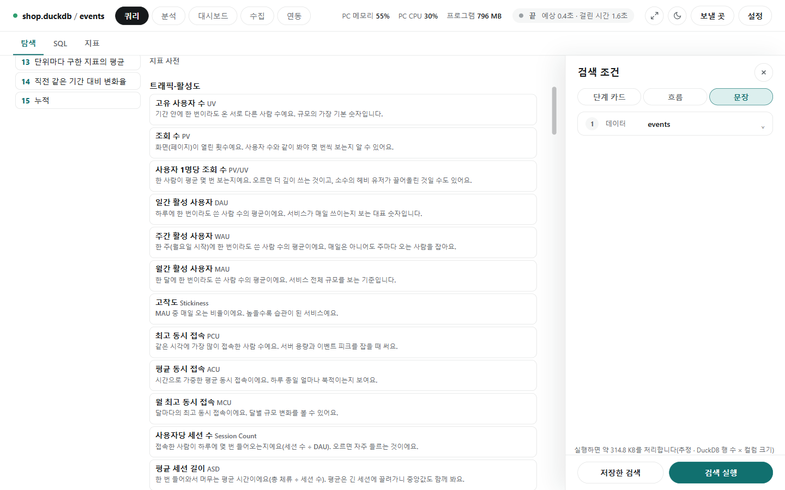

# 지표 사전

[← 쿼리](../query.md) · [지표](metrics.md)

트래픽·퍼널·리텐션·수익화·마케팅·게임 경제·이커머스·실험·모델의 지표 **95개**를 빈칸만 채워 구하는 곳입니다. 아래 목록은 프로그램 안의 지표 사전(`metrics/metric_catalog.py`)과 같습니다.

## 쓰는 법

- 쿼리 화면 [탐색] 탭 → 오른쪽 검색 조건 **[문장]** → 가운데 **[지표]** 탭의 내 지표 아래에 **지표 사전**이 있습니다. 대시보드 화면의 [지표] 단추로도 엽니다.
- 영역별로 지표 이름·약어·쉬운 설명이 보입니다. 지금 테이블에 필요한 컬럼이 없는 지표는 흐리게 두고 "광고비 컬럼이 있는 테이블이 필요해요"처럼 이유를 보입니다.

![DAU를 골라 시각(ts)·사용자(user_id) 빈칸을 채우고 [계산]한 결과: 일 평균 18.73명, 중앙값·P90·P99, 일별 표](../photo/metrics-catalog-dau.png)

- 지표를 누르면 식·북극성 후보 같은 안내와 **문장**이 열립니다. 빈칸(컬럼·값)을 고르고, 필요하면 **기간**을 적습니다. 컬럼 이름에 단서(spend, cost, 광고비 …)가 있으면 빈칸을 미리 채웁니다.
- **[계산]**: 지금 연결에서 구해 값과 표를 보입니다. 평균형 지표는 **중앙값·P90·P99**를, 비율 지표는 분자·분모 같은 **짝 절대량**을 함께 보입니다.
- **[내 지표로 저장]**: 지금 테이블에 묶인 내 지표가 되어 문장·대시보드 카드에서 씁니다([지표](metrics.md#내-지표)).
- 북극성·카운터·가드레일 후보인 지표에는 그 안내가 붙습니다.

## 알아 둘 규칙

- 비율은 0~1 값으로 구하고 화면에는 %로 보입니다.
- 주·월 단위에서 자료가 마지막 기간 중간에 끝나면 그 기간은 **진행 중**이라 평균에서 빼고(표에는 보임) 그렇게 알립니다. 자료의 마지막 날이 오늘이면 일 단위에서도 오늘을 진행 중으로 봅니다.
- 날짜 경계(일·주·월, N일째)는 UTC로 나눕니다. 시간대 없는 시각은 적힌 그대로 나눕니다.
- 첫 활동으로 신규·코호트를 정하는 지표(리텐션·이탈률·LTV·CAC 등)는 고른 기간 앞의 활동을 보지 못합니다. 기간을 걸면 기존 사용자가 신규로 섞일 수 있다고 알립니다.
- LTV·ROAS·회수 기간의 'N일'은 첫 활동일(D0)부터 DN까지입니다.
- 광고 테이블이 따로 필요한 지표(CAC·ROAS·LTV:CAC·회수 기간)는 광고 테이블을 고르고 **기간 단위로 맞춰** 또는 **공통 키로 맞춰**를 골라야 구합니다.
- 실수 컬럼의 NaN·무한대는 빈 값으로 봅니다.
- 큰 DB에서는 행 수를 미리 세지 않고, 실행 전에 처리 용량을 확인합니다.

## 트래픽·활성도 (16개)

| 지표 | 식 | 뜻 |
|---|---|---|
| 고유 사용자 수 (UV) | 고유 사용자 수 | 기간 안에 한 번이라도 온 서로 다른 사람 수예요. 규모의 가장 기본 숫자입니다. |
| 조회 수 (PV) | 이벤트(조회) 행 수 | 화면(페이지)이 열린 횟수예요. 사용자 수와 같이 봐야 몇 번씩 보는지 알 수 있어요. |
| 사용자 1명당 조회 수 (PV/UV) | PV ÷ UV | 한 사람이 평균 몇 번 보는지예요. 오르면 더 깊이 쓰는 것이고, 소수의 헤비 유저가 끌어올린 것일 수도 있어요. |
| 일간 활성 사용자 (DAU) | 일별 고유 사용자 수의 평균 | 하루에 한 번이라도 쓴 사람 수의 평균이에요. 서비스가 매일 쓰이는지 보는 대표 숫자입니다. |
| 주간 활성 사용자 (WAU) | 주별 고유 사용자 수의 평균 | 한 주(월요일 시작)에 한 번이라도 쓴 사람 수의 평균이에요. 매일은 아니어도 주마다 오는 사람을 잡아요. |
| 월간 활성 사용자 (MAU) | 월별 고유 사용자 수의 평균 | 한 달에 한 번이라도 쓴 사람 수의 평균이에요. 서비스 전체 규모를 보는 기준입니다. |
| 고착도 (Stickiness) | DAU ÷ MAU (×100은 %로 보일 때) | MAU 중 매일 오는 비율이에요. 높을수록 습관이 된 서비스예요. |
| 최고 동시 접속 (PCU) | 동시 접속 수의 최댓값 | 같은 시각에 가장 많이 접속한 사람 수예요. 서버 용량과 이벤트 피크를 잡을 때 써요. |
| 평균 동시 접속 (ACU) | Σ 동시 접속 × 유지 시간 ÷ 기간 길이 | 시간으로 가중한 평균 동시 접속이에요. 하루 종일 얼마나 북적이는지 보여요. |
| 월 최고 동시 접속 (MCU) | 달별 동시 접속의 최댓값 | 달마다의 최고 동시 접속이에요. 달별 규모 변화를 볼 수 있어요. |
| 사용자당 세션 수 (Session Count) | 세션 수 ÷ DAU | 접속한 사람이 하루에 몇 번 들어오는지예요(세션 수 ÷ DAU). 오르면 자주 들르는 것이에요. |
| 평균 세션 길이 (ASD) | 총 체류 시간 ÷ 세션 수 | 한 번 들어와서 머무는 평균 시간이에요(총 체류 ÷ 세션 수). 평균은 긴 세션에 끌려가니 중앙값도 함께 봐요. |
| 일 체류 시간 (TSD) | 일 체류 시간 합 ÷ DAU | 접속한 사람이 하루에 머무는 총 시간이에요(일 체류 합 ÷ DAU). |
| DAU 분해 (신규·기존·복귀) | 활성 = 신규 + 기존 + 복귀 | 오늘의 활성 사용자가 신규·기존·복귀 중 어디서 왔는지 나눠요. 늘어난 이유가 신규 때문인지 복귀 때문인지 알 수 있어요. |
| 퀵 레시오 (Quick Ratio) | (신규 + 복귀) ÷ 이탈 | 들어오는 사람(신규+복귀)이 나가는 사람(이탈)의 몇 배인지예요. 1보다 크면 커지고 4 가까이면 건강하다고 봐요. |
| 파워 유저 곡선 (Power User Curve) | 사용자별 최근 L일 중 접속 일수의 분포 | 최근 7일(또는 28일) 중 며칠 왔는지의 분포예요. 오른쪽에 몰릴수록 매일 쓰는 핵심 사용자가 많아요. |

## 퍼널·온보딩 (8개)

| 지표 | 식 | 뜻 |
|---|---|---|
| 단계 전환율 (CVR) | B까지 간 사용자 ÷ A를 한 사용자 | A를 한 사람 중 그 뒤에 B까지 간 비율이에요. 단계마다 구하면 어디서 막히는지 보여요. |
| 단계 이탈률 (Drop-off) | 1 − 전환율 | A를 한 사람 중 B로 못 간 비율이에요(1 − 전환율). 가장 큰 이탈 단계를 먼저 고쳐요. |
| 이탈 세션 비율 (Bounce Rate) | 이벤트 1개짜리 세션 ÷ 세션 수 | 한 번만 보고 나간 세션의 비율이에요. 유입의 질이나 첫 화면의 문제를 알려 줘요. |
| 페이지 이탈률 (Exit Rate) | 마지막 페이지가 p인 세션 ÷ p의 조회 수 | 그 페이지가 세션의 마지막이었던 비율이에요. 사용자가 어느 화면에서 떠나는지 보여요. |
| 첫 가치까지 걸린 시간 (TTV/TTFV) | 사용자별 A 이후 첫 B까지의 시간 | 처음 가치를 느끼는 행동(A→B)까지 걸린 시간이에요. 짧을수록 온보딩이 잘 돼요. |
| 튜토리얼 완료율 (Tutorial Completion) | 튜토리얼 완료 사용자 ÷ 시작 사용자 | 튜토리얼을 시작한 사람 중 끝까지 한 비율이에요. 낮으면 튜토리얼이 길거나 어려운 거예요. |
| 첫 경험 퍼널 (FTUE Funnel) | 단계별 도달 사용자와 전환 | 첫 접속부터 핵심 행동까지 단계별로 몇 명이 남는지예요. 단계 사이 가장 큰 낙폭이 고칠 곳이에요. |
| 첫 결제까지 걸린 시간 (TTFP) | 사용자별 가입 이후 첫 결제까지의 시간 | 가입(첫 접속)부터 첫 결제까지 걸린 시간이에요. 길면 첫 구매를 유도할 계기가 필요해요. |

## 리텐션·코호트 (7개)

| 지표 | 식 | 뜻 |
|---|---|---|
| 클래식 리텐션 (Day-N Retention) | N일째 활동 사용자 ÷ 코호트 크기 | 가입(첫 활동) 후 정확히 N일째에 돌아온 비율이에요. 가장 널리 쓰는 유지율이에요. |
| 롤링 리텐션 (Rolling Retention) | 마지막 활동이 N 이상인 사용자 ÷ 코호트 크기 | N일째 이후 언제든 돌아온 사람의 비율이에요. 클래식보다 너그럽고, 잠깐 쉬었다 오는 서비스에 맞아요. |
| 범위 리텐션 (Bracket Retention) | [a, b] 안에 활동한 사용자 ÷ 코호트 크기 | N1~N2일 사이에 한 번이라도 돌아온 비율이에요. 주 단위 유지를 볼 때 하루 변동을 줄여 줘요. |
| 수평 유지점 (Retention Flattening Point) | \|r(N) − r(N−1)\| < ε가 연속으로 이어지는 첫 N | 유지율 곡선이 더 내려가지 않고 평평해지는 첫 N이에요. 그 높이가 충성 사용자 비율이에요. |
| 이탈률 (Churn Rate) | 이탈 ÷ 앞 기간 활동자 | 지난 기간에 쓰던 사람 중 이번에 안 온 비율이에요. 낮을수록 좋고 성장의 가장 큰 적이에요. |
| 복귀율 (Resurrection Rate) | 복귀 ÷ 기간 시작 때 휴면자 | 한동안 안 오던 사람이 돌아온 비율이에요. 복귀 캠페인의 성과를 볼 때 써요. |
| 생존 곡선 (Survival S(t)) | Kaplan-Meier: S ×= (1 − 떠난 수 ÷ 남은 수) | 머문 기간 t까지 살아남은(떠나지 않은) 사용자 비율이에요. 아직 남은 사람(중도절단)도 반영해서 중앙 생존 시간을 구해요. |

## 수익화·LTV (14개)

| 지표 | 식 | 뜻 |
|---|---|---|
| 총매출 (Gross Revenue) | 금액의 합 | 수수료·환불을 빼기 전 매출 합계예요. |
| 순매출 (Net Revenue) | (총매출 − 환불) ÷ (1 + 부가세) × (1 − 수수료) | 환불·부가세·수수료를 빼고 실제로 남는 매출이에요. 수수료·부가세율은 직접 적어요. |
| 결제 사용자 수 (PU) | 금액 > 0인 고유 사용자 수 | 기간 안에 한 번이라도 결제한 사람 수예요. 객단가 지표(ARPPU)의 짝이에요. |
| 신규 결제자 (NPA) | 기간 안 첫 결제가 그 기간인 고유 사용자 수 | 처음 결제한 사람 수예요. 결제 유입이 늘고 있는지 알 수 있어요. |
| 결제 비율 (PUR, DPUR/MPUR) | 결제자 ÷ 활동 사용자 | 활동 사용자 중 결제한 비율이에요. 단위가 일이면 DPUR, 월이면 MPUR이에요. |
| 사용자당 매출 (ARPU) | 매출 ÷ 활동 사용자 | 활동 사용자 1명당 매출이에요. 결제 안 한 사람까지 나누므로 PUR과 객단가의 곱이에요. 평균은 고래에 끌려가니 중앙값도 함께 봐요. |
| 결제자당 매출 (ARPPU) | 매출 ÷ PU | 결제한 사람 1명당 매출이에요. 객단가(얼마나 쓰는지)를 봐요. |
| 일 활성 사용자당 매출 (ARPDAU) | 매출 합 ÷ 일별 DAU의 합 | 하루 접속자 1명당 그날 매출이에요. 일 단위로 수익성을 비교할 때 써요. |
| 고객 생애 가치 (LTV, LTV7/30/90) | N일 안 코호트 매출 ÷ 코호트 크기 (또는 ARPU ÷ Churn) | 한 사용자가 N일 동안 가져오는 매출이에요. 코호트 누적은 실제로 관찰한 값이고, ARPU÷이탈률은 앞으로를 어림한 값이에요. |
| 재구매율 (Repeat Purchase Rate) | N번 이상 산 사용자 ÷ 구매 사용자 | 한 번이라도 산 사람 중 N번 이상 산 비율이에요. 단골이 얼마나 되는지 알려 줘요. |
| 고래·돌고래·잔챙이 비중 (Whale/Dolphin/Minnow Share) | 등급별 매출 ÷ 전체 매출 | 소수의 큰손이 매출을 얼마나 차지하는지예요. 쏠림이 크면 한 명의 이탈이 매출을 흔들어요. |
| 월 반복 매출 (MRR) | 월별 금액의 합 | 한 달 동안 반복해서 들어오는 매출이에요(구독). 값이 달마다 얼마나 불어나는지 봐요. |
| 연 반복 매출 (ARR) | MRR × 12 | MRR을 1년으로 늘린 값(×12)이에요. 구독 사업의 규모를 한눈에 보여 줘요. |
| 순매출 유지율 (NRR) | 지난달 매출 있던 고객의 이번 달 매출 ÷ 지난달 매출 | 지난달 매출을 낸 고객이 이번 달 얼마를 냈는지예요. 100%가 넘으면 새 고객 없이도 매출이 늘어요. |

## 마케팅·UA (16개)

| 지표 | 식 | 뜻 |
|---|---|---|
| 노출 수 (Impressions) | 노출 수의 합(컬럼이 없으면 행 수) | 광고가 보인 횟수예요. 도달·빈도·클릭률의 바탕이에요. |
| 도달 사용자 (Reach) | 고유 사용자 수 | 광고를 한 번이라도 본 서로 다른 사람 수예요. |
| 노출 빈도 (Frequency) | 노출 수 ÷ 도달 | 한 사람이 광고를 평균 몇 번 봤는지예요. 너무 높으면 피로, 너무 낮으면 기억에 안 남아요. |
| 클릭률 (CTR) | 클릭 ÷ 노출 | 노출 중 클릭한 비율이에요. 소재가 눈길을 끄는지 봐요. |
| 노출 천 번당 설치 (IPM) | 설치 ÷ 노출 × 1000 | 광고가 1,000번 보일 때 설치되는 수예요. 설치 광고의 효율이에요. |
| 노출 천 번당 비용 (CPM) | 광고비 ÷ 노출 × 1000 | 광고가 1,000번 보이는 데 드는 비용이에요. |
| 클릭당 비용 (CPC) | 광고비 ÷ 클릭 | 클릭 한 번에 드는 비용이에요. |
| 설치당 비용 (CPI) | 광고비 ÷ 설치 | 앱 설치 하나에 드는 비용이에요. |
| 행동당 비용 (CPA) | 광고비 ÷ 전환 | 가입·구매 같은 목표 행동 하나에 드는 비용이에요. |
| 고객 획득 비용(전체) (CAC Blended) | 광고비 ÷ 신규 사용자(오가닉 포함) | 신규 사용자 1명을 데려오는 데 든 광고비예요. 오가닉으로 온 사람까지 나누므로 Paid CAC보다 낮아요. 광고 테이블이 따로 필요해요. |
| 고객 획득 비용(유료) (CAC Paid) | 광고비 ÷ 유료 유입 신규 사용자 | 광고로 온 신규 1명당 광고비예요. 채널 효율을 비교할 때 써요. 광고 테이블이 따로 필요해요. |
| 광고 수익률 (ROAS, D1/D7/D30) | 첫 활동 후 N일 누적 매출 ÷ 광고비 | 광고비 대비 N일 안에 돌아온 매출이에요. 1(100%)이 넘으면 N일 안에 본전이에요. 광고 테이블이 따로 필요해요. |
| LTV 대 CAC (LTV:CAC) | LTV ÷ CAC | 한 사용자가 벌어 주는 돈이 데려오는 비용의 몇 배인지예요. 보통 3배 이상이면 건강하다고 봐요. 광고 테이블이 따로 필요해요. |
| 회수 기간 (Payback Period) | 누적 ARPU ≥ CAC가 되는 첫 Day-N | 광고비(CAC)를 매출로 되찾는 데 걸리는 일수예요. 짧을수록 현금 부담이 작아요. 광고 테이블이 따로 필요해요. |
| 바이럴 계수 (K-Factor) | 초대 수/사용자 × 초대 전환율 | 사용자 1명이 데려오는 새 사용자 수예요(사용자당 초대 수 × 초대 전환율). 1이 넘으면 스스로 퍼져요. |
| 오가닉 상승분 (Organic Uplift) | 오가닉 신규 ÷ 유료 신규 | 유료로 온 신규 1명당 오가닉으로 따라온 신규 수예요. 광고가 입소문·검색을 얼마나 키웠는지 어림해요. |

## 게임 경제 (12개)

| 지표 | 식 | 뜻 |
|---|---|---|
| 재화 공급 (Faucet) | 재화 변화량 > 0의 합 | 게임 안으로 새로 풀린 재화 총량이에요(얻은 양의 합). |
| 재화 소비 (Sink) | −재화 변화량 < 0의 합 | 게임 안에서 사라진 재화 총량이에요(쓴 양의 합). |
| 순 유입 (Net Flow) | Faucet − Sink | 공급 − 소비예요. 양수가 계속되면 재화가 쌓여 인플레이션 위험이 커요. |
| 소비 대 공급 비율 (Sink-to-Faucet Ratio) | Sink ÷ Faucet | 푼 재화 중 얼마나 회수했는지예요. 1에 가까우면 균형, 훨씬 낮으면 재화가 넘쳐요. |
| 활성 통화량 (Active Money Supply) | 활성 사용자의 마지막 잔액 합 | 최근 활동한 사용자가 가진 재화의 합이에요. 실제로 시장에서 돌 수 있는 돈의 크기예요. |
| 화폐 유통 속도 (Velocity of Money) | Sink ÷ 활성 통화량 | 활성 통화량 대비 얼마나 쓰였는지예요. 높을수록 재화가 활발히 돌고 낮으면 쌓여 있어요. |
| 지니 계수 (Gini Coefficient) | (2Σ i·x(i)) ÷ (nΣx) − (n+1)/n | 재화가 몇 사람에게 쏠렸는지예요(0 = 평등, 1 = 한 명이 독점). 높으면 상위 유저와 신규 유저의 격차가 커요. |
| 스테이지 클리어율 (Stage Clear Rate) | 클리어 ÷ 도전 | 도전 중 깬 비율이에요. 너무 낮은 스테이지는 이탈 지점이에요. |
| 스테이지 도전 횟수 (Stage Try Count) | 도전 수 ÷ 도전한 (사용자, 스테이지) 수 | 한 사람이 스테이지를 깨기 위해 평균 몇 번 도전했는지예요. 난이도 곡선을 볼 때 써요. |
| 선택률 (Meta Pick Rate) | 항목 선택 수 ÷ 전체 선택 수 | 여러 선택지 중 그 항목을 고른 비율이에요. 메타가 한쪽으로 쏠렸는지 봐요. |
| 승률 (Meta Win Rate) | 승리 ÷ 선택 | 그 항목을 고른 판 중 이긴 비율이에요. 선택률과 같이 봐야 사기 캐릭터를 찾아요. |
| 천장 도달률 (Pity Reach Rate) | 천장 횟수 이상 뽑은 사용자 ÷ 뽑은 사용자 | 뽑기를 한 사람 중 천장 횟수까지 간 비율이에요. 높으면 확률 뽑기만으로는 부족해 천장에 의존해요. |

## 이커머스 (8개)

| 지표 | 식 | 뜻 |
|---|---|---|
| 총거래액 (GMV) | 주문 금액의 합 | 취소·반품을 빼기 전(또는 뺀) 주문 금액의 합이에요. 마켓플레이스의 규모예요. |
| 수수료율 (Take Rate) | 수수료 수익 ÷ GMV | 거래액 중 플랫폼이 가져가는 비율이에요. |
| 평균 주문 금액 (AOV) | GMV ÷ 주문 수 | 주문 1건당 평균 금액이에요. 중앙값과 같이 보면 큰 주문의 영향을 알 수 있어요. |
| 구매 빈도 (Purchase Frequency) | 주문 수 ÷ 구매자 수 | 구매한 사람이 평균 몇 번 샀는지예요. 재구매 유도가 통하는지 봐요. |
| 장바구니 이탈률 (Cart Abandonment Rate) | 1 − (담은 뒤 구매한 사용자 ÷ 담은 사용자) | 장바구니에 담고 사지 않은 비율이에요. 결제 단계의 마찰을 보여 줘요. |
| 검색 이탈률 (Search Exit Rate) | 검색이 마지막인 세션 ÷ 검색한 세션 | 검색한 세션 중 검색이 마지막 행동이었던 비율이에요. 검색 결과가 쓸모없을 때 높아져요. |
| 검색 결과 없음 비율 (Zero-Result Rate) | 결과 0건 검색 ÷ 검색 | 검색했는데 결과가 0건이었던 비율이에요. 높으면 동의어·상품 구색을 손봐야 해요. |
| 상품 쏠림(파레토) (SKU Pareto) | 상위 p% 항목의 매출 ÷ 전체 매출 | 상위 20% 상품이 매출의 몇 %인지예요. 80%에 가까우면 소수 상품에 기대는 구조예요. |

## 실험·모델 (14개)

| 지표 | 식 | 뜻 |
|---|---|---|
| 정밀도 (Precision) | TP ÷ (TP + FP) | 참이라고 한 것 중 실제로 참인 비율이에요. 오탐(헛다리)을 줄이고 싶을 때 봐요. |
| 재현율 (Recall) | TP ÷ (TP + FN) | 실제 참 중 찾아낸 비율이에요. 놓치면 안 되는 문제(사기·질병)에서 중요해요. |
| F1 점수 (F1) | 2PR ÷ (P + R) | 정밀도와 재현율의 조화평균이에요. 둘 중 하나가 낮으면 같이 낮아져요. 둘 다 0이면 0이에요. |
| PR 곡선 아래 넓이 (PR-AUC) | Σ (R_n − R_(n−1)) · P_n | 점수 기준을 바꿔 가며 정밀도-재현율 곡선 아래 넓이를 구한 평균 정밀도예요. 참이 드문 문제에서 AUC보다 믿을 만해요. |
| 추천 순위 품질 (NDCG@K) | DCG ÷ IDCG, DCG = Σ rel_i ÷ log2(i + 1) | 추천 상위 K개가 이상적인 순서에 얼마나 가까운지예요. 관련도가 높은 것이 위에 있을수록 1에 가까워요. |
| 추천 평균 정밀도 (MAP@K) | 질의별 AP@K의 평균 | 질의마다 맞는 항목이 얼마나 위에 있는지의 평균이에요. 맞는 것을 위로 올릴수록 커져요. |
| 제곱근 평균제곱오차 (RMSE) | √ 평균((예측 − 정답)²) | 예측 오차를 제곱해 평균한 뒤 제곱근을 씌운 값이에요. 큰 오차에 더 민감해요. |
| 평균 절대 오차 (MAE) | 평균 \|예측 − 정답\| | 예측과 정답 차이의 절댓값 평균이에요. 단위가 정답과 같아 읽기 쉬워요. |
| 평균 절대 비율 오차 (MAPE) | 평균 \|오차 ÷ 정답\| | 오차를 정답의 몇 %인지로 평균한 값이에요. 정답이 0인 행은 뺍니다. |
| 리프트 (Lift) | (T − C) ÷ C | 실험군이 대조군보다 몇 % 높은지예요. 크기만 볼 뿐 우연인지는 p-value로 따로 봐요. |
| 유의확률 (p-value) | 두 비율 z 검정 또는 Welch t 검정(양측) | 차이가 우연으로 생겼을 확률이에요. 유의수준보다 작으면 우연이라고 보기 어려워요. 숫자(0/1)면 비율 z, 연속이면 Welch t 검정이에요. |
| 검정력 (Power) | 정규 근사 검정력 | 실제로 차이가 있을 때 그걸 잡아낼 확률이에요. 낮으면 차이가 있어도 못 찾으니 표본을 늘려야 해요. |
| 최소 검출 효과 (MDE) | (z_(1−α/2) + z_power) × 표준오차 | 지금 표본으로 잡아낼 수 있는 가장 작은 차이예요. 기대 효과가 이보다 작으면 실험을 더 오래 돌려야 해요. |
| 가드레일 (Guardrail) | Lift ≥ 한계 (또는 ≤) | 실험이 지켜야 할 지표예요. 실험군이 대조군보다 한계 넘게 나빠지면 경고해요. 대시보드의 카운터 한계와 같은 방식이에요. |
