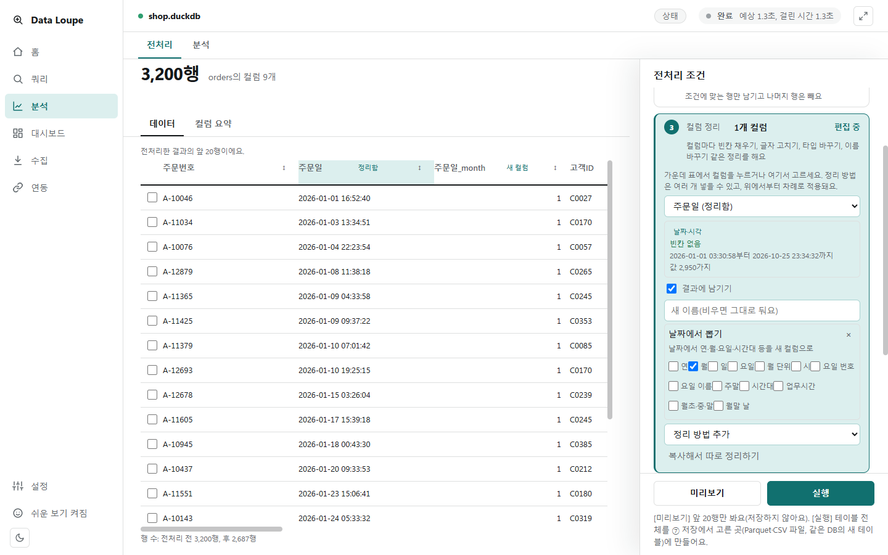
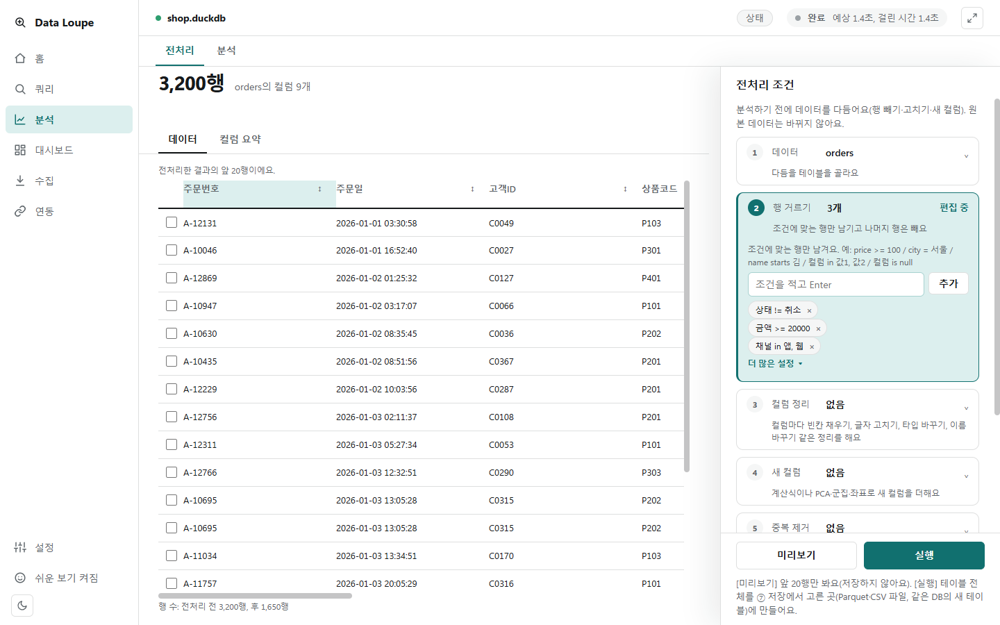
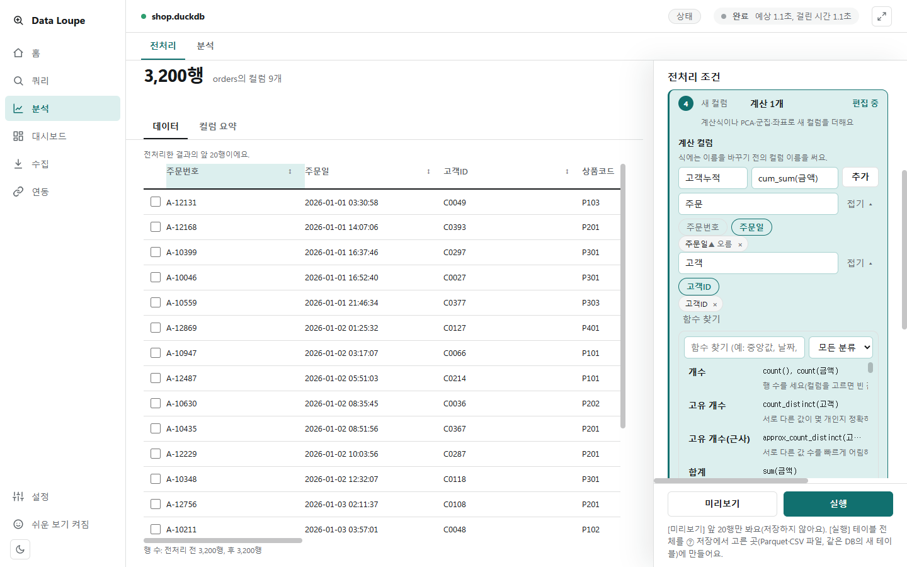
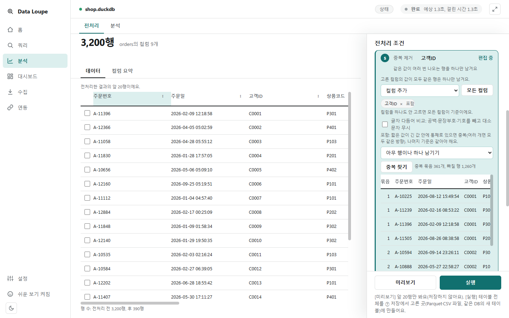
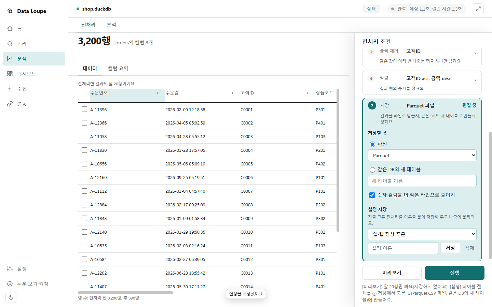

# 전처리

[← 분석](../analysis.md)

분석 전에 데이터를 다듬는 곳입니다. 예: `" 서울 "` → `"서울"`, `"N/A"` → 빈 값, `"20260131"` → 날짜. 오른쪽 **전처리 조건**의 ①~⑦을 위에서 아래로 채우고, **[미리보기]**로 확인한 뒤 **[실행]**으로 저장합니다. 원본은 바꾸지 않습니다.

## ① 데이터 고르기



- ① **데이터**에서 테이블을 고르면 가운데에 행 수와 앞 20행이 나옵니다. 연결은 **[연결 바꾸기]**로 바꿉니다.
- **미리 읽을 행 수**(기본 5,000)만큼만 읽어 통계·추천·분석을 구합니다. 큰 테이블 대신 일부(표본)만 읽어 빠르게 보는 것입니다. 파일(Polars) 연결은 앞·가운데·뒤 세 구간에서 나눠 읽어, 앞쪽만 치우친 표본이 되지 않게 합니다.
- 주소 없이 이 화면을 열면 마지막에 고른 테이블(같은 연결일 때)을 이어서 엽니다. 스키마 목록의 첫 칸은 **스키마(폴더)**입니다.
- **컬럼 통계와 추천 보기**를 끄면 데이터를 읽지 않고 컬럼 이름·타입만 봅니다.
- 주소로 연결한 DB는 **계산 위치**에서 이 PC가 계산할 범위(**전부 이 PC**, 또는 **계산 컬럼만 이 PC**)를 고릅니다. 이때 DB에는 행 거르기까지의 조회 한 번만 가고 나머지는 이 PC가 계산합니다.
- 같은 테이블을 다시 열면 지난번에 이 테이블에 쓴 전처리를 저절로 채웁니다.

## ② 행 거르기



조건을 한 줄씩 쓰고 Enter(또는 **[추가]**)를 누르면 맞는 행만 남깁니다. 예: `price >= 100`, `city = 서울`, `name starts 김`, `시작일 < 종료일`, `컬럼 in 값1, 값2`, `컬럼 is null`, `* is not null`(모든 컬럼에 값이 있는 행만).

쿼리 화면과 같은 **[가장 많은 기간 찾기]**도 있습니다. 날짜 타입 컬럼과 길이(1일·1주·1달)를 고르면 건수가 가장 많은 기간을 테이블 전체로 찾아(위의 조건을 건 뒤의 건수) 보여 주고, **[이 기간 적용]**이 `컬럼 between 시작 끝` 조건 줄로 넣습니다.

## ③ 컬럼 정리

가운데 표에서 컬럼 머리를 누르거나 ③에서 컬럼을 고른 뒤 **정리 방법 추가** 목록에서 방법을 더합니다. 한 컬럼에 여러 방법을 넣을 수 있고 위에서 아래 순서로 적용합니다. 위 사진은 `주문일`에 **날짜에서 뽑기**(월)를 넣어 `주문일_month` 컬럼이 새로 생긴 모습입니다. 정리한 컬럼에는 **정리함**, 새로 생긴 컬럼에는 **새 컬럼** 표시가 붙습니다.

- **결과에 남기기**를 끄면 그 컬럼을 결과에서 뺍니다. **새 이름** 칸으로 이름을 바꾸고, **복사해서 따로 정리하기**로 사본을 만들어 다르게 다듬을 수 있습니다.

| 묶음 | 정리 방법 | 예 |
|---|---|---|
| 글자 | 앞뒤 공백 지우기 · 연속 공백을 하나로 | `' 서울 '` → `'서울'` |
| 글자 | 이 값들을 빈 값으로 | `-, N/A`를 빈 값으로(빈 문자열도 고를 수 있음) |
| 글자 | 글자 찾아 지우기 · 값 바꿔 쓰기 · 정규식으로 바꾸기 · 대문자·소문자로 | `'1,000원'`에서 `원` 지우기, `Y` → `완료` |
| 타입 | 타입 바꾸기(정수·실수·글자·날짜) | 글자 `'123'`을 숫자로, `'20260131'`을 날짜로(형식 `%Y%m%d`). 숫자는 **쉼표·단위 떼기**를 켤 수 있음 |
| 빈 값 | 빈 값 처리 | 그 행 빼기, 정한 값·평균·중앙값·최빈값·앞의 값·뒤의 값으로 채우기 |
| 숫자 | 범위 밖 값 처리 | 직접 범위·사분위수(IQR)·표준편차로 정한 범위 밖을 빼거나 잘라 내기 |
| 숫자 | 크기 맞추기(스케일링) · 반올림 · 구간 나누기 | 표준화, 0~1 사이로, 로그 ln(1+x) / 3.14159 → 3.14 / 23 → `20–30` |
| 범주 | 드문 값 묶기 | 몇 번 안 나오는 값을 `기타`로 |
| 새 컬럼 | 컬럼 여러 개로 펼치기(구조·맵·JSON) · 날짜에서 뽑기 · 빈 값 표시 컬럼 만들기 · 값을 번호로(라벨 인코딩) · 값마다 컬럼으로(원-핫 인코딩) · 패턴에 맞는 부분 뽑기 · 글자가 들어 있는지 표시 · 단어별 개수 세기 | `주문일_month`, `'서울'`→0, 구조·맵·JSON 글자는 `컬럼.키` 컬럼들 |

알아 둘 규칙:

- **컬럼 여러 개로 펼치기**: 구조는 필드마다, 맵은 키마다(맵·JSON은 앞 1,000행에서 모은 키 50개까지), JSON 글자는 맨 위 키마다 `컬럼.키` 새 컬럼을 만듭니다. 찾은 키는 설정에 함께 저장해 두므로 미리보기·실행 때마다 키를 다시 찾지 않습니다. 원래 컬럼은 그대로 남습니다. 목록(배열)을 행으로 펼치는 것은 쿼리의 `펼치기`(`unnest`)입니다.
- 숫자로 바꿀 수 없는 값은 빈 값이 됩니다. 실수를 정수로 바꾸면 소수점은 0 쪽으로 버립니다(2.9 → 2, -2.9 → -2). 글자 컬럼은 정수 모양(`'12'`)만 정수로 바뀌고, `'2.9'`·`'1e3'` 같은 소수·지수 모양은 빈 값이 됩니다(먼저 실수로 바꾼 뒤 정수로 바꾸면 2가 됩니다).
- 날짜로 바꿀 때 형식에 맞지 않는 값과 없는 날짜(2026-02-30, 평년의 2월 29일)는 빈 값이 됩니다. 형식에 시각(`%H` 등)이 있으면 날짜시간이 됩니다.
- 실수 컬럼의 무한대 값(과 NaN)은 빈 값으로 봅니다. 그래서 빈 값 처리·범위 밖 값 처리·크기 맞추기와 컬럼 요약에서 빈 값으로 셉니다. 글자 `"1e400"`처럼 실수에 들어가지 않는 값을 실수로 바꾸면 무한대 대신 빈 값이 됩니다.
- 반올림은 0.5를 0에서 먼 쪽으로 올리고(2.5 → 3), 자릿수 0이면 3.0처럼 실수로 남습니다.
- 범위 밖 값의 경계(IQR·표준편차)는 그 단계를 시작할 때의 표로 구하고, 평균·중앙값으로 채울 값과 크기 맞추기는 앞 컬럼들이 행을 뺀 뒤의 표로 구합니다.

## ④ 새 컬럼



- **새 컬럼 이름**과 식(예: `금액 * 수량`, `median(금액)`, `lag(금액, 1)`)을 쓰고 **[추가]**합니다. 식에는 이름을 바꾸기 전의 컬럼 이름을 씁니다.
- 순위·이전 값·누적 같은 창 함수는 **정렬 기준**을, 집계와 창 함수는 **묶을 컬럼**을 함께 씁니다(둘 다 선택, 없으면 표 전체).
- **[함수 찾기]**를 누르면 함수 사전이 열립니다. 분류로 거르고 예시를 누르면 식에 들어갑니다([SQL 함수](sql_functions.md)).
- 나누는 값이 0이면, 로그가 0 이하면, 제곱근이 음수면 빈 값이 됩니다(안내 글에 적혀 있음).

![가운데 [컬럼 요약] 탭(표본 요약·명세서 설명)과 오른쪽 ④ 새 컬럼: 계산 컬럼 단가 = 금액 / 수량, PCA와 좌표 칸](../photo/prep-spec.png)

- 추가한 계산 컬럼은 `단가 = 금액 / 수량`처럼 칩으로 보이고 ×로 뺍니다.
- **PCA(차원 줄이기)**: 숫자 컬럼을 체크하고 **성분 수**를 정하면 `pca_1`, `pca_2` … 컬럼으로 줄입니다.
- **좌표**: TM 좌표를 경도·위도로 바꾸거나, 가장 가까운 지점·속한 영역을 새 컬럼으로 붙입니다. 종류를 고르고 **[좌표 추가]**를 누릅니다(이 PC에서 계산, [좌표](geo.md)).

## ⑤ 중복 제거 · ⑥ 정렬



- ⑤ 고른 컬럼의 값이 모두 같은 행은 하나만 남깁니다. **[모든 컬럼]**은 완전히 같은 행만 지웁니다. **[중복 세기]**로 몇 행이 겹치는지 먼저 봅니다.
- 기본은 **아무 행이나 하나 남기기**입니다. **남길 값 직접 고르기**를 고르면 정렬 기준의 첫·마지막 행, 최소·최대·최빈값, 이어 붙이기 등으로 남길 값을 정합니다.
- ⑥ 결과 컬럼과 오름차순·내림차순을 골라 **[추가]**합니다.

## 컬럼 요약

가운데 표 위에는 **[데이터]**·**[컬럼 요약]** 탭이 있습니다. 위 사진의 **[컬럼 요약]** 탭은 컬럼마다 쉬운 요약(타입, 빈칸 수, 범위, 값 종류)과 명세서 파일의 설명, 추천을 보여 줍니다.

- **[추천 모두 적용]**: 추천한 정리 방법을 한꺼번에 넣습니다(추천이 있을 때만 보임). **[뺄 만한 컬럼 찾기]**: 값이 하나뿐이거나 다른 숫자 컬럼과 상관이 아주 높은 컬럼을 표본으로 찾습니다(DB에는 묻지 않음).
- 표본 기준의 **품질 점검** 줄이 요약 아래에 나옵니다: **키 후보**(빈 값이 없고 값이 모두 다른 컬럼), **IQR 밖 값**(사분위 범위의 1.5배 밖인 값이 몇 개인지, 숫자 컬럼), **빈 날**(처음~마지막 날 사이 값이 없는 날이 며칠인지, 날짜 컬럼). 없으면 그 줄은 나오지 않습니다.
- 컬럼 이름에 금액 단서(amount·금액·매출 …)가 있는 숫자 컬럼에 빈 값이 있으면 추천에 **빈 값을 0으로 채우기**가 먼저 나옵니다.
- **[다시 구하기]**: 표본을 새로 읽어 요약·추천을 다시 구합니다.
- **[전체로 구하기]**: 표본이 아니라 테이블 전체 값으로 빈 값·고유값·최솟값·최댓값을 다시 구합니다. 표본과 크게 다르면(빈 값 비율 5%p 이상, 고유값 수 20% 이상, 최솟값·최댓값이 다름) 그 컬럼에 **표본과 달라요**가 표시됩니다. 큰 테이블은 오래 걸리고, 쓴 만큼 요금을 받는 DB에서는 비용이 듭니다. 컬럼 8개씩 나눠 집계해서, 컬럼이 아주 많은 테이블도 DB 메모리를 한꺼번에 쓰지 않습니다.
- **[요약 파일로 저장]**: 연결의 모든 테이블의 컬럼 요약(타입·빈 값 비율·빈 값 수·고유값 수·최솟값·최댓값·예시 값)을 파일 하나로 저장합니다. 형식은 **Excel**(첫 시트에 테이블 목록, 테이블마다 시트 하나) 또는 **CSV**(테이블 이름 컬럼이 붙은 표 하나)이고, **전체 기준**을 체크하면 표본 대신 전체로 구합니다. 행 데이터는 예시 값 3개까지만 들어갑니다.
- **명세서 파일**: 테이블·컬럼 설명을 적은 YAML·JSON 파일 경로를 넣고 **[불러오기]**를 누릅니다. 설명은 [질문으로 SQL 만들기](sql.md)도 씁니다. 비우고 [불러오기]를 누르면 쓰지 않습니다.

```yaml
tables:
  orders:
    description: 2026년 주문 내역
    partition: {column: order_date, recent_days: 3}   # 날짜로 나뉜 테이블이면 최근 3일만 표본으로
    columns:
      금액: {description: "결제 금액(원, 할인 뒤)"}
```

## 미리보기와 저장



- **[미리보기]**: 정리한 결과의 앞 20행과 `행 수: 전처리 전 3,200행, 후 2,950행`을 보여 줍니다. 미리 본 뒤 조건을 바꾸면 "설정이 바뀌었어요. [미리보기]를 다시 눌러 주세요"라고 알려 줍니다.
- ⑦ **저장**의 **저장할 곳**: **파일**(Parquet·CSV) 또는 **같은 DB의 새 테이블**. 새 테이블은 **[실행]**을 한 번 더 눌러야 만들고, 같은 이름의 테이블이 있으면 만들지 않습니다.
- **숫자 컬럼을 더 작은 타입으로 줄이기**(downcast): 값이 바뀌지 않을 때만 줄입니다(예: int64 → int16).
- **설정 저장**: 지금 고른 전처리 전체를 이름(**설정 이름**)을 붙여 저장해 두고, 다음에 골라 그대로 불러옵니다(불러오기만 하고 실행하지는 않음).
- 어떤 것이 기억되는지는 [설정](settings.md)에 있습니다.
