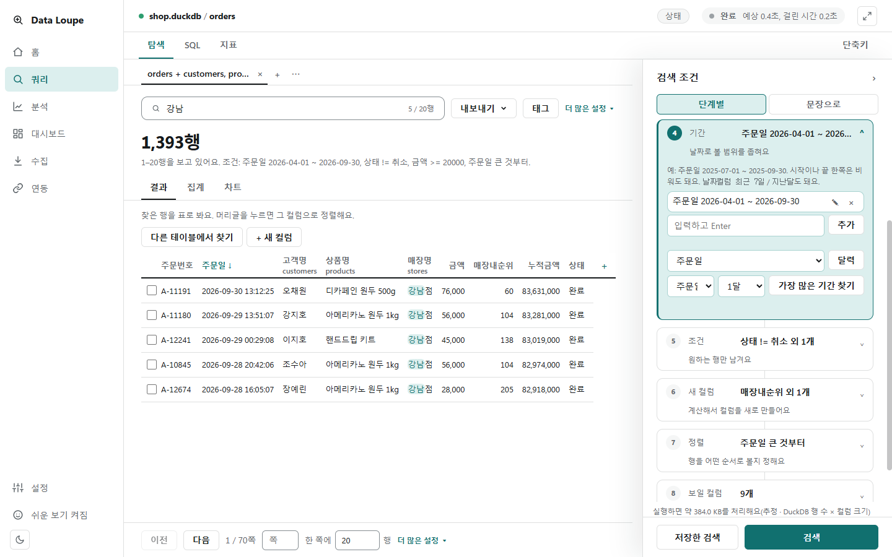
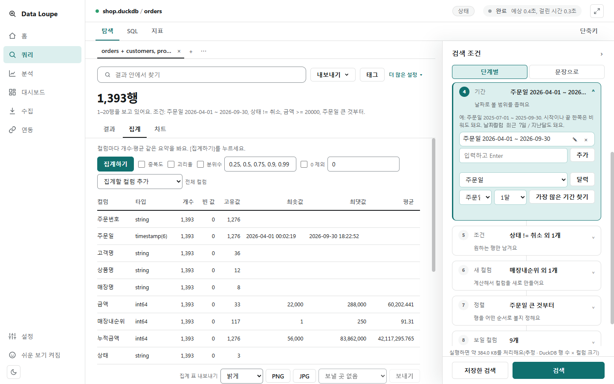
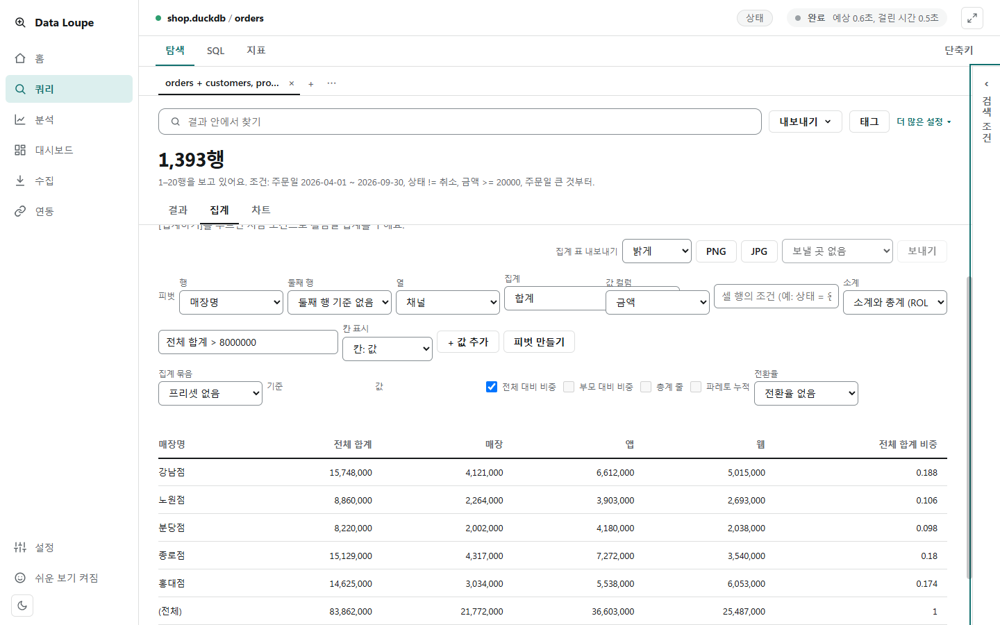
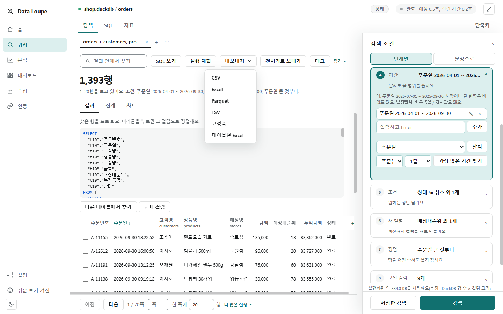
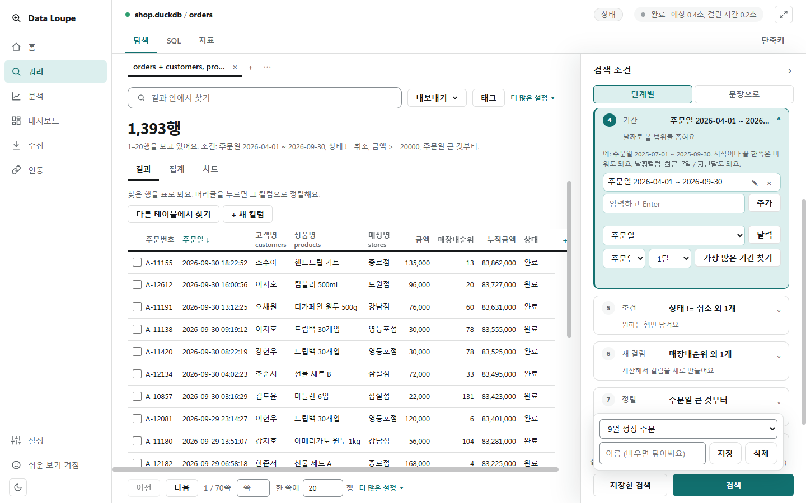

# 결과

[← 쿼리](../query.md)

[검색] 뒤 가운데에 행 수(예: **1,142행**)와 걸린 조건 요약, 결과 표가 나옵니다. 아래 [이전]·[다음]으로 쪽을 넘기고(쪽만 넘길 때는 전체 행 수를 다시 세지 않아요. 단추 위에서 마우스 휠을 굴려도 넘어가고, 쪽 번호 칸에 숫자를 쓰고 Enter를 누르면 그 쪽으로 바로 갑니다. [SQL] 탭도 같습니다), **한 쪽에 N행**(보일 행 수, 처음 20)과 **긴 글은 N자에서 줄임**(이보다 긴 글은 줄여 보이고 마우스를 올리면 다 보임, 처음 40, 0이면 줄이지 않음)을 정합니다.

결과 위에는 **[결과]**·**[집계]**·**[차트]** 탭이 있습니다. 쉬운 보기가 켜져 있으면 [SQL 보기]·[실행 계획]·[전처리로 보내기]·[태그]와 긴 글·총 행 수 칸은 **[더 많은 설정 ▾]**을 눌러야 보입니다([쉬운 보기](settings.md#화면-설정)).

## 결과 안에서 찾기

- 위쪽 **결과 안에서 찾기** 칸에 글자를 쓰면 지금 쪽에서 맞는 행만 남기고 글자를 강조합니다(`5 / 20행`).
- 표 머리글을 누르면 그 컬럼으로 정렬합니다.
- 시각 값은 자정이면 날짜만, 초가 0이면 초 없이 보입니다(보이는 모양만 다르고 값은 그대로).
- 검색하기 전에는 큰 행 수 대신 "아직 검색하지 않았어요"가 보입니다.
- **오른쪽 클릭 메뉴**: 칸 위에서 누르면 [이 값 제외]·[이 값만](빈 값 칸은 [빈 값 제외]·[빈 값만])과 [오름차순 정렬]·[내림차순 정렬]이 나옵니다. 머리글 위에서는 정렬에 더해 [이 컬럼 빼기], [값 골라서 제외·만 보기…](값 목록에 체크), [이 값으로 다른 테이블 찾기…], 그리고 전처리 방법들(고르면 ⑥ 새 컬럼 단계에 줄로 들어감)이 나옵니다. 표 밖 빈 곳에서는 [되돌리기](Ctrl+Z와 같음)가 나옵니다. 조건을 더한 뒤에는 **[검색]**을 눌러야 결과에 반영됩니다.
- **행 고르기**: 표에서 행을 고르면 **[선택한 행 빼기]**·**[선택한 행만 남기기]**·**[선택 해제]**가 나오고, 누르면 그 행들의 조건 줄이 ⑤ 조건에 들어갑니다.
- **총 행 수 세기**를 끄면 총 행 수와 예상 시간을 구하지 않습니다(요금이 나오는 DB에 유용). 주소로 접속한 DB는 결과를 PC에 받아 둘 수 있는지만 100만 행까지 셉니다.

## 다른 테이블에서 찾기

결과 표 위 **[다른 테이블에서 찾기]**는 결과의 한 컬럼 값(ID 등)으로 다른 테이블이나 다른 작업 탭의 결과에서 찾거나 붙입니다. 먼저 검색한 뒤에 씁니다.

1. **기준 컬럼**(지금 결과의 컬럼), **대상 테이블**(찾기 칸에 이름을 써서 좁힘. 원본 테이블은 `이름 (원본)`, 다른 탭은 `탭 이름 (가공 결과)`), **대상 키 컬럼**을 고릅니다.
2. **[미리보기]**를 누르면 "이 컬럼 값 N개 중 대상에 있는 값 N개, 없는 값 N개"를 세어 줍니다.
3. 할 일을 고르고 **[적용]**합니다.

| 고르는 것 | 하는 일 |
|---|---|
| ① 대상에서 이 값들이 있는 행만 보기 (새 탭) | 대상 테이블에서 그 값이 있는 행을 새 작업 탭에 보입니다 |
| ② 지금 결과에 대상 컬럼 붙이기 | 대상의 컬럼을 체크해 지금 결과 옆에 붙입니다(left 조인으로 들어감) |
| ③ 지금 결과에 대상 집계값 붙이기 | 대상에서 키마다 집계(건수·합계·평균·고유 개수·최댓값·최근 값)를 구해 새 컬럼으로 붙입니다. 최근 값은 기준 시각 컬럼을 고릅니다 |
| ④ 대상에 없는 값만 보기 (새 탭) | 대상에 없는 값의 행만 새 작업 탭에 보입니다 |

## 집계

- **[집계]** 탭에서 집계할 컬럼을 고르고(고르지 않으면 전체) **[집계하기]**를 누르면 컬럼마다 타입·개수(count)·빈 값(nulls)·고유값(unique)·최소·최대·평균이 나옵니다.
- [집계하기] 옆 체크로 칸을 더합니다: **중복도**(행 수 ÷ 고유 수), **괴리율**(중앙값과 평균-중앙값 괴리율), **분위수**(옆 **분위** 칸에 `0.25, 0.5, 0.9`처럼 0과 1 사이 수를 쉼표로), **0 제외**, 그리고 **경계** 칸(적으면 이 값을 넘는 행만 셈).
- ID·해시로 보이는 컬럼은 집계 컬럼 목록에서 빠지고 목록 아래 **[다시 넣기]**로 되살립니다(설정 `hash_exclude`, [설정](settings.md)).
- **집계 표 내보내기**: 밝게·어둡게를 고르고 [PNG]·[JPG]로 저장하거나, [보낼 곳]을 골라 **[보내기]**합니다.

## 피벗

- [집계] 탭 아래 **피벗** 줄에서 **행**(매장), **열**(열로 펼칠 컬럼. 채널, 값 30개까지), **집계**(합계), **값 컬럼**(금액. 개수만 셀 때는 비움)을 고르고 **[피벗 만들기]**를 누릅니다. 펼칠 컬럼이 빈 값인 행은 "(빈 값)" 열에 맨 뒤로 모입니다. **둘째 행**을 고르면 행 기준이 두 단계가 됩니다(부모 대비 비중에 필요).
- **[+ 값 추가]**로 값을 여러 개 집계합니다(열 이름은 `금액 합계`처럼 값과 집계가 붙습니다).
- **칸 표시**는 값·행 비율(칸 ÷ 그 행 전체)·열 비율(칸 ÷ 그 열 합계) 등에서 고릅니다. 열 비율은 소계·총계와 함께 쓸 수 없습니다.
- **셀 행의 조건** 칸을 채우면 그 행만 셉니다(조건부 집계).
- **소계** 칸에서 **소계와 총계 (ROLLUP)** 또는 **모든 조합 (CUBE)**를 고르면 소계 줄 `(소계)`와 총계 줄 `(전체)`가 붙습니다.
- **집계 결과로 거르기**: `전체 합계 > 100`처럼 집계한 결과로 거릅니다(HAVING). 결과는 500행까지입니다.
- **집계 묶음**(피벗 아래 줄): 미리 짜 둔 집계 묶음(볼륨·구간 타겟·괴리율·분위수·ARPU/ARPPU)을 고르면 위의 집계·값 컬럼·[+ 값 추가] 대신 그 묶음으로 집계합니다. 묶음에 따라 **기준**·**값** 컬럼, **분위**, **경계** 칸을 채우고, **전체 대비 비중**·**부모 대비 비중**·**총계 줄**·**파레토 누적** 체크와 **전환율**을 더할 수 있습니다.

## 기간별 표

피벗 아래 **기간별 표** 줄은 테이블마다 날짜 컬럼으로 기간을 묶어 건수·고유 개수·합계를 한 표에 나란히 놓습니다(검색 조건은 넣지 않음).

- 기간 단위(일·주·월·분기·연)를 고르고, **기간** 칸에 `2025-01-01 ~ 2025-06-30`처럼 쓰거나 **[달력]**으로 고릅니다(비우면 전체).
- **[+ 테이블]**로 나란히 놓을 테이블 줄을 더하고 **[기간별 표 만들기]**를 누릅니다. 표 아래에 같은 값의 차트도 그려집니다.
- 값 옆에 **비중 % 함께**·**전 기간 대비 % 함께**를 보이거나 **값만** 봅니다. **합계 줄**을 켜면 표 끝에 합계가 붙고(고유 개수는 전체에서 다시 셈), **[CSV]**로 저장합니다.

## 내보내기와 SQL 보기

- **[내보내기]** 메뉴의 [CSV]·[Excel]·[Parquet]·[TSV]·[고정폭]: 지금 쪽이 아니라 조건에 맞는 **전체 행**을 파일로 받습니다. 검색한 뒤에 켜집니다.
  - Excel과 고정폭 텍스트는 1,048,575행까지입니다. 넘으면 CSV·TSV나 Parquet을 쓰세요. 이 PC에서 계산하는 연결(파일)의 Excel은 행 수를 먼저 세어 넘으면 쓰지 않고 바로 알려 줍니다.
  - [테이블별 Excel]: 기준·이어붙이기·조인 테이블을 Excel 한 파일에 테이블마다 시트 하나로 저장합니다(조건 없이 테이블 전체).
  - 16자리 이상 정수(ID 등)는 끝자리가 바뀌지 않게 글자로, 시간대가 있는 시각은 이 PC 시각으로 적습니다.
  - CSV·TSV·고정폭 텍스트는 `=`·`+`·`-`·`@`로 시작하는 글자(앞에 빈칸이 있어도) 앞에 `'`를 붙여 스프레드시트가 수식으로 실행하지 않게 합니다. Excel·Parquet은 값을 그대로 저장합니다(Excel은 글자를 수식으로 해석하지 않음).
  - 주소로 접속한 DB에서 100만 행이 넘을 것 같으면 복제본에서 하라고 한 번 묻습니다.
- **[SQL 보기]**: 지금 조건으로 실행되는 SQL을 표 위에 펼칩니다.
- **[실행 계획]**: 조회를 돌리지 않고(EXPLAIN) 인덱스를 타는지, 테이블 전체를 읽는지 봅니다.
- **[전처리로 보내기]**: 지금 검색을 그대로 분석 화면의 전처리 탭으로 넘깁니다. 파일을 만들지 않고 연결도 그대로입니다. 전처리 ① 데이터에 "쿼리에서 넘어온 검색 '이름' · N행 · 컬럼 N개"와 **[쿼리로 돌아가기]**가 보입니다.

## 저장한 검색

- 패널 아래 **[저장한 검색]**을 누르고 이름(예: '9월 정상 주문')을 써서 **[저장]**합니다. 이름을 비우면 고른 검색을 덮어쓰고(먼저 묻습니다), **[삭제]**로 고른 검색을 지웁니다. 지우기 전에 한 번 묻고, 지운 뒤 5초 동안 **[되돌리기]**가 보입니다.
- 목록에서 고르면 저장해 둔 조건을 불러옵니다(검색은 하지 않음). 많이 불러온 순입니다.
- 화면을 오가면 넣어 둔 조건이 사라지므로, 다시 쓸 조건은 저장해 둡니다. 만들던 화면은 [임시 저장](drafts.md)으로도 이어집니다.
