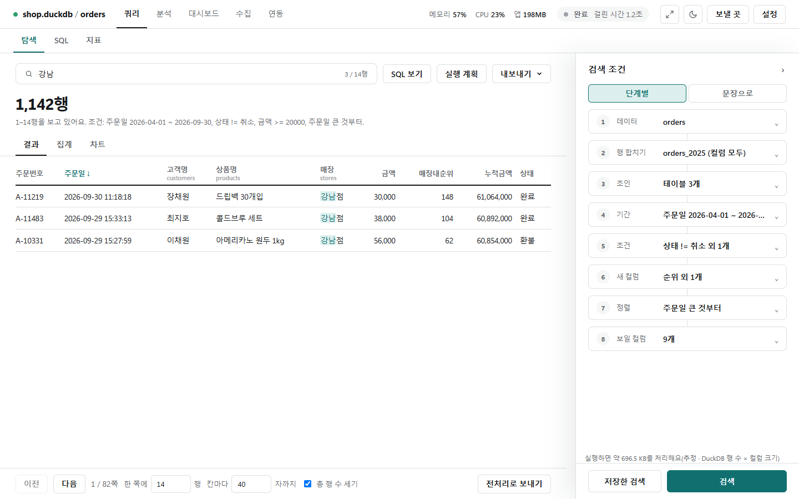
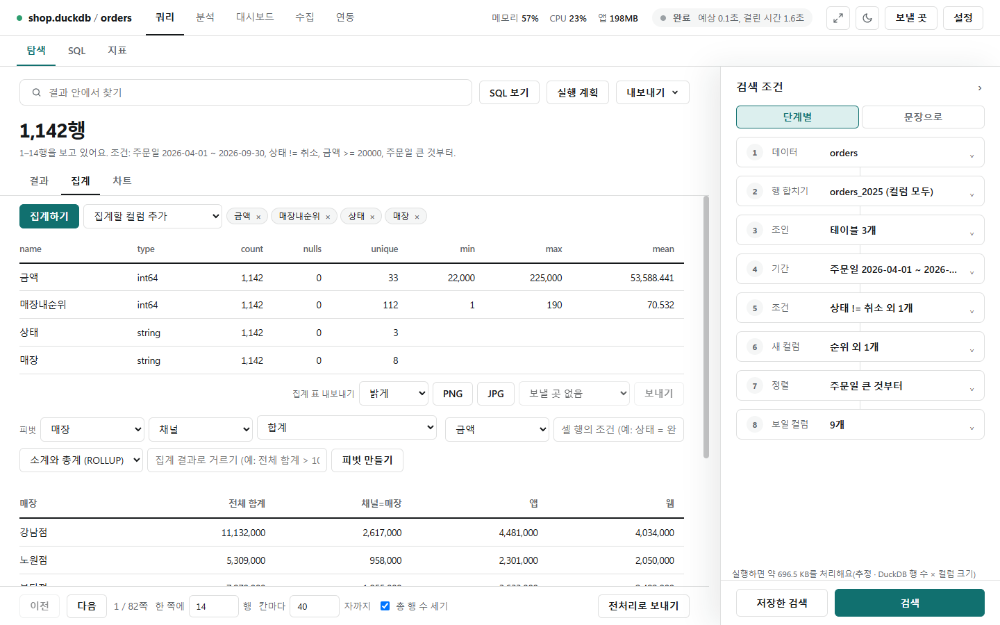
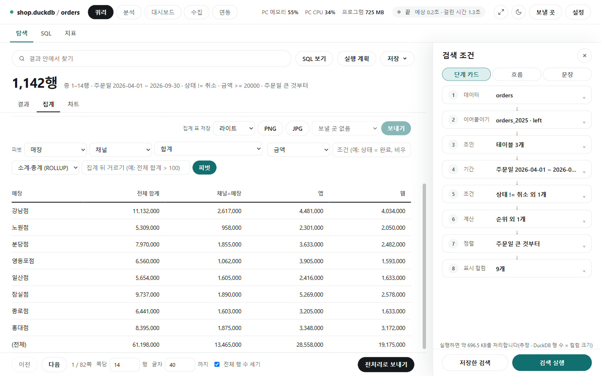
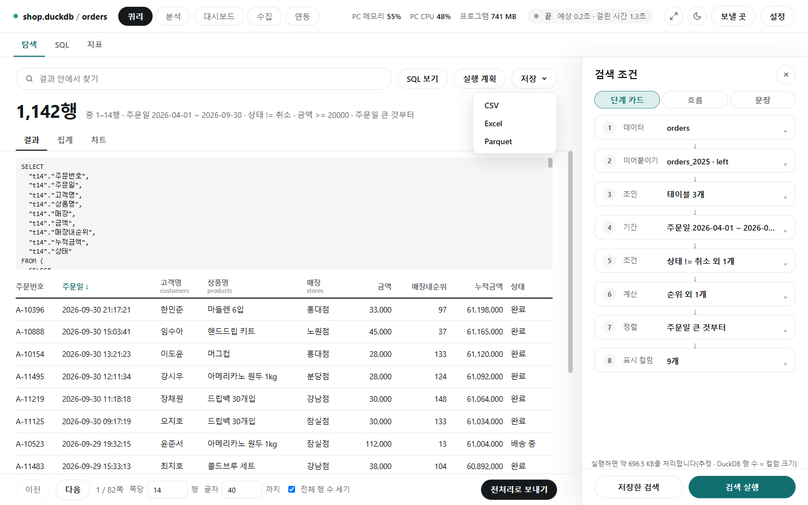
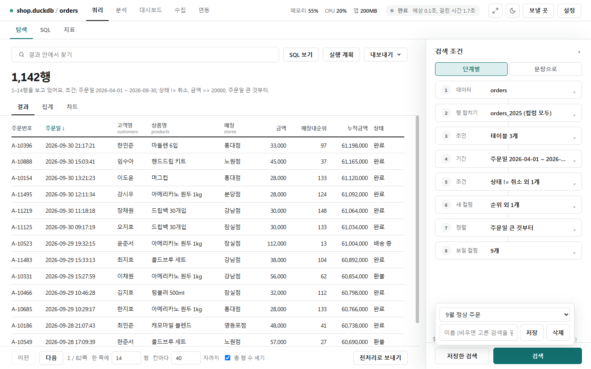

# 결과

[← 쿼리](../query.md)

[검색 실행] 뒤 가운데에 행 수(예: **1,142행**)와 걸린 조건 요약, 결과 표가 나옵니다. 아래 [이전]·[다음]으로 쪽을 넘기고, **쪽당** 행 수와 **글자** 길이(이보다 긴 글자는 줄여 보임)를 정합니다.

## 결과 안에서 찾기

- 위쪽 **결과 안에서 찾기** 칸에 글자를 쓰면 지금 쪽에서 맞는 행만 남기고 글자를 강조합니다(`3 / 14행`).
- 표 머리글을 누르면 그 컬럼으로 정렬합니다.
- **전체 행 수 세기**를 끄면 전체 행 수와 예상 시간을 구하지 않습니다(요금이 나오는 DB에 유용). 주소로 접속한 DB는 결과를 PC에 받아 둘 수 있는지만 100만 행까지 셉니다.

## 집계

- **[집계]** 탭에서 집계할 컬럼을 고르고(고르지 않으면 전체) **[집계 계산]**을 누르면 컬럼마다 타입·개수(count)·빈 값(nulls)·고유값(unique)·최소·최대·평균이 나옵니다.
- **집계 표 저장**: 라이트·다크를 고르고 [PNG]·[JPG]로 저장하거나, [보낼 곳]을 골라 **[보내기]**합니다.

## 피벗

- **피벗** 줄에서 행 기준(매장), 열로 펼칠 컬럼(채널, 값 30개까지), 집계(합계), 값 컬럼(금액)을 고르고 **[피벗]**을 누릅니다. 펼칠 컬럼이 빈 값인 행은 칸이 따로 없어 '전체'에만 들어갑니다(그래서 칸들의 합이 '전체'보다 작을 수 있습니다).
- 조건 칸을 채우면 그 행만 셉니다(조건부 집계).
- **소계·총계 (ROLLUP)** 또는 **모든 조합 (CUBE)**를 고르면 소계 줄 `(소계)`와 총계 줄 `(전체)`가 붙습니다.
- **집계 뒤 거르기**: `전체 합계 > 100`처럼 집계한 결과로 거릅니다(HAVING). 결과는 500행까지입니다.

## 저장과 SQL 보기

- **[저장▾]** → CSV·Excel·Parquet: 지금 쪽이 아니라 조건에 맞는 **전체 행**을 파일로 받습니다.
  - Excel은 1,048,575행까지입니다. 넘으면 CSV나 Parquet을 쓰세요.
  - 16자리 이상 정수(ID 등)는 끝자리가 바뀌지 않게 글자로, 시간대가 있는 시각은 이 PC 시각으로 적습니다.
  - `=`·`+`·`-`·`@`로 시작하는 글자는 앞에 `'`를 붙여 스프레드시트가 수식으로 실행하지 않게 합니다.
  - 주소로 접속한 DB에서 100만 행이 넘을 것 같으면 복제본에서 하라고 한 번 묻습니다.
- **[SQL 보기]**: 지금 조건으로 실행되는 SQL을 표 위에 펼칩니다.
- **[실행 계획]**: 조회를 돌리지 않고(EXPLAIN) 인덱스를 타는지, 테이블 전체를 읽는지 봅니다.
- **[전처리로 보내기]**: 전체 행을 Parquet 파일로 저장하고 분석 화면의 전처리에서 엽니다(연결이 그 파일로 바뀜).

## 저장한 검색

- 패널 아래 **[저장한 검색]**을 누르고 이름(예: '9월 정상 주문')을 써서 **[저장]**합니다. 이름을 비우면 고른 검색에 덮어씁니다.
- 목록에서 고르면 저장해 둔 조건을 불러옵니다(검색은 하지 않음). 많이 불러온 순입니다.
- 화면을 오가면 넣어 둔 조건이 사라지므로, 다시 쓸 조건은 저장해 둡니다. 만들던 화면은 [임시 저장](drafts.md)으로도 이어집니다.
