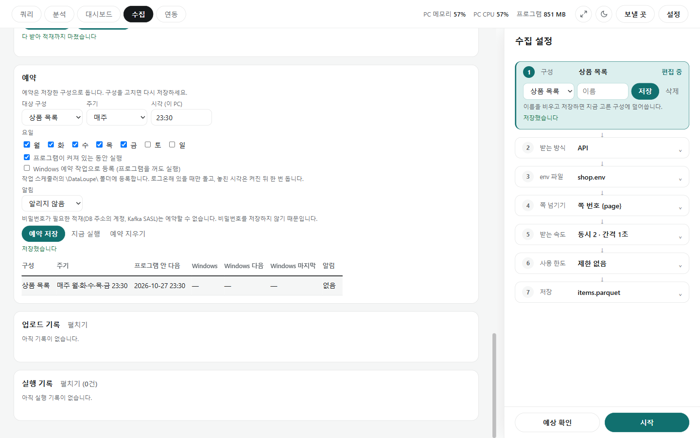

# 예약

[← 수집](../collect.md)

저장한 구성을 정한 시각에 저절로 돌립니다. 수집 화면 아래 **예약** 카드에서 정합니다.

## 예약 만들기

- **대상 구성**: 오른쪽 ① 구성에서 저장한 구성을 고릅니다. 예약은 저장한 구성으로 돌기 때문에, 구성을 고쳤으면 다시 저장합니다.
- **주기**: 매일 · 매주(요일 체크) · N분마다(5~1,440분). **시각**은 이 PC의 시각입니다.
- **실행 방식**(둘 중 하나):
  - **프로그램이 켜져 있는 동안 실행**: 프로그램이 켜져 있을 때만 돕니다.
  - **Windows 예약 작업으로 등록(프로그램을 꺼도 실행)**: 작업 스케줄러의 `\DataLoupe\` 폴더에 관리자 권한 없이 등록합니다. 로그온해 있을 때만 돌고, 놓친 시각은 켜진 뒤 한 번 돕니다. 창 없이 돕니다.
- **[예약 저장]**하면 아래 목록에 구성·주기·다음 실행 시각(프로그램 안 / Windows)·알림이 나옵니다. **[지금 실행]**은 예약처럼 한 번 돌리고(기록·알림 포함), **[예약 지우기]**로 지웁니다.

## 알림

- **알림**에서 보낼 곳을 고르면 실행이 끝났을 때 알립니다. **알릴 때**는 **실패할 때만** 또는 **늘**.
- 보낼 곳(Slack·Notion·웹훅)은 위쪽 **[보낼 곳]**에서 등록합니다([보내기](integrations_send.md)).
- 실패 알림에는 오류 원문을 그대로 넣지 않습니다. 오류 글에 데이터 값이 들어갈 수 있어 정해진 문구만 보내고, 전체 내용은 실행 기록에 남깁니다.

## 알아 둘 점

- 비밀번호가 필요한 적재(DB 주소의 계정, Kafka SASL)는 예약할 수 없습니다. 비밀번호를 저장하지 않기 때문입니다. API 키는 env 파일에서 읽으므로 예약할 수 있습니다.
- 같은 결과 파일에는 한 번에 하나만 수집합니다. 다른 창이나 예약 작업이 이미 받고 있으면 간격 예약은 건너뛰고 실행 기록에 남깁니다(알림을 '늘'로 정했으면 알림도 보냅니다). 프로그램 안의 매일·매주 예약은 이 프로그램에서 도는 수집이 끝나길 기다렸다가 돕니다(기다리는 동안 '다음 시각'은 지난 시각으로 보입니다).
- Windows 예약 작업은 한 번에 12시간까지만 돕니다. 넘으면 작업 스케줄러가 끝내고 기록에는 '프로그램이 중간에 끝나 결과를 모릅니다'가 남습니다. 매일 예약은 다음 날 이어 받지만(주소·요청에 `{today}`·`{now}`를 쓰면 날짜가 바뀌어 처음부터 받습니다), 이어 받기는 하루 안에만 되므로 매주 예약은 처음부터 다시 받습니다. 12시간보다 오래 걸리는 수집은 매일 예약으로 나눠 받거나 프로그램 안 예약을 쓰세요.
- 결과는 아래 **실행 기록**에 남습니다. 창 없이 돈 실행이 실패하면 다음에 수집 화면을 열 때 맨 위에 알리고, **[기록 보기]**·**[확인함]**을 누를 수 있습니다.
- 프로그램 경로가 바뀌어 Windows 예약 작업이 맞지 않으면 **[다시 등록]**이 나타납니다.
