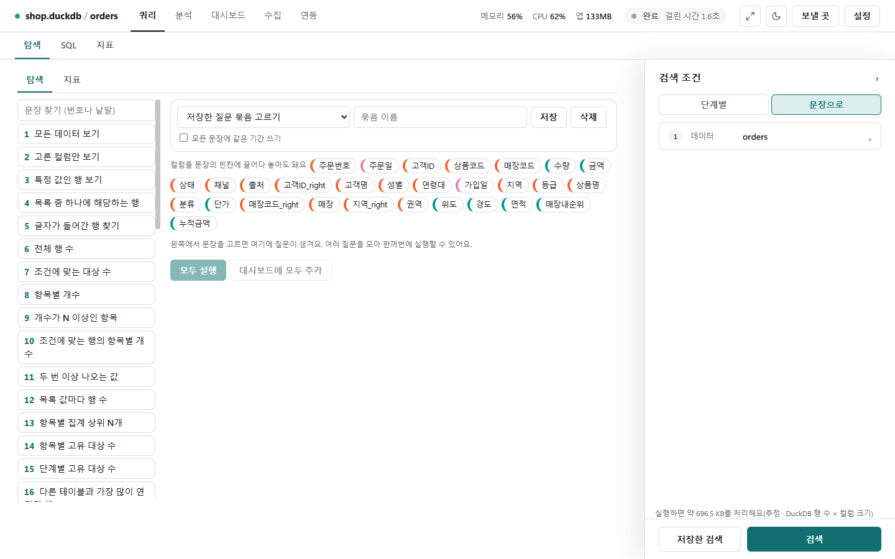
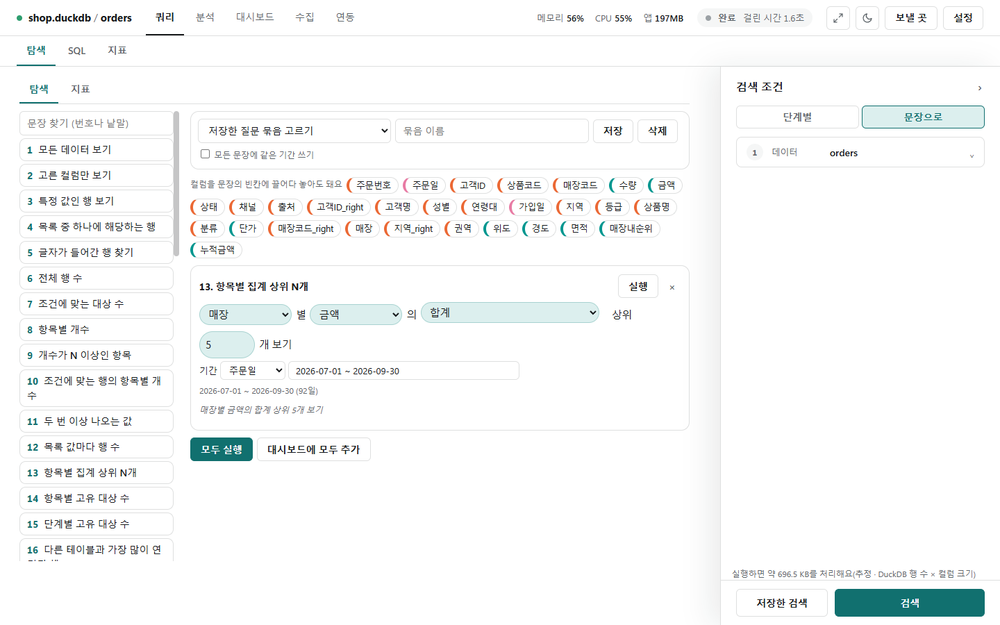
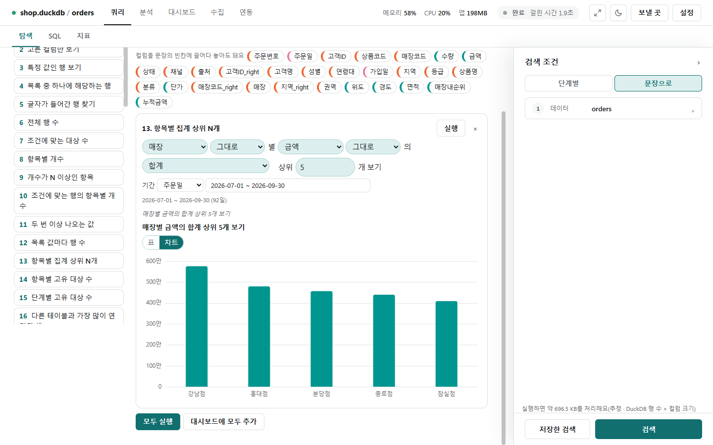
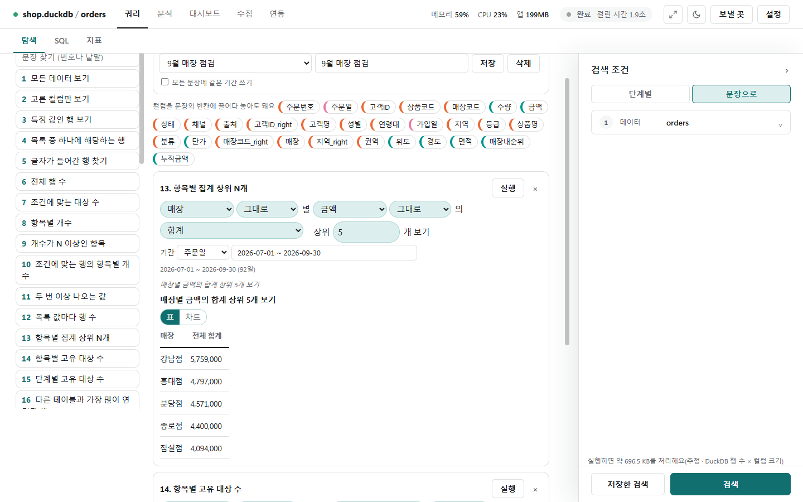

# 문장 보기

[← 쿼리](../query.md)

검색 조건 패널 위 **[문장]**을 누르면 "{무엇}별 {값}의 {집계} 상위 {N}개를 봐요"처럼 **빈칸이 있는 문장 틀**을 채워 묻습니다. SQL을 몰라도 됩니다. 문장은 서버가 정해진 규칙으로 요청으로 바꾸며, 데이터 값을 밖(LLM 등)으로 보내지 않습니다.

문장 보기 안에는 **[탐색]**(문장 틀 50개)과 **[지표]**(지표 틀 15개로 내 지표 만들기) 두 탭이 있습니다.

## 문장 틀 고르기

- 왼쪽 목록에서 문장 틀을 누르면 오른쪽에 문장 카드가 더해집니다. 위 칸에 번호·이름·글자를 써서 틀을 찾습니다.
- 가운데 위의 **컬럼 칩**은 지금 테이블의 컬럼입니다. 칩 색이 숫자·날짜·글자를 나타냅니다.
- 문장을 여러 개 더해 두고 **[모두 실행]**으로 한꺼번에 돌립니다.

## 빈칸 채우기

- 컬럼 빈칸은 **칩을 끌어다 놓거나** 빈칸을 눌러 고릅니다. 그 빈칸에 맞는 종류의 컬럼만 고를 수 있습니다.
- 집계 빈칸은 [함수 사전](sql_functions.md)의 집계에서 고르고, 단위·방향·정확도 같은 것은 누르는 단추로 고릅니다.
- 글자 컬럼에는 **가공**을 붙일 수 있습니다: `? 뒤 자르기`·`앞 N글자`·`날짜만`·`소문자로`(사진의 **가공 없음** 칸).
- **기간**: 날짜 컬럼을 고르고 `최근 7일`, `이번 달`, `2026-07-01 ~ 2026-09-30`처럼 글로 씁니다. 읽은 기간이 바로 아래(`2026-07-01 ~ 2026-09-30 (92일)`)에 보이고, 읽지 못하면 이유가 나옵니다. 어느 틀이든 기간을 붙일 수 있습니다.
- 카드 아래에 완성된 문장(`매장별 금액의 합계 상위 5개를 봐요`)이 기울임 글씨로 보입니다. 빈칸이 잘못되면 그 칸이 표시되고 이유가 나오며, 막힌 문장은 **[실행]**이 꺼집니다.
- 상위 N은 50개까지 보여 줍니다.

## 실행과 결과

- **[실행]**을 누르면 결과 문장과 표가 나옵니다. **[표 | 차트]**로 바꿔 봅니다(라벨이 날짜처럼 보이면 선, 아니면 막대, 앞 50개).
- 행을 보는 문장은 처음 1,000행, 묶어 집계하는 문장은 500행까지 보이고, 더 있으면 기간·조건을 좁히라고 알려 줍니다.
- 문장은 지금 단계 카드의 기준 테이블·조인·조건 위에서 계산합니다.

## 질문 묶음

- 문장 여러 개를 모아 위쪽에 이름(예: '9월 매장 점검')을 쓰고 **[저장]**합니다. **저장한 질문 묶음**에서 골라 다시 열고, **[삭제]**로 지웁니다.
- **묶음의 모든 문장이 같은 기간을 써요**를 켜면 기간 한 줄을 묶음 전체가 씁니다(끄면 문장마다 따로).
- 다른 테이블에서 묶음을 열면 같은 이름의 컬럼만 채우고, 없는 컬럼의 칸은 비운 뒤 어느 칸을 비웠는지 알려 줍니다.
- **[모두 실행]**은 실행할 수 있는 문장을 모두 돌립니다.

### 대시보드에 모두 추가

**[대시보드에 모두 추가]**는 어느 대시보드에 넣을지 한 번만 묻고, **묶어 집계하는 문장 하나**를 차트 카드 하나로 넣습니다. 넣지 못한 문장은 "빼놓음: 틀 이름 — 이유"로 알려 줍니다.

| 넣지 않는 문장 | 이유 |
|---|---|
| 행을 보는 문장(1~5번 등) | 묶어 집계하는 문장만 차트 카드가 됩니다 |
| 여러 계산을 합쳐 구하는 문장(비율·지표 A ÷ B 등) | 카드 하나로 바로 넣을 수 없습니다 |
| 묶음을 거르는 문장: 조건(where), 집계 뒤 거르기(having), 상위 N(top) | 차트 카드에는 이 설정을 담을 칸이 없습니다 |
| 소계·총계를 붙이는 문장(subtotals) | 같은 이유 |
| 빈칸이 잘못된 문장 | 검사를 통과하지 못함 |

그래서 13번 "상위 N"처럼 상위 N을 거는 문장은 표로는 보이지만 카드로는 넣지 않습니다. 넣은 뒤에는 **대시보드에서 보기** 링크가 뜹니다.

## 탐색 문장 틀 50개

빈칸은 `{이름}`으로 적었습니다. 어느 틀이든 앞에 기간을 붙일 수 있습니다.

### 행 보기

| 번호 | 이름 | 문장 |
|---|---|---|
| 1 | 모든 데이터 보기 | 모든 데이터를 봐요 |
| 2 | 컬럼들만 보기 | {컬럼들}만 봐요(중복 {중복}) |
| 3 | 컬럼=값인 행의 컬럼들 | {컬럼}이(가) {값}인 행의 {컬럼들}을 봐요 |
| 4 | 값 목록 중 하나인 행 | {컬럼}이(가) {값 목록} 중 하나인 행을 봐요 |
| 5 | 글자 포함·시작·끝 | {컬럼}이(가) {글자}하는 행을 봐요 |

### 세기

| 번호 | 이름 | 문장 |
|---|---|---|
| 6 | 행 수 | 행이 몇 개인지 세요 |
| 7 | 조건인 대상 수 | {조건}인 {대상}이(가) 몇 개인지 세요 |
| 8 | 무엇별 대상 수 | {무엇}별 {대상} 수를 세요 |
| 9 | 무엇별 수 중 N 이상 많은 순 | {무엇}별 건수가 {N} 이상인 것을 많은 순으로 봐요 |
| 10 | 조건인 행에서 무엇별 수 많은 순 | {조건}인 행에서 {무엇}별 건수를 많은 순으로 봐요 |
| 11 | 두 번 이상 나오는 값 | 두 번 이상 나오는 {컬럼} 값을 찾아요 |
| 12 | 값 목록 각각의 건수 | {컬럼}이(가) {값 목록} 각각인 행이 몇 건인지 봐요 |
| 14 | 무엇별 고유 대상 수 | {무엇}별 고유 {대상} 수를 {정확도}로 구해요 |
| 15 | 단계 값마다 고유 대상 수 | {단계}의 값마다 고유 {대상} 수를 봐요 |
| 16 | 테이블A 중 테이블B에 이어진 행이 가장 많은 것 | {테이블 A} 중 {테이블 B}에 {연결 컬럼}으로 이어진 행이 가장 많은 것을 봐요 |
| 46 | 근사 고유 개수 | {무엇}별 고유 {대상} 수를 빠르게(근사) 어림해요 (14번의 정확도를 '빠르게'로 정한 것) |

### 비율·비중

| 번호 | 이름 | 문장 |
|---|---|---|
| 17 | 전체 중 조건 비율 | 전체 중 {조건}인 비율을 구해요 |
| 18 | 무엇별 수와 전체 대비 비중 | {무엇}별 수와 전체 대비 비중을 봐요 |
| 19 | 무엇별 조건을 한 대상 비율 | {무엇}별로 {조건}을 한 {대상}의 비율을 구해요 |
| 20 | 무엇별 대상 1명당 평균 | {무엇}별 {대상} 1명당 평균 {값}을 구해요 |
| 21 | 지표 A ÷ 지표 B | {지표 A} ÷ {지표 B}를 구해요 |
| 37 | 묶음 안 비율 | {무엇} 안에서 {나눌 것}별 {값}이 차지하는 비율을 봐요 |

### 기간 단위로 보기

| 번호 | 이름 | 문장 |
|---|---|---|
| 22 | 기간 동안 단위마다 고유 대상 수 | {날짜}의 {단위}마다 고유 {대상} 수를 봐요 |
| 23 | 단위마다 대상 수와 대상당 평균 | {날짜}의 {단위}마다 {대상} 수와 {대상}당 평균 {값}을 봐요 |

### 묶어서 집계하기

| 번호 | 이름 | 문장 |
|---|---|---|
| 13 | 무엇별 값 집계 상위 N | {무엇}별 {값}의 {집계} 상위 {N}개를 봐요 |
| 24 | 대상마다 처음 컬럼 값 기준 | {대상}마다 {정렬 기준} 순으로 처음 나온 {컬럼} 값을 기준으로 {집계}를 봐요 |
| 25 | 목록 컬럼을 펼쳐 무엇별 집계 상위 N | {목록 컬럼}을 펼쳐 {무엇}별 {집계} 상위 {N}개를 봐요 |
| 26 | 중앙값·분위수 | {무엇}별 {값}의 {종류}를 구해요 (중앙값·P50·P90·P95·P99·분위수 N) |
| 27 | 퍼짐 | {무엇}별 {값}의 {종류}를 구해요 (표준편차·분산·범위, 표본·모집단) |
| 28 | 최빈값 | {무엇}별로 가장 많이 나온 {컬럼} 값을 찾아요 |
| 29 | 대표 값 | {무엇}마다 {컬럼} 값을 하나로 정해요: {대표 값 고르기} |
| 30 | 이어 붙이기 | {무엇}별 {컬럼} 값을 {구분자}로 이어 붙여요({정렬 기준} 순, 중복 {중복}) |
| 31 | 목록 모으기 | {무엇}별 {컬럼} 값을 목록으로 모아요 |
| 32 | 참거짓 집계 | {무엇}별로 {조건}이 {범위} 맞는지 봐요 (모두·하나라도) |
| 39 | 소계·총계 | {무엇}·{나눌 것}별 {값}의 {집계}와 {방식}을 봐요 (소계·총계, 모든 조합, 고른 조합) |
| 45 | 함께 움직임 | {값 A}와 {값 B}가 함께 움직이는 정도를 {종류}으로 구해요 (상관계수·공분산) |

### 행마다 순위·변화

| 번호 | 이름 | 문장 |
|---|---|---|
| 33 | 첫·마지막 행 | {무엇}마다 {정렬 기준}이 {방향} 행을 봐요 (가장 이른·가장 늦은) |
| 34 | 순위 안 | {무엇}마다 {값} 순위가 {N}위 안인 행을 봐요 |
| 35 | 이전 대비 | {무엇}마다 {정렬 기준} 순으로 {값}이 이전 행보다 얼마나 변했는지({보기}) 봐요 (차이·변화율·이전 값·다음 값) |
| 36 | 누적·이동 | {정렬 기준} 순으로 {값}의 {종류}을 봐요 (누적·이동 합·평균·최소·최대) |
| 38 | 백분위 | {값}이 상위 몇 %인지 행마다 {방식}으로 봐요 (백분위 순위·누적 분포·N등분) |

### 새 컬럼 만들기

| 번호 | 이름 | 문장 |
|---|---|---|
| 40 | 새 컬럼(가공) | {새 이름}은 {컬럼}을 {가공}한 값이에요 (행마다 계산하는 함수 전부) |
| 41 | 조건 분류 | {조건1}이면 {값1}, {조건2}이면 {값2}, 아니면 {값3}으로 {새 이름}을 만들어요 |
| 42 | 날짜 차이 | {날짜 A}와 {날짜 B} 사이가 {단위}로 얼마인지 봐요 |
| 43 | JSON 꺼내기 | {JSON 컬럼}에서 {경로} 값을 꺼내 봐요 |
| 44 | 형 변환 | {컬럼}을 {바꿀 형}로 바꿔요(안 되는 값은 빈 값으로) |
| 47 | SQL 식 직접 | {새 이름}은 SQL 식 {식}의 값이에요 |

### 좌표

| 번호 | 이름 | 문장 |
|---|---|---|
| 48 | 영역별 값 | {영역}별 {값}의 {집계}를 봐요 |
| 49 | 기준점 반경 안 | {위도}·{경도}로 기준점 {기준 위도}, {기준 경도}에서 {반경}km 안의 {값}의 {집계}를 봐요 |
| 50 | 격자별 값 | {위도}·{경도}를 {칸 크기}도 칸으로 나눈 격자별 {값}의 {집계}를 봐요 |

좌표 틀의 쓰임은 [좌표](geo.md)에 있습니다.

## 지표 틀 15개

문장 보기의 **[지표]** 탭에서는 지표 틀로 **내 지표**를 만듭니다. 이름·단위·좋고 나쁨(클수록 좋음 등)을 정하고 빈칸을 채워 **[만들기]**합니다. 내 지표 목록·복사·지표 사전은 [지표](metrics.md)와 [지표 사전](metrics_catalog.md)에 있습니다.

| 번호 | 이름 | 문장 |
|---|---|---|
| 1 | 행 수 | 행 수 |
| 2 | 고유 대상 수 | 고유 {대상} 수 |
| 3 | 값의 집계 | {값}의 {집계} |
| 4 | 처음 값 기준 대상 수 | 처음({정렬 기준} 순) {컬럼} 값이 {값}인 {대상} 수 |
| 5 | A÷B | {지표 A} ÷ {지표 B} |
| 6 | A가 B에서 차지하는 % | {지표 A}가 {지표 B}에서 차지하는 % |
| 7 | A−B | {지표 A} − {지표 B} |
| 8 | A+B | {지표 A} + {지표 B} |
| 9 | 대상 하나당 | {값} 전체 합 ÷ {대상} 수 |
| 10 | 대상마다 구한 값의 평균 | {대상}마다 구한 {값}의 {집계}의 평균 |
| 11 | N번 이상 한 대상 비율 | {조건}을 {N}번 이상 한 {대상}의 비율 |
| 12 | 단계 A 중 단계 B까지 간 비율 | {단계 A}를 한 {대상} 중 {단계 B}까지 간 비율 |
| 13 | 단위마다 구한 지표의 평균 | {단위}마다 구한 {지표}의 평균 |
| 14 | 직전 같은 기간 대비 변화율 | {지표}의 직전 같은 기간 대비 변화율 |
| 15 | 누적 | {지표}의 누적({정렬 기준} 순) |

5~8번과 13~15번은 다른 내 지표를 빈칸에 넣어 만드는 조합 지표입니다.
