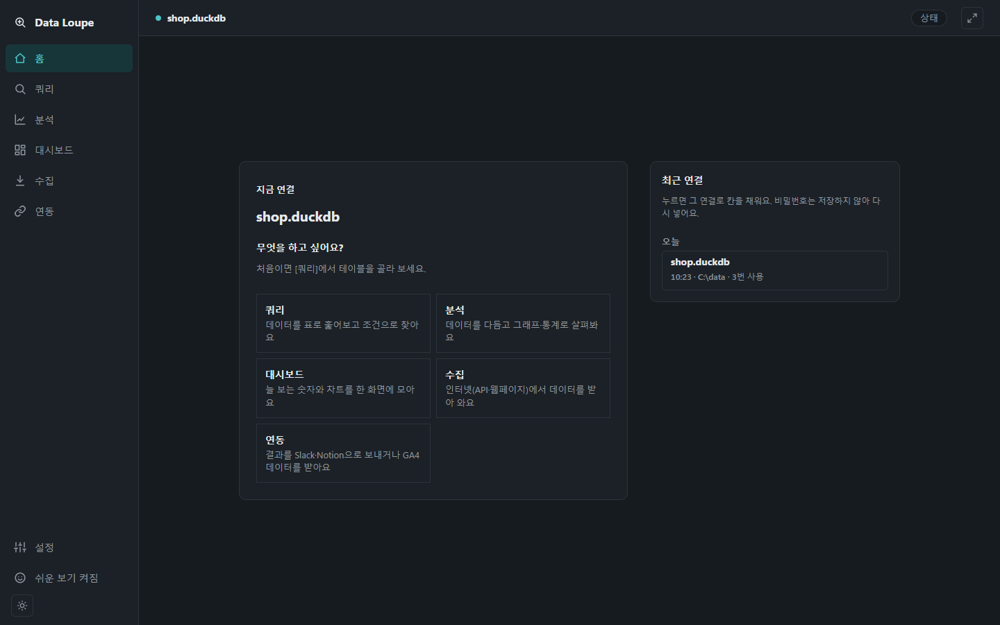
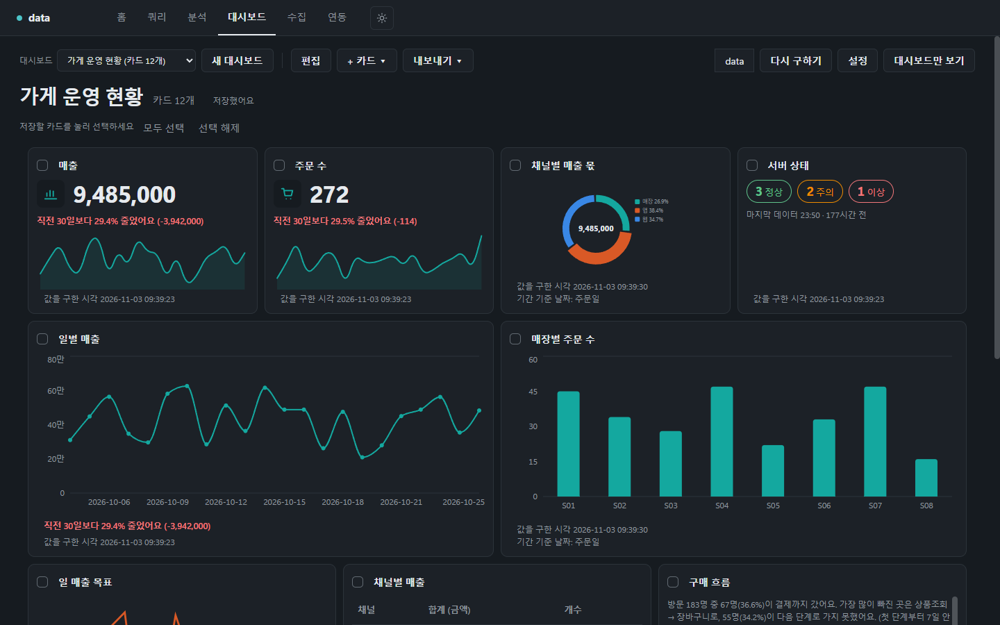
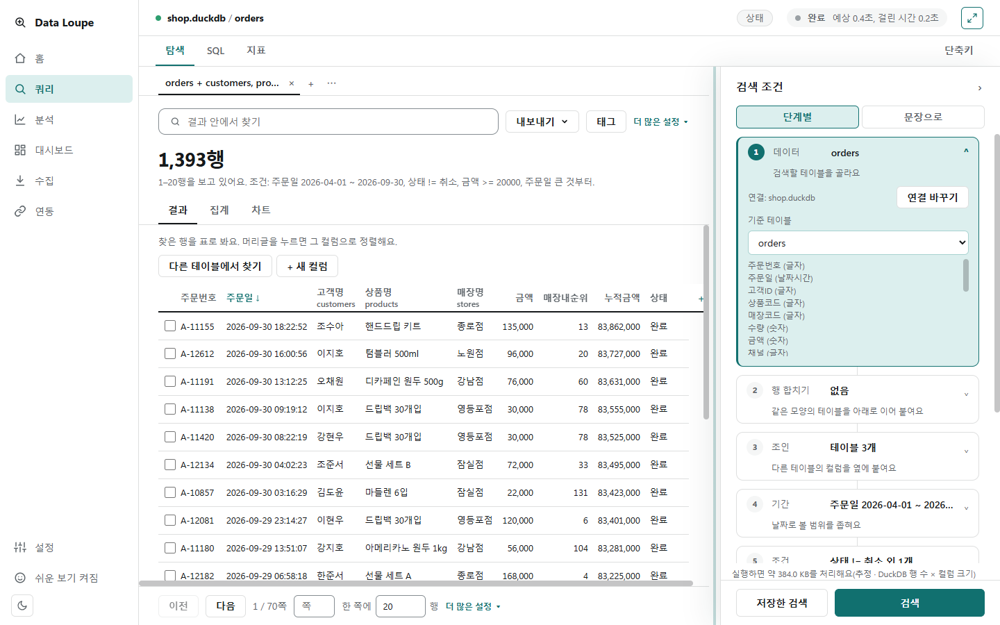

# 설정과 참고

[← README](../../README.md)

모든 화면에 공통인 것을 모았습니다: 작업 진행과 취소, 화면 설정(어두운 화면·쉬운 보기·크기 조절), 설정 창(쓸 기능·업데이트·계산·메모리·표본·날짜·달력·차트 낱말·보낼 곳), 안전, 프로그램이 기억하는 것, DB별 드라이버.

화면 왼쪽에는 메뉴([홈]·[쿼리]·[분석]·[대시보드]·[수집]·[연동], 그 아래 [설정]·[쉬운 보기]·화면 모드 단추)가 있고, 위쪽 줄에는 왼쪽부터 지금 연결 이름, [상태], 작업 진행, 새 버전 알림, 크기 조절 단추가 있습니다.

## 진행 상황과 취소

![SQL 실행 중: 위쪽 줄에 'SQL 실행 중 · 걸린 시간 3.1초'와 [취소] 단추](../photo/settings-progress.png)

- 위쪽 줄의 **[상태]** 알약을 누르면 `메모리 56%`, `CPU 36%`(PC 전체), `앱 835MB`(이 앱이 쓰는 메모리)가 펼쳐집니다(평소에는 접혀 있고, 펼침은 기억하며, 펼쳐 둔 동안 5초마다 갱신). 지금 도는 작업은 늘 보입니다.
- 작업이 도는 동안 **[취소]**를 누르면 멈춥니다. 30분이 넘는 작업은 저절로 멈춥니다.
- 파일 연결에서 [취소] 직후 새 작업을 시작하면, 취소한 작업이 끝나기를 최대 2초 기다립니다. 그래도 안 끝났으면 "취소한 이전 작업이 아직 끝나지 않았어요. 잠시 뒤에 다시 하세요."라고 알립니다.

![[취소]를 누른 뒤: 아래에 '취소했어요.', 위쪽 줄에 '완료 · 걸린 시간 3.3초'](../photo/settings-cancelled.png)

- 끝나면 위쪽 줄이 `완료 예상 0.1초, 걸린 시간 1.6초`처럼 바뀝니다. **예상**은 "행 수 × 지난번 비슷한 크기에서 한 행에 걸린 시간"으로 어림하고, 처음에는 없습니다.
- 너무 오래 걸리면 [취소] 후 기간·조건을 좁히세요. PC 메모리가 90% 가까이 오르면 왼쪽 메뉴 [설정] 창 [계산] 분류의 **메모리 한도**(DuckDB 파일과 받아 둔 결과)를, PC가 무거우면 **계산에 쓸 CPU 코어**를 줄이세요. 이미 붙잡고 있는 데이터는 [메모리] 분류에서 비웁니다([메모리 비우기](#메모리-비우기)). 파일 연결은 계산할 때 읽는 양의 약 3배 메모리를 쓴다고 보고 한도와 견줍니다.
- 받아 둔 큰 결과는 조회가 끝날 때마다 메모리에서 비우므로, 큰 결과를 여러 테이블에서 번갈아 봐도 메모리가 쌓이지 않습니다.
- DB 서버에 연결하면 계산은 DB 서버가 해서 PC 숫자는 거의 움직이지 않습니다.

## 화면 설정

- 왼쪽 메뉴 아래쪽의 **달·해 단추**로 밝은/어두운 화면을 바꿉니다. 처음에는 Windows 설정을 따릅니다.
- 그 위의 **[쉬운 보기]** 단추(처음에는 **쉬운 보기 켜짐**)는 처음 쓰는 사람에게 필요 없는 칸을 **[더 많은 설정 ▾]** 뒤에 접습니다. 접힌 칸은 [더 많은 설정 ▾]을 눌러 펴고 **[접기 ▴]**로 다시 접습니다. 직접 펼친 묶음과 값을 넣어 둔 칸은 다음에도 펼쳐 둡니다. 단추를 한 번 더 눌러 **쉬운 보기 꺼짐**으로 두면 모든 칸이 늘 보입니다.
- 쉬운 보기 단추를 누르면 무엇이 바뀌었는지 아래에 약 4초 알림이 뜹니다: 켜면 "쉬운 보기를 켰어요. 이 화면에서 설정 N개를 [더 많은 설정] 뒤로 접고 설명 N줄을 보여요."(접을 칸이 없는 화면에서는 "이 화면에는 접을 설정이 없어요."), 끄면 "쉬운 보기를 껐어요. 모든 설정을 펼쳐 보여요."
- 이 문서들의 단추·칸 가운데 화면에 안 보이는 것이 있으면 [더 많은 설정 ▾]을 누르거나 쉬운 보기를 끄세요. 예를 들어 쿼리 화면의 ② 행 합치기·③ 조인·⑥ 새 컬럼·⑧ 보일 컬럼 단계와 [SQL 보기]·[실행 계획]·[전처리로 보내기]·[태그]가 접히는 칸입니다.

- 대시보드·차트도 화면 모드의 색으로 그립니다. 그림으로 저장할 때는 [그림으로 저장] 옆에서 밝게/어둡게를 따로 고릅니다.

- 위쪽 줄 오른쪽 끝의 **화살표 두 개 단추**(크기 조절)를 켜면 패널 너비·표·차트 높이의 경계를 끌어 바꿉니다. 경계를 더블클릭하면 기본 크기로 돌아갑니다. 다시 눌러 끕니다. 바꾼 크기는 기억합니다.
- 창이 좁아지면 배치가 바로 맞춰집니다.

## 기능 선택과 업데이트

![[설정] 창: 왼쪽 분류 목록과 오른쪽 쓸 기능(쿼리·분석·대시보드·수집·연동) 체크, [적용]](../photo/settings-features.png)

- 왼쪽 메뉴 아래쪽 **[설정]**을 누르면 설정 창이 뜹니다. 창 왼쪽에 분류 목록, 오른쪽에 고른 분류의 내용이 넓게 보입니다. 오른쪽 위 **[닫기]**나 창 밖을 눌러 닫습니다. 모든 화면에서 열 수 있습니다.

| 분류 | 하는 일 |
|---|---|
| 쓸 기능 | 쓸 화면(쿼리·분석·대시보드·수집·연동)을 고릅니다. 고르지 않은 화면은 왼쪽 메뉴에서 숨습니다 |
| 업데이트 | 지금 버전을 보고, 앱을 열 때 새 버전을 확인할지 정합니다 |
| 계산 | 메모리 한도·CPU 코어, 큰 데이터를 다루는 방법([앱 설정](#앱-설정)) |
| 메모리 | 앱이 붙잡고 있는 데이터를 골라 비웁니다([메모리 비우기](#메모리-비우기)) |
| 표본 | 큰 데이터에서 일부만 뽑을 때의 기준([앱 설정](#앱-설정)) |
| 날짜·달력 | 시간대·주의 시작 요일·주말 같은 날짜 기준([날짜·시간대 설정](#날짜시간대-설정)) |
| 차트 낱말 | 차트의 의미 색에 쓰는 낱말과 자동 규칙 기본값([차트 낱말](#차트-낱말과-자동-규칙-기본값)) |
| 보낼 곳 | 결과와 "작업이 끝났어요" 알림을 받을 Slack·Notion·웹훅, Slack 봇([보내기](integrations_send.md)·[Slack 봇](integrations_bot.md)) |

- **쓸 기능**: 쓸 화면을 체크하고 **[적용]**을 누르면 같은 버전의 설치 프로그램을 받아 다시 설치하고, 앱이 닫혔다가 다시 열립니다. 설정과 대시보드는 그대로 남습니다. 설치하지 않은 기능의 화면에는 "이 기능은 설치하지 않았어요. [설정]에서 추가할 수 있어요."가 뜹니다.
- 받은 설치 프로그램은 지문(SHA-256)을 확인한 뒤 실행하고, 다르면 지웁니다. 수집이 도는 중이거나 디스크 공간이 모자라면 시작하지 않습니다.
- **업데이트**: **지금 버전**이 보입니다. **앱을 열 때 새 버전이 있는지 확인하기**는 기본으로 켜져 있어, 앱을 열 때 GitHub Releases에 최신 버전을 묻습니다(데이터는 보내지 않음). 끄면 묻지 않습니다.
- 새 버전이 있으면 위쪽 줄에 "v… 새 버전이 나왔어요"와 **[업데이트]**가 뜹니다. 누르면 **업데이트 창**이 열려 제목에 새 버전("v…에서 바뀐 점")과 지금 버전을 보이고, 바뀐 점을 **묶음 머리(추가·개선·삭제) 아래 목록**으로 보여 줍니다(항목 이름은 굵게, 바뀐 것이 없는 묶음은 빠짐). **[지금 업데이트]**는 지금 고른 기능·설정·대시보드 그대로 새 버전을 설치하고(설치 파일의 지문을 확인한 뒤 따로 묻지 않고 설치, 앱이 잠시 닫혔다가 다시 열림), **[나중에]**는 창만 닫습니다.

## 안전하게 쓰기

| 걱정 | 프로그램이 하는 일 |
|---|---|
| 실수로 데이터를 망가뜨리면? | SQL 검사가 데이터를 바꾸는 문장, 파일·네트워크 읽기, 테이블 잠금을 막습니다. 이것은 실수를 막는 장치이지 보안 경계가 아니니, 회사 DB에는 **읽기 전용 계정**을 쓰세요. DB에 쓰는 일은 분석의 "새 테이블 만들기"와 수집의 적재뿐입니다 |
| 비밀번호가 새면? | DB·Kafka 비밀번호는 메모리에만 두고 파일에 저장하지 않으며, 오류 문구에서도 가립니다 |
| 요금 폭탄 | 실행 전에 처리 용량을 보여 주고, 결과는 한 번만 조회합니다. 쪽 넘기기는 받아 둔 결과에서 읽습니다. BigQuery는 검색뿐 아니라 차트·피벗·값 목록·집계·지표·대시보드 카드 갱신도 읽는 양(dry run)을 확인한 뒤 실행합니다 |
| 엑셀 파일의 악성 수식 | CSV·TSV·고정폭 텍스트로 저장할 때 `=`, `+`, `-`, `@`로 시작하는 글자 값 앞에 `'`를 붙여 수식으로 실행되지 않게 합니다. Excel(.xlsx)은 글자를 수식으로 저장하지 않고, Parquet은 값을 그대로 둡니다 |
| 몰래 밖으로 보내지 않나? | LLM에는 데이터 값을 보내지 않습니다. 밖과는 사용자가 정한 곳하고만 통신합니다. 수집은 사용자가 넣은 API·웹·파일 주소(웹페이지는 그 사이트의 robots.txt도)로 요청하고, 원격 DB·Kafka 접속은 검색 조건의 값과 새 테이블·적재할 데이터를 그 서버로 보냅니다. 보낼 곳·Slack 봇은 알림과 집계 표·차트·검색 결과 같은 값을 사용자가 등록한 Slack·Notion·웹훅으로 보냅니다. GA4·LLM은 설정하고 쓸 때만 통신합니다. 그 밖의 통신은 업데이트 확인·설치 파일 받기(GitHub)와, 지도 배경을 켰을 때의 지도 조각(tile.openstreetmap.org)뿐입니다 |
| 보낸 기록 | 보낼 곳·Slack·GA4·Notion·LLM으로 보낸 요청은 `%APPDATA%\DataLoupe\egress_log.jsonl`에 시각·방식·호스트·경로만 남습니다(보낸 값·키는 없음). 1MB를 넘으면 오래된 절반을 지웁니다 |
| 키를 엉뚱한 곳에 보내면? | 보낼 곳·Slack·GA4·Notion·LLM은 다른 주소로 넘겨주는 응답(3xx)을 따라가지 않습니다 |
| 남이 준 DuckDB 파일 | 뷰·매크로가 든 DuckDB 파일은 PC의 다른 파일·네트워크를 읽지 못하게 잠그고 엽니다 |
| DB 서버가 PC 파일을 읽어 가면? | MySQL·SingleStore 연결은 `LOAD DATA LOCAL INFILE`을 끕니다 |
| 이상하게 큰 설정 파일 | 목표 파일·데이터 명세서는 5MB까지만 읽습니다 |
| LLM이 이상한 SQL을 만들면? | 자동으로 실행하지 않고, 같은 검사를 거친 뒤 사람이 [실행]합니다 |
| 임시 파일 | `%TEMP%\DataLoupe\` 아래에 만들고 다 쓰면 지웁니다 |
| 다른 프로그램의 접속 | 실행할 때마다 새 열쇠를 만들어 이 프로그램 창의 요청만 받습니다 |

## 날짜·시간대 설정

지표의 날·주·월 경계와 차트의 날짜 묶기는 왼쪽 메뉴 [설정] 창 **[날짜·달력]** 분류의 세 칸(시간대·주의 시작 요일·연도 시작 일자)을 따릅니다. 바꾸면 바로 저장되고(`settings.json`의 아래 키), 시간대를 비우면 기본값으로 돌아갑니다.

| 키 | 뜻 | 기본 |
|---|---|---|
| `timezone` | 날·주·월을 자르는 시간대. IANA 이름(`"Asia/Seoul"`)이나 고정 오프셋(`"+09:00"`) | 이 PC의 시간대 |
| `week_start` | 주의 시작 요일. `"mon"` 또는 `"sun"` | `"mon"` |
| `fiscal_start_month` | 연도 시작 일자(그 달 1일)의 달, 1~12 | 1 |

- 시간대가 있는 시각만 `timezone`의 벽시계로 바꿔 자르고, 시간대 없는 시각은 적힌 그대로 자릅니다.
- 모르는 시간대 이름이나 범위 밖 값은 쓰지 않습니다.

같은 [날짜·달력] 분류에 식의 날짜 함수가 쓰는 기준도 있습니다([함수 사전](sql_functions.md)).

| 칸 | 뜻 |
|---|---|
| 주말 요일 | `is_weekend`·`work_hours`가 주말로 보는 요일(월~일 체크). 모두 끄면 기본값(토·일) |
| 업무시간(시) | `work_hours`가 업무시간으로 보는 시(시작 시 이상, 끝 시 미만). 하나라도 비우면 기본값(9~18시) |
| 간격 묶기 기본(분) | `time_bucket`에서 몇 분씩 묶을지 정하지 않았을 때 쓰는 분. 하루(1,440분)를 나누어떨어지는 값만 |
| EWMA 기본 N | 최근 값에 무게를 더 주는 평균(`ewma`)에서 N을 비웠을 때 쓰는 N(기본 7) |

## 앱 설정

왼쪽 메뉴 [설정] 창의 **[계산]**·**[표본]** 분류입니다. 잘 모르면 그대로 두면 됩니다. 바꾸면 바로 저장됩니다.

**[계산]**: 계산할 때 이 PC를 얼마나 쓸지와 큰 데이터를 어떻게 다룰지.

| 칸 | 뜻 |
|---|---|
| 메모리 한도 | DuckDB 파일과 PC에 받아 둔 결과를 계산할 때 쓰는 메모리 최대치(제한 없음·1GB·2GB·4GB·8GB·직접 입력(GB)). 너무 낮으면 큰 집계가 느려지거나 실패합니다. 다음 [연결]부터 |
| 계산에 쓸 CPU 코어 | DuckDB 파일과 PC에 받아 둔 결과를 계산할 때 쓰는 CPU 코어 수. 줄이면 PC가 덜 무겁고 큰 계산은 느려짐. Parquet·CSV 같은 파일 연결에는 적용되지 않습니다. 다음 [연결]부터 |
| 읽을 양을 미리 모를 때 | 처리 용량을 미리 셀 수 없을 때 그대로 실행(기본)할지, 실행하지 않을지. 용량이 메모리 한도(제한 없음이면 지금 PC의 남은 메모리)를 넘으면 어느 쪽이든 실행 전에 묻습니다 |
| 최소 표본 비율(%) | 컬럼 종류를 짐작하는 표본이 기대한 행의 이만큼도 못 가져오면 다른 방법(최신 파티션, 앞쪽 행)으로 넘어감. 5~90, 비우면 20 |
| PC에서 구할 통계의 최대 행 수 | 연결이 중앙값·사분위수를 직접 구하지 못할 때 그 컬럼을 이 PC로 받아 구하는 최대 행 수. 넘으면 구하지 않고 알립니다. 1,000~50,000,000, 비우면 1,000,000 |
| 워드클라우드 단어 분석 최대 행 수 | 워드클라우드 카드가 글 속 단어를 셀 때 이 PC로 받는 최대 행 수. 넘으면 세지 않고 알립니다. 1,000~2,000,000, 비우면 100,000 |
| ID·해시 컬럼을 묶기·집계 목록에서 빼기 | 주문번호·회원번호처럼 줄마다 다른 값은 묶기·집계 고르는 목록에서 뺍니다(기본 켜짐, [기억되는 것](#기억되는-것)의 `hash_exclude`) |
| 문자 검색에서 특수문자 무시 | `like`·`not like` 조건과 값 목록 찾기에서 글자·숫자·공백이 아닌 글자를 지우고 비교합니다(기본 꺼짐, `ignore_marks`) |

**[표본]**: 데이터가 클 때 일부(표본)만 뽑아 빨리 살펴보는 기준. 분석 화면의 통계·추천·분석이 씁니다. 칸을 비우면 기본값입니다.

| 칸 | 뜻(범위, 기본값) |
|---|---|
| 신뢰수준 % | 표본 결과를 얼마나 믿을지. 높을수록 더 많이 뽑습니다(50~99.99, 기본 95) |
| 비율 허용 오차 %p | 빈 값 비율 같은 비율을 표본으로 구할 때 받아들일 오차(0.1~20, 기본 1) |
| 평균 허용 오차 % | 평균을 표본으로 구할 때 받아들일 상대 오차(0.5~50, 기본 5) |
| 파일럿 행 수 | 표본 크기와 층을 정하려고 먼저 뽑는 작은 표본의 행 수(1,000~100,000, 기본 5,000) |
| 층 수 | 비슷한 것끼리 몇 무리(층)로 나눠 고르게 뽑을지(2~20, 기본 5) |
| 층 최소 행 수 | 층마다 적어도 뽑을 행 수(2~1,000, 기본 30) |
| 키 해시 칸 수 | 고객 같은 키를 통째로 뽑을 때 키를 나눠 담는 칸 수(100~1,000,000, 기본 10,000) |
| 키 표본 상한(표본 행 수의 배) | 키 단위 표본이 목표 표본 행 수의 몇 배까지 받을지(1~20, 기본 3) |
| BigQuery 파일럿 | BigQuery에서 파일럿을 뽑을 때 먼저 해 볼 방법(무과금 미리보기 먼저·블록 표본 먼저). 본 표본은 늘 무과금 미리보기를 먼저 합니다 |

## 메모리 비우기

왼쪽 메뉴 [설정] 창의 **[메모리]** 분류에서, 앱이 붙잡고 있는 데이터를 골라서 놓습니다. 놓은 것은 다음에 쓸 때 다시 읽습니다. 원본 파일과 DB는 바뀌지 않습니다.

1. 맨 위 **지금 앱이 쓰는 메모리**에서 지금 쓰는 양(MB)을 봅니다.
2. 아래 목록에서 비울 것을 체크합니다. 지금 붙잡고 있는 것만 줄마다 크기 같은 설명과 함께 나오고, 없으면 "지금 붙잡고 있는 데이터가 없어요."가 보입니다. **[모두 고르기]**는 전부 체크합니다.
3. **[고른 것 비우기]**를 누르면 "비웠어요. 앱 메모리 …MB → …MB"로 줄어든 양을 알려 줍니다.

| 고를 수 있는 것 | 비우면 |
|---|---|
| 지금 연결 | 연 파일·접속을 놓습니다. 화면이 연결 전 상태로 돌아가고, 다시 쓰려면 다시 연결합니다 |
| DB에서 받아 둔 결과 | 주소로 접속한 DB에서 이 PC로 받아 둔 결과를 놓습니다 |
| 분석 화면의 표본 | 다음에 통계를 구할 때 표본을 다시 읽습니다 |
| 태그 표 | 다음에 태그를 쓸 때 파일에서 다시 읽습니다 |
| 단어 분석기 | 워드클라우드가 쓰는 단어 분석기. 다음에 쓸 때 다시 만듭니다 |

- 목록 아래의 **올라온 계산 라이브러리**(이름만 보임)는 앱이 켜져 있는 동안 내릴 수 없습니다. 앱을 껐다 켜면 내려갑니다.

## 차트 낱말과 자동 규칙 기본값

왼쪽 메뉴 [설정] 창 **[차트 낱말]** 분류의 두 묶음입니다. 설정 폴더의 `viz.json`에 저장되고 쿼리·분석·대시보드가 같이 씁니다.

- **차트 낱말**: 긍정·부정·기타·결측 네 목록입니다. 낱말을 더하고, 눌러 고치고, ×로 지웁니다. 긍정·부정은 이름에 낱말이 **들어 있으면**, 기타·결측은 **이름 전체가 같으면**(대소문자 구분) 맞는 것으로 봅니다. 긍정·부정은 차트의 의미 색(초록·빨강)에, 기타·결측은 맨 뒤로 보내기와 회색에 씁니다. 목록 하나는 200개, 낱말은 50자까지이고 앞뒤 공백·빈 낱말·겹침은 받지 않습니다. 틀리면 그 칸에 이유가 나옵니다. 파일이 없으면 기본 낱말을 씁니다.
- **차트 자동 규칙 기본값**: 쿼리·분석 화면의 [자동 규칙]에서 끈 것과 같은 값입니다. 여기서 끄면 다음에 여는 쿼리·분석 화면의 기본값이 됩니다(대시보드 카드는 카드마다 따로 저장).

## 기억되는 것

- 설정은 `%APPDATA%\DataLoupe\` 폴더에 있습니다(파일 탐색기 주소창에 그대로 넣으면 열림).
- 저장한 검색·SQL·전처리 설정, 대시보드(암호화), 내 지표, 수집 구성·예약, 보낼 곳, 업로드 기록, 화면 설정, 임시 저장([drafts.md](drafts.md)) 등이 들어 있고 **비밀번호는 없습니다**.
- **`hash_exclude`**(왼쪽 메뉴 [설정] 창 [계산] 분류의 **ID·해시 컬럼을 묶기·집계 목록에서 빼기**, 기본 `on`): 해시·UUID 모양의 컬럼을 쿼리·분석의 그룹·집계 목록에서 뺍니다. `off`면 빼지 않습니다. 빠진 컬럼은 목록 아래 **[다시 넣기]**로 되살립니다([전처리](prep.md)).
- **`ignore_marks`**(왼쪽 메뉴 [설정] 창 [계산] 분류의 **문자 검색에서 특수문자 무시**, 기본 `off`): 켜면 `like`·`not like` 조건과 값 목록 찾기에서 글자·숫자·공백이 아닌 글자를 양쪽에서 지우고 비교합니다(`ab`로 `a-b`를 찾음). 컬럼에 함수를 씌워 인덱스를 못 타고, 정규식 바꾸기를 못 하는 연결에서는 오류로 알립니다.
- 파일을 지우면 그 내용만 처음 상태로 돌아갑니다. 덮어쓰기 전에는 `.bak`으로 하나 남깁니다.
- **PC를 바꿀 때**: 이 폴더를 통째로 복사하면 옮겨집니다. 단, 암호화해 저장한 대시보드와 토큰은 새 PC에서 풀 수 없습니다.

## DB별 드라이버

회사 DB 주소 모양입니다. 주소와 읽기 전용 계정은 보통 DB 담당자에게 받습니다. 연결 방법은 [데이터 연결](connect.md)에 있습니다.

| 묶음 | DB | 주소 예 |
|---|---|---|
| DB | PostgreSQL / MySQL | `postgres://host:5432/db` / `mysql://host:3306/db` |
| DB | SQL Server | `mssql://host:1433/db` (ODBC Driver 17/18 프로그램도 필요. 날짜를 일·월·연·시로 묶는 추이·대시보드·`truncate`는 SQL Server 2022 이상) |
| DB | Oracle / ClickHouse | `oracle://host:1521/db` / `clickhouse://host:8123/db` |
| DB | DuckDB / SQLite 파일 | `duckdb://data.duckdb` / `sqlite://data.db` |
| DB | Druid·Exasol·Materialize·RisingWave·SingleStore | 예: `druid://host:8082/druid/v2/sql`, `singlestoredb://host:3306/db` |
| DW | BigQuery | `bigquery://프로젝트/데이터셋` (처음 접속 때 Google 로그인) |
| DW | Snowflake | `snowflake://계정/데이터베이스/스키마?warehouse=WH` |
| DW | Databricks / Impala | `databricks://?server_hostname=…&http_path=…` / `impala://host:21050/db` |
| DW | Redshift | `postgres://host:5439/db` (postgres 드라이버를 씀) |
| DL | Trino / Athena | `trino://host:8080/catalog/schema` / `athena://?s3_staging_dir=s3://…&region_name=…` |
| DL | Spark·Flink | Java가 필요하고 소스로 실행할 때만 |

- **드라이버 확인**: 연결 창에서 **데이터베이스**를 고른 뒤 **[드라이버 확인]**을 누르면 DB·DW·DL별로 설치됨·설치 안 됨·프로그램 필요가 나오고, 줄마다 **[받는 곳 열기]**(PyPI 쪽을 기본 브라우저로 엶)와 **[주소 복사]**가 있습니다. 드라이버 때문에 연결이 실패해도 같은 안내가 그 자리에 뜹니다.
- 프로그램은 아무것도 자동으로 받거나 설치하지 않습니다. exe에서는 받는 곳의 패키지를 Python 3.14로 `%APPDATA%\DataLoupe\drivers` 폴더에 설치(`pip install --target`)한 뒤 프로그램을 다시 켭니다. 이 PC에 Python 3.14가 없으면 그 안내와 Python 받는 곳이 함께 뜹니다.
- 주소에 비밀번호를 쓰지 말고 아이디·비밀번호 칸에 따로 넣으세요.

### Supabase

Supabase는 PostgreSQL이라 `postgres` 드라이버(psycopg)로 접속합니다. exe에는 이미 들어 있습니다.

1. Supabase 대시보드 **Connect**에서 **Session pooler** 주소(포트 5432)를 복사합니다.
   예: `postgresql://postgres.<프로젝트ref>:[YOUR-PASSWORD]@aws-0-<리전>.pooler.supabase.com:5432/postgres`
2. 연결 창의 **데이터베이스 주소**에 그대로 붙여 넣습니다. `[YOUR-PASSWORD]` 자리는 프로그램이 빼니, **비밀번호는 비밀번호 칸**에 쓰세요(저장하지 않습니다).
3. 접속은 10초까지 기다립니다. 느리면 주소 끝에 `?connect_timeout=30`처럼 붙입니다.

| 주소 | 설명 |
|---|---|
| Session pooler (`...pooler.supabase.com:5432`) | 권장 |
| Direct (`db.<ref>.supabase.co:5432`) | 무료 플랜은 IPv6 전용이라 네트워크에 따라 안 붙을 수 있습니다 |
| Transaction pooler (`...pooler.supabase.com:6543`) | prepared statement를 끄고 접속합니다 |

**읽기 전용 계정을 권장합니다.** `postgres` 계정은 행 보안(RLS)을 무시해 모든 행이 보입니다. SQL Editor에서 읽기 전용 역할을 만들어 그 아이디(`역할.프로젝트ref`)와 비밀번호를 쓰세요.
