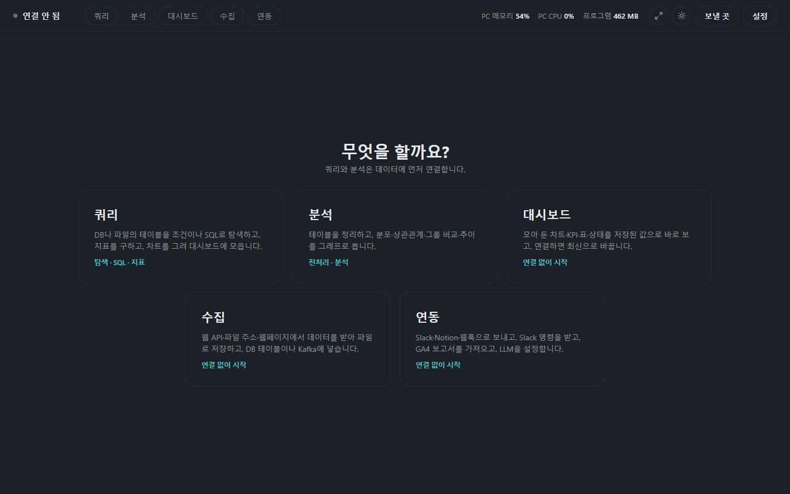
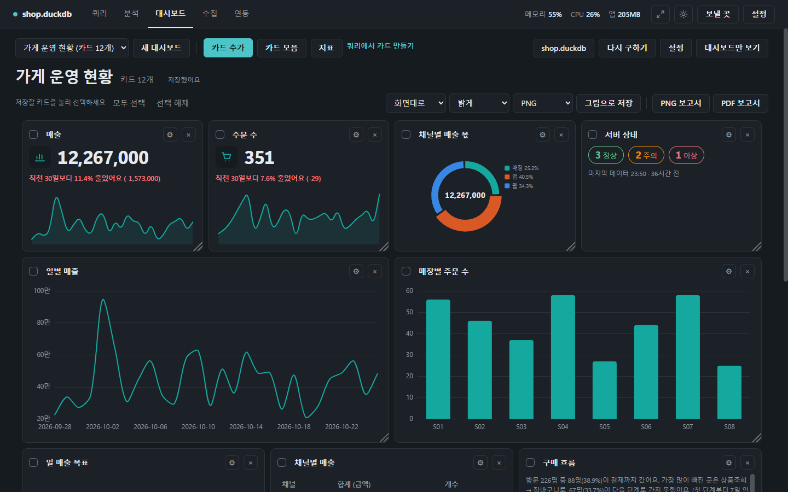
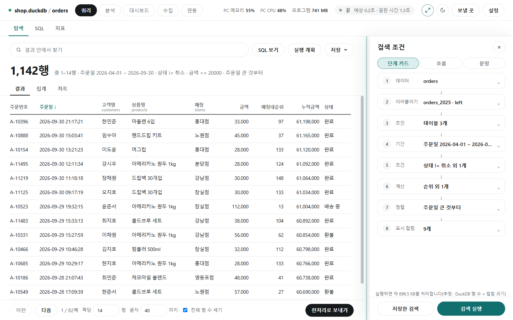

# 설정과 참고

[← README](../../README.md)

모든 화면에 공통인 것을 모았습니다: 작업 진행과 취소, 화면 설정, 기능 고르기·업데이트, 안전, 프로그램이 기억하는 것, DB별 드라이버.

## 진행 상황과 취소

![SQL 실행 중: 위쪽 줄에 'SQL 실행 중 · 걸린 시간 3.2초'와 [취소] 단추](../photo/settings-progress.png)

- 위쪽 줄 오른쪽에 `PC 메모리 56%`, `PC CPU 36%`, `프로그램 835 MB`와 지금 도는 작업이 보입니다.
- 작업이 도는 동안 **[취소]**를 누르면 멈춥니다. 30분이 넘는 작업은 저절로 멈춥니다.

![[취소]를 누른 뒤: 아래에 '취소했습니다.', 위쪽 줄에 '끝 · 걸린 시간 3.3초'](../photo/settings-cancelled.png)

- 끝나면 위쪽 줄이 `끝 · 예상 0.4초 · 걸린 시간 1.6초`처럼 바뀝니다. **예상**은 "행 수 × 지난번 비슷한 크기에서 한 행에 걸린 시간"으로 어림하고, 처음에는 없습니다.
- 너무 오래 걸리면 [취소] 후 기간·조건을 좁히세요. PC 메모리가 90% 가까이 오르면 연결 카드의 **작업 메모리 상한**(DuckDB 파일만)을, PC가 무거우면 **계산 코어 수**를 줄이세요.
- DB 서버에 연결하면 계산은 DB 서버가 해서 PC 숫자는 거의 움직이지 않습니다.

## 화면 설정

- 위쪽 줄의 **달·해 단추**로 밝은/어두운 화면을 바꿉니다. 처음에는 Windows 설정을 따릅니다.

- 대시보드·차트도 화면 모드의 색으로 그립니다. 그림으로 저장할 때는 [다운로드] 옆에서 라이트/다크를 따로 고릅니다.

- **화살표 두 개 단추**(크기 조절)를 켜면 패널 너비·표·차트 높이의 경계를 끌어 바꿉니다. 경계를 더블클릭하면 기본 크기로 돌아갑니다. 다시 눌러 끕니다. 바꾼 크기는 기억합니다.
- 창이 좁아지면 배치가 바로 맞춰집니다.

## 기능 선택과 업데이트

![[설정] 창: 쓸 기능(쿼리·분석·대시보드·수집·연동) 체크와 [적용], 새 버전 확인 체크](../photo/settings-features.png)

- 위쪽 줄 맨 오른쪽 **[설정]**을 누르면 이 창이 뜹니다. 쓸 기능을 고르고 **[적용]**을 누르면 같은 버전의 설치 프로그램을 받아 다시 설치하고, 앱이 닫혔다가 다시 열립니다. 설정과 대시보드는 그대로 남습니다.
- 받은 설치 프로그램은 지문(SHA-256)을 확인한 뒤 실행하고, 다르면 지웁니다. 수집이 도는 중이거나 디스크 공간이 모자라면 시작하지 않습니다.
- **"앱을 열 때 새 버전이 있는지 확인"**은 기본으로 켜져 있어, 앱을 열 때 GitHub Releases에 최신 버전을 묻습니다(데이터는 보내지 않음). 끄면 묻지 않습니다. 새 버전이 있으면 위쪽 줄에 **[업데이트]**가 뜨고, 누르면 바뀐 점을 보여 준 뒤 **[지금 업데이트]**로 설치합니다.

## 안전하게 쓰기

| 걱정 | 프로그램이 하는 일 |
|---|---|
| 실수로 데이터를 망가뜨리면? | SQL 검사가 데이터를 바꾸는 문장, 파일·네트워크 읽기, 테이블 잠금을 막습니다. 이것은 실수를 막는 장치이지 보안 경계가 아니니, 회사 DB에는 **읽기 전용 계정**을 쓰세요. DB에 쓰는 일은 분석의 "새 테이블 만들기"와 수집의 적재뿐입니다 |
| 비밀번호가 새면? | DB·Kafka 비밀번호는 메모리에만 두고 파일에 저장하지 않으며, 오류 문구에서도 가립니다 |
| 요금 폭탄 | 실행 전에 처리 용량을 보여 주고, 결과는 한 번만 조회합니다. 쪽 넘기기는 받아 둔 결과에서 읽습니다 |
| 엑셀 파일의 악성 수식 | CSV·Excel로 저장할 때 `=`, `+`, `-`, `@`로 시작하는 글자 값 앞에 `'`를 붙여 수식으로 실행되지 않게 합니다 |
| 몰래 밖으로 보내지 않나? | 보낼 곳·Slack 봇·GA4·LLM을 설정하고 쓸 때만 그 서비스와 통신합니다. LLM에는 데이터 값을 보내지 않습니다. 그 밖의 통신은 업데이트 확인·설치 파일 받기(GitHub)와, 지도 배경을 켰을 때의 지도 조각(tile.openstreetmap.org)뿐입니다 |
| 보낸 기록 | 보낼 곳·Slack·GA4·Notion·LLM으로 보낸 요청은 `%APPDATA%\DataLoupe\egress_log.jsonl`에 시각·방식·호스트·경로만 남습니다(보낸 값·키는 없음). 1MB를 넘으면 오래된 절반을 지웁니다 |
| 키를 엉뚱한 곳에 보내면? | 보낼 곳·Slack·GA4·Notion·LLM은 다른 주소로 넘겨주는 응답(3xx)을 따라가지 않습니다 |
| 남이 준 DuckDB 파일 | 뷰·매크로가 든 DuckDB 파일은 PC의 다른 파일·네트워크를 읽지 못하게 잠그고 엽니다 |
| DB 서버가 PC 파일을 읽어 가면? | MySQL·SingleStore 연결은 `LOAD DATA LOCAL INFILE`을 끕니다 |
| 이상하게 큰 설정 파일 | 목표 파일·데이터 명세서는 5MB까지만 읽습니다 |
| LLM이 이상한 SQL을 만들면? | 자동으로 실행하지 않고, 같은 검사를 거친 뒤 사람이 [실행]합니다 |
| 임시 파일 | `%TEMP%\DataLoupe\` 아래에 만들고 다 쓰면 지웁니다 |
| 다른 프로그램의 접속 | 실행할 때마다 새 열쇠를 만들어 이 프로그램 창의 요청만 받습니다 |

## 자세히 정하는 값

연결 카드의 **자세히**를 펼치면 있습니다.

| 칸 | 뜻 |
|---|---|
| 작업 메모리 상한 | DuckDB 파일을 조회할 때 쓰는 메모리 최대치(제한 없음·1·2·4·8GB·직접 입력). 다음 [연결]부터 |
| 계산 코어 수 | DuckDB 파일과 PC에 받아 둔 결과를 계산할 때 쓰는 CPU 코어 수. 줄이면 PC가 덜 무겁고 큰 계산은 느려짐 |
| 용량을 알 수 없을 때 | 처리 용량을 미리 셀 수 없을 때 그대로 실행(기본)할지, 실행하지 않을지. 용량이 작업 메모리 상한(없으면 지금 사용 가능한 메모리)을 넘으면 어느 쪽이든 실행 전에 묻습니다 |
| 표본 최소 비율(%) | 컬럼 추론의 표본이 기대한 행의 이만큼도 못 가져오면 다음 방법으로 넘어감. 5~90%, 비우면 20% |

## 기억되는 것

- 설정은 `%APPDATA%\DataLoupe\` 폴더에 있습니다(파일 탐색기 주소창에 그대로 넣으면 열림).
- 저장한 검색·SQL·전처리 구성, 대시보드(암호화), 내 지표, 수집 구성·예약, 보낼 곳, 업로드 기록, 화면 설정, 임시 저장([drafts.md](drafts.md)) 등이 들어 있고 **비밀번호는 없습니다**.
- 파일을 지우면 그 내용만 처음 상태로 돌아갑니다. 덮어쓰기 전에는 `.bak`으로 하나 남깁니다.
- **PC를 바꿀 때**: 이 폴더를 통째로 복사하면 옮겨집니다. 단, 암호화해 저장한 대시보드와 토큰은 새 PC에서 풀 수 없습니다.

## DB별 드라이버

회사 DB 주소 모양입니다. 주소와 읽기 전용 계정은 보통 DB 담당자에게 받습니다. 연결 방법은 [데이터 연결](connect.md)에 있습니다.

| 묶음 | DB | 주소 예 |
|---|---|---|
| DB | PostgreSQL / MySQL | `postgres://host:5432/db` / `mysql://host:3306/db` |
| DB | SQL Server | `mssql://host:1433/db` (ODBC Driver 17/18 프로그램도 필요. 날짜를 일·월·연·시로 묶는 추이·대시보드·`truncate`는 SQL Server 2022 이상) |
| DB | Oracle / ClickHouse | `oracle://host:1521/db` / `clickhouse://host:8123/db` |
| DB | DuckDB / SQLite 파일 | `duckdb://data.duckdb` / `sqlite://data.db` |
| DB | Druid·Exasol·Materialize·RisingWave·SingleStore | 예: `druid://host:8082/druid/v2/sql`, `singlestoredb://host:3306/db` |
| DW | BigQuery | `bigquery://프로젝트/데이터셋` (처음 접속 때 Google 로그인) |
| DW | Snowflake | `snowflake://계정/데이터베이스/스키마?warehouse=WH` |
| DW | Databricks / Impala | `databricks://?server_hostname=…&http_path=…` / `impala://host:21050/db` |
| DW | Redshift | `postgres://host:5439/db` (postgres 드라이버를 씀) |
| DL | Trino / Athena | `trino://host:8080/catalog/schema` / `athena://?s3_staging_dir=s3://…&region_name=…` |
| DL | Spark·Flink | Java가 필요하고 소스로 실행할 때만 |

- **드라이버 확인**: 연결 카드의 [DB 주소] 탭에서 **[드라이버 확인]**을 누르면 DB·DW·DL별로 설치됨·없음·프로그램 필요와 설치 명령(**[복사]**)이 나옵니다. 드라이버 때문에 연결이 실패해도 같은 안내가 그 자리에 뜹니다.
- 프로그램은 아무것도 자동으로 받거나 설치하지 않습니다. exe에서는 Python 3.14로 `%APPDATA%\DataLoupe\drivers`에 설치하는 명령을 [복사]해 직접 실행한 뒤 프로그램을 다시 켭니다.
- 주소에 비밀번호를 쓰지 말고 아이디·비밀번호 칸에 따로 넣으세요.

### Supabase

Supabase는 PostgreSQL이라 `postgres` 드라이버(psycopg)로 접속합니다. exe에는 이미 들어 있습니다.

1. Supabase 대시보드 **Connect**에서 **Session pooler** 주소(포트 5432)를 복사합니다.
   예: `postgresql://postgres.<프로젝트ref>:[YOUR-PASSWORD]@aws-0-<리전>.pooler.supabase.com:5432/postgres`
2. 연결 카드의 [DB 주소]에 그대로 붙여 넣습니다. `[YOUR-PASSWORD]` 자리는 프로그램이 빼니, **비밀번호는 비밀번호 칸**에 쓰세요(저장하지 않습니다).
3. 접속은 10초까지 기다립니다. 느리면 주소 끝에 `?connect_timeout=30`처럼 붙입니다.

| 주소 | 설명 |
|---|---|
| Session pooler (`...pooler.supabase.com:5432`) | 권장 |
| Direct (`db.<ref>.supabase.co:5432`) | 무료 플랜은 IPv6 전용이라 네트워크에 따라 안 붙을 수 있습니다 |
| Transaction pooler (`...pooler.supabase.com:6543`) | prepared statement를 끄고 접속합니다 |

**읽기 전용 계정을 권장합니다.** `postgres` 계정은 행 보안(RLS)을 무시해 모든 행이 보입니다. SQL Editor에서 읽기 전용 역할을 만들어 그 아이디(`역할.프로젝트ref`)와 비밀번호를 쓰세요.
