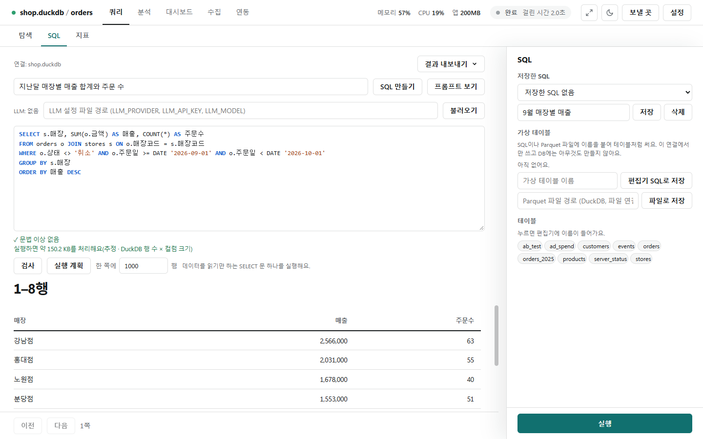
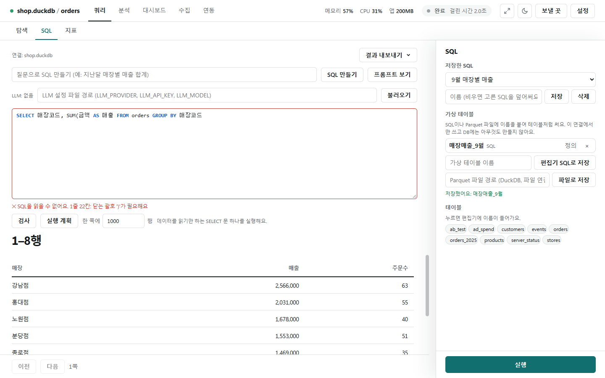
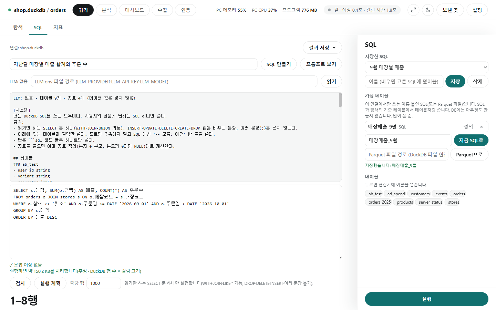

# SQL

[← 쿼리](../query.md)

쿼리 화면의 **[SQL]** 탭에서는 SQL(데이터에 묻는 문장)을 직접 쓰거나, 우리말 질문으로 SQL을 만들어 실행합니다. 몰라도 [탐색] 탭은 쓸 수 있습니다.

## SQL 쓰고 실행하기



- 편집기에 SQL을 쓰고 오른쪽 아래 **[실행]**(또는 Ctrl+Enter)을 누릅니다. 결과는 **쪽당 행** 수만큼 보이고 [이전]·[다음]으로 넘깁니다. 전체는 위쪽 **[결과 저장▾]**(CSV·Excel·Parquet)으로 받습니다.
- 편집기는 `SELECT`·`WHERE` 같은 SQL 키워드를 파란색으로, 따옴표 안 글자는 갈색으로, 주석(`--`, `/* */`)은 흐리게 보입니다. 따옴표·주석 안의 낱말은 키워드로 칠하지 않습니다. [SQL 보기]로 펼친 SQL도 같은 색입니다.
- **읽기만 하는 SELECT 문 하나만** 실행합니다. WITH·JOIN·LIKE·`*`는 되고, DROP·DELETE·INSERT 같은 바꾸는 문장과 여러 문장은 막습니다. 파일·폴더를 읽는 함수, 환경 값을 읽는 함수, 잠금 구문도 막습니다.
- 쓰다가 멈출 때마다 아래 검사 줄에 **✓ 문법 이상 없음**과 처리 용량(`실행하면 약 150.2 KB를 처리합니다`)이 나옵니다.
- **[검사]**는 연결에서 짜 보기만 해서 테이블·컬럼 이름까지 확인합니다(데이터는 읽지 않음). **[실행 계획]**은 조회를 돌리지 않고(EXPLAIN) DB가 어떻게 읽을지 보여 줍니다.
- 오른쪽 **테이블** 목록의 이름을 누르면 편집기에 넣습니다.

## 문법 오류 위치



- 문법이 틀리면 편집기 테두리가 빨개지고 "SQL을 읽을 수 없습니다. 1줄 22칸: 닫는 괄호 ')'가 필요합니다"처럼 줄·칸으로 알려 줍니다.

## 질문으로 SQL 만들기 · 저장한 SQL · 가상 테이블



- 위 질문 칸에 "지난달 매장별 매출 합계와 주문 수"처럼 쓰고 **[SQL 만들기]**를 누르면 LLM(AI)이 SQL을 만들어 편집기에 넣습니다. **실행은 하지 않습니다.** 검사 결과를 보고 사람이 [실행]합니다.
- **[프롬프트 보기]**로 LLM에 보낼 내용을 봅니다. 테이블·컬럼 이름과 타입, 명세서 설명, 지표 정의만 들어가고 **데이터 값은 넣지 않습니다**.
- LLM을 쓰려면 메모장으로 env 파일을 만들어 경로를 넣고 **[읽기]**합니다. 앱은 경로만 저장하고 키는 물을 때마다 파일에서 읽습니다. 경로가 없으면(`LLM: 없음`) 밖으로 아무것도 보내지 않습니다.
  ```
  LLM_PROVIDER=anthropic   # 또는 openai(OpenAI·Azure·사내 게이트웨이·Ollama 등 호환)
  LLM_API_KEY=발급받은 키
  LLM_MODEL=모델 이름
  ```
- **저장한 SQL**: 이름(예: '9월 매장별 매출')을 쓰고 **[저장]**합니다. 목록에서 고르면 편집기에 불러옵니다(실행은 안 함). 많이 불러온 순입니다.
- **가상 테이블**: 자주 쓰는 SQL(또는 Parquet 파일)에 이름(예: `매장매출_9월`)을 붙여 **[지금 SQL로]**·**[Parquet으로]** 저장하면, SQL과 탐색의 기준 테이블에서 테이블처럼 씁니다. 이 연결에서만 쓰고, DB에는 아무것도 만들지 않습니다.
