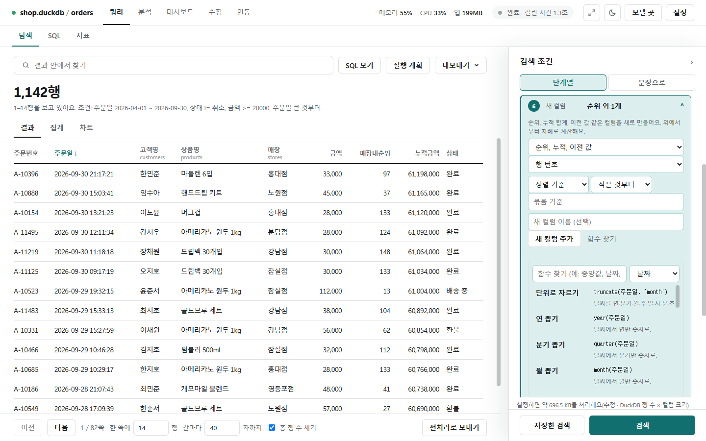

# 함수 사전

[← 쿼리](../query.md)

집계·계산을 고르는 모든 칸(차트·피벗·탐색의 새 컬럼, 문장으로 보기, 지표, 분석·전처리의 계산 컬럼과 중복 제거, 대시보드 카드)은 **같은 함수 사전**에서 고릅니다. 함수마다 이름·한 줄 설명·예시·넣을 값(구분자, 정렬 기준, N, 분위수 P …)이 정해져 있어, 고르면 필요한 칸이 저절로 나타납니다. 모두 147개입니다.

## 함수 찾기

- 탐색 ⑥ 새 컬럼이나 전처리 계산 컬럼의 **[함수 찾기]**를 누르면 패널이 열립니다.
- 칸에 이름·설명(예: 중앙값, 날짜, split)을 쓰거나 분류(사진은 **날짜**)를 골라 거릅니다.
- 함수를 누르면 예시(`truncate(주문일, 'month')` 등)가 식 칸에 들어갑니다. 컬럼 이름만 바꿔 씁니다. 순위·누적 같은 창 함수는 위쪽 폼에서 그 함수가 골라집니다.
- 지금 표에 맞는 종류의 컬럼이 없거나 이 연결이 못 하는 함수는 흐리게 보이고, 마우스를 올리면 이유가 나옵니다.

## 이 연결이 못 하는 함수

테이블을 고르면 지금 연결이 함수마다 계산할 수 있는지 미리 확인합니다(실행하지 않고 SQL만 만들어 봄).

| 표시 | 뜻 |
|---|---|
| 그대로 | 이 연결이 바로 계산합니다 |
| `(대체 식)` | 같은 결과가 나오는 다른 식으로 계산합니다(예: 상관계수 = 공분산 ÷ 표준편차 두 개, 중앙값 = 분위수 0.5) |
| `(이 PC에서 계산)` | 이 연결이 못 해서 기간·조건까지의 결과를 이 PC에 받아 계산합니다(큰 표는 처리 용량을 먼저 물음) |
| 흐리게(고를 수 없음) | 지금 표에 맞는 종류의 컬럼이 없습니다 |

## 겹치는 값 중 하나 고르기

같은 묶음에 값이 여럿일 때 하나로 정하는 방법입니다. 집계 칸의 "겹치는 값 중 하나 고르기" 묶음, 전처리 중복 제거의 **남길 값 직접 고르기**, 문장 틀 29번에서 같은 선택지가 나옵니다: 아무 값 · 정렬 기준의 첫 값 · 정렬 기준의 마지막 값 · 최소 · 최대 · 최빈값 · 모두 이어 붙이기 · 여러 개면 알리기(그 칸은 빈 값). 첫 값·마지막 값은 정렬 기준이 있어야 합니다.

## 알아 둘 것

- 집계 함수에는 "조건(선택): 이 조건인 행만" 칸이 붙습니다.
- `round`는 0.5를 0에서 먼 쪽으로 반올림합니다. `truncate`의 주는 어느 DB에서나 월요일 시작입니다.
- `date_diff`의 연·월은 가득 찬 수입니다(1월 31일 → 2월 28일은 0개월).
- `regex_extract`·`regex_replace`의 `\w`는 DB에서는 영문·숫자·_만, 파일 연결에서는 한글도 포함합니다. 한글은 `[가-힣]`로 쓰세요.
- 예전에 저장한 `nunique`는 `count_distinct`로 읽습니다.

## 전체 목록

### 집계 (35개)

묶음마다 값 하나를 냅니다. 차트의 Y, 피벗의 값, 카드의 값, 지표, 분석의 그룹 비교·추이에서 고릅니다.

| 이름 | 함수 | 뜻 | 예시 |
|---|---|---|---|
| 개수 | `count` | 행 수를 세요(컬럼을 고르면 빈 값이 아닌 것만). | `count(), count(금액)` |
| 고유 개수 | `count_distinct` | 서로 다른 값이 몇 개인지 정확하게 세요. | `count_distinct(고객)` |
| 고유 개수(근사) | `approx_count_distinct` | 서로 다른 값 수를 빠르게 어림해서 세요(큰 표에서 빠름, 약간의 오차). | `approx_count_distinct(고객)` |
| 합계 | `sum` | 더한 값. | `sum(금액)` |
| 평균 | `mean` | 평균 값. | `mean(금액)` |
| 최소 | `min` | 가장 작은(이른) 값. | `min(금액)` |
| 최대 | `max` | 가장 큰(늦은) 값. | `max(금액)` |
| 중앙값 | `median` | 순서대로 세웠을 때 가운데 값. | `median(금액)` |
| 분위수 | `quantile` | 작은 쪽에서 P 위치의 값(P는 0~1, 0.9 = P90). | `quantile(금액, 0.9)` |
| P50 | `p50` | 작은 쪽에서 50% 위치의 값. | `p50(금액)` |
| P90 | `p90` | 작은 쪽에서 90% 위치의 값. | `p90(금액)` |
| P95 | `p95` | 작은 쪽에서 95% 위치의 값. | `p95(금액)` |
| P99 | `p99` | 작은 쪽에서 99% 위치의 값. | `p99(금액)` |
| 최빈값 | `mode` | 가장 많이 나온 값. | `mode(등급)` |
| 표준편차(표본) | `std` | 값이 평균에서 얼마나 퍼졌는지(표본, n-1). | `std(금액)` |
| 표준편차(모집단) | `std_pop` | 값이 평균에서 얼마나 퍼졌는지(모집단, n). | `std_pop(금액)` |
| 분산(표본) | `var` | 표준편차의 제곱(표본, n-1). | `var(금액)` |
| 분산(모집단) | `var_pop` | 표준편차의 제곱(모집단, n). | `var_pop(금액)` |
| 상관계수 | `corr` | 두 숫자 컬럼이 함께 움직이는 정도(-1~1). | `corr(금액, 수량)` |
| 공분산(표본) | `cov` | 두 숫자 컬럼이 함께 움직이는 크기(표본). | `cov(금액, 수량)` |
| 공분산(모집단) | `cov_pop` | 두 숫자 컬럼이 함께 움직이는 크기(모집단). | `cov_pop(금액, 수량)` |
| 이어 붙이기 | `string_agg` | 값을 구분자로 이어 붙여요(정렬 기준 순, 중복 빼기는 값 순). | `string_agg(태그, ',')` |
| 목록 모으기 | `collect` | 값을 목록(배열)으로 모아요. | `collect(태그)` |
| 모두 참 | `all` | 묶음의 모든 행이 조건을 만족하면 참. | `all(금액 > 0)` |
| 하나라도 참 | `any` | 묶음의 행 중 하나라도 조건을 만족하면 참. | `any(금액 > 0)` |
| 조건 개수 | `count_if` | 조건을 만족하는 행 수. | `count_if(금액 > 0)` |
| 조건부 합계 | `sum_if` | 조건을 만족하는 행의 합계. | `sum_if(금액, 구분 = A)` |
| 조건부 평균 | `mean_if` | 조건을 만족하는 행의 평균. | `mean_if(금액, 구분 = A)` |
| 가장 작은 쪽의 값 | `arg_min` | 다른 컬럼이 가장 작은(이른) 행의 이 컬럼 값. | `arg_min(상품, 주문일)` |
| 가장 큰 쪽의 값 | `arg_max` | 다른 컬럼이 가장 큰(늦은) 행의 이 컬럼 값. | `arg_max(상품, 주문일)` |
| 첫 값 | `first` | 정렬 기준으로 가장 앞 행의 값. | `first(상품, 주문일)` |
| 마지막 값 | `last` | 정렬 기준으로 가장 뒤 행의 값. | `last(상품, 주문일)` |
| 아무 값 | `any_value` | 묶음에서 아무 값이나 하나(값이 하나뿐일 때 쓴다). | `any_value(이름)` |
| 범위(최대−최소) | `range` | 가장 큰 값에서 가장 작은 값을 뺀 것. | `range(금액)` |
| 하나일 때만 값 | `unique_or_null` | 묶음의 값이 하나뿐이면 그 값, 둘 이상이면 빈 값(여러 개면 알리기). | `unique_or_null(이름)` |

### 창 함수 (22개)

행마다 값 하나를 냅니다(정렬 기준·묶음 기준을 씀). 탐색 ⑥ 새 컬럼, 전처리 계산 컬럼에서 씁니다.

| 이름 | 함수 | 뜻 | 예시 |
|---|---|---|---|
| 행 번호 | `row_number` | 묶음 안에서 정렬 순서대로 1부터 번호를 매겨요. | `row_number()` |
| 순위 | `rank` | 묶음 안의 순위(같으면 같은 순위, 다음 순위는 건너뜀). | `rank()` |
| 밀집 순위 | `dense_rank` | 같은 값은 같은 순위, 다음 순위를 건너뛰지 않아요. | `dense_rank()` |
| 백분위 순위 | `percent_rank` | 맨 앞이 0, 맨 뒤가 1인 상대 순위. | `percent_rank()` |
| 누적 분포 | `cume_dist` | 나와 같거나 앞선 행의 비율(0~1). | `cume_dist()` |
| N등분 | `ntile` | 정렬 순서대로 N개 구간으로 나눠 1~N 번호를 매겨요. | `ntile(4)` |
| 이전 값 | `lag` | 정렬 순서로 N행 앞의 값. | `lag(금액, 1)` |
| 다음 값 | `lead` | 정렬 순서로 N행 뒤의 값. | `lead(금액, 1)` |
| 묶음의 첫 값 | `first_value` | 묶음 안에서 정렬 기준으로 맨 앞 행의 값. | `first_value(금액)` |
| 묶음의 마지막 값 | `last_value` | 묶음 안에서 정렬 기준으로 맨 뒤 행의 값. | `last_value(금액)` |
| N번째 값 | `nth_value` | 묶음 안에서 정렬 기준으로 N번째 행의 값(1부터). | `nth_value(금액, 2)` |
| 누적 합 | `cum_sum` | 처음부터 지금 행까지의 합. | `cum_sum(금액)` |
| 누적 평균 | `cum_mean` | 처음부터 지금 행까지의 평균. | `cum_mean(금액)` |
| 누적 최소 | `cum_min` | 처음부터 지금 행까지의 최소. | `cum_min(금액)` |
| 누적 최대 | `cum_max` | 처음부터 지금 행까지의 최대. | `cum_max(금액)` |
| 이동 합 | `moving_sum` | 최근 N행(또는 N일)의 합. | `moving_sum(금액, 3)` |
| 이동 평균 | `moving_mean` | 최근 N행(또는 N일)의 평균. | `moving_mean(금액, 3)` |
| 이동 최소 | `moving_min` | 최근 N행(또는 N일)의 최소. | `moving_min(금액, 3)` |
| 이동 최대 | `moving_max` | 최근 N행(또는 N일)의 최대. | `moving_max(금액, 3)` |
| 묶음 안 비율 | `share_of_group` | 값 ÷ 묶음 안 합계(0~1). | `share_of_group(금액)` |
| 이전 대비 차이 | `diff` | 지금 값 − N행 앞의 값. | `diff(금액)` |
| 이전 대비 변화율 | `pct_change` | (지금 값 − N행 앞의 값) ÷ N행 앞의 값. | `pct_change(금액)` |

### 글자 (25개)

아래 글자·숫자·날짜·조건·형 변환·구조 함수는 행마다 계산합니다. 새 컬럼 단계의 `식`, 전처리 계산 컬럼에서 `함수(컬럼, 값…)` 모양으로 씁니다.

| 이름 | 함수 | 뜻 | 예시 |
|---|---|---|---|
| 글자 수 | `length` | 글자가 몇 개인지. | `length(이름)` |
| 대문자로 | `upper` | 영문을 대문자로. | `upper(이름)` |
| 소문자로 | `lower` | 영문을 소문자로. | `lower(이름)` |
| 첫 글자 대문자 | `capitalize` | 첫 글자만 대문자로. | `capitalize(이름)` |
| 앞뒤 공백 지우기 | `trim` | 양쪽 공백을 지워요. | `trim(이름)` |
| 앞 공백 지우기 | `ltrim` | 왼쪽 공백을 지워요. | `ltrim(이름)` |
| 뒤 공백 지우기 | `rtrim` | 오른쪽 공백을 지워요. | `rtrim(이름)` |
| 일부 자르기 | `substr` | 시작 위치(1부터)부터 길이만큼. | `substr(이름, 1, 3)` |
| 앞 N글자 | `left` | 앞에서 N글자. | `left(이름, 3)` |
| 뒤 N글자 | `right` | 뒤에서 N글자. | `right(이름, 3)` |
| 바꾸기 | `replace` | 글자를 다른 글자로 바꿔요. | `replace(이름, 'a', 'b')` |
| 패턴 포함 | `regex_contains` | 정규식 패턴이 들어 있으면 참. | `regex_contains(이름, '^a')` |
| 패턴에서 꺼내기 | `regex_extract` | 정규식에 맞는 부분(그룹 N, 0이면 전체). 맞는 것이 없으면 빈 값. | `regex_extract(이름, '(\d+)', 1)` |
| 패턴 바꾸기 | `regex_replace` | 정규식에 맞는 부분을 바꿔요. | `regex_replace(이름, '\s+', ' ')` |
| 나누기(목록) | `split` | 구분자로 나눠 목록으로. | `split(태그, ',')` |
| 나눈 N번째 | `split_part` | 구분자로 나눈 N번째 조각(1부터). | `split_part(태그, ',', 1)` |
| 이어 쓰기 | `concat` | 여러 컬럼·글자를 한 글자로(사이에 구분자). 빈 값은 건너뛰어요. | `concat(성, 이름)` |
| 왼쪽 채우기 | `lpad` | 길이가 N이 되도록 왼쪽을 채워요. | `lpad(번호, 5, '0')` |
| 오른쪽 채우기 | `rpad` | 길이가 N이 되도록 오른쪽을 채워요. | `rpad(번호, 5, '0')` |
| 포함 | `contains` | 글자가 들어 있으면 참. | `contains(이름, 'a')` |
| 시작 | `startswith` | 글자로 시작하면 참. | `startswith(이름, 'a')` |
| 끝 | `endswith` | 글자로 끝나면 참. | `endswith(이름, 'a')` |
| 위치 찾기 | `find` | 글자가 처음 나오는 위치(1부터, 없으면 0). | `find(이름, 'a')` |
| 거꾸로 | `reverse` | 글자를 거꾸로. | `reverse(이름)` |
| 반복 | `repeat` | 글자를 N번 이어 붙여요. | `repeat(이름, 2)` |

### 숫자 (15개)

| 이름 | 함수 | 뜻 | 예시 |
|---|---|---|---|
| 반올림 | `round` | 소수 자릿수에서 반올림. | `round(금액, 1)` |
| 올림 | `ceil` | 정수로 올림. | `ceil(금액)` |
| 내림 | `floor` | 정수로 내림. | `floor(금액)` |
| 절댓값 | `abs` | 부호를 뗀 값. | `abs(금액)` |
| 나머지 | `mod` | 나눈 나머지(0으로 나누면 빈 값). | `mod(번호, 2)` |
| 거듭제곱 | `power` | x의 N제곱. | `power(금액, 2)` |
| 제곱근 | `sqrt` | 제곱근(음수는 빈 값). | `sqrt(금액)` |
| 지수 | `exp` | e의 x제곱. | `exp(금액)` |
| 자연로그 | `ln` | 밑이 e인 로그(0 이하는 빈 값). | `ln(금액)` |
| 상용로그 | `log10` | 밑이 10인 로그(0 이하는 빈 값). | `log10(금액)` |
| 로그(밑 지정) | `log` | 밑을 정한 로그(0 이하는 빈 값). | `log(금액, 2)` |
| 부호 | `sign` | 음수 -1, 0, 양수 1. | `sign(금액)` |
| 범위 안으로 | `clip` | 하한보다 작으면 하한, 상한보다 크면 상한으로. | `clip(금액, 0, 100)` |
| 나눗셈(0이면 빈 값) | `safe_divide` | 나누는 값이 0이면 빈 값. | `safe_divide(금액, 수량)` |
| 구간 나누기 | `bucket` | 경계 목록으로 구간을 나눠 라벨을 붙여요(경계는 구간의 시작: 10 이상 20 미만). | `bucket(금액, [0, 10, 100])` |

### 날짜 (20개)

| 이름 | 함수 | 뜻 | 예시 |
|---|---|---|---|
| 단위로 자르기 | `truncate` | 날짜를 연·분기·월·주·일·시·분·초의 시작으로. | `truncate(주문일, 'month')` |
| 연 뽑기 | `year` | 날짜에서 연만 숫자로. | `year(주문일)` |
| 분기 뽑기 | `quarter` | 날짜에서 분기만 숫자로. | `quarter(주문일)` |
| 월 뽑기 | `month` | 날짜에서 월만 숫자로. | `month(주문일)` |
| 주(연중 몇 째 주) 뽑기 | `week` | 날짜에서 주(연중 몇 째 주)만 숫자로. | `week(주문일)` |
| 일 뽑기 | `day` | 날짜에서 일만 숫자로. | `day(주문일)` |
| 시 뽑기 | `hour` | 날짜에서 시만 숫자로. | `hour(주문일)` |
| 분 뽑기 | `minute` | 날짜에서 분만 숫자로. | `minute(주문일)` |
| 초 뽑기 | `second` | 날짜에서 초만 숫자로. | `second(주문일)` |
| 요일 뽑기 | `weekday` | 월요일 0 ~ 일요일 6. | `weekday(주문일)` |
| epoch(초) | `epoch` | 1970-01-01부터 지난 초. | `epoch(주문일)` |
| 더하기 | `date_add` | 날짜에 N 단위를 더해요. | `date_add(주문일, 7, 'day')` |
| 빼기 | `date_sub` | 날짜에서 N 단위를 빼요. | `date_sub(주문일, 7, 'day')` |
| 두 날짜 차이 | `date_diff` | 날짜 A에서 날짜 B까지 지난 시간(B−A, 단위로). 연·월은 가득 찬 수. | `date_diff(가입일, 주문일, 'day')` |
| 형식 글자로 | `strftime` | 날짜를 형식(%Y-%m-%d 등)의 글자로. | `strftime(주문일, '%Y-%m')` |
| 글자에서 날짜 읽기 | `parse_date` | 글자를 형식에 맞춰 날짜시간으로. | `parse_date(날짜글자, '%Y-%m-%d')` |
| 날짜만 | `to_date` | 날짜시간에서 날짜만. | `to_date(주문시각)` |
| 시각만 | `to_time` | 날짜시간에서 시각만. | `to_time(주문시각)` |
| 지금까지 지난 시간 | `diff_now` | 그 날짜부터 지금까지 지난 시간(단위로). | `diff_now(가입일, 'day')` |
| 오늘까지 지난 날 | `diff_today` | 그 날짜부터 오늘까지 지난 단위 수. | `diff_today(가입일, 'day')` |

### 조건 (11개)

| 이름 | 함수 | 뜻 | 예시 |
|---|---|---|---|
| 조건 분류(CASE) | `case` | 조건 → 값을 여러 줄 적고, 아무것도 아니면 마지막 값. | `case(금액 >= 100, '고액', 금액 >= 10, '중간', '소액')` |
| 빈 값 채우기(COALESCE) | `coalesce` | 앞에서부터 처음으로 빈 값이 아닌 것. | `coalesce(휴대폰, 전화)` |
| 같으면 빈 값(NULLIF) | `nullif` | 값이 같으면 빈 값으로. | `nullif(코드, '')` |
| 참이면·아니면(IF) | `ifelse` | 조건이 참이면 앞 값, 아니면 뒤 값. | `iif(금액 >= 100, '고액', '일반')` |
| 가장 큰 값(GREATEST) | `greatest` | 여러 컬럼 중 가장 큰 값. | `greatest(가격1, 가격2)` |
| 가장 작은 값(LEAST) | `least` | 여러 컬럼 중 가장 작은 값. | `least(가격1, 가격2)` |
| 목록 안에 있나(IN) | `isin` | 값이 목록 안에 있으면 참. | `isin(등급, 'A', 'B')` |
| 범위 안인가(BETWEEN) | `between` | 하한 이상 상한 이하이면 참. | `between(금액, 0, 10)` |
| 빈 값인가 | `isnull` | 값이 비었으면 참. | `isnull(휴대폰)` |
| 값이 있나 | `notnull` | 값이 있으면 참. | `notnull(휴대폰)` |
| SQL 식 직접 쓰기 | `sql_expr` | DB 고유 함수가 필요할 때: SQL 식 한 줄을 새 컬럼으로 붙여요(읽기만 하는 식, 파일 읽기는 막아요). | `sql_expr(LOWER(name), 소문자)` |

### 형 변환 (2개)

| 이름 | 함수 | 뜻 | 예시 |
|---|---|---|---|
| 형 바꾸기(CAST) | `cast` | 값을 정수·실수·글자·날짜·날짜시간·참거짓으로. 안 되는 값이 있으면 오류. | `cast(코드, 'int')` |
| 형 바꾸기(안 되면 빈 값) | `try_cast` | 바꿀 수 없는 값은 오류 대신 빈 값으로. | `try_cast(코드, 'int')` |

### 구조 (5개)

| 이름 | 함수 | 뜻 | 예시 |
|---|---|---|---|
| JSON 경로 값 | `json_get` | JSON 컬럼에서 경로(user.name, items[0])의 값. | `json_get(정보, 'user.name')` |
| 구조 필드 | `struct_field` | 구조 컬럼 안의 필드 하나. | `struct_field(주소, 'city')` |
| 목록 길이 | `array_length` | 목록에 값이 몇 개인지. | `array_length(태그)` |
| 목록 N번째 | `array_get` | 목록의 N번째 값(1부터). | `array_get(태그, 1)` |
| 목록 펼치기 | `unnest` | 목록 컬럼의 값마다 행을 하나씩 만들어요. | `unnest(태그)` |

### 좌표 (6개)

자세한 쓰임은 [좌표](geo.md)에 있습니다.

| 이름 | 함수 | 뜻 | 예시 |
|---|---|---|---|
| 두 점 거리(km) | `haversine` | 두 점(위도·경도)의 큰 원 거리를 km로. 둘째 점은 숫자 또는 다른 컬럼. | `haversine(위도, 경도, 37.5665, 126.978)` |
| 반경 안(km) | `within_km` | 기준점에서 N km 안(경계 포함)이면 참. 조건 줄로는 near 위도 경도 기준위도 기준경도 반경. | `within_km(위도, 경도, 37.5665, 126.978, 5)` |
| 범위 상자 안 | `in_box` | 최소·최대 위경도 상자 안(경계 포함)이면 참. 조건 줄로는 box 위도 경도 최소위도 최소경도 최대위도 최대경도. | `in_box(위도, 경도, 33, 124, 39, 132)` |
| 격자 칸 id | `grid_id` | 점을 칸 크기(도 단위, 예 0.01 = 약 1.1km)의 격자로 묶는 칸 id(위도칸_경도칸). | `grid_id(위도, 경도, 0.01)` |
| 격자 칸 중심 위도 | `grid_lat` | 점이 든 격자 칸의 중심 위도. | `grid_lat(위도, 0.01)` |
| 격자 칸 중심 경도 | `grid_lon` | 점이 든 격자 칸의 중심 경도. | `grid_lon(경도, 0.01)` |

### 묶음 (6개)

표의 모양을 바꿉니다. 피벗의 [집계 결과로 거르기]·[소계와 총계], 새 컬럼 단계의 `창거르기`, 문장 틀에서 씁니다. 소계 줄의 칸은 `(소계)`, 총계는 `(전체)`로 보입니다.

| 이름 | 함수 | 뜻 | 예시 |
|---|---|---|---|
| 묶은 뒤 거르기(HAVING) | `having` | 집계한 결과 표에서 조건에 맞는 줄만. | `having(합계 > 100)` |
| 창 결과로 거르기(QUALIFY) | `qualify` | 창 함수 결과(예: 순위)가 조건에 맞는 행만. | `qualify(rank, 기준 금액 desc, <= 3)` |
| 소계·총계(ROLLUP) | `rollup` | 기준을 뒤에서부터 하나씩 빼며 소계와 총계 줄을 더해요. | `rollup(지역, 상품 / 합계 금액)` |
| 모든 조합(CUBE) | `cube` | 기준의 모든 조합마다 집계해요. | `cube(지역, 상품 / 합계 금액)` |
| 묶음 조합 고르기(GROUPING SETS) | `grouping_sets` | 고른 조합마다 집계해요. | `grouping_sets(지역, 상품 / 합계 금액)` |
| 중복 빼기(DISTINCT) | `distinct` | 같은 줄을 하나로(컬럼을 고르면 그 컬럼들만). | `distinct(고객, 상품)` |
