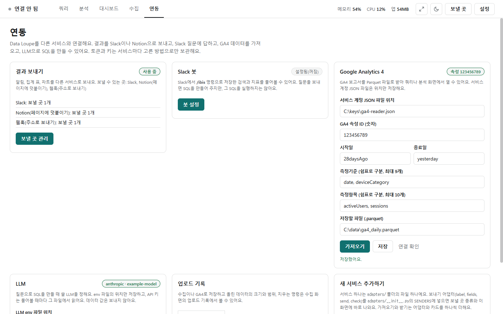

# 연동

[← README](../README.md) · [쿼리](query.md) · [분석](analysis.md) · [수집](collect.md) · [연동](integrations.md) · [대시보드](dashboard.md)

이 프로그램을 다른 앱·서비스(Slack, Notion, Teams 같은 웹훅, Google Analytics 4, LLM)와 잇는 화면입니다. 서비스마다 하는 일(결과 보내기·Slack 봇·GA4 가져오기·LLM)이 카드로 나뉘어 있고, 카드 오른쪽 위에 상태(사용 중, 켜짐, 설정됨(꺼짐), 설정 안 됨, GA4는 `속성 123456789`, LLM은 회사·모델 이름 등)가 보입니다. 설정하지 않은 서비스로는 아무것도 보내지 않습니다.

## 기능 설명

| 기능 | 한 줄 설명 | 자세히 |
|---|---|---|
| 보내기(Slack·Notion·웹훅) | 보낼 곳을 등록해 오래 걸린 작업 알림, 집계 표, 차트를 보내기. 토큰 보관 방식 고르기 | [functions/integrations_send.md](functions/integrations_send.md) |
| Slack 봇 | Slack의 `/ibis` 명령으로 저장한 검색·지표를 묻고 답 받기 | [functions/integrations_bot.md](functions/integrations_bot.md) |
| Google Analytics 4 · LLM | GA4 보고서를 Parquet 파일로 가져오기, 질문으로 SQL 만들 때 물을 LLM 설정. 업로드 기록·새 서비스 추가하기 카드 | [functions/integrations_ga4_llm.md](functions/integrations_ga4_llm.md) |
| 업로드 기록 | 수집·GA4로 저장하고 적재한 것의 장부(수집 화면에 있음) | [functions/load.md](functions/load.md) |
| 안전 | 비밀 값을 저장하지 않는 방식과 밖으로 보내지 않는 것 | [functions/settings.md](functions/settings.md) |
