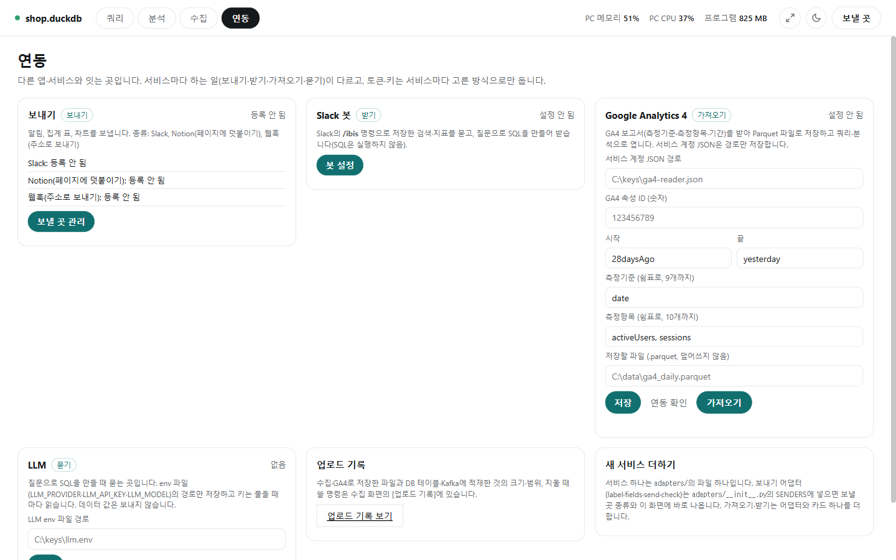

# 연동

[← README](../README.md) · [쿼리 화면](query.md) · [분석 화면](analysis.md) · [수집 화면](collect.md) · [연동](integrations.md) · [설정과 참고](settings.md)

**한 줄 요약**: 이 프로그램을 회사에서 쓰는 다른 서비스(Slack, Notion, Google Analytics, AI)와 이어 주는 곳입니다. 결과를 메신저로 보내고, 메신저에서 물어보고, 다른 서비스의 데이터를 가져옵니다.

## 먼저 알아 둘 말

| 말 | 뜻 |
|---|---|
| 토큰 | 서비스가 발급하는 "출입증" 글자. 이걸로 프로그램이 내 대신 메시지를 보냅니다. 비밀번호처럼 다룹니다 |
| 봇 | 메신저 안에서 대신 말해 주는 계정 |
| 채널 ID | Slack 채널마다 붙은 번호(예: `C0123456789`) |
| 웹훅 | 정해 둔 주소로 글을 보내면 그 서비스(Teams, Discord 등)에 메시지가 뜨게 하는 방법 |
| GA4 | Google Analytics 4. 웹사이트 방문자 통계 서비스 |
| 서비스 계정 | 사람 대신 프로그램이 Google에 로그인할 때 쓰는 계정. 키 파일(JSON)로 받습니다 |
| LLM | ChatGPT·Claude 같은 AI |

## 연동

위쪽의 [연동]을 누르면 연결할 수 있는 서비스가 카드로 모여 있습니다. 카드마다 지금 상태(등록 수, 켜짐, 설정 안 됨)가 보입니다.



| 서비스 | 하는 일 | 예 | 설명 |
|---|---|---|---|
| Slack, Notion, 웹훅 | **보내기** | "검색 끝났습니다"를 Slack으로, 집계 표를 Notion 페이지로 | [보낼 곳 등록](#보낼-곳-등록) |
| Slack 봇 | **받기** | Slack에서 `/ibis 지표 매출`이라고 물으면 답함 | [Slack 봇](#slack-봇-받기) |
| Google Analytics 4 | **가져오기** | 지난 4주 일별 방문자 수를 파일로 | [아래](#google-analytics-4-가져오기) |
| LLM | **묻기** | "매장별 매출"이라고 쓰면 SQL을 만들어 줌 | [질문으로 SQL 만들기](query.md#질문으로-sql-만들기) |

토큰·키는 서비스마다 보관 방식을 고르고([비밀 값 보관 방식](#비밀-값-보관-방식)), 설정하지 않은 서비스로는 아무것도 보내지 않습니다.

## 따라 해 보기

### 예시 1. 오래 걸린 검색이 끝나면 Slack으로 알림 받기

1. Slack에서 봇 토큰과 채널 ID를 준비합니다([Slack 준비](#보낼-곳-등록) 참고).
2. 위쪽 줄 오른쪽 **[보낼 곳]** 을 누릅니다.
3. 이름 `팀 채널`, 종류 `Slack`, 비밀 값 보관 방식 `암호화해 저장`을 고르고, 봇 토큰(`xoxb-…`)과 채널 ID를 넣습니다.
4. **[오래 걸린 작업이 끝나면 여기로 알림]** 을 체크하고 **[저장]** 합니다.
5. **[연동 확인]** 으로 토큰이 맞는지 보고, **[시험 보내기]** 로 실제로 메시지가 오는지 확인합니다.

이제 30초 이상 걸린 검색·저장 등이 끝나면 "검색이 끝났습니다 · orders · 1,300행 · 1분 23초"처럼 알림이 옵니다. 데이터 값은 보내지 않습니다.

### 예시 2. 매장별 매출 차트를 Notion 주간 보고 페이지에 붙이기

1. Notion에서 통합 토큰을 만들고 보고 페이지에 연결합니다([Notion 준비](#보낼-곳-등록)).
2. [보낼 곳]에서 종류 `Notion`, 토큰과 페이지 주소를 넣고 저장합니다.
3. 쿼리 화면에서 매장별 매출 차트를 그리고, 차트 아래 보낼 곳에서 `Notion`을 고르고 **[보내기]** 를 두 번 누릅니다(실수 방지).
4. 페이지 끝에 제목과 매장별 값 표가 붙습니다(Notion에는 그림은 보내지 않습니다).

### 예시 3. GA4 방문자 수를 엑셀처럼 보기

1. [GA4 준비](#google-analytics-4-가져오기)를 마칩니다(키 파일, 속성 ID).
2. [연동] 화면의 Google Analytics 4 카드에 키 파일 경로, 속성 ID, 기간 `28daysAgo`~`yesterday`, 측정기준 `date`, 측정항목 `activeUsers, sessions`, 저장할 파일 `C:\data\ga4_daily.parquet`을 넣고 **[저장]** 합니다.
3. **[가져오기]** → "28행을 저장했습니다" → **[쿼리로 열기]** 를 누르면 쿼리 화면에서 날짜별 방문자 표와 차트를 볼 수 있습니다.

### 예시 4. Slack에서 바로 숫자 묻기

봇을 켜 두면([Slack 봇](#slack-봇-받기)) Slack 아무 채널에서:

```
/ibis 지표 매출 검색="9월 정상 주문"
```

→ `매출 (9월 정상 주문): 48,250,000` 처럼 답이 옵니다(물어본 사람에게만 보임).

---

아래부터는 자세한 설명입니다.

### Google Analytics 4 가져오기

GA4 보고서를 받아 Parquet 파일로 저장하고, [쿼리로 열기]로 바로 살펴봅니다.

**준비** (처음 한 번, 회사 GA·Google Cloud 관리자에게 부탁해도 됩니다)

1. Google Cloud에서 서비스 계정을 만들고 키(JSON 파일)를 내려받습니다. 그 프로젝트에서 "Google Analytics Data API"를 켭니다.
2. GA4의 관리 → 속성 액세스 관리에 그 서비스 계정 이메일을 [뷰어]로 추가합니다.
3. 속성 ID(관리 → 속성 설정에 있는 숫자)를 확인합니다.

**칸 채우기**

| 칸 | 예 | 뜻 |
|---|---|---|
| 서비스 계정 JSON 경로 | `C:\keys\ga4-reader.json` | 내려받은 키 파일 |
| 속성 ID | `123456789` | 숫자 |
| 시작 / 끝 | `28daysAgo` / `yesterday` | `2026-09-01`, `today`, `yesterday`, `7daysAgo` 모양 |
| 측정기준 | `date, country` | 무엇별로 나눌지(9개까지) |
| 측정항목 | `activeUsers, sessions` | 무엇을 셀지(10개까지) |
| 저장할 파일 | `C:\data\ga4_daily.parquet` | 결과 파일(.parquet) |

- [연동 확인]: 보고서는 받지 않고 로그인과 속성 접근만 확인합니다.
- [가져오기]: 보고서 전체를 받아 저장합니다. 같은 이름의 파일이 있으면 덮어쓰지 않습니다. 200만 행이 넘으면 기간이나 측정기준을 줄이세요.
- 측정기준은 글자, 측정항목은 숫자 컬럼이 됩니다.
- 키 파일은 경로만 저장하고, 안의 키는 그 파일에만 있습니다.
- 저장한 파일은 [업로드 기록](collect.md#업로드-기록)에 남습니다.

## 다른 앱으로 보내기

작업이 끝났다는 알림, 집계 표, 차트를 Slack·Notion·웹훅으로 보냅니다. **보낼 곳을 등록하지 않으면 프로그램은 바깥으로 아무것도 보내지 않습니다.** 위쪽 줄 [보낼 곳] 또는 [연동] 화면의 [보낼 곳 관리]로 엽니다.

### 보낼 곳 등록

[보낼 곳] 패널에서 이름·종류·비밀 값 보관 방식을 고르고 그 종류의 칸을 채워 [저장]합니다(30개까지).

| 종류 | 채울 것 | 보낼 수 있는 것 |
|---|---|---|
| Slack | 봇 토큰, 채널 ID | 글, 그림 |
| Notion | 통합 토큰, 페이지 주소 | 글과 표(페이지 끝에 덧붙임). 그림은 안 됨 |
| 웹훅 | 주소, 본문 틀 | 글과 표(Teams, Discord 등) |

- **[연동 확인]**: 메시지를 보내지 않고 토큰이 맞는지 확인합니다. Slack은 봇이 그 채널에 들어 있는지까지 봅니다(권한이 있을 때).
- **[시험 보내기]**: 시험 메시지를 실제로 보내 봅니다.

**Slack 준비**

1. [api.slack.com](https://api.slack.com/apps)에서 앱을 만들고, OAuth & Permissions의 Bot Token Scopes에 `chat:write`와 `files:write`를 넣은 뒤 워크스페이스에 설치합니다.
2. 보낼 채널에 그 봇을 초대합니다(채널에서 `/invite @봇이름`).
3. `xoxb-`로 시작하는 봇 토큰과 채널 ID(채널 이름 누르기 → 맨 아래)를 넣습니다.

**Notion 준비**

1. Notion의 설정 → 연결 → 통합 개발에서 내부 통합을 만들고 토큰(`ntn_` 또는 `secret_`로 시작)을 받습니다.
2. 보낼 페이지 오른쪽 위 [⋯] → 연결에서 그 통합을 추가합니다.
3. 페이지 주소를 그대로 붙여 넣습니다. [연동 확인]으로 페이지를 읽을 수 있는지 봅니다.

보낼 때마다 페이지 끝에 제목, 내용, 행 수·걸린 시간, 표가 덧붙습니다.

**웹훅**

받는 서비스(Teams, Discord 등)에서 웹훅 주소(`https://`로 시작)를 받아 넣습니다. [기본 틀]에서 일반 JSON·Teams·Discord·글자용 틀을 골라 시작하고, 필요하면 고칩니다. 틀에 아래 자리를 넣으면 보낼 때 값으로 바뀝니다.

| 자리 | 들어가는 값 |
|---|---|
| `{제목}` | 무엇인지(예: 집계, 검색이 끝났습니다) |
| `{내용}` | 테이블 이름 등 |
| `{행수}` | 행 수 |
| `{걸린시간}` | 예: 1분 23초 |
| `{표}` | 표를 글자로(50행까지) |
| `{그림}` | 그림을 글자(base64)로 바꾼 것 |

JSON 틀은 값을 채운 결과가 올바른 JSON이 아니면 보내지 않습니다.

### 비밀 값 보관 방식

보낼 곳마다 고릅니다. 어느 방식이든 화면에 다시 보여 주지 않고, 바꾸려면 새로 입력합니다.

| 방식 | 어디에 두나 | 이럴 때 |
|---|---|---|
| 암호화해 저장 | 내 PC의 설정 파일에, 지금 Windows 계정만 풀 수 있게 암호화 | 보통은 이것. 다른 PC로 옮기면 다시 입력 |
| 이번 실행 동안만 | 메모리에만(파일에 안 남음) | 공용 PC. 프로그램을 다시 켜면 다시 입력. 창 없는 예약 실행에서는 못 씀 |
| 환경변수 | Windows 환경변수(파일에는 변수 이름만) | 회사 보안 규칙상 파일에 저장하면 안 될 때. 칸에 값 대신 변수 이름(예: `IBIS_SLACK_TOKEN`)을 넣음 |

### Slack 봇 (받기)

Slack에서 `/ibis` 명령으로 저장해 둔 검색과 지표를 물어보면 프로그램이 답합니다. **이 PC에서 프로그램이 켜져 있고 데이터에 연결돼 있을 때만** 답합니다.

**Slack 준비** (Slack 관리자와 함께)

1. [api.slack.com](https://api.slack.com/apps)의 앱 설정에서 **Socket Mode** 를 켭니다. 이때 앱 토큰(`xapp-`로 시작, `connections:write`)이 나옵니다. Socket Mode는 PC에서 Slack 쪽으로만 연결하므로, 방화벽을 열거나 서버를 둘 필요가 없습니다.
2. Slash Commands에서 `/ibis` 명령을 만듭니다.
3. Bot Token Scopes에 `commands`를 넣고 설치한 뒤 봇 토큰(`xoxb-`)을 받습니다.
4. 명령을 쓸 사람의 Slack 멤버 ID(`U`로 시작. 프로필 → [⋮] → [멤버 ID 복사])를 모읍니다.

**프로그램 설정**: [보낼 곳] 패널 아래 "Slack 봇 (받기)"에서

1. 토큰 보관 방식을 고르고 봇 토큰과 앱 토큰을 넣습니다.
2. **허용할 사용자 ID** 를 넣습니다(비어 있으면 봇을 켤 수 없음). 허용할 채널 ID도 넣으면 그 채널에서만 받습니다.
3. [저장] → [연동 확인] → [봇 시작]. [봇 멈춤]이나 프로그램 종료로 멈춥니다.

**명령**

| Slack에 쓰는 것 | 답 |
|---|---|
| `/ibis` 또는 `/ibis 도움` | 쓸 수 있는 명령 |
| `/ibis 지표` | 지표 목록 |
| `/ibis 지표 매출 검색="9월 정상 주문"` | 그 저장한 검색의 데이터로 계산한 매출 |
| `/ibis 지표 취소율 검색="9월 정상 주문" 나누기=매장코드` | 매장별 취소율 표 |
| `/ibis 검색` | 저장한 검색 목록 |
| `/ibis 검색 "9월 정상 주문" 행=10` | 그 검색의 행 수와 앞 10행(50행까지) |
| `/ibis 질문 지난달 매장별 매출 합계` | AI가 만든 SQL(실행하지 않음. 프로그램 SQL 탭에서 확인 후 실행) |

- 띄어쓰기가 있는 이름은 따옴표로 감쌉니다.
- 답은 물어본 사람에게만 보입니다.
- 미리 저장해 둔 검색과 지표만 씁니다. 데이터를 바꾸거나 SQL을 바로 실행하는 명령은 없습니다.
- 허용하지 않은 사람·채널에는 "쓸 수 없습니다"라고만 답합니다. 패널에 최근 요청 20개가 보입니다.
- 프로그램이 다른 작업 중이면 60초까지 기다렸다가 답합니다.

### 끝나면 알림

보낼 곳에서 [오래 걸린 작업이 끝나면 여기로 알림]을 켜 두면, 정한 시간(기본 30초, 5~3,600초) 이상 걸린 작업이 끝났을 때 알립니다. 작업 종류, 테이블 이름, 행 수, 걸린 시간만 보내고 데이터 값은 보내지 않습니다. 취소·오류로 끝난 작업은 알리지 않습니다.

### 집계와 차트 보내기

쿼리 화면의 [집계]·[차트] 탭 아래에서 보낼 곳을 고르고 [보내기]를 누릅니다. 버튼에 어디로 무엇을 보낼지 표시되고, 한 번 더 눌러야 보냅니다.

- 집계: 집계 표를 글자와 그림으로
- 차트: 차트 값(표)과 그림으로
