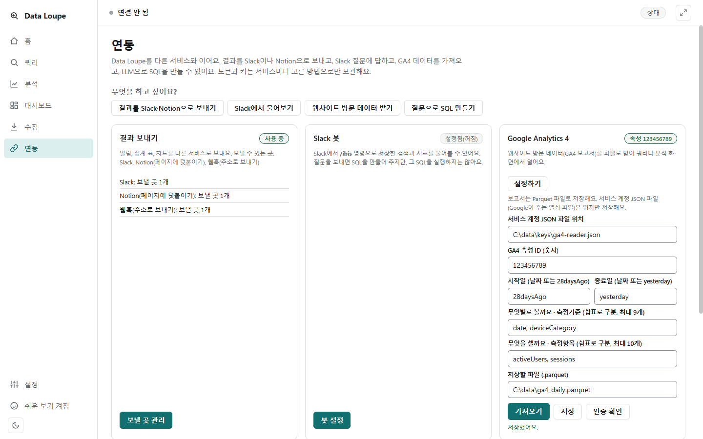

# 연동

[← README](../README.md) · [쿼리](query.md) · [분석](analysis.md) · [수집](collect.md) · [연동](integrations.md) · [대시보드](dashboard.md)

이 프로그램을 다른 앱·서비스(Slack, Notion, Teams 같은 웹훅, Google Analytics 4, LLM)와 잇는 화면입니다. 서비스마다 하는 일이 카드 다섯 개(**결과 보내기** · **Slack 봇** · **Google Analytics 4** · **LLM** · **업로드 기록**)로 나뉘어 있습니다. 창이 넓으면 한 줄에 셋까지 놓이고, 같은 줄의 카드는 높이가 같으며 단추 줄(**[보낼 곳 관리]**·**[봇 설정]**·**[업로드 기록 보기]**)은 카드 맨 아래에 가지런히 놓입니다.

- 카드 오른쪽 위에 상태가 보입니다. 결과 보내기는 **사용 중**·**아직 없음**(카드 안에는 종류마다 `보낼 곳 2개`·`등록 안 됨`), Slack 봇은 **켜짐**·**설정됨(꺼짐)**·**설정 안 됨**, GA4는 `속성 123456789`·**설정 안 됨**, LLM은 회사·모델 이름이나 **없음**입니다.
- 맨 위 **무엇을 하고 싶어요?** 단추(결과를 Slack·Notion으로 보내기, Slack에서 물어보기, 웹사이트 방문 데이터 받기, 질문으로 SQL 만들기)를 누르면 그 카드로 가서 잠깐 강조되고, 접힌 설정 칸이 있으면 펼쳐집니다.
- GA4·LLM 카드의 입력 칸은 **[설정하기]**를 누르면 펼쳐집니다(이미 설정했으면 펼쳐져 있음).
- 설정하지 않은 서비스로는 아무것도 보내지 않습니다.

## 기능 설명

| 기능 | 한 줄 설명 | 자세히 |
|---|---|---|
| 보내기(Slack·Notion·웹훅) | 보낼 곳을 등록해 오래 걸린 작업 알림, 집계 표, 차트를 보내기. 토큰 보관 방식 고르기 | [functions/integrations_send.md](functions/integrations_send.md) |
| Slack 봇 | Slack의 `/ibis` 명령으로 저장한 검색·지표를 묻고 답 받기 | [functions/integrations_bot.md](functions/integrations_bot.md) |
| Google Analytics 4 · LLM | GA4 보고서를 Parquet 파일로 가져오기, 질문으로 SQL 만들 때 물을 LLM 설정. 업로드 기록 카드, 개발자용 새 서비스 추가 방법 | [functions/integrations_ga4_llm.md](functions/integrations_ga4_llm.md) |
| 업로드 기록 | 수집·GA4로 저장하고 적재한 것의 장부(수집 화면에 있음) | [functions/load.md](functions/load.md) |
| 안전 | 비밀 값을 저장하지 않는 방식과 밖으로 보내지 않는 것 | [functions/settings.md](functions/settings.md) |
