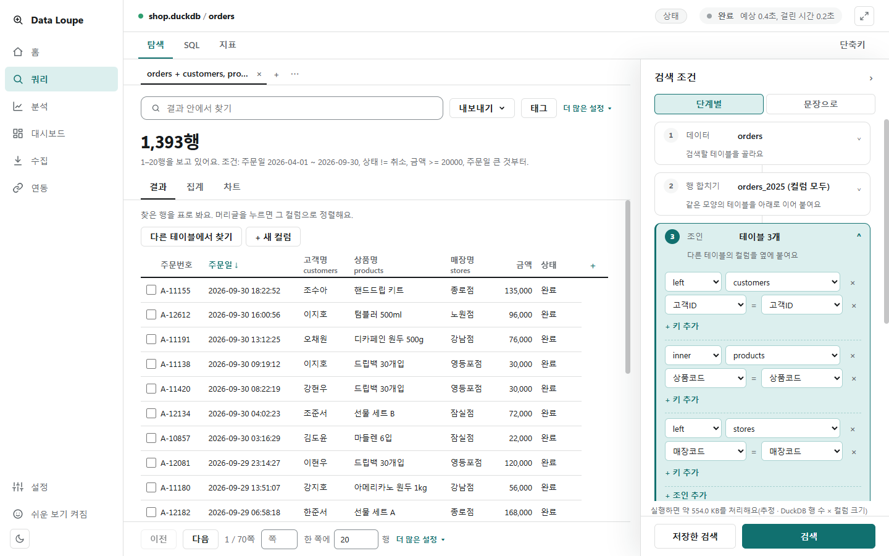

# 쿼리

[← README](../README.md) · [쿼리](query.md) · [분석](analysis.md) · [수집](collect.md) · [연동](integrations.md) · [대시보드](dashboard.md)

DB나 파일의 테이블에서 원하는 행만 골라 보고, 합계·평균을 내고, 차트로 그리는 화면입니다. 엑셀의 필터·피벗·차트를 떠올리면 됩니다. 위쪽 [탐색] [SQL] [지표] 탭으로 오가며, 탐색의 조건은 검색 조건 패널 위 [단계별 | 문장으로] 두 보기 중 편한 것으로 넣습니다.

## 기능 설명

| 기능 | 한 줄 설명 | 자세히 |
|---|---|---|
| 데이터 연결 | 내 PC의 파일이나 데이터베이스에 연결하고 드라이버를 확인합니다 | [functions/connect.md](functions/connect.md) |
| 탐색(단계별) | 데이터 → 행 합치기 → 조인 → 기간 → 조건 → 새 컬럼 → 정렬 → 보일 컬럼 순으로 칸을 채웁니다 | [functions/explore.md](functions/explore.md) |
| 결과 | 결과 안 찾기, 집계·피벗, 파일로 내보내기, SQL 보기, 저장한 검색 | [functions/results.md](functions/results.md) |
| 차트 | 막대·선 겹치기, 오른쪽 축, 컬럼을 끌어다 놓아 만들기, 대시보드에 추가 | [functions/chart.md](functions/chart.md) |
| 문장으로 보기 | 문장 틀 56개의 빈칸을 채워 묻고, 질문 묶음으로 모아 실행 | [functions/sentences.md](functions/sentences.md) |
| SQL | SQL 직접 쓰기, 문법 검사, 질문으로 SQL 만들기, 저장한 SQL·가상 테이블 | [functions/sql.md](functions/sql.md) |
| 지표 | 지표 파일로 바로 구하기, 지표 틀로 내 지표 만들기 / 지표 사전 | [functions/metrics.md](functions/metrics.md) · [functions/metrics_catalog.md](functions/metrics_catalog.md) |
| 함수 사전 | 집계·계산 칸에서 고르는 함수 전부와 [함수 찾기] | [functions/sql_functions.md](functions/sql_functions.md) |
| 좌표 | 거리·반경·격자 계산, GeoJSON 연결, 좌표 문장 틀 | [functions/geo.md](functions/geo.md) |

## 태그 붙이기

결과 행에 직접 라벨(태그)을 달고, 단 태그로 다시 거를 수 있습니다. 태그는 테이블마다 따로 저장됩니다.

- **켜기**: 결과 카드 도구 줄의 **[태그]**를 누르고, 행마다 다른 값인 **고유 키 컬럼**, 글 컬럼(선택), 처음 태그(쉼표로 여러 개)를 정합니다. 키 컬럼은 태그가 달린 뒤에는 바꿀 수 없습니다.
- **태그 사전**: 같은 창에서 태그를 더하고, 이름을 바꾸고, 차례를 바꾸고, 지웁니다. 이름 바꾸기·지우기는 이미 달린 행에도 적용되며, 지울 때는 확인을 묻습니다. 태그 이름에는 앞뒤 공백·쉼표·줄바꿈·탭을 쓸 수 없습니다.
- **태그 막대**: 결과 표에서 행을 고르면 표 아래에 태그 칩이 나옵니다. 칩에는 고른 행 중 몇 개에 달렸는지가 보이고, 누르면 달거나(고른 행이 모두 가졌으면) 뗍니다. 숫자 키 1~9·0은 그 번호의 칩입니다. 한 번에 고를 수 있는 행은 10,000개까지이고, 그보다 많으면 **[검색 결과 전체에 달기·떼기]**를 씁니다.
- **하나씩 태그**: **[하나씩 태그]** 창에서 행을 한 줄씩 보며 숫자 키나 단추로 태그를 켜고 끕니다(여러 개 가능). **Enter**를 눌러야 다음 행으로 가고, `←`는 앞 행, `Esc`는 닫기입니다. **[태그 없는 행만]**(기본 켬)이면 태그가 없는 행만 차례로 나옵니다.
- **거르기**: 모든 행 / 태그 없는 행 / 고른 태그(**하나라도** 또는 **모두**) 중에서 고릅니다. 조건 줄에는 `태그`를 쓸 수 없고 이 거르기를 씁니다.
- 태그를 켜면 결과에 `태그` 컬럼(여러 개면 `, `로 이음)이 붙고, 내보내기·차트·집계·대시보드 카드·전처리로 보내기에 그대로 따라갑니다. 원격 DB는 조건까지의 결과를 이 PC로 받아 태그를 붙입니다.

### ID·해시 컬럼 안내

ID·해시·UUID로 보이는 글자 컬럼은 집계할 컬럼과 차트의 가로축·나누기 목록에서 빠지고, 카드 위 안내의 **[다시 넣기]**로 되살립니다([분석](analysis.md#컬럼-요약의-품질-진단)).

### 집계·피벗·기간별·차트 표 정렬

표 머리글을 누를 때마다 오름(↑) → 내림(↓) → 원래 순서로 바뀝니다(한 컬럼 기준). 이미 받은 결과만 화면에서 정렬하며 다시 조회하지 않고, 빈 값은 맨 뒤입니다. 피벗(500줄 상한)·차트 표처럼 잘린 표는 받은 행만 정렬하고 표 아래에 안내가 나옵니다. 소계·총계·파레토가 있는 피벗은 순서에 뜻이 있어 정렬하지 않습니다. 기간별 표는 정렬하면 기간별 차트도 같은 차례로 다시 그려지고 합계 줄은 맨 끝에 고정입니다. 차트 표를 정렬해도 차트 그림의 순서는 바뀌지 않습니다. 집계 표 그림·보내기와 차트 CSV·보내기는 화면에서 정렬한 차례대로 냅니다.

### 차트 그룹 고르기

차트 도구의 **그룹 고르기**를 펼쳐 보일 그룹·계열을 체크로 고릅니다. 체크 칸 위에서 왼쪽 단추를 누른 채 끌면 지나는 칸이 같이 바뀌고, [모두]·[없음]으로 한꺼번에 바꿉니다. 숫자·날짜 가로축은 범위를 더해 그 안만 보이고, 숫자 가로축은 [범위를 한 막대로 묶기]로 범위마다 한 막대로 합칩니다. 이름은 [라벨 바꾸기]에서 바꿉니다. [대시보드에 담기]에 고른 것이 같이 담깁니다. 날짜가 아닌 가로축은 [그룹 찾아 더하기] 칸에서 표 전체의 값을 찾아 보일 그룹에 더할 수 있고, 보일 그룹·숫자 범위를 고르면 서버가 그 그룹만 다시 구해 처음 받은 50개 밖의 그룹도 그립니다(나누기를 쓰면 나눌 값도 고른 그룹 안에서 다시 고릅니다). 그 밖의 고르기(보일 계열·날짜 범위)는 화면에서만 하고 CSV·그림 저장은 보이는 값 그대로입니다. 범위로 묶으면 서버가 전체 데이터에서 범위마다 다시 구하고, 막대 값은 계열 컬럼의 고유 개수입니다(컬럼이 없는 개수 계열은 행 개수). 나누기와 함께 묶을 수 없습니다.

### 차트 정렬·자동 규칙·모든 데이터

- **[정렬]**: 자동(기본) / 원래 순서 / 값 큰 순 / 값 작은 순 / 이름 순 다섯 가지입니다. 자동은 글자 가로축이면 값 큰 순, 숫자·날짜면 가로축 순이고, 요일·월 이름은 달력 순서로 놓습니다. 직접 고른 정렬이 자동 정렬보다 먼저입니다. 값이 많아 서버가 50개로 잘랐으면 고른 정렬대로 50개를 다시 받아 옵니다.
- **[자동 규칙]**(그룹 고르기 옆): 차트가 알아서 하는 Top-N·'기타' 합치기·파이 상위 5개·가로 막대 전환·스파게티 선·0 기준선·선 확대·점 솎기·산점도 점 밀도·숫자 줄이기·참조선·의미 색 따위를 규칙마다 끕니다. 끈 것은 기억해 다음에 열 때 기본값이 됩니다([설정](functions/settings.md#차트-낱말과-자동-규칙-기본값)에서도 고칩니다). 규칙 목록은 [대시보드 카드](functions/dashboard_cards.md#차트-자동-규칙)와 같습니다.
- **[값 축]**: 보통 / 로그 / SymLog. 로그·SymLog를 고르면 선 확대·0 기준선은 쓰지 않습니다. 세로축 최소·최대는 주 축·보조 축 모두 직접 정할 수 있고, 보조 축 값이 비율이면 %로 읽습니다.
- **[모든 데이터]**(기본 끔, 기억하지 않음): 자동 규칙이 덜어 낸 것을 풀어 전부 그립니다(산점도는 받은 점 전부). 서버 안전 상한(가로축 그룹 50개, 산점도 점 5,000개 표본 등)은 풀리지 않고 걸리면 안내 문장이 나옵니다. **[표로 보기]**는 지금 그려진 것과 같은 값입니다.
- **[모든 데이터 포함]**(CSV·그림 저장 칸 옆, 기본 끔, 기억하지 않음): 끄면 화면에 보이는 그대로, 켜면 자동 규칙 전의 모든 값으로 CSV를 만들고 그림을 다시 그려 저장합니다. [그룹]으로 고른 것은 그대로입니다.
- **[대시보드에 담기]**는 자동 규칙·값 축·정렬(새 카드는 자동)·모든 데이터를 카드에 함께 담습니다.
