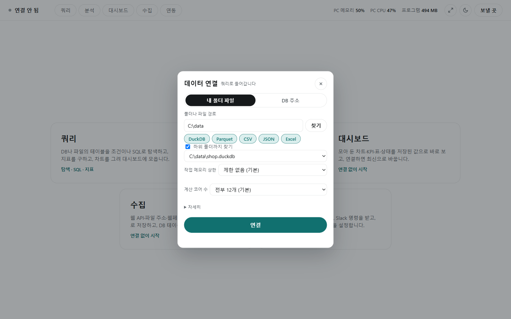
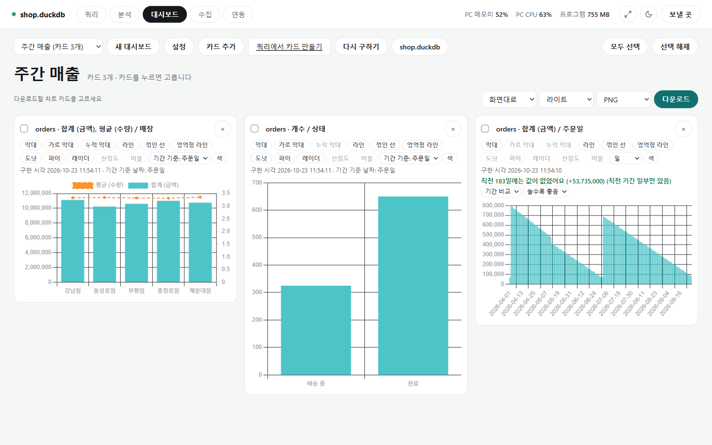
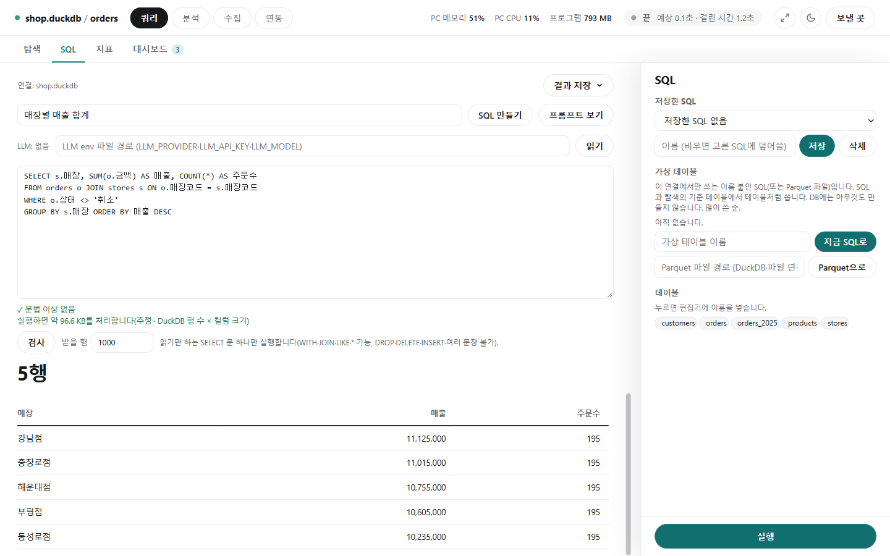

# 쿼리 화면

[← README](../README.md) · [쿼리](query.md) · [분석](analysis.md) · [수집](collect.md) · [연동](integrations.md) · [설정과 참고](settings.md)

**한 줄 요약**: 엑셀 같은 데이터에서 원하는 행만 골라 보고, 합계·평균을 내고, 그래프로 그리는 화면입니다.

| 말 | 뜻(엑셀로 치면) |
|---|---|
| 테이블 / 컬럼 / 행 | 시트 / 열 / 행 |
| 조건 | 필터. 예: `상태 = 취소` |
| 조인 | 다른 테이블을 같은 값(고객 번호 등)으로 옆에 붙이기. VLOOKUP |
| SQL | 데이터를 묻는 문장. 몰라도 [탐색] 탭은 쓸 수 있습니다 |

## 따라 해 보기

예시 데이터 `shop.duckdb`에는 주문 `orders`(주문일, 고객ID, 매장코드, 금액, 상태 등)와 고객·상품·매장 테이블이 있습니다.

**1. 9월의 취소 아닌 주문 보기**

1. 첫 화면 **[쿼리]** → 폴더 경로(예: `C:\data`)를 넣고 **[찾기]** → `shop.duckdb`를 고르고 **[연결]**
2. 오른쪽 패널 **1 데이터** 에서 `orders`
3. **4 기간** 에 `주문일 2026-09-01 ~ 2026-09-30` 을 쓰고 Enter
4. **5 조건** 에서 `상태`, `!=`, `취소` 를 고르고 **[추가]**
5. **[검색 실행]** → 행 수와 표가 나옵니다. 전체를 받으려면 위쪽 **[저장▾] → Excel**

**2. 매장별 매출 막대그래프**

1. 위에 이어서 **3 조인** 에서 `left`, `stores`, `매장코드 = 매장코드` → 매장 이름이 붙습니다.
2. 결과 위 **[차트]** 탭 → X `매장`, Y `금액`, 집계 `합계`, 종류 `막대` → **[그리기]**
3. **[PNG]** 로 저장하거나 **[대시보드에 추가]** 로 모아 둡니다.

**3. SQL로 묻기**

**[SQL]** 탭에 `SELECT 상태, COUNT(*) AS 주문수 FROM orders GROUP BY 상태`처럼 쓰고 **[실행]** 합니다. 몰라도 질문 칸에 "상태별 주문 수"라고 쓰고 **[SQL 만들기]** 를 누르면 AI가 만들어 줍니다.

## 연결



- **내 PC 파일**(DuckDB, Parquet, CSV, JSON, Excel): 폴더 경로 → [찾기] → 파일 고르기 → [연결]. 파일 하나가 테이블 하나입니다.
- **회사 DB**: [DB 주소] 탭에 주소·아이디·비밀번호 → [연결]. 주소 모양은 [DB별 드라이버](settings.md#db별-드라이버)에 있고, 비밀번호는 저장하지 않습니다.

## 탐색: 오른쪽 패널 1~8번


| 단계 | 하는 일 | 예 |
|---|---|---|
| 1 데이터 | 볼 테이블 | `orders` |
| 2 이어붙이기 | 같은 모양 테이블을 아래로 | 올해 + 작년 |
| 3 조인 | 다른 테이블을 옆으로(처음이면 `left`) | 고객 이름 |
| 4 기간 | 날짜 범위 | `주문일 2026-09-01 ~ 2026-09-30` |
| 5 조건 | 어떤 행만 | `금액 >= 100000` |
| 6 계산 | 순위·누적 합계 등 | `누적합 금액 기준 주문일` |
| 7 정렬 | 순서(`desc`는 큰 것부터) | `금액 desc` |
| 8 표시 컬럼 | 보일 컬럼만 | `주문번호, 금액, 상태` |

- 조건에 쓸 수 있는 것: `=` `!=` `>=` `<` `between 1 10` `in 완료, 배송 중` `except 취소` `like 김`(포함) `starts 김`(시작, 인덱스를 탈 수 있음) `is null`(비었음). 조건 사이 [and]를 누르면 [or]로 바뀝니다.
- **검색 저장**: 패널 아래 [저장한 검색]에 이름을 붙여 저장하면, 다음에 목록에서 골라 조건을 그대로 채웁니다.
- **처리 용량**: [검색 실행] 위에 "실행하면 약 1.2 GB를 처리합니다"가 나옵니다. 요금이 나오는 DB에서 미리 봅니다(BigQuery는 정확, 그 밖에는 추정).

## 결과에서 할 수 있는 것


| 하는 일 | 방법 |
|---|---|
| 정렬 바꾸기 | 표 머리글 누르기 |
| 파일로 받기 | [저장▾] → Excel(약 100만 행까지)·CSV·Parquet. 조건에 맞는 전체 행 |
| 요약·피벗 | [집계] 탭 → 컬럼별 개수·평균 등, 아래에 피벗(매장 × 상태별 합계 등) |
| 그래프 | [차트] 탭. 막대·선 여러 개 겹치기, 값별로 나누기, 오른쪽 축 |
| 분석으로 넘기기 | [전처리로 보내기] → 파일로 저장하고 분석 화면에서 엽니다 |

## 대시보드



[차트]·[지표]를 [대시보드에 추가]로 모아 [대시보드] 탭에서 봅니다(48개까지). 열면 **저장된 값**으로 바로 그리고 [다시 구하기]로 최신으로 바꿉니다. 차트 종류 11가지(산점도·버블 포함)·색(HEX)도 고르고, 값은 암호화해 저장합니다. 기준일·기간·최신화는 [대시보드](dashboard.md).

## SQL 직접 쓰기



[SQL] 탭에서 SQL을 쓰면 잠깐 멈출 때마다 문법을 검사해 "3줄 15칸: 닫는 괄호가 필요합니다"처럼 알려 주고, 처리 용량도 보여 줍니다. **읽기만 하는 문장(SELECT) 하나만 실행**하고, 데이터를 지우거나 바꾸는 문장은 막습니다. 결과는 [이전]·[다음]으로 넘기고, 전체는 [결과 저장▾]으로 받습니다.

- **가상 테이블**: 자주 쓰는 SQL에 이름을 붙여(예: `큰주문`) 테이블처럼 씁니다(DB에는 아무것도 만들지 않음). SQL도 이름을 붙여 저장합니다.

### 질문으로 SQL 만들기

질문 칸에 우리말로 쓰고 [SQL 만들기]를 누르면 AI(LLM)가 SQL을 만들어 편집기에 넣습니다. **자동으로 실행하지 않고**, 사람이 확인하고 [실행]합니다. AI에는 테이블·컬럼 이름과 설명만 보내고 실제 데이터 값은 보내지 않습니다([프롬프트 보기]로 확인).

처음 한 번, 메모장으로 아래 파일(예: `C:\keys\llm.env`)을 만들고 LLM 경로 칸에 넣어 [읽기]를 누릅니다. 프로그램은 파일 경로만 저장합니다.

```
LLM_PROVIDER=anthropic   # 또는 openai(OpenAI, Azure, 사내 AI, Ollama 등)
LLM_API_KEY=발급받은 키
LLM_MODEL=모델 이름
```

## 지표

[지표] 탭에서 "취소율", "매출"처럼 자주 보는 숫자를 **눌러서 바로** 봅니다. 계산 방법은 파일(예: `C:\data\metrics.yaml`)에 한 번 적어 두고, 경로를 넣어 [읽기]합니다.

```yaml
metrics:
  취소율:
    format: percent
    numerator: {agg: count, where: "상태 = 취소"}
    denominator: {agg: count}
```

`numerator`는 분자, `denominator`는 분모(없으면 분자 그대로), `agg`는 `count`(개수)·`sum`(합계)·`mean`(평균) 등입니다. [탐색]의 테이블·조건 위에서 계산하고, [나누기]에 `매장`을 고르면 매장별로 나옵니다.
