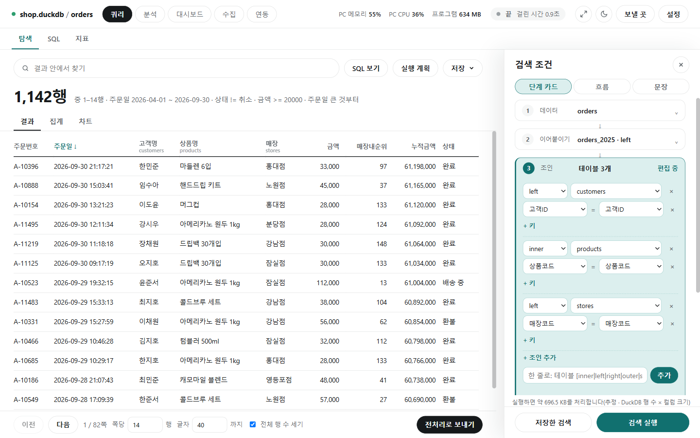

# 쿼리

[← README](../README.md) · [쿼리](query.md) · [분석](analysis.md) · [수집](collect.md) · [연동](integrations.md) · [대시보드](dashboard.md)

DB나 파일의 테이블에서 원하는 행만 골라 보고, 합계·평균을 내고, 차트로 그리는 화면입니다. 엑셀의 필터·피벗·차트를 떠올리면 됩니다. 위쪽 [탐색] [SQL] [지표] 탭으로 오가며, 탐색의 조건은 단계 카드·흐름·문장 세 모양 중 편한 것으로 넣습니다.

## 기능 설명

| 기능 | 한 줄 설명 | 자세히 |
|---|---|---|
| 데이터 연결 | 폴더의 파일이나 DB 주소에 연결하고 드라이버를 확인합니다 | [functions/connect.md](functions/connect.md) |
| 탐색(단계 카드) | 데이터 → 이어붙이기 → 조인 → 기간 → 조건 → 계산 → 정렬 → 표시 컬럼 순으로 칸을 채웁니다 | [functions/explore.md](functions/explore.md) |
| 결과 | 결과 안 찾기, 집계·피벗, 파일로 저장, SQL 보기, 저장한 검색 | [functions/results.md](functions/results.md) |
| 차트 | 막대·선 겹치기, 오른쪽 축, 끌어 놓기로 만들기, 대시보드에 추가 | [functions/chart.md](functions/chart.md) |
| 흐름 보기 | 같은 조건을 상자와 선으로 그리고, 공통 키 찾기·단계별 행 수·최적화 | [functions/flow.md](functions/flow.md) |
| 문장 보기 | 문장 틀 50개의 빈칸을 채워 묻고, 질문 묶음으로 모아 실행 | [functions/sentences.md](functions/sentences.md) |
| SQL | SQL 직접 쓰기, 문법 검사, 질문으로 SQL 만들기, 저장한 SQL·가상 테이블 | [functions/sql.md](functions/sql.md) |
| 지표 | 지표 파일로 바로 구하기, 지표 틀로 내 지표 만들기 / 지표 사전 | [functions/metrics.md](functions/metrics.md) · [functions/metrics_catalog.md](functions/metrics_catalog.md) |
| 함수 사전 | 집계·계산 칸에서 고르는 함수 전부와 [함수 찾기] | [functions/sql_functions.md](functions/sql_functions.md) |
| 좌표 | 거리·반경·격자 계산, GeoJSON 연결, 좌표 문장 틀 | [functions/geo.md](functions/geo.md) |
